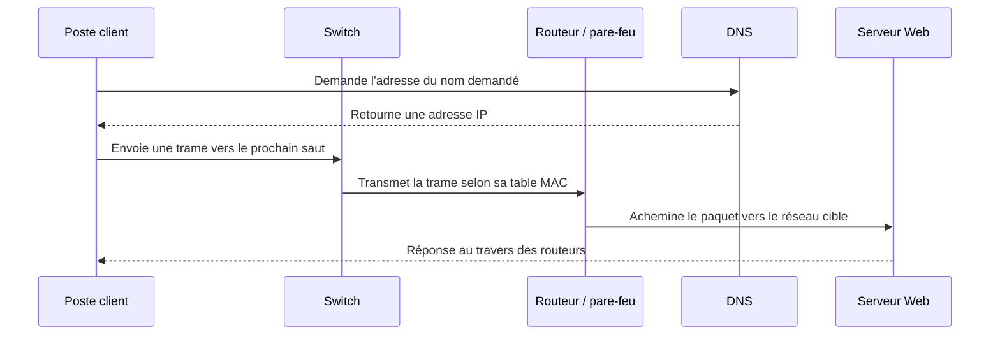

# Réseaux TCP/IP : du paquet au pare-feu

- **Niveau** : débutant à intermédiaire
- **Public** : TSSR, administrateurs systèmes et réseaux en formation
- **Durée indicative** : 2 à 3 heures avec les animations et exercices liés
- **Tags** : `cours`, `theorie`, `reseau`, `tcp-ip`, `tssr`
- **Dernière vérification des liens** : 2026-10-31

## Objectif

Comprendre comment un poste obtient sa configuration, trouve une destination et échange des données avec un service, puis savoir où interviennent le switch, le routeur, le DNS et le pare-feu.

## 1. Les couches et l'encapsulation

Une application produit des données. Les protocoles de transport les organisent en segments TCP ou datagrammes UDP. IP ajoute les adresses de source et de destination pour acheminer les paquets entre réseaux. Sur chaque liaison, Ethernet ou Wi-Fi transporte le paquet dans une trame vers le prochain saut.

Les adresses MAC servent à la livraison sur le lien local. Les adresses IP servent à l'acheminement entre réseaux. À chaque routeur, la trame du lien courant est remplacée par une trame adaptée au lien suivant; les adresses IP restent normalement les mêmes de bout en bout, sauf mécanisme tel que le NAT.

**À retenir** : une trame est locale à une liaison; un paquet IP peut traverser plusieurs réseaux. TCP fournit notamment accusés de réception et retransmissions; UDP n'offre pas ces garanties à lui seul.

**Animation** : [Le voyage d'un paquet TCP/IP](https://www.jousseaume.online/cours/voyage-dun-paquet-tcp-ip/) (animation, transcription et quiz sur le site d'origine).

## 2. IPv4, préfixes et passerelle

Une adresse IPv4 contient 32 bits. Le préfixe CIDR, par exemple `/24`, indique combien de bits identifient le réseau. L'adresse réseau et le préfixe déterminent si une destination est considérée comme locale. Pour une destination hors du sous-réseau, l'hôte transmet le trafic à sa passerelle par défaut.

Les plages privées définies par la RFC 1918 sont `10.0.0.0/8`, `172.16.0.0/12` et `192.168.0.0/16`. Elles ne sont pas routées sur l'Internet public. Le NAT traduit des adresses; il ne remplace pas le filtrage d'un pare-feu.

**Cours et entraînement** :
- [Adressage IPv4 : introduction](https://www.jousseaume.online/cours/adressage-ipv4-introduction/) — modèle TCP/IP, masque, préfixe, réseau, diffusion et adresses privées.
- [Adressage IPv4 : rappels de calcul](https://www.jousseaume.online/cours/adressage-ipv4-calculs/) — exercices de calcul.
- [Calculatrice IPv4 et mode entraînement](https://www.jousseaume.online/cours/calculatrice-ipv4/).

## 3. Switches, VLAN et routage

Un switch apprend quelles adresses MAC sont visibles sur ses ports et utilise cette table pour transmettre les trames. Un VLAN crée un domaine de diffusion logique distinct. Un lien trunk transporte plusieurs VLAN en ajoutant une étiquette 802.1Q aux trames concernées.

Deux VLAN sont deux réseaux distincts : pour communiquer, ils ont besoin d'un équipement de couche 3 (routeur ou switch de niveau 3). Le routage inter-VLAN est un point naturel de contrôle des flux. La séparation seule ne suffit pas : les règles d'accès doivent être définies et vérifiées.

**Animation** : [Le switch et les VLAN](https://www.jousseaume.online/cours/switch-et-vlan-animation/) (table MAC, domaines de diffusion, trunk, routage inter-VLAN et sécurité).

## 4. DHCP : obtenir une configuration

DHCP distribue notamment une adresse IP, un préfixe, une passerelle, des DNS et une durée de bail. L'échange classique se retient par **DORA** :

| Étape | Rôle |
|---|---|
| Discover | Le client cherche un serveur DHCP. |
| Offer | Un serveur propose une configuration et un bail. |
| Request | Le client demande l'offre retenue. |
| Acknowledge | Le serveur confirme le bail. |

Les messages initiaux sont diffusés sur le réseau local; un routeur ne relaie pas spontanément une diffusion. Un relais DHCP permet donc de joindre un serveur situé dans un autre sous-réseau. Comme un client peut accepter une offre non autorisée, la protection des ports de switch et la surveillance des baux comptent.

**Animation** : [DHCP en quatre temps](https://www.jousseaume.online/cours/dhcp-en-4-temps/).

## 5. DNS : résoudre un nom

Le DNS associe des noms à des données, notamment des adresses IPv4 (A) ou IPv6 (AAAA). Une panne DNS peut empêcher l'accès par nom alors que la connectivité IP fonctionne. Dans un domaine Active Directory, les postes et serveurs membres doivent utiliser les DNS capables de résoudre les enregistrements internes du domaine; un résolveur public ne remplace pas ce service.

Le DNS aide à trouver une destination, mais ne garantit ni que le service répond, ni que le trafic est autorisé. Il faut distinguer résolution, routage, filtrage et état applicatif pendant un diagnostic.

**Pour continuer** : [cours sur DNS, DHCP et réseau](https://www.jousseaume.online/categorie/reseau/) et [modules Linux / Windows / sécurité de ZenTSSR](https://zentssr.com/modules).

## 6. Pare-feu, états et DMZ

Un pare-feu compare un flux à des règles définies par des critères tels que source, destination, protocole et port. Selon le produit, les règles sont évaluées dans un ordre donné. Une politique de refus par défaut, suivie d'autorisations limitées au besoin, réduit les ouvertures accidentelles.

Un pare-feu à états suit les connexions afin de reconnaître le trafic de réponse associé à une connexion autorisée. Une DMZ isole les services publiés du réseau interne; elle ne rend pas un service sûr à elle seule. Il faut aussi contrôler les flux de la DMZ vers les autres zones et protéger l'administration.

**Animation** : [Le pare-feu et ses règles](https://www.jousseaume.online/cours/pare-feu-et-regles/) (ordre des règles, suivi des connexions et DMZ).

## 7. Configurer et diagnostiquer

Les concepts réseau sont communs, mais les interfaces de configuration dépendent du système et de sa version. Pour les procédures, suivre les cours distincts plutôt que transposer une commande d'un OS à l'autre :

- [Configuration réseau Linux](https://www.jousseaume.online/cours/configurer-reseau-linux/) — Debian, Ubuntu et famille Red Hat.
- [Configuration réseau Windows](https://www.jousseaume.online/cours/configurer-reseau-windows/) — Windows client et Server.
- [Parcours Linux de Stéphane Robert](https://www.stephane-robert.info/docs/admin-serveurs/linux/parcours/) — leçons, labs et quiz de l'utilisation du système à l'exploitation.
- [Index des modules TSSR sur GitHub](https://github.com/kipit/nivvlem-TSSR/blob/main/modules.md) — cours organisés par domaine.

Pour le diagnostic, progresser du local vers le distant : état de l'interface, adressage, route, passerelle, résolution du nom, puis accès au service et au port autorisé. Un résultat négatif isolé ne suffit pas toujours à identifier la cause.

## Exercices

1. Explique pourquoi les adresses MAC changent à chaque saut alors que les adresses IP restent généralement stables.
2. Deux postes du même switch sont dans des VLAN différents. Quel équipement doit permettre leur communication, et où appliquer le filtrage ?
3. Un client reçoit une adresse mais ne résout pas les noms internes d'un domaine. Quelles couches et quels paramètres vérifier séparément ?
4. Quelle différence y a-t-il entre NAT et pare-feu ?

## Réponses attendues

1. La trame est reconstruite pour chaque liaison; le paquet IP est acheminé entre réseaux, hors traduction d'adresse.
2. Un routeur ou switch de couche 3; filtrer le routage inter-VLAN selon les flux autorisés.
3. Vérifier la configuration IP et la passerelle, puis le DNS configuré, la résolution des enregistrements internes et enfin le service visé.
4. Le NAT traduit des adresses; le pare-feu autorise ou bloque des flux selon sa politique.

## Sources et médias

Les pages de Root & Code indiquent une licence **CC BY-NC-SA 4.0**. Ce parcours n'en reprend pas les illustrations ni les animations : il renvoie vers les pages originales, où les médias et leur contexte restent visibles. Pour toute réutilisation ou adaptation de leurs contenus, respecter la licence et ses conditions, notamment l'attribution, le partage sous la même licence et l'usage non commercial.

- [Root & Code — catégorie Réseau](https://www.jousseaume.online/categorie/reseau/)
- [Licence CC BY-NC-SA 4.0](https://creativecommons.org/licenses/by-nc-sa/4.0/deed.fr)
- [Ressources externes TSSR du pack](../06-Documentation-ext/Sources_Publiques_TSSR_Pour_Fiches_Tout-en-un.md)
