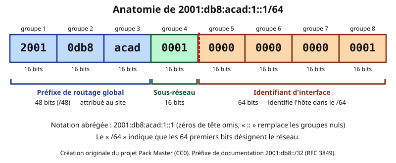
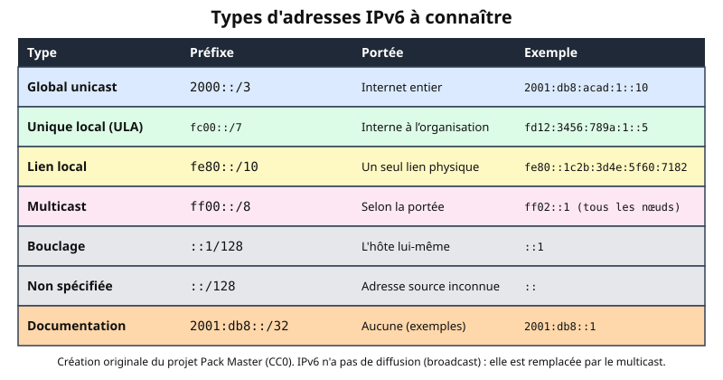
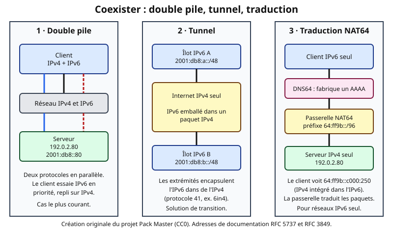

# Leçon — IPv6 : bases, types d'adresses et coexistence avec IPv4

- **Tags** : `transverse`, `tout-en-un`, `lecon`, `reseau`, `ipv6`, `slaac`, `double-pile`, `nat64`, `ndp`
- **Niveau** : intermédiaire (TSSR, support, administration système)
- **Durée estimée** : 3 h 30 (lecture 1 h 15, laboratoire 1 h, exercices et quiz 1 h 15)

---

## Objectifs pédagogiques

À la fin de cette leçon, vous saurez :

- expliquer pourquoi IPv6 existe et ce qui le distingue d'IPv4 ;
- **lire, abréger et développer** une adresse IPv6 sans erreur ;
- décomposer une adresse en **préfixe, identifiant de sous-réseau et identifiant d'interface** ;
- reconnaître les grands **types d'adresses** : global unicast, unique local, lien local, multicast, bouclage, anycast ;
- décrire comment un hôte obtient une adresse : **SLAAC**, **DHCPv6**, configuration statique, et le rôle de **NDP** ;
- construire un petit **plan d'adressage** à partir d'un préfixe /48 ;
- comparer les stratégies de **coexistence** : double pile, tunnels, traduction NAT64/DNS64 ;
- observer la configuration IPv6 d'une machine avec des commandes en lecture seule.

## Prérequis et durée

- Connaître le principe d'une adresse IP et d'un masque (voir la leçon [Adressage IPv4, masques, CIDR, VLSM](Lecon_IPv4-CIDR-VLSM.md)) ; savoir lire de l'hexadécimal (0-9, a-f) : A = 10, F = 15.
- Notions de couches réseau (voir [Modèle OSI et TCP/IP](Lecon_OSI-TCPIP.md)).
- Durée : environ 3 h 30. Le laboratoire se fait sur une VM Linux ou un poste Windows de test ; les commandes sont en lecture seule.

## L'essentiel en bref

- Une adresse IPv6 fait **128 bits**, écrite en **8 groupes de 16 bits en hexadécimal** : `2001:db8:acad:1::1`.
- Les zéros de tête d'un groupe peuvent être omis et **une seule** suite de groupes nuls consécutifs peut être remplacée par `::`.
- Un sous-réseau est presque toujours un **/64** : 64 bits de préfixe, 64 bits d'identifiant d'interface.
- Il n'y a **plus de broadcast** : il est remplacé par le **multicast**.
- Un hôte possède **plusieurs adresses** à la fois : une adresse **lien local** (`fe80::/10`) et une ou plusieurs adresses globales ou ULA.
- **NDP** (sur ICMPv6) remplace ARP ; **SLAAC** permet l'auto-configuration à partir d'annonces de routeur.
- IPv4 et IPv6 coexisteront longtemps : **double pile** (le plus courant), **tunnels**, **NAT64/DNS64**.
- Préfixe d'exemple dans cette leçon : `2001:db8::/32` (RFC 3849), réservé à la documentation.

---

## 1. Pourquoi IPv6 ?

### 1.1 Le problème : l'épuisement d'IPv4

IPv4 offre environ 4,3 milliards d'adresses (2³²). Avec la multiplication des téléphones, objets connectés et serveurs, les réserves publiques sont épuisées depuis plusieurs années. Pour tenir, on a recouru massivement au **NAT** : plusieurs machines privées partagent une adresse publique. Le NAT est pratique mais complique les connexions entrantes, certains protocoles et le diagnostic.

IPv6 apporte 2¹²⁸ adresses, soit environ 3,4 × 10³⁸. Un seul site se voit attribuer en général un /48, qui contient 65 536 sous-réseaux, chacun capable d'héberger 2⁶⁴ adresses.

### 1.2 Ce qui change par rapport à IPv4

| Sujet | IPv4 | IPv6 |
|---|---|---|
| Taille d'adresse | 32 bits | 128 bits |
| Écriture | décimal pointé | hexadécimal séparé par `:` |
| En-tête | 20 octets minimum, longueur variable | **40 octets fixes**, extensions séparées |
| Diffusion | broadcast | **multicast** (pas de broadcast) |
| Résolution adresse ↔ MAC | ARP | **NDP** (ICMPv6) |
| Configuration | DHCP ou statique | **SLAAC**, DHCPv6 ou statique |
| Fragmentation | par les routeurs possible | **uniquement par l'émetteur** |
| Somme de contrôle d'en-tête | oui | non (laissée aux couches 2 et 4) |
| Protocole d'accompagnement | ICMP | ICMPv6, **indispensable** au fonctionnement |

Analogie : passer d'IPv4 à IPv6 ressemble au passage des anciens numéros de téléphone à 8 chiffres à des numéros bien plus longs : le principe reste le même (un numéro identifie une ligne), mais l'espace disponible devient pratiquement inépuisable et le plan de numérotation, plus hiérarchique.

---

## 2. Écrire et lire une adresse IPv6

### 2.1 Format complet

Une adresse IPv6 comporte **8 groupes de 4 chiffres hexadécimaux** (16 bits chacun) séparés par `:` :

`2001:0db8:acad:0001:0000:0000:0000:0001`

### 2.2 Les deux règles d'abréviation (RFC 5952)

1. **Zéros de tête** : dans chaque groupe, on peut supprimer les zéros de gauche (`0db8` → `db8`, `0001` → `1`, `0000` → `0`).
2. **Double deux-points `::`** : on peut remplacer **une seule fois** la plus longue suite de groupes entièrement nuls consécutifs.

Application : `2001:0db8:acad:0001:0000:0000:0000:0001` devient `2001:db8:acad:1::1`.

Règles de bonne écriture : lettres en **minuscules**, `::` pour la **plus longue** suite de zéros (et pas pour un seul groupe isolé si on peut l'éviter).

**Pièges :**

- `2001:db8::1::2` est **invalide** : deux `::` rendent l'adresse ambiguë.
- `2001:db8:0:0:1:0:0:1` : deux suites de deux groupes nuls ; on abrège la première : `2001:db8::1:0:0:1`.
- Pour **développer** `2001:db8:acad::1`, on compte les groupes présents (4) et on complète avec 8 − 4 = 4 groupes nuls : `2001:0db8:acad:0000:0000:0000:0000:0001`.

### 2.3 Préfixe et longueur

Comme en CIDR, `/n` donne le nombre de bits du préfixe : `2001:db8:acad:1::/64` désigne tous les hôtes dont les 64 premiers bits valent `2001:0db8:acad:0001`. Il n'existe pas de masque décimal en IPv6 : on n'utilise **que** la notation `/n`.

Dans une URL, l'adresse se place entre crochets : `http://[2001:db8::10]:8080/`, pour ne pas confondre `:` de l'adresse et `:` du port.

### 2.4 Anatomie d'une adresse unicast typique



*Figure 1 — Anatomie de 2001:db8:acad:1::1/64 (création originale Pack Master, CC0).*

- **Préfixe de routage global (48 bits)** : attribué à l'organisation par son fournisseur.
- **Identifiant de sous-réseau (16 bits)** : choisi par l'administrateur (jusqu'à 65 536 sous-réseaux).
- **Identifiant d'interface (64 bits)** : identifie l'hôte à l'intérieur du /64.

---

## 3. Planifier l'adressage

### 3.1 Les tailles de préfixe usuelles

| Préfixe | Attribué à | Remarque |
|---|---|---|
| /32 | Un fournisseur d'accès (registre régional) | Contient 65 536 /48 |
| /48 | Un site ou une entreprise | 65 536 sous-réseaux /64 |
| /56 | Un petit site (certains fournisseurs) | 256 sous-réseaux /64 |
| /64 | **Un sous-réseau (un VLAN, un lien)** | Taille standard, nécessaire à SLAAC |

Règle pratique : **on ne découpe pas en dessous de /64** pour les réseaux d'utilisateurs ; on ne s'économise pas les adresses. Le travail du VLSM d'IPv4 est remplacé par un simple numérotage hexadécimal.

### 3.2 Exemple : un /48 pour une entreprise

Préfixe reçu : `2001:db8:acad::/48`. On place le numéro du VLAN dans le groupe « sous-réseau » :

| Usage | VLAN | Sous-réseau |
|---|---|---|
| Serveurs | 10 (0x0a) | `2001:db8:acad:a::/64` |
| Utilisateurs | 20 (0x14) | `2001:db8:acad:14::/64` |
| Invités | 100 (0x64) | `2001:db8:acad:64::/64` |

Remarquez la commodité : on convertit simplement le numéro de VLAN en hexadécimal. Aucun calcul de plage, de diffusion ou de chevauchement n'est nécessaire : tous les /64 sont indépendants et de même taille.

---

## 4. Les types d'adresses



*Figure 2 — Types d'adresses IPv6 (création originale Pack Master, CC0).*

### 4.1 Unicast global (2000::/3)

Adresse **routable sur Internet**, équivalent d'une adresse publique IPv4. Actuellement, les adresses attribuées commencent par `2` ou `3` (par exemple `2001:`). Dans la leçon, on utilise `2001:db8::/32`, qui ne doit **jamais** apparaître en production.

### 4.2 Unique local, ULA (fc00::/7, en pratique fd00::/8)

Adresses **privées** (RFC 4193), non routées sur Internet : l'équivalent d'adresses RFC 1918 IPv4. On les génère avec un identifiant aléatoire de 40 bits : `fd` + 40 bits + sous-réseau 16 bits, par exemple `fd12:3456:789a:1::/64`. Elles servent pour des réseaux internes stables, indépendamment du fournisseur.

### 4.3 Lien local (fe80::/10)

**Obligatoire sur chaque interface IPv6.** Valable uniquement sur le lien physique ; jamais routée. Elle sert à NDP, aux protocoles de routage et souvent de **passerelle par défaut** (la route par défaut pointe vers `fe80::…` du routeur). Comme la même adresse `fe80::1` peut exister sur plusieurs liens, on précise l'interface avec un **identifiant de zone** : `fe80::1%eth0` (Linux) ou `fe80::1%12` (Windows, numéro d'interface).

### 4.4 Multicast (ff00::/8)

Une adresse multicast désigne un **groupe**. Les plus utiles :

| Adresse | Groupe |
|---|---|
| `ff02::1` | Tous les nœuds du lien (le « broadcast » d'IPv6) |
| `ff02::2` | Tous les routeurs du lien |
| `ff02::1:ffXX:XXXX` | **Nœud sollicité** (*solicited-node*) : sert à NDP ; XX:XXXX = 24 derniers bits de l'adresse |
| `ff02::fb` | mDNS |

Le 4ᵉ chiffre hexadécimal (`ff0`**`2`**) code la **portée** : 1 = interface, 2 = lien, 5 = site, e = global.

### 4.5 Bouclage et non spécifiée

- `::1/128` : l'hôte lui-même (équivalent de 127.0.0.1).
- `::/128` : adresse non spécifiée, utilisée comme source tant qu'on n'a pas d'adresse ; `::/0` : route par défaut.

### 4.6 Anycast

Une adresse **anycast** est attribuée à plusieurs machines ; le routage envoie le paquet à la plus proche. Techniquement, c'est une adresse unicast présente sur plusieurs équipements. Cette technique sert surtout à des services répartis (DNS, CDN).

---

## 5. Obtenir une adresse : SLAAC, DHCPv6, NDP

### 5.1 NDP : le voisinage

**NDP** (*Neighbor Discovery Protocol*, RFC 4861) remplace ARP et ajoute la découverte des routeurs. Il repose sur 5 messages ICMPv6 :

| Message | Rôle |
|---|---|
| **RS** — Router Solicitation | L'hôte demande « y a-t-il un routeur ? » (vers `ff02::2`) |
| **RA** — Router Advertisement | Le routeur annonce préfixe, passerelle, drapeaux de configuration |
| **NS** — Neighbor Solicitation | « Qui possède cette adresse ? » (envoyé au groupe nœud sollicité) ; sert aussi à détecter les doublons |
| **NA** — Neighbor Advertisement | Réponse avec l'adresse MAC |
| Redirect | Le routeur signale un meilleur chemin |

Analogie : si ARP lançait un appel à toute la salle (« qui est M. Martin ? »), NDP appelle seulement la petite table où M. Martin est assis (le groupe nœud sollicité) : les autres ne sont pas dérangés.

### 5.2 SLAAC

**SLAAC** (*Stateless Address Autoconfiguration*, RFC 4862) fonctionne en trois temps :

1. L'hôte se forme une adresse **lien local** `fe80::…` et vérifie qu'elle est unique (DAD, *Duplicate Address Detection*).
2. Il reçoit un **RA** : préfixe /64 (ex. `2001:db8:acad:14::/64`) et passerelle (le routeur).
3. Il compose son adresse : **préfixe + identifiant d'interface**.

L'identifiant d'interface peut être :

- dérivé de la MAC (**EUI-64**) : on insère `ff:fe` au milieu de la MAC et on inverse le 7ᵉ bit du premier octet. Exemple : MAC `00:00:5e:00:53:01` → `02:00:5e:ff:fe:00:53:01` → identifiant `200:5eff:fe00:5301` → adresse lien local `fe80::200:5eff:fe00:5301` ;
- **stable opaque** (RFC 7217), ou
- **temporaire/aléatoire** (RFC 4941) pour limiter le suivi : l'adresse change régulièrement. C'est le comportement par défaut de nombreux systèmes actuels.

### 5.3 DHCPv6 et configuration statique

- **DHCPv6** peut distribuer des adresses (mode *stateful*) ou seulement des options comme les serveurs DNS (mode *stateless*). Il ne transmet **pas** la passerelle par défaut : celle-ci vient toujours du RA.
- **Statique** : pour les serveurs et équipements réseau, on fixe l'adresse et on en note l'identifiant dans un plan d'adressage.

### 5.4 Ce qu'on voit sur une machine

Une interface IPv6 typique possède **plusieurs adresses à la fois** : une lien local, une globale stable, une globale temporaire, éventuellement une ULA. C'est normal. Le système choisit l'adresse source selon des règles de sélection (RFC 6724).

---

## 6. Faire coexister IPv4 et IPv6

Le passage est progressif : pendant de longues années, les deux protocoles cohabitent. Trois grandes familles de techniques existent.



*Figure 3 — Double pile, tunnel et traduction NAT64/DNS64 (création originale Pack Master, CC0).*

### 6.1 Double pile (dual stack)

Chaque équipement exécute **IPv4 et IPv6 en parallèle**, avec les deux adresses. C'est la solution la plus simple et la plus répandue.

- Le serveur publie un enregistrement **A** (IPv4) **et** un enregistrement **AAAA** (IPv6) dans le DNS.
- Le client interroge les deux et choisit l'adresse. Avec l'algorithme **Happy Eyeballs** (RFC 8305), il tente IPv6 en priorité mais bascule rapidement sur IPv4 si IPv6 ne répond pas en quelques centaines de millisecondes.
- Contrepartie : il faut **gérer deux plans d'adressage**, deux jeux de règles de pare-feu et deux sources de pannes.

### 6.2 Tunnels

Un **tunnel** encapsule des paquets IPv6 dans des paquets IPv4 (protocole IP numéro 41, par exemple le **6in4**, RFC 4213) pour traverser un réseau qui ne gère pas encore IPv6. Utile pour relier deux sites IPv6 ou raccorder un site isolé, mais :

- réduit la MTU effective (en-tête IPv4 supplémentaire de 20 octets) ;
- ajoute de la latence et un point de panne ;
- doit être considéré comme une **solution transitoire**.

### 6.3 Traduction : NAT64 et DNS64

Dans un réseau **IPv6 seul** (réseau mobile ou entreprise très avancée), les clients doivent pourtant joindre des serveurs **IPv4 seul**.

- Le **DNS64** fabrique à la volée un enregistrement AAAA pour un nom qui n'a qu'un enregistrement A, en intégrant l'adresse IPv4 dans un préfixe spécial.
- Le **NAT64** (RFC 6146) traduit les paquets IPv6 en IPv4 et inversement. Le préfixe bien connu est `64:ff9b::/96` (RFC 6052).

Exemple : le serveur `192.0.2.80` devient pour le client IPv6 `64:ff9b::c000:250` (`c0 00 02 50` = 192.0.2.80 en hexadécimal). La passerelle NAT64 reconnaît ce préfixe, extrait l'adresse IPv4 et émet le paquet vers l'extérieur.

### 6.4 Quelle stratégie choisir ?

| Situation | Choix usuel |
|---|---|
| Le fournisseur propose IPv4 et IPv6 | **Double pile** |
| Site distant sans IPv6 natif à relier à un réseau IPv6 | **Tunnel** (transitoire) |
| Réseau IPv6 seul devant atteindre des services IPv4 | **NAT64 + DNS64** (souvent avec 464XLAT sur mobile) |

### 6.5 Sécurité : ne pas oublier le pare-feu

- IPv6 **n'est pas** protégé par le NAT : un hôte avec une adresse globale peut être joignable depuis Internet. Le NAT n'a d'ailleurs jamais été un mécanisme de sécurité ; c'est le **pare-feu à état** qui protège.
- Vérifiez que vos règles de pare-feu couvrent **les deux protocoles** (par exemple `ip6tables`/`nftables` en plus d'`iptables`).
- **Ne bloquez pas tout ICMPv6** : NDP, la découverte de MTU et SLAAC en dépendent. Autorisez au minimum les types nécessaires (RFC 4890).

---

## Mise en pratique guidée

**Cadre** : VM jetable ou poste de test. Commandes en **lecture seule**, sauf mention contraire. N'utilisez jamais `2001:db8::/32` en production.

### Étape 1 — Observer les adresses IPv6 de la machine

```bash
ip -6 -br address
```

👉 Explication : liste chaque interface avec ses adresses IPv6 (lien local `fe80::`, globales, ULA) et leur préfixe. Repérez les différents types étudiés en section 4.

```powershell
Get-NetIPAddress -AddressFamily IPv6 | Select-Object InterfaceAlias, IPAddress, PrefixLength, AddressState
```

👉 Explication : équivalent Windows ; la colonne `AddressState` indique si l'adresse est utilisable (`Preferred`) ou en cours de vérification (`Tentative`).

### Étape 2 — Observer la table de routage IPv6

```bash
ip -6 route
```

👉 Explication : affiche les routes IPv6 ; cherchez la ligne `default via fe80::…` qui montre que la passerelle est une adresse **lien local**.

```powershell
Get-NetRoute -AddressFamily IPv6 | Sort-Object RouteMetric | Select-Object -First 10
```

👉 Explication : affiche les dix routes IPv6 de plus faible métrique, dont `::/0` (route par défaut).

### Étape 3 — Observer les voisins (NDP)

```bash
ip -6 neigh show
```

👉 Explication : montre le cache des voisins (équivalent du cache ARP) avec leur état `REACHABLE`, `STALE`, `DELAY`… Lecture seule.

```powershell
Get-NetNeighbor -AddressFamily IPv6 | Select-Object -First 10
```

👉 Explication : équivalent Windows pour le cache NDP.

### Étape 4 — Tester le bouclage et le multicast « tous les nœuds »

```bash
ping -6 -c 3 ::1
```

👉 Explication : teste la pile IPv6 locale. Si `ping -6` n'existe pas sur votre distribution, utilisez `ping6`.

```bash
ping -6 -c 2 ff02::1%eth0
```

👉 Explication : envoie 2 requêtes ICMPv6 au groupe « tous les nœuds du lien » via l'interface `eth0` (remplacez-la par le nom relevé à l'étape 1) ; chaque voisin IPv6 répondra. À réserver à un réseau de laboratoire que vous maîtrisez.

### Étape 5 — Vérifier la résolution et l'accès en IPv6

```bash
getent ahostsv6 example.com
```

👉 Explication : demande la résolution du nom en adresses IPv6 (enregistrements AAAA) ; une réponse vide signifie qu'aucune adresse IPv6 n'est obtenue par ce résolveur.

```powershell
Resolve-DnsName example.com -Type AAAA
```

👉 Explication : équivalent Windows pour afficher les enregistrements AAAA.

```bash
curl -6 -sI https://example.com/ -o /dev/null -w '%{http_code}\n'
curl -4 -sI https://example.com/ -o /dev/null -w '%{http_code}\n'
```

👉 Explication : envoie la même requête en forçant IPv6 (`-6`) puis IPv4 (`-4`) et n'affiche que le code HTTP. Si la première échoue et pas la seconde, le problème est propre à IPv6 (route, pare-feu ou absence de connectivité).

### Étape 6 — Manipuler les adresses avec Python

```bash
python3 -c "
import ipaddress
a = ipaddress.ip_address('2001:0db8:0000:0000:0000:ff00:0042:8329')
print(a.compressed)
print(ipaddress.ip_address('2001:db8:acad::1').exploded)
n = ipaddress.ip_network('2001:db8:acad::/48')
print(n.num_addresses // 2**64, 'sous-réseaux /64')
print(list(n.subnets(new_prefix=64))[10])
"
```

👉 Explication : abrège une adresse, développe une autre, compte les /64 contenus dans un /48 (65 536) et affiche le 11ᵉ (`2001:db8:acad:a::/64`). Ce sont des calculs purement locaux.

---

## Exercices

**Exercice 1.** Abrégez `2001:0db8:0000:0000:0000:ff00:0042:8329`.

**Exercice 2.** Développez `2001:db8:acad::1`. Expliquez pourquoi `2001:db8::1::2` est invalide.

**Exercice 3.** Identifiez le type de chaque adresse : `fe80::1`, `fd12:3456:789a:1::5`, `2001:db8::1`, `ff02::2`, `::1`.

**Exercice 4.** À partir de `2001:db8:acad::/48`, donnez les sous-réseaux /64 des VLAN 10, 20 et 100, puis le nombre total de /64 disponibles.

**Exercice 5.** Calculez l'adresse lien local EUI-64 d'une interface de MAC `00:00:5e:00:53:2a`.

**Exercice 6.** Écrivez l'URL d'un service web écoutant sur le port 8080 de l'hôte `2001:db8::10`, puis la commande `curl` qui force IPv6 vers cette URL.

**Exercice 7.** Un client possède un enregistrement A et un AAAA pour `www.example.test`, mais sa connectivité IPv6 est défaillante. Quel comportement attend-on avec Happy Eyeballs ? Quel symptôme voit-on sans lui ?

**Exercice 8.** Choisissez le mécanisme de coexistence adapté : (a) fournisseur offrant IPv4 et IPv6 ; (b) site distant dont le fournisseur n'offre que de l'IPv4 mais qui doit joindre un réseau IPv6 ; (c) réseau IPv6 seul devant atteindre un serveur IPv4 seul.

---

## Corrigés des exercices

**Exercice 1.** `2001:db8::ff00:42:8329` (on supprime les zéros de tête et on remplace la suite de trois groupes nuls par `::`).

**Exercice 2.** `2001:0db8:acad:0000:0000:0000:0000:0001`. L'adresse `2001:db8::1::2` est invalide : deux `::` empêchent de savoir combien de groupes nuls remplace chacun.

**Exercice 3.** `fe80::1` : lien local ; `fd12:3456:789a:1::5` : unique local (ULA) ; `2001:db8::1` : adresse de documentation (de la forme global unicast) ; `ff02::2` : multicast « tous les routeurs du lien » ; `::1` : bouclage.

**Exercice 4.** VLAN 10 = 0xa → `2001:db8:acad:a::/64` ; VLAN 20 = 0x14 → `2001:db8:acad:14::/64` ; VLAN 100 = 0x64 → `2001:db8:acad:64::/64`. Total : 2¹⁶ = **65 536** sous-réseaux /64.

**Exercice 5.** MAC `00:00:5e:00:53:2a` → insertion de `ff:fe` : `00:00:5e:ff:fe:00:53:2a` → inversion du 7ᵉ bit du premier octet (00 → 02) : `02:00:5e:ff:fe:00:53:2a` → identifiant `200:5eff:fe00:532a` → **`fe80::200:5eff:fe00:532a`**.

**Exercice 6.** URL : `http://[2001:db8::10]:8080/`. Commande : `curl -6 'http://[2001:db8::10]:8080/'` (les crochets sont obligatoires ; les apostrophes évitent toute interprétation par le shell).

**Exercice 7.** Avec Happy Eyeballs, le client lance une tentative IPv6 puis, après un court délai, une tentative IPv4 en parallèle ; la première qui aboutit gagne, l'utilisateur ne perçoit qu'un très léger retard. Sans cet algorithme, le client attend l'expiration du délai IPv6 (souvent plusieurs secondes) avant de basculer : « le site est lent à s'ouvrir ».

**Exercice 8.** (a) **Double pile** ; (b) **tunnel** (solution transitoire) ; (c) **NAT64 + DNS64**.

---

## Quiz

**Q1.** Combien de bits compte une adresse IPv6 ?
A) 32  B) 64  C) 128  D) 256

**Q2.** Quelle est l'abréviation correcte de `2001:0db8:0000:0000:0000:0000:0000:0001` ?
A) `2001:db8::1`  B) `2001:db8::1::`  C) `2001:db8:0:1`  D) `2001::db8:1`

**Q3.** Quel préfixe désigne les adresses de lien local ?
A) `fc00::/7`  B) `fe80::/10`  C) `ff00::/8`  D) `2000::/3`

**Q4.** Par quoi le broadcast IPv4 est-il remplacé en IPv6 ?
A) Par l'anycast  B) Par le multicast  C) Par le NAT  D) Par le DHCP

**Q5.** Que désigne `ff02::1` ?
A) Tous les routeurs du lien  B) Tous les nœuds du lien  C) L'hôte local  D) Une adresse de documentation

**Q6.** Quelle taille de préfixe attribue-t-on normalement à un sous-réseau d'utilisateurs ?
A) /48  B) /56  C) /64  D) /128

**Q7.** Quel protocole remplace ARP en IPv6 ?
A) DHCPv6  B) NDP  C) RIPng  D) SLAAC

**Q8.** Quel est le préfixe des adresses unique locales (ULA) ?
A) `fc00::/7`  B) `fe80::/10`  C) `::1/128`  D) `2001:db8::/32`

**Q9.** À quoi sert la combinaison NAT64 + DNS64 ?
A) À permettre à un client IPv6 seul d'atteindre un serveur IPv4 seul  B) À chiffrer le trafic IPv6  C) À attribuer des adresses automatiquement  D) À remplacer le pare-feu

**Q10.** Combien de sous-réseaux /64 un préfixe /48 contient-il ?
A) 256  B) 4 096  C) 65 536  D) 4 294 967 296

### Réponses justifiées

1. **C** — IPv6 = 128 bits (8 groupes de 16 bits). 32 bits correspond à IPv4.
2. **A** — Les groupes nuls consécutifs deviennent `::` et les zéros de tête disparaissent. B contient `::` à la fin en plus de `1::` (invalide), C n'a que 4 groupes sans `::`, D change l'ordre des groupes.
3. **B** — `fe80::/10` est le lien local ; `fc00::/7` est ULA, `ff00::/8` multicast, `2000::/3` global unicast.
4. **B** — IPv6 n'a pas de broadcast ; il utilise des groupes multicast comme `ff02::1`.
5. **B** — `ff02::1` : tous les nœuds du lien ; `ff02::2` : tous les routeurs.
6. **C** — /64 est la norme (SLAAC en dépend) ; /48 est pour un site, /128 pour une seule adresse.
7. **B** — NDP (ICMPv6) assure la résolution d'adresses ; SLAAC configure l'adresse mais ne la résout pas ; DHCPv6 attribue des adresses/options ; RIPng est un protocole de routage.
8. **A** — ULA : `fc00::/7` (en pratique `fd00::/8`).
9. **A** — Le DNS64 synthétise un AAAA, le NAT64 traduit les paquets entre les deux protocoles.
10. **C** — 64 − 48 = 16 bits → 2¹⁶ = 65 536.

---

## Erreurs fréquentes et dépannage

| Erreur ou symptôme | Cause probable | Que faire |
|---|---|---|
| Deux `::` dans une adresse | Mauvaise abréviation | N'abréger qu'une seule suite de groupes nuls |
| Adresse en URL sans crochets | Ambiguïté avec le port | Écrire `[adresse]:port` |
| `fe80::1` injoignable avec `ping` | Identifiant de zone manquant | Ajouter `%interface` (`fe80::1%eth0`) |
| Découpage en /120 ou /112 « pour économiser » | Réflexe IPv4 | Utiliser /64 ; SLAAC et beaucoup de fonctions l'exigent |
| Pas d'adresse globale, seulement `fe80::` | Aucun RA reçu (routeur ou filtrage RA) | Vérifier le routeur, les VLAN, le filtrage ICMPv6 |
| Pages lentes, puis ouverture après quelques secondes | AAAA publié mais IPv6 cassé, client sans repli rapide | Vérifier la route par défaut IPv6, le pare-feu, le service à l'écoute (`ss -6 -tln`) |
| « Connection refused » en IPv6 seulement | Service qui écoute seulement sur 0.0.0.0 | Configurer l'écoute sur `::` ou `[::]` |
| Blocage de tout ICMPv6 | Application d'une règle IPv4 | Autoriser les types nécessaires à NDP et à la découverte de MTU |
| Règles de pare-feu IPv4 seulement | IPv6 oublié | Dupliquer et contrôler la politique IPv6 |
| Adresse source qui change | Adresses temporaires (RFC 4941) | Utiliser l'adresse stable pour les règles et les serveurs |
| Utilisation de `2001:db8::/32` en production | Copie d'exemple | Remplacer par le préfixe reçu du fournisseur |

---

## À retenir

- IPv6 : **128 bits**, 8 groupes hexadécimaux, **/64** pour un sous-réseau, /48 pour un site.
- Abréviation : zéros de tête supprimés, **un seul `::`**.
- Types : **global** `2000::/3`, **ULA** `fc00::/7`, **lien local** `fe80::/10`, **multicast** `ff00::/8`, bouclage `::1`.
- **Pas de broadcast** ; multicast `ff02::1` (tous les nœuds), `ff02::2` (tous les routeurs).
- **NDP** remplace ARP ; **SLAAC** compose l'adresse à partir du préfixe annoncé ; la passerelle vient du RA.
- Une interface a **plusieurs adresses** : c'est normal.
- Coexistence : **double pile** (par défaut), **tunnel** (transitoire), **NAT64/DNS64** (réseaux IPv6 seuls).
- **Pare-feu IPv6 obligatoire** ; ne pas bloquer tout l'ICMPv6.

---

## Pour aller plus loin

- RFC 8200 — *Internet Protocol, Version 6 (IPv6) Specification* : https://www.rfc-editor.org/rfc/rfc8200
- RFC 4291 — *IP Version 6 Addressing Architecture* : https://www.rfc-editor.org/rfc/rfc4291
- RFC 5952 — *A Recommendation for IPv6 Address Text Representation* : https://www.rfc-editor.org/rfc/rfc5952
- RFC 4861 — *Neighbor Discovery for IP version 6 (IPv6)* : https://www.rfc-editor.org/rfc/rfc4861
- RFC 4862 — *IPv6 Stateless Address Autoconfiguration* : https://www.rfc-editor.org/rfc/rfc4862
- RFC 4193 — *Unique Local IPv6 Unicast Addresses* : https://www.rfc-editor.org/rfc/rfc4193
- RFC 3849 — *IPv6 Address Prefix Reserved for Documentation* : https://www.rfc-editor.org/rfc/rfc3849
- RFC 4213 — *Basic Transition Mechanisms for IPv6 Hosts and Routers* : https://www.rfc-editor.org/rfc/rfc4213
- RFC 6052 — *IPv6 Addressing of IPv4/IPv6 Translators* : https://www.rfc-editor.org/rfc/rfc6052
- RFC 6146 — *Stateful NAT64* : https://www.rfc-editor.org/rfc/rfc6146
- RFC 8305 — *Happy Eyeballs Version 2* : https://www.rfc-editor.org/rfc/rfc8305
- RFC 4890 — *Recommendations for Filtering ICMPv6 Messages in Firewalls* : https://www.rfc-editor.org/rfc/rfc4890
- Documentation du module Python `ipaddress` : https://docs.python.org/3/library/ipaddress.html

---

## Crédits des images

| Fichier | Source (URL de la page Commons) | Auteur | Licence (nom + URL) | Modifications |
|---|---|---|---|---|
| `images/ipv6-bases-1.svg` | Création originale du projet Pack Master | Projet Pack Master | CC0 (domaine public) — https://creativecommons.org/publicdomain/zero/1.0/ | Sans objet |
| `images/ipv6-bases-2.svg` | Création originale du projet Pack Master | Projet Pack Master | CC0 (domaine public) — https://creativecommons.org/publicdomain/zero/1.0/ | Sans objet |
| `images/ipv6-bases-3.svg` | Création originale du projet Pack Master | Projet Pack Master | CC0 (domaine public) — https://creativecommons.org/publicdomain/zero/1.0/ | Sans objet |

Les créations originales sont « dédiées au domaine public (CC0) ». Aucune image tierce n'est utilisée dans cette leçon.

---

## Historique de vérification

| Date | OS/logiciel | Testeur | Verdict |
|---|---|---|---|
| 2026-11-01 | Linux et Windows (commandes réseau et Python) | Rédaction assistée (Copilot) | Non testé sur plateforme cible |

Note : les résultats chiffrés (abréviations, développements, sous-réseaux, EUI-64, préfixe NAT64) ont été recalculés localement avec le module Python `ipaddress` (calculs purs, sans accès réseau) ; l'extrait Python de l'étape 6 a été exécuté pour de vrai avec les sorties annoncées ; les commandes d'observation réseau (`ip`, `ping`, `curl`, PowerShell) n'ont pas été exécutées.
