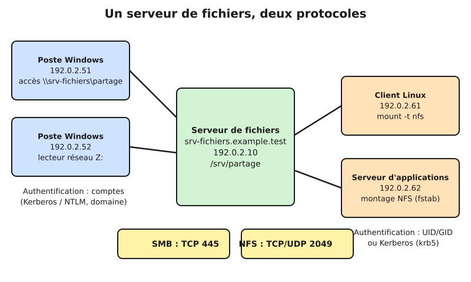
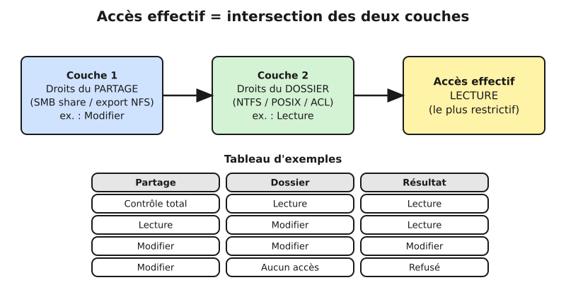
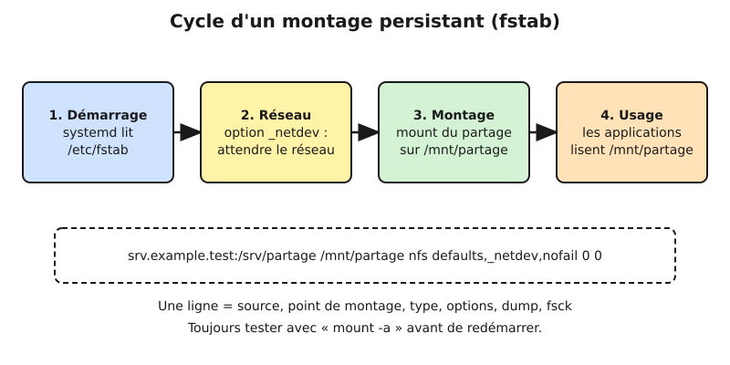
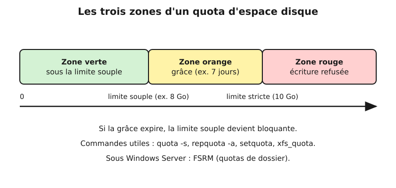

# Leçon — Partage de fichiers : SMB/CIFS, NFS, droits, montages persistants et quotas

- **Tags** : `transverse`, `tout-en-un`, `lecon`, `partage-de-fichiers`, `smb`, `samba`, `nfs`, `quotas`, `fstab`
- **Niveau** : Débutant à intermédiaire (technicien systèmes et réseaux)
- **Durée estimée** : 3 h 30 (lecture 1 h 30, laboratoire 1 h 15, exercices et quiz 45 min)

---

## Objectifs pédagogiques

À l'issue de cette leçon, vous saurez :

1. expliquer le rôle d'un serveur de fichiers et distinguer SMB/CIFS (monde Windows, Samba) de NFS (monde Unix) ;
2. publier un dossier avec Samba sous Linux et avec `New-SmbShare` sous Windows Server ;
3. exporter un dossier en NFS et le monter sur un client Linux ;
4. raisonner sur la **double couche de permissions** (droits du partage et droits du système de fichiers) et prédire l'accès effectif ;
5. rendre un montage réseau **persistant** et robuste avec `/etc/fstab` (options `_netdev`, `nofail`, fichier d'identifiants protégé) ;
6. mettre en place et surveiller des **quotas** d'espace (Linux et Windows) ;
7. diagnostiquer les pannes courantes : « accès refusé », « stale file handle », montage bloquant au démarrage, quota atteint.

## Prérequis et durée

- Connaissances de base de Linux (ligne de commande, utilisateurs et groupes, droits `rwx`) et de la leçon sur le stockage local (partitions, systèmes de fichiers, `fstab`) — voir [Leçon — Stockage local](Lecon_Stockage-local.md).
- Notions de réseau IP : adresse, masque, port TCP, pare-feu.
- Une ou deux machines virtuelles **jetables** : une VM Linux (Debian/Ubuntu Server) suffit pour tout le laboratoire ; une VM Windows Server d'évaluation est optionnelle.
- Durée totale : environ 3 h 30.

Convention : serveur `srv-fichiers.example.test` = `192.0.2.10`, clients dans `192.0.2.0/24`, domaine fictif `EXAMPLE`. Aucun mot de passe réel n'est écrit ; les mots de passe sont saisis à l'invite et ne doivent jamais figurer dans un script ni dans un dépôt.

## L'essentiel en bref

- Un **serveur de fichiers** rend un dossier accessible à plusieurs machines. Le client voit un dossier ou un lecteur ; le serveur garde le contrôle du système de fichiers (c'est ce qui le distingue d'un disque en mode bloc, cf. leçon NAS/SAN/iSCSI).
- **SMB/CIFS** (TCP 445) : standard Windows, implémenté sous Linux par **Samba** ; authentification par comptes (local, domaine, Kerberos).
- **NFS** (TCP/UDP 2049, version 4 conseillée) : standard Unix/Linux ; identification par UID/GID ou Kerberos.
- Accès effectif = **intersection** des droits du partage et des droits du système de fichiers : le plus restrictif l'emporte.
- Montage persistant : ligne `fstab` avec `_netdev,nofail` (voire `x-systemd.automount`), identifiants dans un fichier en mode `600`.
- Les **quotas** évitent qu'un seul utilisateur remplisse le volume commun : limite souple, période de grâce, limite stricte.

---

## 1. Le principe du partage de fichiers

Imaginez un classeur central dans le couloir : le **serveur** détient les documents, les **clients** demandent l'ouverture, la lecture, l'écriture d'un fichier par l'intermédiaire d'un **protocole**.



*Un même serveur de fichiers peut proposer le même dossier à des clients Windows (SMB) et Linux (NFS), chaque protocole ayant son port et son modèle d'authentification.*

Ce sont des protocoles de **niveau fichier** : le client demande « ouvre `rapport.docx` », « lis 4 Ko », « verrouille ce fichier » ; le serveur applique droits, verrous et cache. C'est la différence avec iSCSI (niveau bloc), où le client reçoit un disque brut.

Les deux familles à maîtriser :

| Critère | SMB/CIFS | NFS |
|---|---|---|
| Origine | Microsoft (IBM, puis Microsoft) | Sun Microsystems |
| Implémentation Linux | Samba (serveur), `cifs-utils` (client) | `nfs-kernel-server`, `nfs-common` |
| Port | TCP 445 | TCP 2049 (NFSv4) |
| Identification | Comptes et mots de passe, domaine, Kerberos | UID/GID par défaut, Kerberos en option |
| Sémantique de droits | ACL Windows (NTFS) | Droits POSIX, ACL NFSv4 |
| Usage typique | Postes Windows, partages de service, imprimantes | Serveurs Linux, virtualisation, home dirs Unix |
| Découverte | Navigation réseau, DFS | Aucune : on connaît l'export |

**CIFS** désigne à l'origine un ancien dialecte (SMB 1) mais reste employé pour SMB en général ; la commande Linux `mount -t cifs` négocie aujourd'hui SMB 2 ou 3.

## 2. SMB : partages Windows et Samba

### 2.1 Versions et sécurité

- **SMB 1** : bavard, sans chiffrement, vulnérable ; **à désactiver** partout.
- **SMB 2.x** (Vista/Server 2008) : bien moins bavard.
- **SMB 3.x** (Windows 8/Server 2012) : **chiffrement**, multicanal, partages à disponibilité continue.

Règle pratique : SMB 2.02 au minimum, SMB 3 avec chiffrement pour les données sensibles, jamais le port 445 sur Internet.

### 2.2 Publier un dossier avec Samba sous Linux

Installation et préparation (Debian/Ubuntu) :

```bash
sudo apt update && sudo apt install -y samba
sudo mkdir -p /srv/partage/compta
sudo groupadd grp_compta
```

👉 Explication : installe le serveur Samba, crée le dossier à publier et un groupe Unix `grp_compta` qui portera les droits (la gestion par groupe évite de manipuler les comptes un par un).

Créer un utilisateur de test sans accès shell, puis lui donner un mot de passe **Samba** (distinct du mot de passe Unix) :

```bash
sudo useradd -M -s /usr/sbin/nologin -G grp_compta alice
sudo smbpasswd -a alice
```

👉 Explication : crée le compte `alice` sans répertoire personnel ni connexion interactive, puis l'enregistre dans la base Samba ; `smbpasswd` demande le mot de passe à l'invite (ne le tapez jamais en argument de commande, il resterait dans l'historique).

Donner les droits Unix au dossier :

```bash
sudo chown root:grp_compta /srv/partage/compta
sudo chmod 2770 /srv/partage/compta
```

👉 Explication : propriétaire `root`, groupe `grp_compta`, droits `rwxrwx---` et bit **setgid** (le `2` initial) : les nouveaux fichiers héritent du groupe du dossier au lieu du groupe principal de leur créateur.

Définir le partage dans `/etc/samba/smb.conf` (ajouter à la fin du fichier) :

```ini
[global]
   workgroup = EXAMPLE
   server role = standalone server
   server min protocol = SMB2_02
   map to guest = never

[compta]
   comment = Documents du service comptabilité
   path = /srv/partage/compta
   read only = no
   valid users = @grp_compta
   force group = grp_compta
   create mask = 0660
   directory mask = 2770
```

👉 Explication : `[global]` fixe le groupe de travail, désactive SMB 1 (`server min protocol`) et interdit l'accès invité ; la section `[compta]` publie le dossier en écriture, réservé au groupe `grp_compta` (`valid users`), avec masques de création cohérents avec les droits Unix. Si `[global]` existe déjà, modifiez ses lignes au lieu de la dupliquer.

Valider la syntaxe puis recharger :

```bash
testparm -s
sudo systemctl restart smbd
```

👉 Explication : `testparm` relit la configuration et signale erreurs et paramètres ignorés ; `restart smbd` applique les changements (un `reload` suffit pour les modifications de partages, mais le redémarrage est plus simple en laboratoire).

Tester depuis le serveur lui-même (lecture seule côté réseau, aucun changement) :

```bash
smbclient -L //127.0.0.1 -U alice
```

👉 Explication : liste les partages visibles pour `alice` (le mot de passe est demandé à l'invite) ; on doit voir `compta`.

### 2.3 Se connecter depuis Windows et Linux

Depuis un poste Windows (invite de commandes ou PowerShell) :

```powershell
net use Z: \\192.0.2.10\compta /user:alice
```

👉 Explication : associe la lettre `Z:` au partage ; le mot de passe est demandé à l'invite. Ajouter `/persistent:yes` reconnecte le lecteur à chaque ouverture de session.

```powershell
New-SmbMapping -LocalPath Z: -RemotePath \\srv-fichiers.example.test\compta -Persistent $true
```

👉 Explication : équivalent PowerShell moderne pour un lecteur réseau persistant ; la persistance fait réapparaître le lecteur à la prochaine ouverture de session.

Depuis un client Linux :

```bash
sudo apt install -y cifs-utils
sudo mkdir -p /mnt/compta
sudo mount -t cifs //192.0.2.10/compta /mnt/compta -o username=alice,vers=3.0,uid=1000,gid=1000
```

👉 Explication : monte le partage ; le mot de passe est demandé à l'invite. `vers=3.0` impose SMB 3 ; `uid` et `gid` indiquent à quel utilisateur local les fichiers distants apparaîtront appartenir (SMB n'a pas de notion d'UID Unix côté client).

### 2.4 Créer un partage sous Windows Server

Un dossier est publié en deux temps : création du dossier, puis du partage avec ses permissions.

```powershell
New-Item -ItemType Directory -Path D:\Partages\Compta
New-SmbShare -Name Compta -Path D:\Partages\Compta -FullAccess "EXAMPLE\GG_Compta_RW" -ReadAccess "EXAMPLE\GG_Compta_RO"
```

👉 Explication : crée le dossier puis le partage `Compta` en donnant le contrôle total au groupe global `GG_Compta_RW` et la lecture à `GG_Compta_RO` (groupes fictifs du domaine `EXAMPLE`) ; on évite d'attribuer des droits à des comptes individuels.

```powershell
Get-SmbShare
Get-SmbShareAccess -Name Compta
```

👉 Explication : commandes en lecture seule qui listent les partages publiés et leurs permissions de partage (pas les permissions NTFS).

Bonne pratique Windows : utiliser le modèle **AGDLP** (comptes → groupes globaux → groupes locaux de domaine → permissions) plutôt que des droits individuels.

## 3. NFS : le partage Unix

### 3.1 Principe

NFS fait apparaître le disque distant comme un disque local : le serveur publie des **exports**, le client les **monte**.

Les versions à connaître :

- **NFSv3** : sans état, plusieurs services annexes (`rpcbind`, `mountd`, `lockd`…) et ports variables — pénible à filtrer ;
- **NFSv4** (RFC 7530) puis **4.1/4.2** : avec état, **un seul port (TCP 2049)**, verrouillage intégré, ACL, authentification Kerberos possible, meilleure traversée des pare-feu. **Choix par défaut aujourd'hui.**

Point de vigilance : NFS fait confiance au client et applique tel quel l'**UID/GID** reçu. Si `alice` est l'UID 1001 sur le client et 1002 sur le serveur, les droits sont faux. Il faut des UID/GID **cohérents** (LDAP, SSSD) ou Kerberos (`sec=krb5`) dès que le réseau n'est pas totalement maîtrisé.

### 3.2 Exporter un dossier

```bash
sudo apt install -y nfs-kernel-server
sudo mkdir -p /srv/partage/projets
sudo chown root:root /srv/partage/projets
sudo chmod 0775 /srv/partage/projets
```

👉 Explication : installe le serveur NFS du noyau et prépare le dossier à exporter ; les droits Unix du dossier restent la barrière réelle d'accès côté serveur.

Déclarer l'export dans `/etc/exports` :

```bash
echo '/srv/partage/projets 192.0.2.0/24(rw,sync,no_subtree_check,root_squash)' | sudo tee -a /etc/exports
sudo exportfs -ra
sudo exportfs -v
```

👉 Explication : autorise le réseau `192.0.2.0/24` à monter le dossier en lecture/écriture. `sync` n'acquitte une écriture qu'une fois qu'elle est sur disque (sûr, un peu plus lent) ; `no_subtree_check` évite des vérifications coûteuses ; **`root_squash`** transforme le `root` du client en utilisateur anonyme (`nobody`) : à conserver. `exportfs -ra` recharge les exports et `-v` les affiche.

Ne jamais exporter vers `*` ni utiliser `no_root_squash` hors cas maîtrisé.

Côté pare-feu (NFSv4 seul) :

```bash
sudo ufw allow from 192.0.2.0/24 to any port 2049 proto tcp
```

👉 Explication : n'ouvre que le port 2049 et seulement pour le réseau des clients (exemple avec `ufw` ; adaptez à `firewalld` ou `nftables`).

### 3.3 Monter sur le client

```bash
sudo apt install -y nfs-common
sudo mkdir -p /mnt/projets
sudo mount -t nfs4 192.0.2.10:/srv/partage/projets /mnt/projets
```

👉 Explication : installe le client, crée le point de montage et monte l'export en NFSv4 ; la syntaxe est `serveur:chemin_export`.

```bash
mount | grep nfs4
nfsstat -m
```

👉 Explication : confirme que le montage est actif et affiche ses options effectives (version, taille des blocs `rsize`/`wsize`, protocole, mode `hard`).

### 3.4 Mode « hard » ou « soft »

Option importante : **`hard`** (défaut) fait attendre les applications si le serveur tombe (aucune perte silencieuse, mais processus bloqués) ; **`soft`** échoue après un délai (risque d'écritures perdues sans que l'application le sache). Gardez `hard` pour les données qui comptent.

## 4. Droits de partage et droits du système de fichiers

C'est **la** source d'erreur numéro un : « j'ai donné les droits, mais l'utilisateur est refusé » (ou l'inverse : « il a trop de droits »). L'explication est que tout accès via SMB ou NFS traverse **deux barrières successives**.



*Accès effectif = intersection des droits du partage et des droits du système de fichiers (NTFS ou POSIX) : le plus restrictif l'emporte.*

Analogie : il faut franchir la porte de l'immeuble (le partage) **puis** celle de la salle (le dossier).

### 4.1 Côté Windows

- **Permissions de partage** : trois niveaux seulement (Lecture, Modifier, Contrôle total), appliquées uniquement aux accès **réseau**.
- **Permissions NTFS** : granulaires (lecture, écriture, exécution, suppression, prise de possession…), héritées par les sous-dossiers, appliquées aussi en accès local.
- Résultat : le plus restrictif des deux (avec une subtilité : un « Refuser » explicite l'emporte toujours sur un « Autoriser »).

```powershell
Get-Acl D:\Partages\Compta | Format-List
icacls D:\Partages\Compta
```

👉 Explication : affichent les permissions NTFS du dossier (lecture seule) ; `icacls` donne une version compacte (`(OI)(CI)` pour l'héritage, `F` contrôle total, `M` modification, `RX` lecture et exécution).

```powershell
icacls D:\Partages\Compta /grant "EXAMPLE\GG_Compta_RW:(OI)(CI)M"
```

👉 Explication : accorde la permission « Modifier » au groupe, avec héritage aux fichiers (`OI`) et sous-dossiers (`CI`) ; à exécuter avec précaution sur un dossier de production, car le changement est immédiat.

### 4.2 Côté Linux (Samba)

Le même principe s'applique : le partage Samba (`valid users`, `read only`, `write list`) est la première barrière, les droits Unix du dossier la seconde. Le compte Samba est mappé sur un compte Unix, et **c'est ce compte Unix** qui accède réellement aux fichiers. Si `alice` n'est pas membre de `grp_compta` ou si le dossier est en `0700` appartenant à `root`, l'accès sera refusé même si le partage est ouvert à tous.

Pour des besoins plus fins que `rwx`, on utilise les **ACL POSIX** :

```bash
sudo apt install -y acl
sudo setfacl -m g:grp_audit:rx /srv/partage/compta
sudo setfacl -d -m g:grp_audit:rx /srv/partage/compta
getfacl /srv/partage/compta
```

👉 Explication : donne au groupe `grp_audit` un accès en lecture et traversée ; la seconde commande définit l'ACL **par défaut** (`-d`) pour que les futurs fichiers l'héritent ; `getfacl` affiche le résultat. Le système de fichiers doit supporter les ACL (ext4 et XFS le font par défaut).

### 4.3 Côté NFS

Pour NFS, la barrière « partage » est `/etc/exports`, la barrière « système de fichiers » les droits Unix ou ACL du dossier. Sans Kerberos, **le serveur ne peut pas vérifier** que le client dit vrai : exportez uniquement vers des réseaux de confiance.

### 4.4 Méthode de raisonnement

Devant un « accès refusé », posez-vous dans cet ordre :

1. Le client atteint-il le serveur (réseau, pare-feu, nom, port) ?
2. Le **partage** autorise-t-il cet utilisateur (permissions de partage, `valid users`, export) ?
3. Le **système de fichiers** autorise-t-il le compte réel côté serveur (propriétaire, groupe, ACL, héritage) ?
4. Y a-t-il un autre filtre (SELinux ou AppArmor, quota, FS en lecture seule, verrou) ?

Avec SELinux, un partage Samba peut exiger le contexte `samba_share_t` : cause fréquente d'« accès refusé » ; consultez `ausearch -m avc -ts recent` avant de désactiver quoi que ce soit.

## 5. Montages persistants

Un montage réalisé avec `mount` disparaît au redémarrage. Pour qu'il revienne, on le déclare dans `/etc/fstab`, que `systemd` transforme en unités de montage.



*Cycle d'un montage persistant : lecture de fstab, attente du réseau (`_netdev`), montage, utilisation.*

### 5.1 NFS dans fstab

```bash
echo 'srv-fichiers.example.test:/srv/partage/projets  /mnt/projets  nfs4  defaults,_netdev,nofail,x-systemd.automount,x-systemd.idle-timeout=600  0  0' | sudo tee -a /etc/fstab
sudo systemctl daemon-reload
sudo mount -a
```

👉 Explication : ajoute une ligne `fstab`. `_netdev` signale un montage réseau (attendre le réseau) ; `nofail` empêche un blocage du démarrage si le serveur est absent ; `x-systemd.automount` ne monte qu'au premier accès, et `idle-timeout=600` démonte après 10 minutes d'inactivité. `daemon-reload` prend en compte la modification et `mount -a` teste la ligne.

### 5.2 SMB dans fstab avec fichier d'identifiants

Ne mettez **jamais** le mot de passe dans `fstab` (lisible par tous). On utilise un fichier d'identifiants lisible uniquement par `root` :

```bash
sudo install -m 600 -o root -g root /dev/null /etc/samba/credentials-compta
sudoedit /etc/samba/credentials-compta
```

👉 Explication : crée un fichier vide en mode `600` puis l'ouvre dans l'éditeur ; on y saisit deux lignes `username=alice` et `password=<à saisir dans l'éditeur, jamais dans un script>`. Pour un poste de travail, préférez une authentification Kerberos ou un compte de service dédié au droit minimal.

```bash
echo '//srv-fichiers.example.test/compta  /mnt/compta  cifs  credentials=/etc/samba/credentials-compta,vers=3.0,uid=1000,gid=1000,_netdev,nofail,x-systemd.automount  0  0' | sudo tee -a /etc/fstab
sudo mount -a
```

👉 Explication : monte le partage SMB au démarrage en lisant les identifiants dans le fichier protégé, avec les mêmes garde-fous que pour NFS.

### 5.3 Les erreurs classiques

- **Sans `nofail`/`_netdev`** : le démarrage attend 90 s ou bascule en mode secours si le serveur est injoignable.
- **Nom non résolu au démarrage** : préférer un DNS fiable ou une IP fixe.
- **Fichiers créés sous le point de montage avant le montage** : masqués une fois le partage monté, ils semblent « disparus ».
- **Montage obsolète (*stale file handle*)** : `umount -l` puis remonter.

Côté Windows, la persistance s'obtient avec `net use /persistent:yes`, `New-SmbMapping -Persistent $true`, ou, en entreprise, avec une **stratégie de groupe** (Préférences → Mappages de lecteurs) qui attache les lecteurs selon l'appartenance aux groupes.

## 6. Quotas

Sans limite, un utilisateur peut remplir tout le volume (téléchargements, copies de sauvegarde…) et bloquer tous les autres. Un **quota** limite l'espace (et parfois le nombre de fichiers) par utilisateur, groupe ou dossier.



*Les trois zones d'un quota : limite souple (alerte), période de grâce, limite stricte (blocage).*

- **Limite souple** (*soft limit*) : on peut la dépasser temporairement ; le dépassement déclenche un avertissement et lance un compte à rebours.
- **Période de grâce** (*grace period*) : durée pendant laquelle le dépassement est toléré. Si elle expire, la limite souple devient bloquante.
- **Limite stricte** (*hard limit*) : jamais dépassable, l'écriture échoue.

### 6.1 Quotas utilisateur sous Linux (ext4)

Activer les quotas demande une option de montage (`usrquota`, `grpquota`) puis la création des fichiers de comptabilité :

```bash
sudo apt install -y quota
sudo mount -o remount,usrquota /srv/donnees
sudo quotacheck -cu /srv/donnees
sudo quotaon -u /srv/donnees
```

👉 Explication : installe les outils, active la comptabilité par utilisateur sur le volume `/srv/donnees` (à rendre permanent en ajoutant `usrquota` dans les options `fstab`), crée la base de quotas puis les active. Sur certains noyaux récents, `quotacheck` demande de passer le système de fichiers sans activité ; faites-le d'abord en laboratoire.

Fixer les limites de `alice` (en blocs de 1 Kio : 8 Go ≈ 8388608, 10 Go ≈ 10485760) :

```bash
sudo setquota -u alice 8388608 10485760 0 0 /srv/donnees
sudo setquota -t 604800 604800 /srv/donnees
```

👉 Explication : la première ligne fixe limite souple 8 Go, limite stricte 10 Go, sans limite sur le nombre d'inodes (0 0) ; la seconde fixe la période de grâce à 7 jours (604 800 s) pour l'espace et les inodes.

Consulter :

```bash
sudo repquota -s /srv/donnees
quota -s -u alice
```

👉 Explication : `repquota` dresse le tableau de tous les utilisateurs (taille, limites, délai de grâce, lisible grâce à `-s`) ; `quota` montre la situation d'un utilisateur. Commandes en lecture seule.

### 6.2 Quotas XFS

XFS gère les quotas à l'aide de `xfs_quota` et d'options de montage à positionner **au montage** (`usrquota`, `grpquota`, `prjquota`). Les **quotas de projet** (`prjquota`) sont particulièrement utiles pour limiter un **dossier** plutôt qu'un utilisateur :

```bash
sudo xfs_quota -x -c 'limit bsoft=8g bhard=10g alice' /srv/donnees
sudo xfs_quota -x -c 'report -h' /srv/donnees
```

👉 Explication : fixe limites souple et stricte pour `alice` puis affiche le rapport (le volume doit avoir été monté avec `usrquota`).

### 6.3 Quotas Windows (FSRM)

Sous Windows Server, le rôle **Gestionnaire de ressources du serveur de fichiers** (FSRM) fournit des quotas par **dossier**, avec modèles, notifications par e-mail et filtrage de fichiers.

```powershell
Install-WindowsFeature FS-Resource-Manager -IncludeManagementTools
New-FsrmQuota -Path D:\Partages\Compta -Size 50GB -SoftLimit
Get-FsrmQuota -Path D:\Partages\Compta
```

👉 Explication : installe le rôle FSRM, crée un quota « souple » de 50 Go sur le dossier (avertissement sans blocage) puis affiche son état ; retirez `-SoftLimit` pour un quota strict. L'installation modifie le serveur : à tester sur une VM d'évaluation.

### 6.4 Bien choisir ses quotas

Observer d'abord (quota souple), prévenir à 80 et 90 %, prévoir une procédure de levée exceptionnelle.

## 7. Sécurité et exploitation en bref

- Pare-feu : TCP 445 et 2049 limités aux réseaux clients, jamais vers Internet.
- SMB 1 désactivé, signature SMB, chiffrement SMB 3 pour les données sensibles, pas d'accès invité.
- Moindre privilège : groupes par rôle, revue périodique.
- Journaux : `journalctl -u smbd`, `/var/log/samba/`, `journalctl -u nfs-server`, audit Windows.
- Les « versions précédentes » (VSS, snapshots) ne remplacent pas une sauvegarde externe testée.
- Utiliser un nom DNS de service (`fichiers.example.test`) pour migrer sans toucher aux clients.

---

## Mise en pratique guidée

**Cadre** : une seule VM Linux jetable (Debian/Ubuntu), que l'on utilise à la fois comme serveur et comme client (via `127.0.0.1`). Faites un instantané avant de commencer. Aucune connexion à une machine distante n'est nécessaire.

**Étape 1 — préparer un volume de test avec quotas.**

```bash
mkdir -p ~/labo-partage && cd ~/labo-partage
truncate -s 300M volume.img
sudo mkfs.ext4 -q -L PARTAGE volume.img
sudo mkdir -p /srv/partage
sudo mount -o loop,usrquota volume.img /srv/partage
df -h /srv/partage
```

👉 Explication : crée un faux disque de 300 Mio dans un fichier, le formate en ext4 et le monte sur `/srv/partage` avec l'option de quota utilisateur ; ainsi les expériences ne touchent aucun vrai disque.

**Étape 2 — créer les comptes, groupes et dossiers.**

```bash
sudo groupadd grp_compta
sudo useradd -M -s /usr/sbin/nologin -G grp_compta alice
sudo useradd -M -s /usr/sbin/nologin bob
sudo mkdir -p /srv/partage/compta /srv/partage/projets
sudo chown root:grp_compta /srv/partage/compta && sudo chmod 2770 /srv/partage/compta
sudo chmod 0775 /srv/partage/projets
```

👉 Explication : `alice` est membre du groupe comptabilité, `bob` ne l'est pas ; le dossier `compta` est protégé par le groupe, `projets` est lisible par tous.

**Étape 3 — publier `compta` avec Samba.** Installez Samba, ajoutez la section `[compta]` de la partie 2.2 à `smb.conf`, puis créez les mots de passe Samba (`sudo smbpasswd -a alice` et `sudo smbpasswd -a bob`, saisis à l'invite), vérifiez avec `testparm -s` et redémarrez `smbd`.

```bash
sudo mkdir -p /mnt/compta
sudo mount -t cifs //127.0.0.1/compta /mnt/compta -o username=alice,vers=3.0
echo "note comptable" | sudo tee /mnt/compta/note.txt
ls -l /srv/partage/compta
```

👉 Explication : monte le partage via SMB en tant qu'`alice` et y écrit un fichier ; sur le serveur, on doit voir `note.txt` avec le groupe `grp_compta` (effet du `force group`).

**Étape 4 — vérifier l'intersection des droits.**

```bash
sudo umount /mnt/compta
sudo mount -t cifs //127.0.0.1/compta /mnt/compta -o username=bob,vers=3.0
```

👉 Explication : `bob` n'est pas dans `valid users` : le montage doit échouer avec un message « Permission denied » (ou `NT_STATUS_ACCESS_DENIED`). Essayez ensuite de donner à `bob` l'accès au partage (ajout au groupe) puis de retirer le droit sur le dossier (`chmod 0700`) : vous observerez que chaque barrière peut bloquer l'accès à elle seule.

**Étape 5 — exporter et monter en NFS.**

```bash
sudo apt install -y nfs-kernel-server nfs-common
echo '/srv/partage/projets 127.0.0.1(rw,sync,no_subtree_check,root_squash)' | sudo tee -a /etc/exports
sudo exportfs -ra
sudo mkdir -p /mnt/projets
sudo mount -t nfs4 127.0.0.1:/srv/partage/projets /mnt/projets
nfsstat -m
```

👉 Explication : exporte `projets` vers la boucle locale uniquement et le monte ; `nfsstat -m` doit afficher `vers=4.x` et l'état du montage.

Vérifiez `root_squash` :

```bash
sudo touch /mnt/projets/test-root.txt
ls -l /srv/partage/projets/test-root.txt
```

👉 Explication : même exécuté par `root` sur le client, le fichier appartient à `nobody` côté serveur (ou la création est refusée selon les droits du dossier), preuve que l'écrasement du root est actif.

**Étape 6 — rendre persistant.** Ajoutez une ligne `fstab` de type NFS (partie 5.1, avec `127.0.0.1:/srv/partage/projets`), puis testez :

```bash
sudo umount /mnt/projets
sudo systemctl daemon-reload
sudo mount -a
findmnt /mnt/projets
```

👉 Explication : `findmnt` confirme que le montage a été rétabli à partir de `fstab` ; en situation réelle, on redémarrerait ensuite la machine pour valider la persistance.

**Étape 7 — quota.**

```bash
sudo quotacheck -cu /srv/partage
sudo quotaon -u /srv/partage
sudo setquota -u alice 20480 30720 0 0 /srv/partage
sudo repquota -s /srv/partage
sudo -u alice dd if=/dev/zero of=/srv/partage/compta/gros.bin bs=1M count=40
```

👉 Explication : fixe pour `alice` une limite souple de 20 Mio et stricte de 30 Mio puis tente d'écrire 40 Mio ; l'écriture doit s'arrêter autour de 30 Mio avec « Disk quota exceeded », preuve du blocage à la limite stricte. (Le dossier `compta` appartient au groupe, le quota par utilisateur s'applique au **propriétaire** des fichiers : `alice`.)

**Étape 8 — nettoyage.**

```bash
sudo umount /mnt/compta /mnt/projets 2>/dev/null
sudo exportfs -ua
sudo quotaoff -u /srv/partage
sudo umount /srv/partage
rm -f ~/labo-partage/volume.img
```

👉 Explication : démonte les montages, retire les exports, désactive les quotas, démonte le volume de test et supprime l'image. Retirez aussi les lignes ajoutées à `/etc/exports`, `/etc/fstab` et `smb.conf` (ou restaurez l'instantané de la VM).

**Critères de réussite** : montage SMB refusé pour `bob`, accepté pour `alice` ; export NFS fonctionnel avec `root_squash` ; ligne `fstab` validée par `mount -a` ; écriture bloquée à la limite stricte du quota.

## Exercices

1. **(Vocabulaire)** Citez trois différences entre SMB et NFSv4 (port, identification, usage principal).
2. **(Intersection)** Un partage Windows donne « Modifier » à `GG_Ventes`. Le dossier NTFS ne donne que « Lecture » à ce groupe. Que peuvent faire les membres via le réseau ? Et en ouvrant une session locale sur le serveur ?
3. **(Samba)** Rédigez la section `smb.conf` d'un partage `[rh]` pointant sur `/srv/partage/rh`, réservé au groupe `grp_rh`, en écriture, sans accès invité, avec création de fichiers en `0660`.
4. **(NFS)** Écrivez la ligne `/etc/exports` qui autorise en **lecture seule** le réseau `198.51.100.0/24` et en **lecture/écriture** la machine `192.0.2.50` sur `/srv/partage/docs`, `root_squash` actif.
5. **(fstab)** Rédigez la ligne `fstab` d'un montage NFSv4 de `fichiers.example.test:/srv/partage/docs` sur `/mnt/docs` qui ne bloque pas le démarrage si le serveur est absent. Expliquez chaque option.
6. **(Quotas)** Vous devez limiter chaque utilisateur à 5 Go avec un dépassement toléré jusqu'à 6 Go pendant 3 jours. Quelles valeurs de limite souple, limite stricte et grâce ? Calculez-les en Kio pour `setquota`.
7. **(Diagnostic)** Un utilisateur écrit sans problème sur le partage depuis son poste, mais obtient « accès refusé » pour un nouveau sous-dossier créé par un collègue d'un autre service. Listez trois causes probables et la commande de vérification associée.
8. **(Analyse)** Un administrateur a mis `password=MonMotDePasse` dans `/etc/fstab` pour un montage CIFS. Quels risques et quelle correction proposez-vous ?

## Corrigés des exercices

1. SMB : TCP 445, authentification par comptes (local, domaine, Kerberos), usage principal postes Windows (Samba côté Linux). NFSv4 : TCP 2049, identification par UID/GID ou Kerberos, usage principal serveurs Linux/Unix. Autres différences acceptées : sémantique d'ACL, présence de la découverte réseau côté SMB.
2. Via le réseau : **lecture seule**, car l'accès effectif est l'intersection (Modifier ∩ Lecture = Lecture). En session locale sur le serveur : les permissions de partage ne s'appliquent pas, seules celles du NTFS comptent : lecture également.
3. Exemple :
   ```ini
   [rh]
      path = /srv/partage/rh
      read only = no
      guest ok = no
      valid users = @grp_rh
      force group = grp_rh
      create mask = 0660
      directory mask = 2770
   ```
   👉 Explication : partage en écriture réservé au groupe `grp_rh`, sans invité, fichiers en `0660` ; le dossier doit être `root:grp_rh` en `2770`.
4. `/srv/partage/docs 198.51.100.0/24(ro,sync,no_subtree_check,root_squash) 192.0.2.50(rw,sync,no_subtree_check,root_squash)` — les options sont propres à chaque client ; il n'y a **pas** d'espace entre l'adresse et la parenthèse (sinon l'option s'applique à tout le monde).
5. `fichiers.example.test:/srv/partage/docs  /mnt/docs  nfs4  defaults,_netdev,nofail  0  0`. `defaults` : options usuelles ; `_netdev` : attendre le réseau avant de monter ; `nofail` : ne pas bloquer le démarrage si le montage échoue ; `0 0` : pas de `dump` ni de `fsck` pour un système distant.
6. Limite souple 5 Go = 5 × 1 048 576 = **5 242 880** Kio ; limite stricte 6 Go = **6 291 456** Kio ; grâce 3 jours = **259 200** s. Commande : `setquota -u utilisateur 5242880 6291456 0 0 /srv/donnees` puis `setquota -t 259200 259200 /srv/donnees`.
7. (a) Le sous-dossier n'a pas hérité du groupe : vérifier le bit setgid et le groupe avec `ls -ld` (ou, sous Windows, l'héritage avec `icacls`). (b) Masque de création trop strict (`create mask`/`directory mask` ou umask du collègue) : consulter `testparm -s` et `ls -l`. (c) Une ACL spécifique ou un contexte SELinux incorrect : `getfacl` et `ls -Z`. Un quota atteint ou un FS en lecture seule sont des causes supplémentaires.
8. `fstab` est lisible par tout utilisateur local : le mot de passe est exposé (et souvent copié dans des sauvegardes et des journaux). Correction : fichier d'identifiants en mode `600` propriété de `root` (`credentials=`), idéalement compte de service dédié au minimum de droits, **changement immédiat du mot de passe** exposé, ou authentification Kerberos.

## Quiz

**Q1. Quel port TCP est utilisé par SMB moderne ?**
a) 139  b) 445  c) 2049  d) 3260
**Réponse : b.** SMB 2/3 utilise TCP 445 directement ; 139 est l'ancien transport NetBIOS, 2049 est NFS, 3260 iSCSI.

**Q2. Quel est le rôle de `root_squash` en NFS ?**
a) Chiffrer le trafic  b) Transformer le `root` du client en utilisateur sans privilège sur l'export  c) Interdire le montage à tous  d) Compresser les données
**Réponse : b.** Cela empêche un administrateur d'une machine cliente d'agir en `root` sur le serveur.

**Q3. Un partage donne « Contrôle total » et le dossier NTFS donne « Lecture ». Quel est l'accès réseau effectif ?**
a) Contrôle total  b) Lecture  c) Modifier  d) Refusé
**Réponse : b.** L'accès effectif est l'intersection : le plus restrictif l'emporte.

**Q4. Pourquoi ajouter `_netdev` dans `fstab` pour un montage NFS ?**
a) Pour activer le chiffrement  b) Pour indiquer qu'il faut attendre le réseau avant de monter  c) Pour augmenter le débit  d) Pour monter en lecture seule
**Réponse : b.** Sans cela, le système peut tenter de monter avant que le réseau soit disponible.

**Q5. Quelle option évite de bloquer le démarrage si le serveur de fichiers est indisponible ?**
a) `hard`  b) `sync`  c) `nofail`  d) `rw`
**Réponse : c.** `nofail` autorise le système à continuer si le montage échoue.

**Q6. Où ne faut-il jamais écrire un mot de passe de montage CIFS ?**
a) Dans un fichier en mode 600 appartenant à root  b) Dans `/etc/fstab`, lisible par tous  c) À l'invite de saisie  d) Dans un coffre de secrets
**Réponse : b.** `fstab` est lisible par tous les utilisateurs locaux.

**Q7. Quelle version de SMB doit être désactivée en priorité ?**
a) SMB 3.1.1  b) SMB 3.0  c) SMB 2.1  d) SMB 1
**Réponse : d.** SMB 1 est obsolète, sans chiffrement et vulnérable à des attaques majeures.

**Q8. Dans un quota, que se passe-t-il quand la période de grâce expire alors que l'utilisateur dépasse encore la limite souple ?**
a) Rien  b) La limite souple devient bloquante  c) Le compte est supprimé  d) Les fichiers sont effacés
**Réponse : b.** L'utilisateur ne peut plus écrire tant qu'il n'est pas repassé sous la limite souple.

**Q9. Pourquoi des UID incohérents entre client et serveur posent-ils problème en NFS sans Kerberos ?**
a) Le débit baisse  b) Le serveur applique l'UID reçu tel quel : les fichiers peuvent appartenir à la mauvaise personne  c) Le port change  d) Le montage devient en lecture seule
**Réponse : b.** NFS classique ne vérifie pas l'identité : il fait confiance à l'UID annoncé par le client.

**Q10. Quel bit de droits sur un dossier fait hériter aux nouveaux fichiers du groupe du dossier ?**
a) sticky bit  b) setuid  c) setgid  d) umask
**Réponse : c.** Le bit setgid (`chmod 2770`) force l'héritage du groupe du dossier parent.

## Erreurs fréquentes et dépannage

| Symptôme | Cause probable | Vérification / action |
|---|---|---|
| `mount error(13): Permission denied` (CIFS) | Mauvais compte ou mot de passe, `valid users`, groupe | `testparm -s`, `smbclient -L`, journaux Samba |
| `mount error(95)` ou `(112)` (CIFS) | Version SMB non supportée (`vers=`) | Essayer `vers=3.0` ou `2.1`, vérifier `server min protocol` |
| `mount.nfs: access denied by server` | Client non autorisé dans `/etc/exports` | `exportfs -v`, relancer `exportfs -ra` |
| `mount.nfs: Connection timed out` | Pare-feu, nom non résolu | `ping`, `nc -zv 192.0.2.10 2049`, pare-feu |
| `Stale file handle` | Export modifié ou fichier supprimé côté serveur | `umount -l` puis remontage |
| Démarrage lent ou en mode secours | Ligne `fstab` sans `nofail`/`_netdev` | Corriger `fstab`, `systemctl daemon-reload` |
| « Accès refusé » alors que le partage est ouvert | Droits Unix/NTFS plus restrictifs, SELinux | Méthode des 4 questions (partie 4.4) |
| Fichiers créés avec le mauvais groupe | Absence de setgid ou `force group` | `chmod 2770`, `force group` |
| « Disk quota exceeded » | Limite stricte atteinte | `repquota -s`, nettoyer ou relever temporairement |
| Fichiers « disparus » sous le point de montage | Fichiers créés avant montage, masqués | Démonter et nettoyer le dossier sous-jacent |

Outils de diagnostic utiles : `smbstatus` (sessions Samba ouvertes), `showmount -e 192.0.2.10` (exports visibles), `rpcinfo -p` (NFSv3), `nfsstat`, `ss -tlnp | grep -E ':(445|2049)'`, `journalctl -u smbd -u nfs-server --since "1 hour ago"`.

## À retenir

- SMB (TCP 445) et NFSv4 (TCP 2049) sont des protocoles de **niveau fichier** : le serveur gère le système de fichiers.
- Désactiver SMB 1 ; préférer SMB 3 ; ne jamais exposer 445 ou 2049 à Internet.
- Samba : `smb.conf`, `smbpasswd`, `testparm`, `valid users`, `force group` ; Windows : `New-SmbShare`, NTFS, modèle AGDLP.
- NFS : `/etc/exports`, `exportfs -ra`, `root_squash`, UID/GID cohérents ou Kerberos.
- **Accès effectif = intersection** des droits du partage et du système de fichiers ; vérifier toujours les deux couches.
- `fstab` : `_netdev`, `nofail`, éventuellement `x-systemd.automount` ; fichier d'identifiants en `600` ; test par `mount -a`.
- Quotas : limite souple, grâce, limite stricte ; observer avant de bloquer, prévenir les utilisateurs.
- Un partage n'est pas une sauvegarde : prévoir sauvegarde externe et test de restauration.

## Pour aller plus loin

Documentations officielles et RFC :

- Documentation Samba : <https://www.samba.org/samba/docs/>
- Page de manuel `smb.conf` : <https://www.samba.org/samba/docs/current/man-html/smb.conf.5.html>
- Page de manuel `mount.cifs` : <https://www.samba.org/samba/docs/current/man-html/mount.cifs.8.html>
- RFC 7530 — Network File System (NFS) Version 4 Protocol : <https://www.rfc-editor.org/rfc/rfc7530>
- RFC 8881 — NFS Version 4 Minor Version 1 : <https://www.rfc-editor.org/rfc/rfc8881>
- Page de manuel `exports` : <https://man7.org/linux/man-pages/man5/exports.5.html>
- Page de manuel `fstab` : <https://man7.org/linux/man-pages/man5/fstab.5.html>
- Microsoft — Vue d'ensemble de SMB : <https://learn.microsoft.com/fr-fr/windows-server/storage/file-server/file-server-smb-overview>
- Microsoft — Cmdlet `New-SmbShare` : <https://learn.microsoft.com/fr-fr/powershell/module/smbshare/new-smbshare>
- Microsoft — Gestionnaire de ressources du serveur de fichiers (quotas) : <https://learn.microsoft.com/fr-fr/windows-server/storage/fsrm/fsrm-overview>
- Documentation du noyau Linux — quotas de disque : <https://docs.kernel.org/filesystems/quota.html>

## Crédits des images

| Fichier | Source (URL de la page) | Auteur | Licence | Modifications |
|---|---|---|---|---|
| `images/partage-fichiers-1.svg` | Fichier original de ce dépôt | Pack Master | Création originale du projet Pack Master, dédiée au domaine public (CC0) — <https://creativecommons.org/publicdomain/zero/1.0/> | Sans objet |
| `images/partage-fichiers-2.svg` | Fichier original de ce dépôt | Pack Master | Création originale du projet Pack Master, dédiée au domaine public (CC0) — <https://creativecommons.org/publicdomain/zero/1.0/> | Sans objet |
| `images/partage-fichiers-3.svg` | Fichier original de ce dépôt | Pack Master | Création originale du projet Pack Master, dédiée au domaine public (CC0) — <https://creativecommons.org/publicdomain/zero/1.0/> | Sans objet |
| `images/partage-fichiers-4.svg` | Fichier original de ce dépôt | Pack Master | Création originale du projet Pack Master, dédiée au domaine public (CC0) — <https://creativecommons.org/publicdomain/zero/1.0/> | Sans objet |

Aucune image tierce n'est utilisée dans cette leçon.

## Historique de vérification

| Date | OS/logiciel | Testeur | Verdict |
|---|---|---|---|
| 2026-11-01 | Linux (Debian/Ubuntu) — Samba, nfs-kernel-server, quota ; Windows Server — SMB, FSRM | Rédaction assistée (Copilot) | Non testé sur plateforme cible |

Précision : aucune commande de cette leçon n'a été exécutée lors de la rédaction ; les procédures sont à valider en VM jetable avant tout usage en production.
