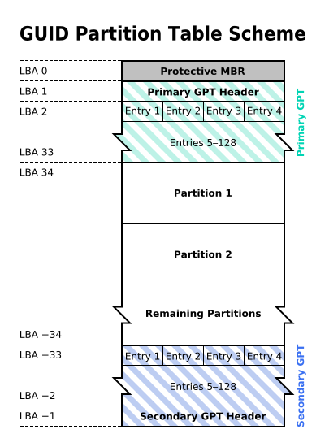
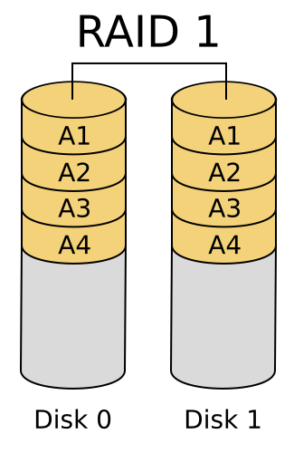
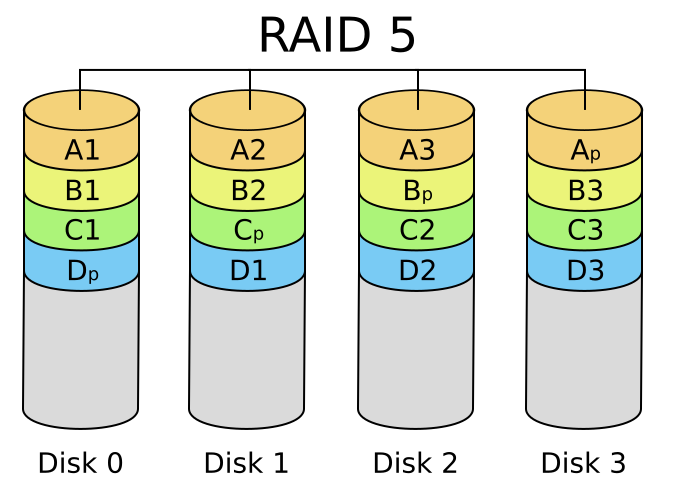
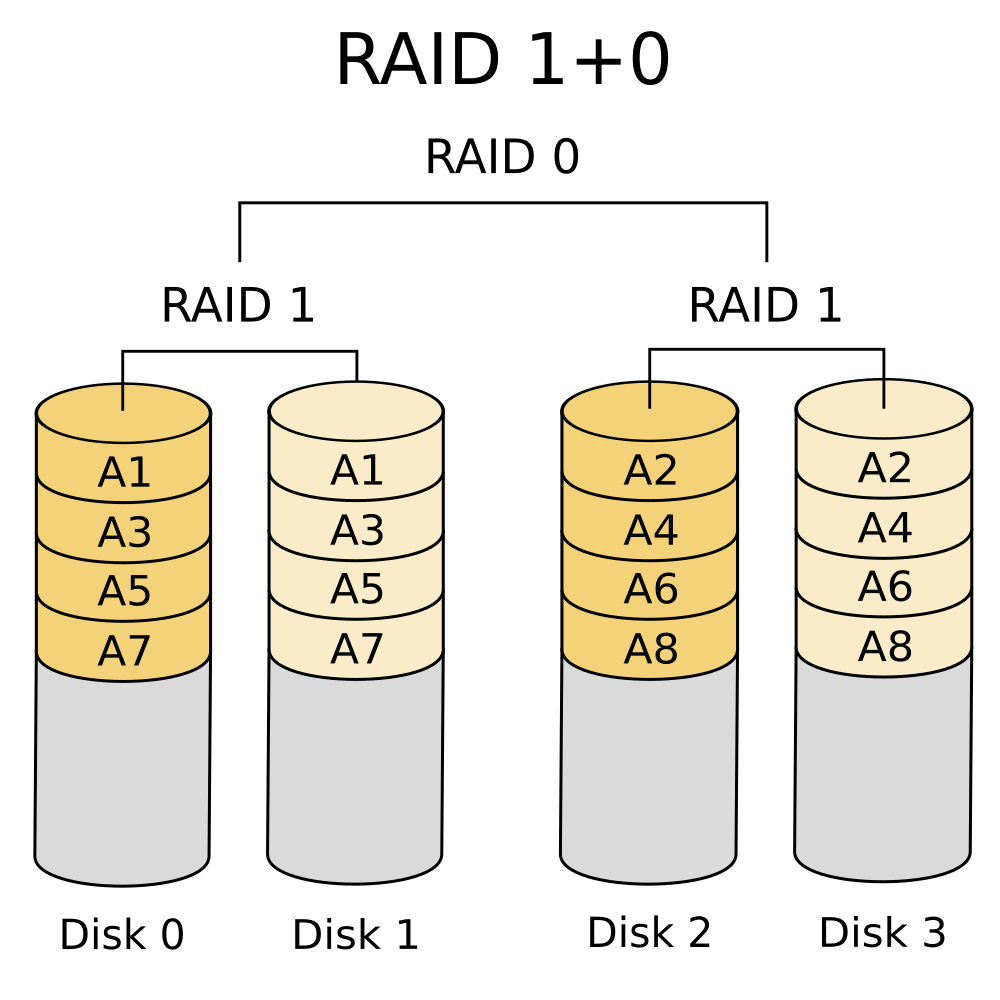
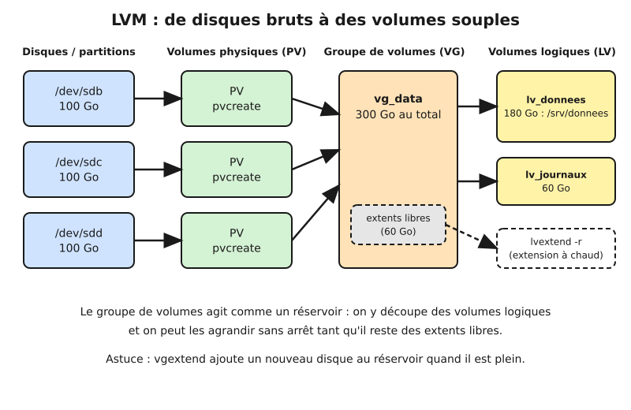

# Leçon — Stockage local : disques, partitions, systèmes de fichiers, RAID et LVM

- **Tags** : `transverse`, `tout-en-un`, `lecon`, `stockage`, `raid`, `lvm`, `partitions`, `systeme-de-fichiers`
- **Niveau** : Débutant à intermédiaire (technicien systèmes et réseaux)
- **Durée estimée** : 3 h 30 (lecture 1 h 30, laboratoire 1 h, exercices et quiz 1 h)

---

## Objectifs pédagogiques

À l'issue de cette leçon, vous saurez :

1. décrire le chemin qui sépare un disque physique d'un fichier lisible par une application (disque, partition, système de fichiers, point de montage) ;
2. choisir entre MBR et GPT pour un disque donné et expliquer pourquoi ;
3. choisir un système de fichiers (ext4, XFS, Btrfs, NTFS, exFAT) selon l'usage ;
4. calculer la capacité utile et la tolérance de panne des niveaux RAID 0, 1, 5, 6 et 10, et expliquer pourquoi un RAID n'est jamais une sauvegarde ;
5. construire un volume avec LVM (PV, VG, LV), l'agrandir à chaud et prendre un snapshot ;
6. diagnostiquer les pannes classiques : disque plein, grappe dégradée, UUID changé, table de partitions illisible.

## Prérequis et durée

- Savoir ouvrir un terminal Linux et lire la sortie d'une commande (`ls`, `cat`, `df`).
- Notions de base sur les droits Unix (utilisateur, groupe) — utile mais non indispensable.
- Une machine virtuelle Linux **jetable** (Debian ou Ubuntu Server récent, 2 Go de RAM, 5 Go de disque libre) pour la partie pratique. Ne faites jamais les manipulations de formatage sur une machine contenant des données réelles.
- Durée totale : environ 3 h 30.

Convention : adresses et noms fictifs (`example.com`, `192.0.2.0/24`), aucun mot de passe réel.

## L'essentiel en bref

- Un disque est un grand tableau de blocs numérotés. La **table de partitions** (MBR ou GPT) le découpe, le **système de fichiers** y range des fichiers, le **point de montage** les rend visibles dans l'arborescence.
- **GPT** est le choix par défaut aujourd'hui (disques de plus de 2 To, 128 partitions, table dupliquée). **MBR** ne subsiste que pour du matériel ancien.
- **RAID** améliore la disponibilité (et parfois la vitesse) : il protège d'une **panne de disque**, pas d'une suppression, d'un virus ou d'un incendie.
- **LVM** ajoute une couche souple : on regroupe des disques dans un réservoir (VG) puis on y découpe des volumes (LV) que l'on peut agrandir sans arrêt et photographier (snapshot).
- Règle d'or : **sauvegarder avant de toucher, vérifier le nom du périphérique avant d'écrire**. `/dev/sdb` d'hier peut être `/dev/sdc` aujourd'hui.

---

## 1. Du disque au fichier : les couches du stockage

Imaginez une bibliothèque : le **disque** est le bâtiment, les **partitions** sont les salles, le **système de fichiers** est le catalogue qui sait où chaque livre est rangé, le **point de montage** est la porte d'entrée.

Les couches, de bas en haut :

| Couche | Rôle | Exemple Linux |
|---|---|---|
| Support physique | Stocker des bits | HDD, SSD SATA, SSD NVMe |
| Périphérique bloc | Exposer des blocs numérotés | `/dev/sda`, `/dev/nvme0n1` |
| Table de partitions | Découper le disque | MBR ou GPT |
| (Optionnel) RAID / LVM | Regrouper, redonder, rendre souple | `/dev/md0`, `/dev/vg_data/lv_donnees` |
| Système de fichiers | Organiser fichiers et métadonnées | ext4, XFS, Btrfs |
| Point de montage | Greffer dans l'arborescence | `/srv/donnees` |

Vocabulaire : un **secteur** (512 ou 4 096 octets) est la plus petite unité lue ou écrite, repérée par son adresse **LBA** ; un **bloc** de système de fichiers regroupe plusieurs secteurs ; un **inode** est la fiche d'identité d'un fichier (propriétaire, droits, dates, emplacement des blocs).

Côté nommage : `sda`, `sdb`… (SATA/SAS/USB), `nvme0n1` (NVMe), `vda` (virtio) ; les partitions ajoutent un numéro (`sda1`, `nvme0n1p1`).

Commençons par observer sans rien modifier :

```bash
lsblk -o NAME,SIZE,TYPE,FSTYPE,MOUNTPOINT,UUID
```

👉 Explication : affiche l'arbre des disques, partitions, volumes LVM/RAID avec taille, type de système de fichiers, point de montage et UUID ; commande en lecture seule, idéale pour commencer tout diagnostic.

```bash
sudo blkid
```

👉 Explication : liste les identifiants (UUID, étiquette, type) lus sur chaque périphérique ; l'UUID est l'identifiant stable à utiliser dans `/etc/fstab` plutôt que `/dev/sdb1`, qui peut changer d'un démarrage à l'autre.

```bash
df -hT
```

👉 Explication : montre l'espace utilisé et libre par système de fichiers monté, avec son type ; `-h` rend les tailles lisibles, `-T` ajoute le type.

## 2. Partitionner : MBR ou GPT ?

### 2.1 MBR, le vétéran

Le **MBR** (*Master Boot Record*) date de 1983. Il occupe le premier secteur du disque (512 octets) : un petit programme de démarrage, une table de **quatre** entrées de partitions et une signature. Ses limites sont structurelles :

- adresses sur 32 bits : au plus **2 Tio** adressables (avec des secteurs de 512 octets) ;
- **4 partitions primaires** ; au-delà, il faut une partition « étendue » contenant des partitions « logiques » ;
- aucune copie de secours : si le secteur 0 est écrasé, la table disparaît.

### 2.2 GPT, le standard actuel

Le **GPT** (*GUID Partition Table*) fait partie de la spécification UEFI. Le schéma ci-dessous montre sa disposition : un « MBR de protection » au secteur 0 (pour que les vieux outils ne croient pas le disque vide), un en-tête primaire, une table d'entrées (128 par défaut), puis les partitions, et enfin une **copie complète** de l'en-tête et de la table à la fin du disque.



*Structure d'un disque GPT : table primaire au début, copie secondaire à la fin (légende traduite : « Primary GPT » = table primaire, « Secondary GPT » = table secondaire, « Protective MBR » = MBR de protection).*

Avantages : capacité quasi illimitée, GUID et nom lisible par partition, sommes de contrôle CRC32 et copie de secours (un outil comme `gdisk` répare la table primaire depuis la secondaire), démarrage UEFI natif.

### 2.3 Quand choisir quoi ?

| Situation | Choix |
|---|---|
| Disque > 2 To | GPT (obligatoire) |
| Serveur ou poste UEFI récent | GPT |
| BIOS historique, disque < 2 To, vieux système | MBR possible |
| Clé USB destinée à de très vieux appareils | MBR possible |
| Doute | GPT |

### 2.4 Manipuler les partitions

Les outils principaux sont `fdisk` (MBR et GPT dans ses versions récentes), `gdisk` (GPT), `parted` (scriptable) et `lsblk`. Une première commande purement informative :

```bash
sudo fdisk -l /dev/sdb
```

👉 Explication : affiche la table de partitions du disque `/dev/sdb` sans rien modifier (option `-l`) ; remplacez `/dev/sdb` par votre disque de laboratoire et vérifiez bien le nom avant toute commande d'écriture.

Créer une table GPT avec une partition unique occupant tout le disque, de façon non interactive :

```bash
sudo parted --script /dev/sdb mklabel gpt mkpart donnees ext4 1MiB 100%
```

👉 Explication : `mklabel gpt` **écrase** l'ancienne table ; `mkpart` crée une partition nommée « donnees » qui démarre à 1 Mio (alignement correct pour les SSD et les disques 4K) et va jusqu'au bout du disque ; l'indication `ext4` n'est qu'une étiquette, elle ne formate pas.

Après un changement, le noyau doit relire la table :

```bash
sudo partprobe /dev/sdb
```

👉 Explication : demande au noyau de relire la table de partitions pour faire apparaître `/dev/sdb1` sans redémarrer.

Sous Windows, la gestion des disques (`diskmgmt.msc`) ou PowerShell offrent l'équivalent :

```powershell
Get-Disk | Select-Object Number, FriendlyName, PartitionStyle, Size
```

👉 Explication : liste les disques avec leur style de partition (MBR, GPT ou RAW si non initialisé) ; commande en lecture seule.

## 3. Choisir et créer un système de fichiers

Une partition vierge n'est qu'un espace de blocs. Le **système de fichiers** (FS) y installe la structure qui permet de nommer, retrouver, protéger et supprimer des fichiers. Presque tous les FS modernes sont **journalisés** : avant de modifier les métadonnées, ils notent l'intention dans un journal. Après une coupure de courant, le système rejoue le journal au lieu de parcourir tout le disque. 

| FS | Plateforme | Points forts | Points d'attention |
|---|---|---|---|
| **ext4** | Linux | Robuste, éprouvé, réduction et agrandissement possibles | Pas de snapshots natifs |
| **XFS** | Linux | Excellent pour gros fichiers et forte concurrence ; défaut de plusieurs distributions serveur | Agrandissement possible, **réduction impossible** |
| **Btrfs** | Linux | Snapshots, sommes de contrôle de données, compression, sous-volumes | Plus complexe, RAID 5/6 Btrfs à éviter en production |
| **NTFS** | Windows | ACL, journal, quotas, chiffrement EFS | Support en écriture sous Linux via pilote `ntfs3` ou `ntfs-3g` |
| **exFAT** | Multi-OS | Fichiers > 4 Gio, idéal clé USB/carte SD | Pas de droits fins, pas de journal |
| **FAT32** | Multi-OS | Compatibilité maximale (partition EFI) | Fichier maximal 4 Gio, aucune sécurité |

Règle simple pour un serveur Linux : **ext4 ou XFS** (Btrfs si l'on veut des snapshots et qu'on le maîtrise). Pour un partage destiné à Windows, le FS sous-jacent reste ext4 ou XFS : c'est Samba qui parle SMB (voir la leçon sur le partage de fichiers).

Créer un système de fichiers :

```bash
sudo mkfs.ext4 -L DONNEES /dev/sdb1
```

👉 Explication : formate la partition en ext4 avec l'étiquette « DONNEES » ; **destructif** : toutes les données de `/dev/sdb1` sont perdues.

```bash
sudo mkfs.xfs -L DONNEES /dev/sdb1
```

👉 Explication : variante XFS de la commande précédente (ajoutez `-f` seulement si vous êtes certain de vouloir écraser une signature existante).

Monter et rendre le montage persistant :

```bash
sudo mkdir -p /srv/donnees
sudo mount /dev/sdb1 /srv/donnees
```

👉 Explication : crée le point de montage puis y greffe la partition ; le montage disparaît au redémarrage tant qu'il n'est pas déclaré dans `/etc/fstab`.

```bash
echo 'UUID=0a1b2c3d-1111-2222-3333-444455556666  /srv/donnees  ext4  defaults,nofail  0  2' | sudo tee -a /etc/fstab
sudo mount -a
```

👉 Explication : ajoute une ligne `fstab` (UUID d'exemple : remplacez-le par la valeur affichée par `blkid`) puis teste immédiatement avec `mount -a` ; une erreur de syntaxe dans `fstab` peut empêcher le démarrage, d'où l'option `nofail` pour un disque de données et le test avant tout redémarrage.

Les six champs d'une ligne `fstab` : périphérique (idéalement `UUID=`), point de montage, type, options, `dump` (presque toujours 0), ordre de vérification `fsck` (0 = jamais, 1 = racine, 2 = autres).

Vérifier l'intégrité d'un système de fichiers **démonté** :

```bash
sudo umount /srv/donnees
sudo fsck.ext4 -f /dev/sdb1
```

👉 Explication : contrôle la cohérence d'un FS ext4 ; ne jamais lancer `fsck` sur un système monté en écriture, au risque de l'abîmer (pour XFS, utiliser `xfs_repair` sur un FS démonté).

## 4. RAID : redondance et performance

### 4.1 Ce que le RAID apporte… et ce qu'il n'apporte pas

**RAID** signifie « grappe redondante de disques indépendants ». Le principe : plusieurs disques se comportent comme un seul, soit pour aller plus vite (répartir les données), soit pour survivre à une panne (dupliquer ou recalculer les données), soit les deux.

> **Le RAID n'est pas une sauvegarde.** Une suppression accidentelle, un chiffrement par un rançongiciel, une erreur d'administration ou un incendie sont répliqués instantanément sur tous les disques. Le RAID protège de la **panne matérielle d'un disque**, pas de la perte de données. Conservez toujours une sauvegarde indépendante (règle 3-2-1 : trois copies, deux supports, une hors site).

Le RAID peut être **matériel** (carte contrôleur), **logiciel** (`mdadm` sous Linux, Espaces de stockage sous Windows, ZFS) ou **« fake RAID »** fourni par le chipset. Pour un laboratoire ou un petit serveur, `md` est simple et portable.

### 4.2 Les niveaux essentiels

**RAID 0 — striping (agrégation par bandes).** Les données sont découpées en bandes réparties sur tous les disques. La capacité est la somme des disques et le débit augmente. Mais **aucune redondance** : la panne d'un seul disque détruit toute la grappe. À réserver aux données jetables (cache, calcul temporaire).

**RAID 1 — miroir.** Chaque donnée est écrite à l'identique sur deux disques (ou plus). Capacité utile = celle d'**un seul** disque. Tolère la panne de tout disque sauf le dernier. Lecture rapide (on peut lire sur l'un ou l'autre), écriture à la vitesse du plus lent. Usage typique : disque système d'un serveur.



*RAID 1 : le disque 1 est le miroir exact du disque 0 (blocs A1 à A4 en double).*

**RAID 5 — parité distribuée (au moins 3 disques).** Les données sont réparties par bandes, et pour chaque bande un bloc de **parité** (calculée par XOR) est stocké, à tour de rôle sur chaque disque. Capacité utile = (N − 1) × taille d'un disque. Tolère la panne d'**un** disque. Si un disque tombe, les blocs manquants se recalculent à partir des autres disques et de la parité.



*RAID 5 : les blocs de parité (Ap, Bp, Cp, Dp) tournent d'un disque à l'autre ; la capacité d'un disque sert à la parité.*

Les points faibles du RAID 5 : écritures pénalisées (lire ancienne donnée et parité, recalculer, écrire) et surtout **reconstruction** longue avec de gros disques, pendant laquelle une seconde erreur de lecture fait perdre la grappe.

**RAID 6 — double parité (au moins 4 disques).** Deux blocs de parité indépendants par bande. Capacité utile = (N − 2) × taille d'un disque. Tolère la panne de **deux** disques simultanés : le bon compromis pour les grosses grappes de gros disques à plateaux. Écriture encore plus pénalisée.

**RAID 10 (ou 1+0) — miroirs agrégés (au moins 4 disques).** On forme des paires en miroir (RAID 1), puis on répartit les données sur ces paires (RAID 0). Capacité utile = N/2 disques. Tolère la panne d'un disque par paire (au pire, deux disques de la **même** paire font tout perdre). Excellentes performances en lecture et en écriture, reconstruction rapide (copie d'un seul disque) : c'est le choix classique pour les bases de données et les machines virtuelles.



*RAID 1+0 : deux paires en miroir (disques 0-1 et 2-3) agrégées en bandes ; les blocs impairs vont à la première paire, les blocs pairs à la seconde.*

### 4.3 Tableau de synthèse

Pour N disques identiques de taille T :

| Niveau | Disques min. | Capacité utile | Pannes tolérées | Performance | Usage typique |
|---|---|---|---|---|---|
| RAID 0 | 2 | N × T | 0 | Lecture et écriture excellentes | Données jetables |
| RAID 1 | 2 | T | N − 1 | Lecture bonne, écriture normale | Système, petits serveurs |
| RAID 5 | 3 | (N − 1) × T | 1 | Lecture bonne, écriture pénalisée | Fichiers, capacités moyennes |
| RAID 6 | 4 | (N − 2) × T | 2 | Écriture plus pénalisée | Archives, grosses capacités |
| RAID 10 | 4 | (N / 2) × T | 1 par paire (min.) | Excellente | Bases de données, virtualisation |

Exemple chiffré : avec 6 disques de 4 To, RAID 0 = 24 To, RAID 5 = 20 To, RAID 6 = 16 To, RAID 10 = 12 To. Plus la sécurité augmente, plus l'espace utile baisse.

### 4.4 Mettre en œuvre un RAID logiciel avec mdadm

Création d'un RAID 5 de trois disques (ici des périphériques de laboratoire) :

```bash
sudo mdadm --create /dev/md0 --level=5 --raid-devices=3 /dev/sdb /dev/sdc /dev/sdd
```

👉 Explication : assemble les trois disques en RAID 5 sous le nom `/dev/md0` ; la synchronisation initiale démarre en arrière-plan et le volume est utilisable pendant ce temps ; **destructif** pour le contenu des trois disques.

```bash
cat /proc/mdstat
sudo mdadm --detail /dev/md0
```

👉 Explication : `/proc/mdstat` montre l'état et la progression de la synchronisation (`[UUU]` = tous les disques sains, `[UU_]` = un disque manquant) ; `--detail` donne l'état complet, les disques actifs, de secours ou en échec.

Enregistrer la grappe pour qu'elle soit assemblée au démarrage (le chemin du fichier varie : `/etc/mdadm/mdadm.conf` sous Debian/Ubuntu, `/etc/mdadm.conf` sous les distributions Red Hat) :

```bash
sudo mdadm --detail --scan | sudo tee -a /etc/mdadm/mdadm.conf
sudo update-initramfs -u
```

👉 Explication : écrit la définition de la grappe dans la configuration de mdadm et régénère l'image de démarrage (commande Debian/Ubuntu) pour que `/dev/md0` retrouve son nom après un redémarrage.

Simuler puis remplacer un disque défaillant — à faire **uniquement** en laboratoire :

```bash
sudo mdadm /dev/md0 --fail /dev/sdc
sudo mdadm /dev/md0 --remove /dev/sdc
sudo mdadm /dev/md0 --add /dev/sde
```

👉 Explication : marque `/dev/sdc` comme défaillant, le retire de la grappe puis ajoute un disque de remplacement `/dev/sde` ; la reconstruction démarre automatiquement et se suit avec `cat /proc/mdstat`.

Ajoutez un disque de secours (*hot spare*) et une alerte e-mail (`MAILADDR admin@example.com`) pour être prévenu le jour de la panne.

Surveiller la santé des disques eux-mêmes avec SMART :

```bash
sudo smartctl -H /dev/sda
```

👉 Explication : affiche le verdict global SMART du disque (paquet `smartmontools`) ; commande en lecture seule, à planifier régulièrement avec `smartd`.

## 5. LVM : des volumes souples

### 5.1 Pourquoi LVM ?

Un partitionnement classique est rigide : une partition pleine ne grandit que s'il reste de l'espace contigu derrière elle. **LVM** (*Logical Volume Manager*) ajoute une couche souple : un **entrepôt** (groupe de volumes) cloisonné à volonté en volumes logiques.

Trois notions : **PV** (disque ou partition préparé par `pvcreate`), **VG** (réservoir réunissant des PV, découpé en *extents* de 4 Mio, `vgcreate`), **LV** (volume prélevé dans le VG par `lvcreate`, qui reçoit le système de fichiers).



*Pile LVM : disques → PV → VG → LV. Les extents libres du VG permettent d'agrandir un LV sans interruption.*

### 5.2 Création pas à pas

```bash
sudo pvcreate /dev/sdb /dev/sdc /dev/sdd
sudo vgcreate vg_data /dev/sdb /dev/sdc /dev/sdd
```

👉 Explication : initialise les trois disques comme volumes physiques puis crée le groupe `vg_data` qui les regroupe ; destructif pour le contenu des disques.

```bash
sudo lvcreate -n lv_donnees -L 180G vg_data
sudo mkfs.ext4 -L DONNEES /dev/vg_data/lv_donnees
```

👉 Explication : prélève 180 Go dans le groupe pour créer le volume `lv_donnees` puis y crée un système de fichiers ext4 ; le chemin stable est `/dev/vg_data/lv_donnees` (ou `/dev/mapper/vg_data-lv_donnees`).

Inspecter l'état :

```bash
sudo pvs
sudo vgs
sudo lvs
```

👉 Explication : trois vues synthétiques en lecture seule, pour les volumes physiques, les groupes et les volumes logiques ; `vgs` indique l'espace libre (`VFree`), donnée essentielle avant toute extension.

### 5.3 Étendre à chaud

C'est l'atout majeur de LVM : agrandir un volume sans démonter ni arrêter le service.

```bash
sudo lvextend -r -L +20G /dev/vg_data/lv_donnees
```

👉 Explication : ajoute 20 Go au volume et, grâce à l'option `-r` (`--resizefs`), agrandit aussi le système de fichiers dans la foulée ; fonctionne à chaud avec ext4 et XFS.

Si le groupe est plein, on ajoute d'abord un disque :

```bash
sudo pvcreate /dev/sde
sudo vgextend vg_data /dev/sde
sudo lvextend -r -l +100%FREE /dev/vg_data/lv_donnees
```

👉 Explication : prépare le nouveau disque, l'ajoute au groupe, puis attribue tout l'espace libre au volume et au système de fichiers.

Réduction : possible avec ext4 (à froid, FS démonté), **impossible avec XFS** ; on réduit d'abord le FS puis le LV, jamais l'inverse, après sauvegarde.

### 5.4 Snapshots LVM

Un **snapshot** fige l'état d'un volume à un instant donné par **copie sur écriture** : avant qu'un bloc soit modifié, son ancienne version est copiée dans une zone réservée.

```bash
sudo lvcreate -s -n snap_avant_maj -L 10G /dev/vg_data/lv_donnees
```

👉 Explication : crée un snapshot de 10 Go du volume `lv_donnees` ; cette taille est la **réserve pour les modifications** (pas la taille de la donnée) : si elle est saturée, le snapshot devient invalide.

```bash
sudo lvs -o lv_name,lv_size,data_percent,snap_percent vg_data
```

👉 Explication : surveille le remplissage du snapshot (colonne `Snap%`) ; un snapshot plein est perdu, il faut donc l'agrandir (`lvextend`) ou le supprimer.

Revenir en arrière (restauration) ou abandonner :

```bash
sudo umount /srv/donnees
sudo lvconvert --merge /dev/vg_data/snap_avant_maj
```

👉 Explication : réintègre le snapshot dans le volume d'origine, annulant toutes les modifications faites depuis ; le volume doit être démonté (sinon la fusion est différée au prochain réactivation).

```bash
sudo lvremove /dev/vg_data/snap_avant_maj
```

👉 Explication : supprime le snapshot quand on n'en a plus besoin ; un snapshot laissé en place ralentit les écritures et finit par se remplir, il faut le supprimer rapidement après usage.

Un snapshot n'est **pas** une sauvegarde : il vit sur les mêmes disques que l'original. Il sert à figer un état cohérent avant une sauvegarde ou une mise à jour risquée.

### 5.5 RAID et LVM ensemble

L'empilement classique est : disques → RAID (`/dev/md0`) → PV → VG → LV → système de fichiers. Le RAID apporte la résistance aux pannes, LVM la souplesse.

## 6. Dimensionner et surveiller

Mesurez avant d'acheter (volume actuel, croissance, rétention), gardez 30 % de marge, ne dépassez pas 80 à 85 % de remplissage, séparez système, données, journaux et bases, surveillez `df -h`, `df -i` (inodes), `/proc/mdstat`, SMART et `iostat -x`, et **testez la restauration** : une sauvegarde jamais restaurée n'est qu'une hypothèse.

---

## Mise en pratique guidée

**Cadre** : machine virtuelle Linux jetable, droits administrateur dans la VM uniquement. Nous allons simuler des disques avec de simples **fichiers** associés à des périphériques *loop* : aucun vrai disque n'est modifié. Faites un instantané de la VM avant de commencer.

**Étape 1 — créer quatre faux disques de 512 Mio.**

```bash
mkdir -p ~/labo-stockage && cd ~/labo-stockage
for i in 1 2 3 4; do truncate -s 512M disque$i.img; done
ls -lh
```

👉 Explication : crée quatre fichiers « creux » de 512 Mio dans le dossier du laboratoire ; ils n'occupent presque rien sur le disque réel tant qu'on n'y écrit pas.

**Étape 2 — les présenter comme des disques.**

```bash
for i in 1 2 3 4; do sudo losetup -f --show disque$i.img; done
```

👉 Explication : associe chaque fichier à un périphérique `/dev/loopN` et affiche son nom ; notez les quatre noms (par exemple `/dev/loop10` à `/dev/loop13`). Dans la suite, remplacez `LOOP1`…`LOOP4` par ces noms.

**Étape 3 — créer un RAID 5 sur trois disques et un disque de secours.**

```bash
sudo mdadm --create /dev/md100 --level=5 --raid-devices=3 --spare-devices=1 LOOP1 LOOP2 LOOP3 LOOP4
cat /proc/mdstat
```

👉 Explication : construit un RAID 5 de trois membres avec le quatrième disque en secours ; attendez la fin de la synchronisation (`cat /proc/mdstat` plusieurs fois). Capacité attendue : environ 1 Gio (deux disques de 512 Mio utiles).

**Étape 4 — empiler LVM par-dessus.**

```bash
sudo pvcreate /dev/md100
sudo vgcreate vg_labo /dev/md100
sudo lvcreate -n lv_test -L 400M vg_labo
sudo mkfs.ext4 -L LABO /dev/vg_labo/lv_test
sudo mkdir -p /mnt/labo && sudo mount /dev/vg_labo/lv_test /mnt/labo
echo "fichier de test" | sudo tee /mnt/labo/test.txt
```

👉 Explication : construit toute la pile RAID → PV → VG → LV → ext4, la monte sur `/mnt/labo` et y dépose un fichier de contrôle.

**Étape 5 — étendre à chaud.**

```bash
sudo lvextend -r -L +300M /dev/vg_labo/lv_test
df -h /mnt/labo
```

👉 Explication : le volume passe d'environ 400 à 700 Mio pendant qu'il est monté ; `df` doit afficher la nouvelle taille et `test.txt` rester lisible.

**Étape 6 — snapshot, modification, retour arrière.**

```bash
sudo lvcreate -s -n snap_labo -L 100M /dev/vg_labo/lv_test
echo "modification" | sudo tee /mnt/labo/test.txt
sudo umount /mnt/labo
sudo lvconvert --merge /dev/vg_labo/snap_labo
sudo mount /dev/vg_labo/lv_test /mnt/labo && cat /mnt/labo/test.txt
```

👉 Explication : après fusion, le contenu doit être revenu à « fichier de test » ; la fusion est effectuée immédiatement car le volume était démonté.

**Étape 7 — simuler la panne d'un disque.**

```bash
sudo mdadm /dev/md100 --fail LOOP2
cat /proc/mdstat
sudo mdadm --detail /dev/md100
```

👉 Explication : on déclare un disque en panne ; le disque de secours doit prendre automatiquement le relais et reconstruire la grappe, sans interruption du fichier de test (`cat /mnt/labo/test.txt` reste valide).

**Étape 8 — démontage et nettoyage complet.**

```bash
sudo umount /mnt/labo
sudo lvremove -y /dev/vg_labo/lv_test
sudo vgremove -y vg_labo
sudo pvremove /dev/md100
sudo mdadm --stop /dev/md100
for d in LOOP1 LOOP2 LOOP3 LOOP4; do sudo losetup -d $d; done
rm -f ~/labo-stockage/disque*.img
```

👉 Explication : détruit proprement la pile dans l'ordre inverse de sa construction (LV, VG, PV, RAID, loop, fichiers) ; si `mdadm --stop` échoue, vérifiez qu'aucun volume n'est encore monté ou actif.

**Critères de réussite** : vous avez observé `[UUU]`, étendu à chaud, restauré via snapshot, vu le disque de secours prendre le relais et tout nettoyé sans reste dans `lsblk`.

## Exercices

1. **(Vocabulaire)** Expliquez en deux phrases la différence entre partition, système de fichiers et point de montage.
2. **(MBR/GPT)** Un serveur UEFI reçoit un disque de 8 To. Quelle table de partitions et pourquoi ? Que se passe-t-il si le début de la table GPT est endommagé ?
3. **(Calcul RAID)** Vous disposez de 8 disques de 2 To. Calculez la capacité utile et le nombre de pannes tolérées (minimum garanti) pour RAID 0, 5, 6 et 10.
4. **(Choix)** Pour chaque cas, proposez un niveau RAID et justifiez : (a) disque système d'un petit serveur, (b) stockage de machines virtuelles très actives, (c) archive de 60 To en lecture surtout, (d) cache vidéo temporaire.
5. **(fstab)** Rédigez la ligne `fstab` montant en ext4 le volume `/dev/vg_data/lv_donnees` sur `/srv/donnees` avec l'option `nofail`, sans vérification `fsck` automatique. Pourquoi préférer l'UUID pour une partition simple ?
6. **(LVM)** Le VG `vg_data` indique 0 d'espace libre et `lv_donnees` est plein à 95 %. Décrivez la séquence de commandes pour ajouter un disque `/dev/sde` et agrandir le volume de tout l'espace libre, à chaud.
7. **(Snapshot)** Un collègue dit : « J'ai un snapshot toutes les heures, donc je n'ai pas besoin de sauvegarde ». Répondez-lui en trois arguments.
8. **(Diagnostic)** `/proc/mdstat` affiche `md0 : active raid5 sdb[0] sdd[2] ... [3/2] [U_U]`. Que signifie cette ligne, et quelles sont vos trois premières actions ?

## Corrigés des exercices

1. La **partition** est une tranche du disque délimitée par la table de partitions ; le **système de fichiers** est la structure qui y organise les fichiers ; le **point de montage** est le dossier de l'arborescence par lequel on accède à ce système de fichiers. On peut avoir une partition sans FS (RAW), mais un FS sans point de montage reste inaccessible aux applications.
2. **GPT** : MBR est limité à 2 Tio et le serveur est UEFI (démarrage natif GPT). Si l'en-tête primaire est endommagé, la **copie secondaire** située à la fin du disque permet de reconstruire la table (outils `gdisk` ou `sgdisk`, option de récupération), d'où la robustesse de GPT.
3. Disques : N = 8, T = 2 To. **RAID 0** : 16 To, 0 panne. **RAID 5** : (8−1)×2 = 14 To, 1 panne. **RAID 6** : (8−2)×2 = 12 To, 2 pannes. **RAID 10** : 8/2×2 = 8 To, 1 panne garantie (jusqu'à 4 si chaque panne touche une paire différente).
4. (a) **RAID 1** : simple, fiable, suffisant pour un petit disque système. (b) **RAID 10** : bonnes performances en écriture aléatoire et reconstruction rapide. (c) **RAID 6** (ou équivalent) : grande capacité avec double protection pendant la longue reconstruction. (d) **RAID 0** : seule la vitesse compte et les données sont recréables.
5. Exemple : `/dev/vg_data/lv_donnees  /srv/donnees  ext4  defaults,nofail  0  0`. Le dernier `0` désactive le `fsck` au démarrage. Pour une partition simple, l'UUID est préférable car le nom `/dev/sdX` dépend de l'ordre de détection des disques et peut changer ; l'UUID est stocké dans le système de fichiers lui-même. (Pour un LV, le chemin `/dev/vg_data/lv_donnees` est stable.)
6. `pvcreate /dev/sde` → `vgextend vg_data /dev/sde` → `lvextend -r -l +100%FREE /dev/vg_data/lv_donnees` → vérifier avec `vgs`, `lvs` et `df -h`. Tout se fait sans démontage pour ext4 ou XFS.
7. Le snapshot est sur le **même matériel** (panne ou incendie détruisent tout), il devient invalide s'il se remplit, et une vraie sauvegarde doit être **externe, versionnée et testée en restauration** (règle 3-2-1).
8. `[3/2] [U_U]` : la grappe devrait avoir 3 disques, 2 seulement sont actifs ; le disque en position 1 manque : la grappe est **dégradée** (plus aucune tolérance de panne). Actions : (1) identifier le disque fautif (`mdadm --detail /dev/md0`, `smartctl`, journaux `dmesg`) ; (2) vérifier que les sauvegardes sont à jour ; (3) remplacer le disque (`--remove` puis `--add`) et surveiller la reconstruction.

## Quiz

**Q1. Quelle est la limite de taille d'un disque en MBR avec des secteurs de 512 octets ?**
a) 512 Gio  b) 2 Tio  c) 16 To  d) Illimitée
**Réponse : b.** Les adresses MBR sont sur 32 bits : 2³² secteurs × 512 octets = 2 Tio.

**Q2. Quel avantage GPT possède-t-il par rapport à MBR en matière de robustesse ?**
a) Il chiffre les partitions  b) Il possède une copie de la table en fin de disque et des sommes de contrôle  c) Il accélère le disque  d) Il supprime le besoin de système de fichiers
**Réponse : b.** La table secondaire et le CRC permettent de détecter et réparer une corruption.

**Q3. Quel RAID n'offre aucune tolérance de panne ?**
a) RAID 1  b) RAID 5  c) RAID 0  d) RAID 10
**Réponse : c.** Le RAID 0 répartit sans redondance : un disque perdu = grappe perdue.

**Q4. Avec 5 disques de 4 To en RAID 5, quelle est la capacité utile ?**
a) 20 To  b) 16 To  c) 12 To  d) 8 To
**Réponse : b.** (5 − 1) × 4 = 16 To ; un disque équivalent sert à la parité.

**Q5. Pourquoi le RAID 6 est-il préféré au RAID 5 pour de très gros disques ?**
a) Il est plus rapide en écriture  b) Il utilise moins d'espace  c) Il survit à une seconde panne pendant la reconstruction  d) Il ne nécessite pas de contrôleur
**Réponse : c.** La double parité couvre le risque d'un deuxième défaut pendant la longue reconstruction.

**Q6. Un RAID 1 protège-t-il contre la suppression accidentelle d'un dossier ?**
a) Oui, grâce au miroir  b) Oui, si on a un disque de secours  c) Non, la suppression est répliquée sur le miroir  d) Seulement sous Windows
**Réponse : c.** Le miroir recopie toutes les écritures, y compris les suppressions ; il faut une sauvegarde.

**Q7. Dans LVM, quel est l'ordre correct de construction ?**
a) LV → VG → PV  b) VG → PV → LV  c) PV → VG → LV  d) PV → LV → VG
**Réponse : c.** On prépare les PV, on les regroupe en VG, puis on découpe des LV.

**Q8. Quelle commande agrandit un LV et son système de fichiers en une seule opération ?**
a) `lvextend -r`  b) `lvcreate -s`  c) `pvmove`  d) `lvremove`
**Réponse : a.** L'option `-r` (`--resizefs`) redimensionne le FS juste après le volume.

**Q9. Quel système de fichiers ne peut pas être réduit après création ?**
a) ext4  b) XFS  c) Btrfs  d) NTFS
**Réponse : b.** XFS peut s'agrandir mais pas se réduire.

**Q10. Que se passe-t-il si un snapshot LVM atteint 100 % de remplissage ?**
a) Il double de taille automatiquement  b) Il devient invalide et est perdu  c) Il est transformé en sauvegarde  d) Le volume d'origine est supprimé
**Réponse : b.** La zone de copie sur écriture est saturée : le snapshot est abandonné (le volume d'origine reste intact).

## Erreurs fréquentes et dépannage

| Symptôme | Cause probable | Action |
|---|---|---|
| Le serveur ne démarre plus après un ajout dans `fstab` | Ligne incorrecte ou disque absent sans `nofail` | Passer en mode secours, corriger `/etc/fstab`, toujours tester avec `mount -a` |
| `/dev/sdb` est devenu `/dev/sdc` | Ordre de détection modifié | Utiliser UUID, étiquette ou chemin LVM |
| « No space left on device » alors que `df -h` montre de la place | Inodes épuisés ou quota atteint | `df -i`, chercher les dossiers à millions de fichiers |
| `mdadm: device busy` à l'arrêt de la grappe | Volume monté ou LVM actif | `umount`, `lvchange -an`, puis `mdadm --stop` |
| Grappe `[U_U]` | Disque en panne | `mdadm --detail`, `smartctl`, remplacer et reconstruire |
| `lvextend` : « insufficient free space » | VG sans extents libres | `vgs` ; `pvcreate` + `vgextend` d'un nouveau disque |
| Snapshot invalide | Réserve trop petite | Surveiller `lvs`, agrandir ou supprimer plus tôt |
| Données illisibles après formatage | Mauvais périphérique ciblé | Vérifier `lsblk` **avant** chaque `mkfs`, arrêter l'écriture et se reporter à la sauvegarde |

Réflexe de prudence : copiez le nom du périphérique depuis `lsblk` et vérifiez-le deux fois avant `mkfs`, `mklabel`, `pvcreate` ou `--create`.

## À retenir

- Disque → partition (MBR/GPT) → système de fichiers → montage : chaque couche a son rôle et ses outils.
- **GPT** par défaut ; **MBR** limité à 2 Tio et 4 partitions primaires.
- Choix du FS : **ext4/XFS** pour Linux serveur, NTFS pour Windows, exFAT pour l'échange.
- RAID : 0 (vitesse), 1 (miroir), 5 (parité simple), 6 (double parité), 10 (miroirs agrégés) ; **jamais un substitut à la sauvegarde**.
- LVM : PV → VG → LV ; extension à chaud avec `lvextend -r`, snapshots en copie sur écriture à surveiller.
- Utiliser UUID/chemins LVM dans `fstab`, tester avec `mount -a`, garder 15 à 20 % d'espace libre, surveiller RAID et SMART, **tester la restauration**.

## Pour aller plus loin

Documentations officielles et normes (lecture) :

- Documentation du noyau Linux — RAID logiciel (md) : <https://docs.kernel.org/admin-guide/md.html>
- Page de manuel `mdadm` : <https://man7.org/linux/man-pages/man8/mdadm.8.html>
- Page de manuel `lvm` : <https://man7.org/linux/man-pages/man8/lvm.8.html>
- Spécification UEFI (structure GPT) : <https://uefi.org/specifications>
- Documentation Microsoft — Gestion des disques et GPT : <https://learn.microsoft.com/fr-fr/windows-server/storage/disk-management/overview-of-disk-management>
- Page de manuel `fstab` : <https://man7.org/linux/man-pages/man5/fstab.5.html>

## Crédits des images

| Fichier | Source | Auteur | Licence | Modifications |
|---|---|---|---|---|
| `images/stockage-local-1.svg` | <https://commons.wikimedia.org/wiki/File:GUID_Partition_Table_Scheme.svg> | Kbolino (téléversement d'origine, Wikipédia en anglais) | CC BY-SA 2.5 — <https://creativecommons.org/licenses/by-sa/2.5/> | Aucune modification du fichier ; légende traduite en français dans la leçon |
| `images/stockage-local-2.svg` | <https://commons.wikimedia.org/wiki/File:RAID_1.svg> | Cburnett (Wikipédia en anglais) | CC BY-SA 3.0 — <https://creativecommons.org/licenses/by-sa/3.0/> | Aucune modification du fichier |
| `images/stockage-local-3.svg` | <https://commons.wikimedia.org/wiki/File:RAID_5.svg> | Cburnett (Wikipédia en anglais) | CC BY-SA 3.0 — <https://creativecommons.org/licenses/by-sa/3.0/> | Aucune modification du fichier |
| `images/stockage-local-4.svg` | <https://commons.wikimedia.org/wiki/File:RAID_10.svg> | Wheart, d'après `RAID 0.svg` de Cburnett | CC BY-SA 3.0 — <https://creativecommons.org/licenses/by-sa/3.0/> | Aucune modification du fichier |
| `images/stockage-local-5.svg` | Fichier original de ce dépôt | Pack Master | Création originale du projet Pack Master, dédiée au domaine public (CC0) — <https://creativecommons.org/publicdomain/zero/1.0/> | Sans objet |

Les images 1 à 4 restent soumises à leur licence CC BY-SA d'origine (partage dans les mêmes conditions) ; elles ont été téléchargées telles quelles depuis Wikimedia Commons (licences vérifiées par l'API de Commons le 2026-11-01).

## Historique de vérification

| Date | OS/logiciel | Testeur | Verdict |
|---|---|---|---|
| 2026-11-01 | Linux (Debian/Ubuntu) — mdadm, LVM, ext4/XFS, parted | Rédaction assistée (Copilot) | Non testé sur plateforme cible |

Précision : aucune commande de stockage de cette leçon n'a été exécutée lors de la rédaction. Seules les licences des images ont été vérifiées par requêtes de lecture sur l'API de Wikimedia Commons. Les procédures sont à valider en VM jetable avant usage.
