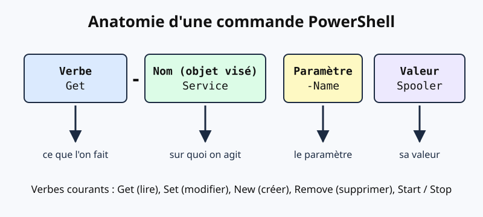
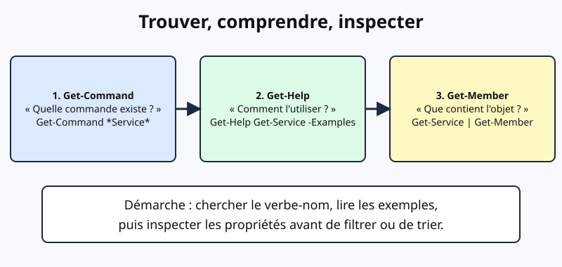
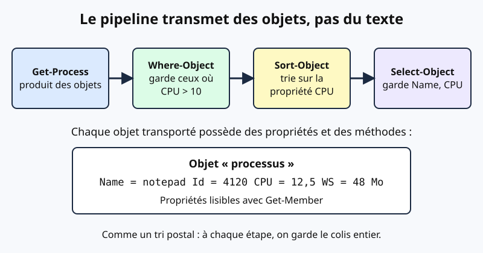
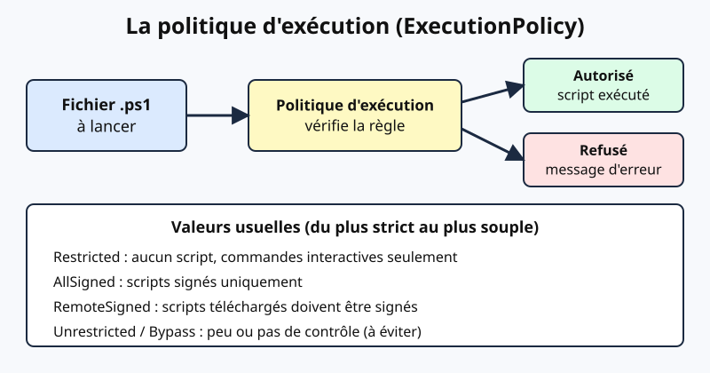

# Leçon — PowerShell pour débuter : cmdlets, pipeline d'objets et premiers scripts sûrs

- **Tags** : `transverse`, `tout-en-un`, `lecon`, `automatisation`, `powershell`, `pipeline`, `debutant`
- **Niveau** : Débutant (aucune connaissance de scripting requise)
- **Durée estimée** : 3 h 30 (cours 1 h 30, pratique 1 h, exercices et quiz 1 h)

---

## Objectifs pédagogiques

À la fin de cette leçon, vous serez capable de :

1. expliquer ce qu'est PowerShell et en quoi il diffère d'un interpréteur de commandes qui ne manipule que du texte ;
2. lire et construire une commande au format **Verbe-Nom** avec ses paramètres ;
3. trouver une commande inconnue avec `Get-Command`, comprendre son usage avec `Get-Help` et inspecter ce qu'elle renvoie avec `Get-Member` ;
4. enchaîner des cmdlets dans un **pipeline d'objets** et raisonner sur ce qui circule entre deux étapes ;
5. filtrer, trier, regrouper et résumer des résultats avec `Where-Object`, `Sort-Object`, `Select-Object`, `Group-Object` et `Measure-Object` ;
6. choisir un format de sortie adapté (`Format-Table`, `Format-List`, export CSV ou JSON) sans casser le pipeline ;
7. décrire le rôle et les limites de la **politique d'exécution** et choisir une valeur raisonnable pour un poste de travail ;
8. écrire un petit script paramétré, l'exécuter proprement et le tester sans risque.

## Prérequis et durée

- Savoir ouvrir une console (terminal) et se déplacer dans une arborescence de dossiers.
- Un environnement de test **jetable** : machine virtuelle Windows 10/11 ou Windows Server, ou bien une machine virtuelle Linux sur laquelle on installe PowerShell 7 (`pwsh`).
- Durée totale : environ 3 h 30, à répartir en deux séances.

> Les adresses et noms utilisés ici sont des valeurs de documentation (192.0.2.0/24, 198.51.100.0/24, 203.0.113.0/24, 2001:db8::/32, domaine `example.com` / `example.test`). Aucun secret n'est présent.

## L'essentiel en bref

- PowerShell manipule des **objets** (avec des propriétés et des méthodes), pas seulement du texte.
- Les commandes natives s'appellent des **cmdlets** et suivent le schéma **Verbe-Nom** (`Get-Service`, `Stop-Process`).
- Trois commandes de découverte suffisent pour apprendre seul : `Get-Command`, `Get-Help`, `Get-Member`.
- Le **pipeline** (`|`) passe les objets d'une étape à la suivante ; on filtre tôt, on formate tard.
- Les cmdlets de modification acceptent souvent `-WhatIf` (simuler) et `-Confirm` (demander confirmation).
- La **politique d'exécution** est un garde-fou contre les erreurs, pas une barrière de sécurité absolue.

---

## 1. Qu'est-ce que PowerShell ?

PowerShell est à la fois une **console interactive** et un **langage de script**. Il a été conçu pour l'administration des systèmes, d'abord sous Windows, puis sur Linux et macOS avec PowerShell 7.

On rencontre deux familles :

| Édition | Exécutable | Particularités |
|---|---|---|
| Windows PowerShell 5.1 | `powershell.exe` | Livrée avec Windows, basée sur .NET Framework, n'évolue plus que par correctifs |
| PowerShell 7 et suivants | `pwsh` | Multiplateforme, basée sur .NET moderne, développée activement |

Pour savoir où vous êtes :

```powershell
$PSVersionTable
```

👉 Explication : affiche la version (`PSVersion`), l'édition (`Desktop` pour 5.1, `Core` pour 7+) et le système ; c'est le premier réflexe avant de suivre un tutoriel, car certaines commandes diffèrent entre éditions.

**Analogie.** Un interpréteur classique (comme un shell Unix traditionnel) est un employé de bureau qui se passe des **notes écrites** : chaque étape doit relire la note et deviner ce qu'elle veut dire. PowerShell passe des **dossiers complets** déjà classés : colonnes nommées, types de données, actions possibles. L'étape suivante n'a plus à deviner.



*Figure 1 — Anatomie d'une commande PowerShell : verbe, nom, paramètre et valeur. Création originale du projet Pack Master (CC0).*

## 2. Les cmdlets : le principe Verbe-Nom

Une **cmdlet** (prononcer « commandelette ») est une commande native de PowerShell. Son nom suit la forme **Verbe-Nom** au singulier : le verbe dit l'action, le nom désigne la ressource.

```powershell
Get-Verb | Sort-Object Verb | Select-Object -First 10
```

👉 Explication : `Get-Verb` liste les verbes **approuvés** ; ce sont ceux que l'on doit utiliser pour nommer ses propres fonctions. Les plus fréquents sont `Get` (lire), `Set` (modifier), `New` (créer), `Remove` (supprimer), `Start`/`Stop`, `Add`, `Import`/`Export`.

Quelques exemples pour s'imprégner :

| Cmdlet | Ce qu'elle fait |
|---|---|
| `Get-Service` | liste les services |
| `Get-Process` | liste les processus |
| `Get-ChildItem` | liste le contenu d'un dossier |
| `Get-Date` | renvoie la date et l'heure |
| `New-Item` | crée un fichier ou un dossier |
| `Stop-Process` | arrête un processus |

### 2.1 Paramètres

Un **paramètre** commence par un tiret. Il peut recevoir une valeur (`-Name Spooler`), être un simple interrupteur (`-Recurse`) ou être déduit de sa position.

```powershell
Get-Service -Name Spooler
Get-Service Spooler
Get-Service -Name "Spool*"
```

👉 Explication : les trois lignes sont équivalentes pour l'essentiel ; la deuxième utilise l'argument **positionnel**, la troisième un **joker** (`*`). Les paramètres ne sont pas sensibles à la casse et peuvent être abrégés tant que l'abréviation reste unambiguë (`-Na` pour `-Name`), mais on évite les abréviations dans un script destiné à être relu.

### 2.2 Alias

Un **alias** est un surnom pour une cmdlet : `ls` et `dir` pointent vers `Get-ChildItem`, `gps` vers `Get-Process`, `?` vers `Where-Object`, `%` vers `ForEach-Object`.

```powershell
Get-Alias -Name ls
Get-Alias -Definition Get-ChildItem
```

👉 Explication : la première commande dit vers quoi pointe `ls` ; la seconde liste tous les surnoms de `Get-ChildItem`. Dans un script, on écrit les noms complets : plus lisible.

### 2.3 Variables et opérateurs de base

Une variable commence par `$`. Les comparaisons utilisent des opérateurs à tiret : `-eq` (égal), `-ne` (différent), `-gt` (supérieur), `-lt` (inférieur), `-like` (joker), `-match` (expression régulière), `-contains`/`-in` (appartenance à une liste).

```powershell
$seuil = 10
$seuil -gt 5
"Spooler" -like "Spool*"
```

👉 Explication : affecte une valeur, puis évalue deux comparaisons qui renvoient `True`. Les symboles `<` et `>` redirigent la sortie vers un fichier, d'où ces opérateurs à tiret.

## 3. S'aider soi-même : Get-Help, Get-Command, Get-Member

Un administrateur ne connaît jamais toutes les commandes ; il sait **les retrouver**. Trois outils forment un cycle : chercher, comprendre, inspecter.



*Figure 2 — Chercher (Get-Command), comprendre (Get-Help), inspecter (Get-Member). Création originale du projet Pack Master (CC0).*

### 3.1 Get-Command : « Quelle commande existe ? »

```powershell
Get-Command -Noun Service
Get-Command *Service* -CommandType Cmdlet
Get-Command -Verb Get -Module Microsoft.PowerShell.Management
```

👉 Explication : cherche par nom (`-Noun`), par motif, ou par verbe et module. Si vous savez ce que vous voulez faire mais pas comment, cherchez avec un joker autour du mot-clé.

### 3.2 Get-Help : « Comment l'utiliser ? »

```powershell
Get-Help Get-Service
Get-Help Get-Service -Examples
Get-Help Get-Service -Parameter Name
Get-Help about_Pipelines
```

👉 Explication : affiche la syntaxe, puis des exemples concrets, puis le détail d'un paramètre ; les rubriques `about_*` sont des articles conceptuels (pipeline, opérateurs de comparaison, etc.). Si l'aide est vide, l'aide locale n'est pas installée : `Update-Help` la télécharge (privilèges élevés et accès à Internet nécessaires, à faire dans le laboratoire seulement).

### 3.3 Get-Member : « Qu'y a-t-il dans l'objet ? »

```powershell
Get-Service Spooler | Get-Member
Get-Service Spooler | Get-Member -MemberType Property
```

👉 Explication : `Get-Member` reçoit les objets du pipeline et liste leur **type** ainsi que leurs **membres** : propriétés (`Name`, `Status`, `StartType`…) et méthodes (`Stop()`, `Start()`…). Les propriétés sont ce que vous pourrez filtrer, trier ou afficher.

## 4. Le pipeline d'objets

Le caractère `|` envoie la sortie d'une commande vers l'entrée de la suivante. La différence essentielle : ce qui circule, ce sont des **objets**.



*Figure 3 — Le pipeline transmet des objets complets d'une étape à l'autre. Création originale du projet Pack Master (CC0).*

**Analogie.** Imaginez une chaîne de tri postal. Chaque colis (objet) garde son étiquette, son poids et son adresse tout au long du trajet. Une étape peut retirer les colis trop légers (filtrer), une autre les ranger du plus lourd au plus léger (trier), une dernière ne relever que l'adresse (sélectionner). Aucune étape ne recopie l'étiquette à la main.

```powershell
Get-Process |
    Where-Object { $_.CPU -gt 10 } |
    Sort-Object -Property CPU -Descending |
    Select-Object -First 5 -Property Name, Id, CPU
```

👉 Explication : récupère les processus, garde ceux dont la propriété `CPU` dépasse 10 secondes cumulées, les trie du plus gourmand au moins gourmand puis n'en conserve que cinq avec trois colonnes. Dans le bloc `{ }`, `$_` désigne « l'objet en cours de traitement ».

### 4.1 Filtrer tôt, formater tard

Deux règles d'or :

1. **Filtrer le plus tôt possible.** Utiliser le paramètre de filtrage de la cmdlet quand il existe (`Get-Service -Name`, `Get-ChildItem -Filter`) est plus rapide que de tout récupérer puis de filtrer ensuite.
2. **Formater en dernier.** Les cmdlets `Format-*` produisent des objets de mise en page, pas des données : on ne peut plus filtrer ni exporter proprement après elles.

## 5. Sélectionner, filtrer, trier, regrouper

### 5.1 Where-Object : garder seulement ce qui correspond

```powershell
Get-Service | Where-Object { $_.Status -eq 'Running' }
Get-Service | Where-Object Status -eq 'Running'
Get-ChildItem -File | Where-Object { $_.Length -gt 1MB -and $_.Extension -eq '.log' }
```

👉 Explication : les deux premières lignes font la même chose (la seconde utilise la syntaxe simplifiée, à condition d'un seul test). La troisième combine deux conditions avec `-and` ; `1MB` est un raccourci PowerShell pour 1 048 576 octets (aussi `KB`, `GB`).

### 5.2 Select-Object : choisir des colonnes ou des lignes

```powershell
Get-Service | Select-Object -Property Name, Status -First 5
Get-Service | Select-Object -Last 3
Get-Service Spooler | Select-Object -ExpandProperty Status
```

👉 Explication : restreint aux colonnes voulues, aux premières ou dernières lignes, ou **extrait la valeur brute** d'une propriété avec `-ExpandProperty` (le résultat est alors la valeur seule, et non un objet à une colonne).

On peut aussi créer une **propriété calculée** :

```powershell
Get-Process |
    Select-Object Name, @{Name='RAM_Mo'; Expression={ [math]::Round($_.WorkingSet64 / 1MB, 1) }} |
    Sort-Object RAM_Mo -Descending |
    Select-Object -First 5
```

👉 Explication : ajoute une colonne `RAM_Mo` obtenue par un calcul sur la mémoire utilisée, arrondie à une décimale ; la table de hachage `@{Name=…; Expression=…}` décrit la nouvelle propriété.

### 5.3 Sort-Object : trier

```powershell
Get-ChildItem -File | Sort-Object -Property Length -Descending | Select-Object -First 5 Name, Length
Get-Service | Sort-Object Status, Name
```

👉 Explication : les cinq plus gros fichiers du dossier courant, puis un tri sur deux critères (d'abord le statut, ensuite le nom). `-Descending` inverse l'ordre.

### 5.4 Group-Object et Measure-Object : résumer

```powershell
Get-Service | Group-Object -Property Status
Get-ChildItem -File | Measure-Object -Property Length -Sum -Average -Maximum
Get-Service | Group-Object Status -NoElement
```

👉 Explication : `Group-Object` compte combien d'objets partagent la même valeur d'une propriété (ici : combien de services démarrés et arrêtés) ; `-NoElement` n'affiche que le décompte. `Measure-Object` calcule somme, moyenne, maximum… d'une propriété numérique.

## 6. Formater et exporter les résultats

L'affichage par défaut est choisi par PowerShell. Pour en changer :

```powershell
Get-Service | Select-Object -First 5 | Format-Table -AutoSize
Get-Service Spooler | Format-List *
Get-Process | Sort-Object CPU -Descending | Select-Object -First 5 | Format-Table Name, CPU -AutoSize
```

👉 Explication : `Format-Table` présente en colonnes, `Format-List *` présente toutes les propriétés d'un objet en liste verticale (idéal pour explorer). Rappel : ces cmdlets sont à placer **en toute fin** de pipeline.

Pour conserver des **données**, exportez avant tout formatage :

```powershell
Get-Service | Select-Object Name, Status, StartType | Export-Csv -Path .\services.csv -NoTypeInformation -Encoding UTF8
Get-Service | Select-Object Name, Status | ConvertTo-Json | Set-Content -Path .\services.json
Get-Content .\services.json | ConvertFrom-Json | Select-Object -First 3
```

👉 Explication : la première commande écrit un fichier CSV (une ligne par service, colonnes nommées), la deuxième produit du JSON, la troisième relit le JSON et retrouve des objets. Ces formats servent à échanger des données avec d'autres outils ou à garder une trace.

## 7. Politique d'exécution : principes

Par défaut, Windows peut refuser d'exécuter vos fichiers de script. C'est la **politique d'exécution** (*execution policy*) qui en décide.



*Figure 4 — La politique d'exécution est évaluée avant le lancement d'un fichier de script. Création originale du projet Pack Master (CC0).*

Valeurs courantes, du plus strict au plus souple :

| Valeur | Principe |
|---|---|
| `Restricted` | aucun fichier de script ; seules les commandes tapées sont acceptées |
| `AllSigned` | seuls les scripts signés par un éditeur de confiance s'exécutent |
| `RemoteSigned` | les scripts **locaux** s'exécutent ; ceux téléchargés doivent être signés |
| `Unrestricted` | tout s'exécute, avec avertissement pour les scripts venant d'Internet |
| `Bypass` | aucun blocage, aucun avertissement |

La valeur par défaut dépend du système : `Restricted` sur les éditions Windows clientes, `RemoteSigned` sur les éditions Windows Server, et sous Linux/macOS la politique n'est pas appliquée (`Unrestricted`). Vérifiez toujours chez vous plutôt que de supposer.

```powershell
Get-ExecutionPolicy
Get-ExecutionPolicy -List
```

👉 Explication : la première commande donne la valeur effective ; la seconde montre chaque **portée** (*scope*) : `MachinePolicy` et `UserPolicy` (imposées par stratégie de groupe), puis `Process`, `CurrentUser` et `LocalMachine`. La stratégie de groupe l'emporte sur les réglages locaux.

Pour un poste de test, un réglage raisonnable et limité à votre compte :

```powershell
Set-ExecutionPolicy -ExecutionPolicy RemoteSigned -Scope CurrentUser
```

👉 Explication : autorise les scripts locaux pour votre utilisateur seulement, sans toucher aux autres comptes ; la modification d'un réglage `LocalMachine` demande des droits d'administrateur. En entreprise, ne contournez pas une valeur imposée par stratégie de groupe : demandez la validation de la sécurité.

**Ce qu'il faut bien comprendre.** La politique d'exécution protège surtout contre l'exécution **accidentelle** d'un fichier. Ce n'est **pas** une frontière de sécurité : quelqu'un qui peut taper des commandes peut les copier-coller dans la console, et la documentation officielle le précise. Elle ne remplace ni les droits d'accès, ni la signature de code, ni les outils de contrôle d'applications.

## 8. Premier script paramétré

Un script est un fichier texte `.ps1` qui contient des commandes. Voici un exemple court qui **lit** seulement des informations :

```powershell
<#
.SYNOPSIS
Liste les N plus gros fichiers d'un dossier.
.PARAMETER Chemin
Dossier à analyser.
.PARAMETER Nombre
Nombre de fichiers à afficher.
#>
param(
    [Parameter(Mandatory)]
    [string]$Chemin,

    [int]$Nombre = 5
)

if (-not (Test-Path -Path $Chemin -PathType Container)) {
    Write-Error "Le dossier '$Chemin' est introuvable."
    return
}

Get-ChildItem -Path $Chemin -File -Recurse -ErrorAction SilentlyContinue |
    Sort-Object -Property Length -Descending |
    Select-Object -First $Nombre -Property FullName, Length
```

👉 Explication : le bloc `<# … #>` est l'aide du script (consultable avec `Get-Help`) ; `param()` déclare deux paramètres typés dont le premier est obligatoire ; `Test-Path` vérifie le dossier avant de travailler ; la sortie reste des objets, que l'appelant peut trier ou exporter. Enregistrez-le sous `Top-Fichiers.ps1` puis lancez :

```powershell
.\Top-Fichiers.ps1 -Chemin "C:\Temp" -Nombre 3
Get-Help .\Top-Fichiers.ps1 -Full
```

👉 Explication : le préfixe `.\` est obligatoire pour lancer un script du dossier courant (PowerShell n'exécute pas un script du répertoire actuel par simple nom, par sécurité). La seconde commande affiche l'aide intégrée.

### 8.1 Sécurité à l'exécution : -WhatIf et -Confirm

Les cmdlets qui modifient quelque chose (`Remove-Item`, `Stop-Service`, `Set-Content`…) acceptent en principe :

```powershell
Remove-Item -Path .\*.tmp -WhatIf
Remove-Item -Path .\*.tmp -Confirm
```

👉 Explication : `-WhatIf` affiche ce qui **serait** fait sans le faire ; `-Confirm` demande une validation à chaque élément. Prenez l'habitude de simuler d'abord, puis d'exécuter, surtout avec des jokers.

## Mise en pratique guidée

**Contexte.** Vous disposez d'une machine virtuelle jetable (Windows ou Linux avec `pwsh`). Prenez un instantané (*snapshot*) avant de commencer. Tout se passe dans un dossier de test.

1. **Identifier l'environnement.**
   ```powershell
   $PSVersionTable.PSVersion
   Get-ExecutionPolicy -List
   ```
   👉 Explication : note la version et les politiques en vigueur ; ne changez rien pour l'instant.

2. **Préparer un dossier de travail.**
   ```powershell
   New-Item -Path .\labo-ps -ItemType Directory
   Set-Location .\labo-ps
   1..5 | ForEach-Object { Set-Content -Path ".\fichier$_.log" -Value ('x' * ($_ * 1000)) }
   ```
   👉 Explication : crée un dossier et cinq petits fichiers de tailles croissantes (1 000 à 5 000 caractères) ; l'opérateur `..` génère la suite de nombres de 1 à 5.

3. **Explorer.**
   ```powershell
   Get-ChildItem | Get-Member -MemberType Property
   Get-ChildItem | Sort-Object Length -Descending | Format-Table Name, Length -AutoSize
   ```
   👉 Explication : vérifie les propriétés disponibles (`Length`, `LastWriteTime`…) puis affiche les fichiers du plus gros au plus petit.

4. **Résumer.**
   ```powershell
   Get-ChildItem | Measure-Object -Property Length -Sum -Average
   Get-Service | Group-Object Status -NoElement
   ```
   👉 Explication : calcule la taille totale et moyenne, puis compte les services par état.

5. **Simuler une suppression.**
   ```powershell
   Get-ChildItem -Filter *.log | Where-Object Length -lt 3000 | Remove-Item -WhatIf
   ```
   👉 Explication : affiche « What if: Performing the operation "Remove File"… » pour les fichiers de moins de 3 000 octets, sans rien supprimer ; vérifiez ensuite avec `Get-ChildItem` que les cinq fichiers existent toujours.

6. **Exporter.**
   ```powershell
   Get-ChildItem | Select-Object Name, Length, LastWriteTime | Export-Csv -Path .\inventaire.csv -NoTypeInformation -Encoding UTF8
   Import-Csv .\inventaire.csv | Format-Table -AutoSize
   ```
   👉 Explication : sauvegarde l'inventaire puis le relit ; les valeurs relues sont du **texte**, à convertir (`[int]`) pour un tri numérique.

7. **Nettoyage.** Revenez au dossier parent puis supprimez le dossier de test, d'abord en simulation :
   ```powershell
   Set-Location ..
   Remove-Item -Path .\labo-ps -Recurse -WhatIf
   Remove-Item -Path .\labo-ps -Recurse
   ```
   👉 Explication : la simulation vous laisse relire le chemin exact avant la suppression réelle ; restaurez l'instantané de la VM si vous avez modifié autre chose.

## Exercices

1. **Découverte (facile).** Avec `Get-Command`, trouvez les cmdlets dont le nom contient `Process`. Combien en comptez-vous ? (Indice : `Measure-Object`.)
2. **Aide (facile).** Lisez les exemples de `Get-Help Get-ChildItem`. Notez un exemple qui utilise `-Recurse` et expliquez-le avec vos mots.
3. **Inspection (facile).** Quelles sont les propriétés de l'objet renvoyé par `Get-Date` ? Quelle propriété donne le jour de la semaine ?
4. **Filtre (moyen).** Listez les services arrêtés (`Stopped`) dont le type de démarrage est `Automatic`. Affichez seulement `Name` et `DisplayName`, triés par `Name`.
5. **Regroupement (moyen).** Comptez les fichiers de `C:\Windows` (ou de `/usr/bin` sous Linux), sans descendre dans les sous-dossiers, par extension. Affichez les cinq extensions les plus fréquentes.
6. **Propriété calculée (moyen).** Affichez les cinq processus qui consomment le plus de mémoire avec une colonne `RAM_Mo` arrondie à une décimale.
7. **Export (moyen).** Exportez en CSV la liste des services démarrés (nom, nom affiché), puis relisez le fichier et affichez les trois premières lignes.
8. **Script (avancé).** Écrivez un script `Resume-Dossier.ps1` avec un paramètre obligatoire `-Chemin` qui affiche le nombre de fichiers, la taille totale en Mo et le fichier le plus récent. Il doit refuser un chemin inexistant avec un message clair.

## Corrigés des exercices

1. ```powershell
   Get-Command *Process* | Measure-Object
   ```
   👉 Explication : le champ `Count` donne le total, qui varie selon la version et les modules chargés.

2. ```powershell
   Get-Help Get-ChildItem -Examples
   ```
   👉 Explication : par exemple `Get-ChildItem -Path C:\Test -Recurse -Include *.txt` liste les fichiers texte, sous-dossiers compris.

3. ```powershell
   Get-Date | Get-Member -MemberType Property
   (Get-Date).DayOfWeek
   ```
   👉 Explication : on trouve notamment `Year`, `Month`, `Day`, `DayOfWeek`. Les parenthèses donnent accès à une propriété du résultat.

4. ```powershell
   Get-Service |
       Where-Object { $_.Status -eq 'Stopped' -and $_.StartType -eq 'Automatic' } |
       Sort-Object Name |
       Select-Object Name, DisplayName
   ```
   👉 Explication : deux conditions combinées par `-and` ; certains services automatiques « à déclenchement » sont arrêtés légitimement.

5. ```powershell
   Get-ChildItem -Path C:\Windows -File |
       Group-Object -Property Extension |
       Sort-Object Count -Descending |
       Select-Object -First 5 Count, Name
   ```
   👉 Explication : `Group-Object` produit des groupes avec `Name` (l'extension) et `Count` ; on trie par effectif décroissant avant de limiter à cinq. Sous Linux, remplacez le chemin par `/usr/bin`.

6. ```powershell
   Get-Process |
       Select-Object Name, @{Name='RAM_Mo'; Expression={ [math]::Round($_.WorkingSet64 / 1MB, 1) }} |
       Sort-Object RAM_Mo -Descending |
       Select-Object -First 5
   ```
   👉 Explication : la propriété calculée convertit des octets en mégaoctets ; on trie après l'avoir créée, ce qui n'est possible que parce que le pipeline transporte des objets.

7. ```powershell
   Get-Service | Where-Object Status -eq 'Running' |
       Select-Object Name, DisplayName |
       Export-Csv -Path .\services-demarres.csv -NoTypeInformation -Encoding UTF8
   Import-Csv .\services-demarres.csv | Select-Object -First 3
   ```
   👉 Explication : on exporte avant tout formatage ; le fichier ne contient que les deux colonnes choisies.

8. ```powershell
   param([Parameter(Mandatory)][string]$Chemin)

   if (-not (Test-Path -Path $Chemin -PathType Container)) {
       Write-Error "Dossier introuvable : $Chemin"
       return
   }

   $f = Get-ChildItem -Path $Chemin -File -Recurse -ErrorAction SilentlyContinue
   $s = $f | Measure-Object -Property Length -Sum
   [pscustomobject]@{
       NombreFichiers = $s.Count
       TailleTotaleMo = [math]::Round($s.Sum / 1MB, 2)
       PlusRecent     = ($f | Sort-Object LastWriteTime -Descending | Select-Object -First 1).FullName
   }
   ```
   👉 Explication : le script ne modifie rien et renvoie **un objet** (réutilisable avec `Export-Csv` ou `ConvertTo-Json`).

## Quiz

**1. Que signifie le format Verbe-Nom ?**
a) Le nom d'abord puis le verbe ; b) un verbe approuvé suivi du nom de la ressource ; c) deux verbes accolés ; d) un nom de fichier suivi de son extension.
**Réponse : b.** Le verbe exprime l'action (`Get`), le nom la ressource (`Service`), ce qui rend les commandes prévisibles.

**2. Quelle commande liste les membres (propriétés et méthodes) d'un objet reçu ?**
a) `Get-Help` ; b) `Get-Command` ; c) `Get-Member` ; d) `Get-Verb`.
**Réponse : c.** `Get-Member` inspecte le type et les membres des objets reçus par le pipeline.

**3. Dans `Where-Object { $_.CPU -gt 10 }`, que représente `$_` ?**
a) Le dernier code d'erreur ; b) le nom du script ; c) l'objet en cours de traitement ; d) le dossier courant.
**Réponse : c.** Le bloc est évalué une fois par objet entrant, et `$_` désigne cet objet.

**4. Pourquoi placer `Format-Table` en dernier ?**
a) Parce qu'il est lent ; b) parce qu'il produit des objets de mise en page et non des données exploitables ; c) parce qu'il demande des droits admin ; d) parce qu'il n'accepte pas le pipeline.
**Réponse : b.** Après `Format-*`, on ne peut plus filtrer, trier ni exporter correctement.

**5. Que fait `Remove-Item .\*.tmp -WhatIf` ?**
a) Supprime sans confirmation ; b) supprime après confirmation ; c) simule et affiche ce qui serait supprimé ; d) compresse les fichiers.
**Réponse : c.** `-WhatIf` décrit l'action sans l'exécuter.

**6. Quelle cmdlet résume le nombre d'objets par valeur d'une propriété ?**
a) `Group-Object` ; b) `Sort-Object` ; c) `Select-Object` ; d) `Out-String`.
**Réponse : a.** `Group-Object -Property Status` compte les objets par statut.

**7. La politique d'exécution est-elle une protection absolue contre les scripts malveillants ?**
a) Oui, avec `Restricted` ; b) oui, si elle est signée ; c) non, c'est un garde-fou contre l'exécution accidentelle de fichiers ; d) oui, avec `Bypass`.
**Réponse : c.** On peut contourner une politique en collant des commandes dans la console ; elle ne remplace pas les droits ni le contrôle d'applications.

**8. Quelle portée de politique d'exécution n'affecte que votre compte utilisateur ?**
a) `LocalMachine` ; b) `CurrentUser` ; c) `MachinePolicy` ; d) `Bypass`.
**Réponse : b.** `CurrentUser` s'applique à l'utilisateur courant seulement ; `LocalMachine` à tous et exige des droits élevés.

**9. Comment lancer un script `rapport.ps1` situé dans le dossier courant ?**
a) `rapport.ps1` ; b) `.\rapport.ps1` ; c) `run rapport.ps1` ; d) `Get-Script rapport`.
**Réponse : b.** Le dossier courant n'est pas dans le chemin de recherche des commandes ; le préfixe `.\` indique explicitement le fichier voulu.

**10. Quel est le résultat de `Get-Service Spooler | Select-Object -ExpandProperty Status` ?**
a) Un objet à une colonne ; b) la valeur brute de la propriété `Status` ; c) une erreur ; d) la liste de tous les services.
**Réponse : b.** `-ExpandProperty` extrait la valeur elle-même (par exemple `Running`), utile pour la comparer ou l'utiliser ailleurs.

## Erreurs fréquentes et dépannage

| Symptôme | Cause probable | Remède |
|---|---|---|
| « L'exécution de scripts est désactivée sur ce système » | Politique d'exécution `Restricted` ou `AllSigned` | Lire `Get-ExecutionPolicy -List` ; en labo, `RemoteSigned` sur `CurrentUser` ; en entreprise, demander validation si une stratégie de groupe s'applique |
| « The term 'xxx' is not recognized » | Faute de frappe, module non chargé, mauvaise édition (5.1 / 7) | `Get-Command *mot*`, `Import-Module`, vérifier `$PSVersionTable` |
| Le script du dossier courant « n'est pas reconnu » | Oubli de `.\` | Lancer `.\script.ps1` |
| Un filtre ne renvoie rien | Mauvais nom de propriété ou valeur de type différent | `Get-Member` d'abord, puis tester `$_.Propriete` seule |
| Tri numérique erroné après un import CSV | Les valeurs importées sont du texte | Convertir : `Sort-Object { [int]$_.Length }` |
| Impossible d'exporter après `Format-Table` | Les objets sont devenus des objets de mise en page | Exporter **avant** le formatage |
| Suppression de trop de fichiers | Joker trop large, pas de simulation | Toujours `-WhatIf` d'abord, puis `-Confirm` |

## À retenir

- PowerShell enchaîne des **objets** : on peut donc filtrer et trier sur des propriétés nommées, sans analyser du texte.
- **Verbe-Nom** rend les commandes devinables : cherchez avec `Get-Command`, lisez avec `Get-Help -Examples`, inspectez avec `Get-Member`.
- Dans un script, préférez les noms complets et les paramètres nommés aux alias et aux abréviations.
- **Filtrer tôt, formater tard** ; exporter avant `Format-*`.
- Simulez toujours (`-WhatIf`) avant une action destructive, surtout avec des jokers.
- La politique d'exécution évite les accidents ; elle ne remplace pas la gestion des droits ni la relecture du code.
- Un bon script déclare ses paramètres, vérifie ses entrées et renvoie des objets.

## Pour aller plus loin

- Documentation PowerShell (Microsoft Learn) : <https://learn.microsoft.com/powershell/>
- Rubrique d'aide `about_Pipelines` : <https://learn.microsoft.com/powershell/module/microsoft.powershell.core/about/about_pipelines>
- Rubrique d'aide `about_Execution_Policies` : <https://learn.microsoft.com/powershell/module/microsoft.powershell.core/about/about_execution_policies>
- Rubrique d'aide `about_Common_Parameters` (`-WhatIf`, `-Confirm`, `-ErrorAction`…) : <https://learn.microsoft.com/powershell/module/microsoft.powershell.core/about/about_commonparameters>
- Adresses réservées à la documentation (RFC 5737) : <https://www.rfc-editor.org/rfc/rfc5737>

## Crédits des images

Aucune image libre adaptée n'a été retenue (captures de produits propriétaires et logos exclus) : les quatre schémas ont été dessinés pour cette leçon.

| Fichier | Source (URL de la page) | Auteur | Licence | Modifications |
|---|---|---|---|---|
| `images/powershell-debutant-1.svg` | Création originale du projet Pack Master | Projet Pack Master | CC0 1.0, dédiée au domaine public — <https://creativecommons.org/publicdomain/zero/1.0/deed.fr> | Aucune |
| `images/powershell-debutant-2.svg` | Création originale du projet Pack Master | Projet Pack Master | CC0 1.0 — <https://creativecommons.org/publicdomain/zero/1.0/deed.fr> | Aucune |
| `images/powershell-debutant-3.svg` | Création originale du projet Pack Master | Projet Pack Master | CC0 1.0 — <https://creativecommons.org/publicdomain/zero/1.0/deed.fr> | Aucune |
| `images/powershell-debutant-4.svg` | Création originale du projet Pack Master | Projet Pack Master | CC0 1.0 — <https://creativecommons.org/publicdomain/zero/1.0/deed.fr> | Aucune |

Création originale du projet Pack Master, dédiée au domaine public (CC0).

## Historique de vérification

| Date | OS/logiciel | Testeur | Verdict |
|---|---|---|---|
| 2026-11-01 | Windows PowerShell 5.1 / PowerShell 7 | Rédaction assistée (agent Copilot) — relecture statique ; aucune commande PowerShell exécutée | Non testé sur plateforme cible |
