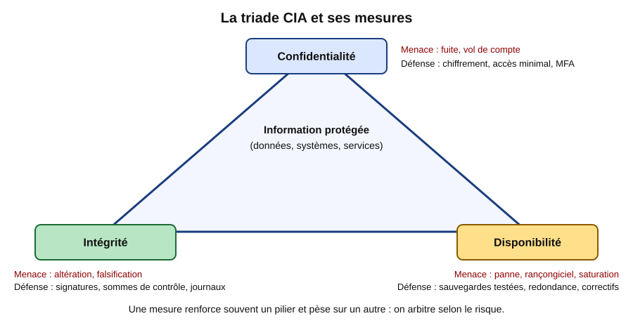
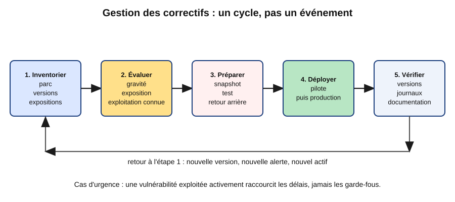
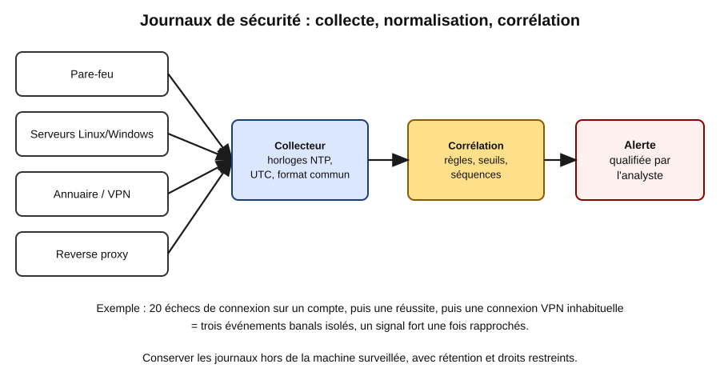
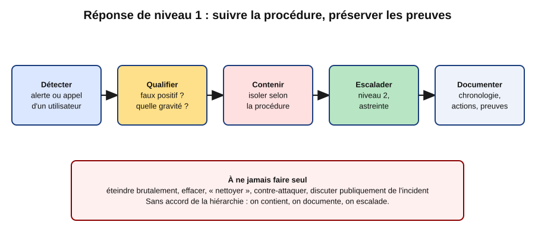

# Leçon — Menaces et défense : triade CIA, correctifs, scan autorisé, journaux, hameçonnage et incident de niveau 1

- **Tags** : `transverse`, `tout-en-un`, `lecon`, `securite`, `durcissement`, `menaces`, `cia`, `correctifs`, `journalisation`, `hameconnage`, `reponse-incident`
- **Niveau** : Débutant à intermédiaire (technicien et administrateur systèmes)
- **Durée estimée** : 3 h 30 (cours 1 h 30, laboratoire 1 h, exercices et quiz 1 h)

---

## Objectifs pédagogiques

À la fin de cette leçon, vous serez capable de :

1. **expliquer** la triade CIA et raisonner en termes de risque (menace, vulnérabilité, impact) ;
2. **organiser** la gestion des vulnérabilités et des correctifs : inventaire, priorisation, tests, déploiement par vagues, vérification ;
3. **cadrer** un scan de vulnérabilités **autorisé** et interpréter ses résultats ;
4. **décrire** le chemin d'un journal de sécurité jusqu'à l'alerte et écrire une règle de corrélation simple ;
5. **reconnaître** un hameçonnage, vérifier SPF, DKIM et DMARC, et organiser un signalement ;
6. **bâtir** un programme de sensibilisation utile ;
7. **appliquer** une réponse à incident de premier niveau : qualifier, contenir selon la procédure, préserver les preuves, escalader, documenter.

Leçon **strictement défensive** : ni exploit, ni outil offensif.

## Prérequis et durée

- Bases d'administration Linux et Windows (services, comptes, journaux) et de réseau (ports, DNS).
- Une VM Linux jetable avec snapshot ; une VM Windows de test est un plus.
- Voir aussi : [Cryptographie appliquée](Lecon_Cryptographie_Appliquee.md), [VPN et segmentation](Lecon_VPN_Segmentation.md).
- Durée : environ 3 h 30. Adresses de documentation (`192.0.2.0/24`, `198.51.100.0/24`, `203.0.113.0/24`, `2001:db8::/32`), domaines `example.com` et `example.test`, données fictives.

## L'essentiel en bref

- **Confidentialité, intégrité, disponibilité** : trois objectifs qui s'arbitrent ; on raisonne par **risque** et on **priorise**.
- Un correctif non appliqué reste une cause majeure de compromission : adoptez un **cycle** régulier.
- On ne scanne **que** ce que l'on est autorisé à scanner : accord écrit, périmètre, fenêtre.
- Un journal isolé est banal ; la **corrélation** fait émerger le signal, à condition d'avoir des horloges synchronisées et une centralisation.
- L'hameçonnage demande une défense technique (SPF/DKIM/DMARC, MFA résistant) **et** humaine (sensibilisation, signalement facile).
- Niveau 1 : **qualifier, contenir selon la procédure, préserver les preuves, escalader, documenter**.



*Figure 1 — La triade CIA et ses mesures. Schéma original, domaine public (CC0).*

---

## 1. La triade CIA et le raisonnement par le risque

La sécurité de l'information repose sur trois propriétés (CIA en anglais, DIC en français).

| Propriété | Question | Exemple de violation | Mesures |
|---|---|---|---|
| **Confidentialité** | Seuls les bons acteurs lisent-ils ? | Fuite de fichier client, compte volé | Contrôle d'accès, chiffrement, MFA |
| **Intégrité** | L'information est-elle exacte ? | IBAN modifié, fichier piégé | Signatures, sommes de contrôle, droits d'écriture limités |
| **Disponibilité** | Le service est-il utilisable ? | Rançongiciel, panne, saturation | Sauvegardes testées, redondance, correctifs |

Analogie : une **pharmacie**. Confidentialité : le secret médical ; intégrité : la boîte contient le bon médicament ; disponibilité : la pharmacie est ouverte. Verrouillée au point de ne plus ouvrir, elle sacrifie la disponibilité : **les mesures s'arbitrent** (une clé de chiffrement perdue rend les données indisponibles).

**Vocabulaire du risque** : l'**actif** est ce qui a de la valeur ; la **menace** peut causer un dommage ; la **vulnérabilité** est la faiblesse exploitable ; l'**impact** est la conséquence ; le **risque** combine probabilité et impact. On le **réduit**, l'**évite**, le **transfère** ou l'**accepte** formellement. La bonne question n'est pas « sommes-nous sûrs à 100 % ? » mais « quels risques traitons-nous en premier ? ».

## 2. Panorama des menaces courantes

| Menace | Mécanisme | Pilier | Parades |
|---|---|---|---|
| Hameçonnage, fraude au président | Tromper un humain (clic, identifiant, virement) | C, I | Sensibilisation, MFA, DMARC, double validation |
| Identifiants volés | Mots de passe réutilisés | C | Gestionnaire, MFA, alertes |
| Logiciels non corrigés | Faille connue exploitée | C, I, D | Gestion des correctifs, moins d'exposition |
| Rançongiciel | Chiffrement et rançon | D, C | Sauvegardes hors ligne, segmentation, moindre privilège |

Des référentiels publics comme MITRE ATT&CK servent à **vérifier que l'on détecte et bloque à chaque étape d'une attaque**, pas à la reproduire.

## 3. Vulnérabilités et gestion des correctifs

### 3.1 Vocabulaire

- **CVE** : identifiant public d'une vulnérabilité.
- **CVSS** : note de gravité technique de 0 à 10 ; elle ne dit pas si la faille est exploitée chez vous.
- **KEV** : catalogue (CISA) des failles **réellement exploitées**, à traiter en priorité.
- **Avis de sécurité** : bulletins de l'éditeur, de la distribution ou du CERT-FR.

### 3.2 Le cycle

Les intrusions exploitent souvent des failles **déjà corrigées** ; mais un correctif sans méthode peut casser un service.



*Figure 2 — Le cycle de gestion des correctifs. Schéma original, domaine public (CC0).*

1. **Inventorier** : on ne protège pas ce que l'on ne connaît pas (machines, versions, rôles, exposition). Les équipements oubliés sont les plus dangereux.
2. **Évaluer** : croiser gravité (CVSS), **exploitation connue**, **exposition** (accessible depuis Internet ?) et criticité de l'actif.
3. **Préparer** : **snapshot**, machine pilote, notes de version, **retour arrière**, fenêtre annoncée.
4. **Déployer par vagues** : pilote, puis une partie de la production, puis le reste, en surveillant entre chaque vague.
5. **Vérifier** : version installée, redémarrage de service, supervision et journaux normaux, inventaire mis à jour.

Politique indicative : faille exploitée sur un actif exposé, en quelques jours ; gravité critique ou élevée, sous 7 à 15 jours ; moyenne, sous 30 jours. **L'urgence raccourcit les délais, jamais les garde-fous.** Si un système ne peut pas être corrigé, on applique des **mesures compensatoires** (isolement, filtrage, supervision), avec une exception documentée et datée.

## 4. Scan autorisé

### 4.1 Le cadre

Un scanner envoie des requêtes pour identifier versions et mauvaises configurations. Utilisé sur un système que l'on n'a pas le droit de tester, il peut constituer une infraction (en France, l'accès frauduleux à un système d'information est puni par le Code pénal). Règle d'or : **pas d'autorisation écrite, pas de scan**. Formalisez :

- qui autorise et qui exécute ;
- le **périmètre** précis et les exclusions ;
- la **fenêtre** et les contraintes (pas de déni de service, cadence limitée) ;
- un **contact d'urgence** pour interrompre ;
- la protection du **rapport**, qui liste des faiblesses.

### 4.2 Familles de contrôles

- **Découverte** : quels hôtes et services existent ? Peu intrusif.
- **Scan de vulnérabilités** : versions obsolètes et mauvaises configurations ; l'**authentifié** (compte en lecture) est plus précis.
- **Audit de configuration** : comparaison à une référence de durcissement (CIS, ANSSI), en local et en lecture seule.

### 4.3 Lire les résultats

Un **faux positif** signale une faille inexistante (version rétro-portée par la distribution) : vérifiez avant d'alarmer. Un **faux négatif** manque une faille réelle : un rapport vide ne prouve rien. Classez par exposition et criticité, puis transformez chaque constat en tâche avec responsable, échéance et nouveau scan de preuve.

## 5. Journaux de sécurité et corrélation

### 5.1 Sources

- **Linux** : connexions SSH, `sudo`, comptes (`journald`, `/var/log/auth.log`).
- **Windows** : connexions réussies (4624), échecs (4625), verrouillage (4740), création de compte (4720), effacement des journaux (1102).
- **Réseau et applications** : pare-feu, VPN, DNS, authentifications, reverse proxy.

### 5.2 Conditions pour qu'un journal serve

1. **Horloges synchronisées** (NTP, chrony), de préférence en UTC.
2. **Centralisation** hors de la machine surveillée : l'attaquant efface d'abord les traces locales.
3. **Rétention** adaptée, accès restreint, respect de la vie privée (les journaux contiennent des données personnelles).
4. **Normalisation** : champs communs (date, source, utilisateur, adresse, action, résultat), intégrité protégée.

### 5.3 Corréler

Un échec de connexion est banal. Mais voici une séquence : vingt échecs sur un compte depuis une adresse, puis une **réussite** depuis cette adresse, puis une connexion VPN à une heure inhabituelle, puis une règle de transfert créée dans la messagerie. Chaque événement est ordinaire ; l'enchaînement signale un compte probablement compromis.



*Figure 3 — De la source de journaux à l'alerte qualifiée. Schéma original, domaine public (CC0).*

Types de règles : **seuil** (N échecs en M minutes), **séquence** (échecs puis succès), **nouveauté** (nouveau pays), **liste de référence**, **interdit** (effacement du journal).

Trop d'alertes inutiles épuisent l'équipe. Réglez les seuils, listez les exceptions légitimes, donnez à chaque règle une gravité, un propriétaire et une procédure (« que faire ? »).

## 6. Hameçonnage et ingénierie sociale

**Formes** : hameçonnage (courriel imitant une organisation), *spear-phishing* ciblé, smishing et vishing (SMS, téléphone), **fraude au président** (virement ou changement d'IBAN), QR code frauduleux. Elles jouent sur l'**urgence**, l'**autorité**, la **peur** et l'**appât du gain** : le bon réflexe est de **ralentir**.

**Indices** : expéditeur inattendu ou domaine proche (`examp1e.com`), ton pressant, lien dont la destination réelle diffère du texte, pièce jointe inattendue, demande inhabituelle de virement ou de coordonnées bancaires.

**Authentification du courriel** (trois enregistrements DNS) :

- **SPF** (RFC 7208) : serveurs autorisés à envoyer pour le domaine ;
- **DKIM** (RFC 6376) : signature des messages, clé publique dans le DNS ;
- **DMARC** (RFC 7489) : politique si SPF et DKIM échouent (`none`, `quarantine`, `reject`) et rapports. Commencez par `none` pour observer, puis resserrez : passer directement à `reject` peut bloquer du courrier légitime.

**Défenses en couches** : filtrage et analyse des liens et pièces jointes, bandeau « externe », blocage des macros ; **MFA résistant à l'hameçonnage** (clés FIDO2, passkeys) ; double validation et rappel au numéro connu pour les virements ; bouton de signalement unique.

**Si l'on a cliqué ou saisi son mot de passe** : le dire **immédiatement**, sans honte. Le niveau 1 applique alors la procédure : changer le mot de passe depuis un poste de confiance, révoquer sessions et jetons, vérifier les règles de messagerie, isoler le poste si un fichier a été ouvert.

## 7. Sensibiliser les utilisateurs

Un programme efficace est :

1. **court et régulier** : capsules de 5 à 10 minutes toute l'année ;
2. **concret** : exemples réels anonymisés, adaptés aux rôles (comptabilité, accueil, administrateurs) ;
3. **sans blâme** : on remercie le signalement, y compris après une erreur ;
4. **facile** : un seul moyen évident de signaler ;
5. **mesuré** par le taux et le délai de **signalement**, plus utiles que le seul taux de clic ;
6. **éthique** : les simulations de faux hameçonnage exigent l'accord de la direction et des représentants du personnel, sans humiliation, avec retour pédagogique ;

## 8. Réponse à incident de premier niveau

Un **événement** est une observation ; un **incident** compromet ou menace la sécurité de l'information ou des services. Les processus s'inspirent souvent du guide **NIST SP 800-61** : préparation ; détection et analyse ; confinement, éradication, récupération ; retour d'expérience. Le **niveau 1** reçoit l'alerte, la qualifie, applique les mesures **prévues** et **escalade**. Il n'enquête pas à fond et ne « répare » pas à sa façon.



*Figure 4 — Réponse de niveau 1 : suivre la procédure et préserver les preuves. Schéma original, domaine public (CC0).*

### 8.1 Les cinq gestes

1. **Détecter et enregistrer** : ticket immédiat, heure et source.
2. **Qualifier** : faux positif ou réel ? Catégorie (hameçonnage, compte compromis, programme malveillant, perte de matériel, fuite, indisponibilité) et gravité (nombre de personnes, sensibilité, impact). Dans le doute, traiter comme réel.
3. **Contenir** (seulement ce que la procédure permet) : isoler un poste du réseau, verrouiller temporairement un compte, bloquer un expéditeur. On **arrête la propagation**, on ne nettoie pas.
4. **Escalader** : niveau 2, responsable sécurité ou astreinte, avec un dossier clair.
5. **Documenter** : chronologie, machines, comptes, actions, décideurs.

### 8.2 Préserver les preuves

- **Ne pas éteindre brutalement** sans consigne : la mémoire contient des éléments précieux. **Isoler** du réseau d'abord.
- **Ne rien supprimer** : fichiers, courriels et journaux restent en l'état.
- **Capturer** ce qui est visible (photo de l'écran, courriel avec ses en-têtes) et noter l'heure avec le fuseau.
- **Consigner chaque action** : toute manipulation modifie l'état du système.

### 8.3 À ne pas faire

Contre-attaquer ou scanner l'attaquant (illégal) ; répondre au fraudeur ou payer sans décision de la direction ; en parler publiquement ; réinstaller ou restaurer avant décision sur les preuves ; cacher l'incident.

### 8.4 Dimension réglementaire

Une violation de données personnelles peut imposer une **notification à l'autorité dans les 72 heures** (RGPD, article 33). La décision revient au délégué à la protection des données et à la direction : le niveau 1 **escalade sans délai** et consigne l'heure de découverte.

### 8.5 Contenu d'un ticket

Heure de découverte ; déclarant ; faits ; systèmes et comptes ; catégorie et gravité ; actions avec heures ; preuves conservées ; escalade ; prochaines étapes.

## 9. Mise en pratique guidée

> **Cadre.** Laboratoire **local** sur une VM Linux jetable avec snapshot. Les journaux sont **fictifs** ; les scans visent **uniquement la VM de test** dont vous êtes responsable. N'élargissez jamais le périmètre sans autorisation écrite.
>
> **Toute modification de sécurité** suit : **1.** snapshot préalable ; **2.** accès console de secours ouvert ; **3.** test (validation de configuration, vérification depuis un second terminal) ; **4.** retour arrière prêt (restauration du snapshot ou de la copie du fichier).

### Étape 1 — Inventaire et correctifs (lecture seule)

```bash
hostnamectl
date -Is
apt list --upgradable 2>/dev/null | head -20
```

👉 Explication : consigne l'identité de la machine et l'heure, puis liste les mises à jour disponibles d'après les index APT présents ; rien n'est installé. Sous famille RPM : `dnf updateinfo list security`.

```powershell
Get-ComputerInfo -Property OsName,OsVersion,OsBuildNumber
Get-HotFix | Sort-Object InstalledOn -Descending | Select-Object -First 10
```

👉 Explication : sous Windows, affiche la version du système et les dix derniers correctifs installés, en lecture seule ; un écart avec la politique ouvre un ticket.

### Étape 2 — Mise à jour sous contrôle (modification)

Snapshot et console ouverte, puis :

```bash
sudo apt-get -s upgrade | head -30
sudo apt-get upgrade
systemctl --failed --no-pager
```

👉 Explication : la simulation `-s` montre ce qui serait installé ou retiré sans rien modifier ; après validation, l'installation réelle, puis contrôle qu'aucun service n'est en échec. Retour arrière : restauration du snapshot.

### Étape 3 — Scan autorisé de la VM de labo

On ne scanne que sa **propre VM jetable**, avec une ligne dans le cahier de laboratoire (date, cible, finalité).

```bash
nmap -sV -p 22,80,443 192.0.2.10
ss -lntup
```

👉 Explication : `nmap` interroge trois ports de la VM de laboratoire (adresse de documentation à remplacer) et identifie les versions ; `ss` donne la vue interne des ports à l'écoute et des processus. Tout service non justifié par le rôle de la machine est à désactiver ou à justifier. Jamais sur une machine qui n'est pas la vôtre.

### Étape 4 — Journaux d'authentification

```bash
journalctl -u ssh --since "1 hour ago" --no-pager | tail -20
timedatectl
last -n 10
```

👉 Explication : événements SSH de la dernière heure (service `sshd` sur certaines distributions), état de la synchronisation d'horloge (attendez `System clock synchronized: yes`) et dix dernières connexions ; un compte ou une origine inconnus mérite vérification.

### Étape 5 — Journal fictif et règle de corrélation

```bash
cat > auth-demo.log <<'EOF'
Nov  1 09:01:02 srv01 sshd[1201]: Failed password for invalid user admin from 203.0.113.5 port 40001 ssh2
Nov  1 09:01:05 srv01 sshd[1203]: Failed password for invalid user test from 203.0.113.5 port 40002 ssh2
Nov  1 09:01:09 srv01 sshd[1205]: Failed password for root from 203.0.113.5 port 40003 ssh2
Nov  1 09:01:12 srv01 sshd[1207]: Failed password for alice from 203.0.113.5 port 40004 ssh2
Nov  1 09:01:15 srv01 sshd[1209]: Failed password for alice from 203.0.113.5 port 40005 ssh2
Nov  1 09:01:18 srv01 sshd[1211]: Failed password for alice from 203.0.113.5 port 40006 ssh2
Nov  1 09:02:40 srv01 sshd[1230]: Accepted password for alice from 203.0.113.5 port 40010 ssh2
Nov  1 09:10:11 srv01 sshd[1250]: Failed password for bob from 198.51.100.77 port 50001 ssh2
Nov  1 09:15:20 srv01 sshd[1260]: Accepted publickey for bob from 198.51.100.77 port 50020 ssh2
EOF
```

👉 Explication : fabrique un journal d'exemple : six échecs puis un succès depuis `203.0.113.5`, et un échec isolé suivi d'un succès par clé depuis `198.51.100.77`.

```bash
grep 'Failed password' auth-demo.log | awk '{print $(NF-3)}' | sort | uniq -c | sort -rn
```

👉 Explication : compte les échecs par adresse source (quatrième champ avant la fin de ligne) ; attendu : 6 pour `203.0.113.5`, 1 pour `198.51.100.77`.

```bash
cat > correle.sh <<'EOF'
#!/usr/bin/env bash
# Usage : ./correle.sh fichier.log [seuil]
set -euo pipefail
fichier="${1:?fichier de journal requis}"
seuil="${2:-5}"
awk -v seuil="$seuil" '
  /Failed password/ { ip=$(NF-3); echec[ip]++ }
  /Accepted/        { ip=$(NF-3); if (echec[ip] >= seuil) { print "ALERTE : " ip " reussit apres " echec[ip] " echecs (" $0 ")" } ; echec[ip]=0 }
' "$fichier"
EOF
chmod +x correle.sh
./correle.sh auth-demo.log 5
```

👉 Explication : règle de corrélation « séquence » : alerte quand une adresse réussit après au moins `seuil` échecs ; seule `203.0.113.5` est signalée. Le script ne fait que lire le fichier. Essayez les seuils `2` et `10` : trop bas, du bruit ; trop haut, des attaques lentes manquées.

### Étape 6 — Authentification d'un domaine de messagerie

```bash
dig +short TXT example.com
dig +short TXT _dmarc.example.com
```

👉 Explication : requêtes DNS en lecture seule pour voir l'éventuel SPF (TXT commençant par `v=spf1`) et la politique DMARC (`v=DMARC1`) du domaine de documentation. Dans un courriel fictif suspect, `spf=fail`, `dkim=none` et `dmarc=fail` dans `Authentication-Results` indiquent une usurpation probable.

### Étape 7 — Journalisation persistante (modification)

Snapshot et console ouverte, puis :

```bash
sudo mkdir -p /var/log/journal
sudo systemd-tmpfiles --create --prefix /var/log/journal
sudo systemctl restart systemd-journald
journalctl --disk-usage
```

👉 Explication : active le stockage persistant du journal, redémarre `systemd-journald` et affiche l'espace utilisé. Test : après redémarrage de la VM, `journalctl --list-boots` doit montrer plusieurs amorçages. Retour arrière : supprimer `/var/log/journal` et redémarrer le service ; limitez la taille avec `SystemMaxUse=` dans `/etc/systemd/journald.conf`.

### Étape 8 — Nettoyage

```bash
rm -f auth-demo.log correle.sh
```

👉 Explication : supprime les fichiers fictifs ; restaurez le snapshot pour repartir d'un état propre.

## Exercices

1. **(CIA)** Pilier principalement touché : (a) portable non chiffré volé ; (b) montant d'une facture modifié ; (c) serveur de fichiers chiffré par un rançongiciel ; (d) mise à jour qui bloque la paie un jour de paie.
2. **(Priorités)** Serveur exposé : faille CVSS 6,5 exploitée activement. Serveur isolé : CVSS 9,0 sans exploitation connue. Lequel d'abord, et pourquoi ?
3. **(Cadrage d'un scan)** Remplissez une fiche d'autorisation : parties, périmètre, exclusions, fenêtre, limites, contact d'urgence, gestion du rapport.
4. **(Corrélation)** Proposez une règle à trois événements pour détecter un compte de messagerie compromis, avec seuil, gravité et faux positifs possibles.
5. **(Hameçonnage)** Analysez : « URGENT – votre compte sera suspendu dans 2 h. Cliquez sur http://example.test.verification-compte.invalid/connexion. Le support. » Indices et conduite.
6. **(Incident)** Un utilisateur a saisi son mot de passe sur une fausse page à 14 h 05 ; l'alerte VPN signale une connexion à 14 h 40 depuis un pays inhabituel. Décrivez les actions de niveau 1, les preuves et l'escalade.
7. **(Laboratoire)** Réalisez les étapes 1 à 5 puis ajoutez une règle qui alerte à partir de 3 échecs d'un même **compte** (et non d'une même adresse).

## Corrigés des exercices

1. (a) Confidentialité ; (b) intégrité ; (c) disponibilité (et confidentialité en cas d'exfiltration) ; (d) disponibilité : une mesure de sécurité mal maîtrisée crée elle-même l'incident, d'où tests et fenêtres.
2. Le **serveur exposé** : l'exploitation est réelle et accessible ; CVSS décrit la gravité théorique, pas la probabilité chez vous. Le serveur isolé suit, avec mesures compensatoires entre-temps.
3. Exemple : responsable du système (autorise) et opérateur ; périmètre `192.0.2.10` ; exclusions : tout le reste ; fenêtre le 2026-11-01 de 14 h à 15 h ; pas de déni de service, débit réduit ; contact d'astreinte ; rapport stocké chiffré, accès restreint, supprimé après correction.
4. Exemple : plus de 10 échecs en 10 minutes depuis une même adresse, puis une réussite depuis cette adresse, puis création d'une règle de redirection vers l'extérieur : gravité **haute**. Faux positifs : utilisateur qui a oublié son mot de passe puis crée un transfert légitime, supervision interne, NAT partagé. On les traite par exceptions et vérification auprès de l'utilisateur.
5. Indices : urgence artificielle, menace de suspension, domaine réel `verification-compte.invalid` (le préfixe `example.test` est trompeur), signature générique. Conduite : ne pas cliquer, signaler, conserver le message, ne pas répondre ; si le lien a été ouvert, déclencher la procédure de compte compromis.
6. Ticket immédiat (heures 14:05 et 14:40) ; verrouiller le compte et révoquer les sessions selon la procédure ; changement de mot de passe depuis un poste de confiance ; vérifier règles de messagerie et MFA ; conserver courriel, capture de la fausse page et journaux VPN ; **escalader** au niveau 2 avec chronologie ; ne pas contacter l'attaquant.
7. Exemple, testé sur le journal fictif : `awk '/Failed password/ { u=$(NF-5); n[u]++; if (n[u]==3) print "ALERTE compte " u }' auth-demo.log` ; le nom du compte est le cinquième champ avant la fin de ligne, que l'utilisateur soit valide ou `invalid user`. Seul `alice` déclenche l'alerte.

## Quiz

**Q1.** Un attaquant modifie le numéro de compte d'un fournisseur dans la base : quel pilier ?
- A. Confidentialité — B. Intégrité — C. Disponibilité — D. Aucun

**Q2.** Que mesure CVSS ?
- A. La probabilité d'exploitation chez vous — B. La gravité technique théorique — C. Le coût du correctif — D. L'âge de la faille

**Q3.** Qu'est-ce qui place une faille en tête de priorité ?
- A. Son nom médiatisé — B. Une exploitation active sur un actif exposé — C. Son ancienneté — D. La taille du correctif

**Q4.** Condition indispensable avant un scan ?
- A. Un outil gratuit — B. Une autorisation écrite avec périmètre et fenêtre — C. Un accès administrateur partout — D. Un accord oral

**Q5.** Pourquoi centraliser les journaux ?
- A. Gagner du disque — B. Un attaquant efface d'abord les traces locales — C. Accélérer le système — D. Supprimer les doublons

**Q6.** Que fait la corrélation ?
- A. Remplace la journalisation — B. Relie des événements banals pour faire émerger un signal — C. Bloque seule les attaques — D. Chiffre les journaux

**Q7.** Quel enregistrement indique quoi faire quand SPF et DKIM échouent ?
- A. MX — B. DMARC — C. PTR — D. CNAME

**Q8.** Indicateur de sensibilisation à privilégier en plus du taux de clic ?
- A. Nombre de diapositives — B. Taux et délai de signalement — C. Durée de la formation — D. Nombre de sanctions

**Q9.** Poste suspecté d'infection : premier réflexe du niveau 1 ?
- A. Éteindre brutalement et formater — B. Isoler du réseau, conserver l'état, documenter, escalader — C. Scanner l'attaquant — D. Rien

**Q10.** Mise à jour d'urgence d'une faille exploitée : que garde-t-on ?
- A. Rien — B. Snapshot, test minimal et retour arrière — C. L'accord de tous les utilisateurs — D. Un délai de six mois

**Réponses justifiées.** **Q1 — B** : donnée altérée = intégrité. **Q2 — B** : CVSS décrit la faille, pas votre risque. **Q3 — B** : l'exploitation réelle et l'exposition rendent la menace immédiate. **Q4 — B** : sans autorisation, le scan peut être illégal ; périmètre et fenêtre protègent les services. **Q5 — B** : la copie distante survit à la compromission locale. **Q6 — B** : elle donne du sens à des événements isolés. **Q7 — B** : DMARC fixe la politique (`none`, `quarantine`, `reject`). **Q8 — B** : signaler vite permet de réagir pour tous. **Q9 — B** : on arrête la propagation sans détruire les preuves. **Q10 — B** : l'urgence raccourcit les délais, pas les garde-fous.

## Erreurs fréquentes et dépannage

| Symptôme | Cause probable | Vérification / solution |
|---|---|---|
| Mise à jour faite mais faille toujours détectée | Service non redémarré | `needrestart -r l`, redémarrer selon la procédure |
| Scanner : nombreuses failles « critiques » | Faux positifs (versions rétro-portées) | Comparer à l'avis de la distribution ; scan authentifié |
| Heures incohérentes entre journaux | Horloges ou fuseaux non alignés | `timedatectl`, `chronyc tracking`, UTC |
| `journalctl` vide après redémarrage | Journal non persistant | Étape 7 |
| Règle de corrélation trop bruyante | Seuil bas, exceptions non listées | Ajuster, lister les exceptions, revoir après incident |

Principe constant : **recueillir les faits d'abord**, n'agir que selon la procédure, **escalader tôt**.

## À retenir

- **CIA** : trois objectifs qui s'arbitrent ; on traite les risques par priorité.
- **Correctifs** : inventorier, évaluer (exploitation et exposition d'abord), préparer, déployer par vagues, vérifier.
- **Scan** : autorisation écrite, périmètre, fenêtre ; distinguer faux positifs et priorités.
- **Journaux** : horloges synchronisées, centralisation, corrélation, maîtrise du bruit.
- **Hameçonnage** : SPF/DKIM/DMARC, MFA résistant, signalement facile, culture sans blâme.
- **Incident N1** : qualifier, contenir, **préserver les preuves**, escalader, documenter ; jamais de contre-attaque.
- Toute modification : **snapshot, console de secours, test, retour arrière**.

## Pour aller plus loin

- NIST SP 800-61 Rev. 2 : <https://csrc.nist.gov/pubs/sp/800/61/r2/final>
- NIST SP 800-40 Rev. 4 (correctifs) : <https://csrc.nist.gov/pubs/sp/800/40/r4/final>
- NIST SP 800-92 (journaux) : <https://csrc.nist.gov/pubs/sp/800/92/final>
- CISA — Known Exploited Vulnerabilities : <https://www.cisa.gov/known-exploited-vulnerabilities-catalog>
- FIRST — CVSS : <https://www.first.org/cvss/>
- CERT-FR : <https://www.cert.ssi.gouv.fr/>
- ANSSI : <https://cyber.gouv.fr/>
- Cybermalveillance.gouv.fr : <https://www.cybermalveillance.gouv.fr/>
- RFC 7208 (SPF) : <https://www.rfc-editor.org/rfc/rfc7208> ; RFC 6376 (DKIM) : <https://www.rfc-editor.org/rfc/rfc6376> ; RFC 7489 (DMARC) : <https://www.rfc-editor.org/rfc/rfc7489>
- CNIL — violations de données : <https://www.cnil.fr/>

## Crédits des images

| Fichier | Source (URL de la page Commons) | Auteur | Licence | Modifications |
|---|---|---|---|---|
| `images/menaces-defense-1.svg` | Création originale (pas de page Commons) | Projet Pack Master | CC0 1.0 : <https://creativecommons.org/publicdomain/zero/1.0/deed.fr> | Aucune |
| `images/menaces-defense-2.svg` | Création originale | Projet Pack Master | CC0 1.0 : <https://creativecommons.org/publicdomain/zero/1.0/deed.fr> | Aucune |
| `images/menaces-defense-3.svg` | Création originale | Projet Pack Master | CC0 1.0 : <https://creativecommons.org/publicdomain/zero/1.0/deed.fr> | Aucune |
| `images/menaces-defense-4.svg` | Création originale | Projet Pack Master | CC0 1.0 : <https://creativecommons.org/publicdomain/zero/1.0/deed.fr> | Aucune |

Création originale du projet Pack Master, dédiée au domaine public (CC0).

## Historique de vérification

| Date | OS/logiciel | Testeur | Verdict |
|---|---|---|---|
| 2026-11-01 | Linux, bash, awk : étape 5 (comptage par adresse, script `correle.sh`, règle par compte de l'exercice 7) exécutée dans un répertoire jetable puis supprimé ; alerte attendue obtenue pour `203.0.113.5` | Agent de rédaction du pack | Étape 5 validée localement (hors production) |
| 2026-11-01 | VM Debian/Ubuntu et Windows de laboratoire : étapes 1 à 4, 6 et 7 | — | Non testé sur plateforme cible |
