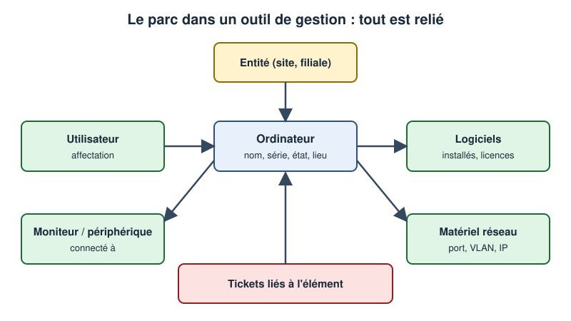
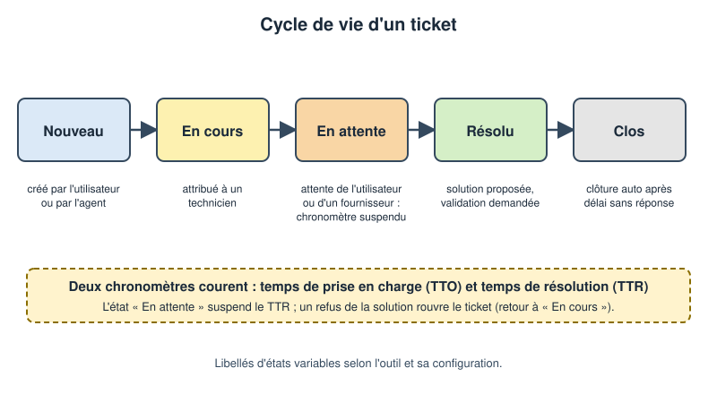
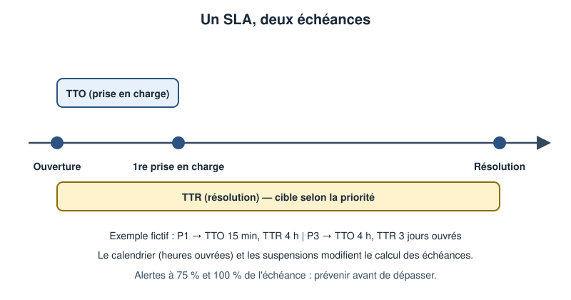
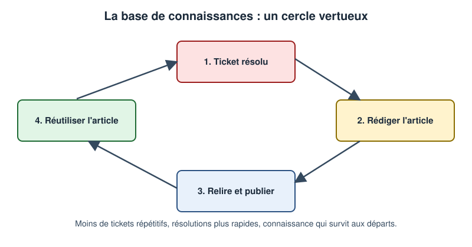

# Leçon — GLPI : parc, inventaire, tickets, catégories, SLA, tableaux de bord et base de connaissances

- **Tags** : `transverse`, `tout-en-un`, `lecon`, `support`, `glpi`, `itsm`, `inventaire`, `ticketing`, `sla`, `base-de-connaissances`
- **Niveau** : débutant à intermédiaire (technicien support, administrateur d'un outil de gestion de parc et de tickets)
- **Durée estimée** : 4 h (lecture 1 h 30, laboratoire 1 h 30, exercices et quiz 1 h)

---

## Objectifs pédagogiques

À l'issue de cette leçon, vous saurez :

1. Situer **GLPI** (logiciel libre de gestion de parc et de support) dans une démarche de gestion de services.
2. Organiser un **parc** et comprendre l'**inventaire** (manuel, importé, automatique).
3. Concevoir des **catégories**, des **modèles** et des **règles** sobres, et raisonner sur les **SLA**.
4. Construire des **tableaux de bord** utiles et alimenter une **base de connaissances**.
5. Suivre un **parcours d'administration** ordonné, avec sauvegarde et retour arrière.

## Prérequis et durée

- Connaître incident, demande, priorité, SLA et CMDB (voir la leçon [ITIL 4 pour le technicien](Lecon_ITIL4_Technicien.md)) ; bases de Linux et du web.
- Une **machine virtuelle jetable** (Debian ou Ubuntu récente) pour la mise en pratique, avec un **instantané** disponible. Ne jamais installer ni tester sur un serveur de production.
- Durée totale : environ 4 h.

> **Remarque** : la leçon traite des **concepts** et des **parcours d'administration**, sans capture d'écran du produit. Les libellés de menus (version francophone courante) peuvent varier : vérifiez-les sur votre instance.

## L'essentiel en bref

- GLPI rassemble dans un **même outil** : le **parc** (ce qui existe), l'**assistance** (tickets, problèmes, changements), la **gestion** (contrats, fournisseurs, licences) et les **outils** (base de connaissances, rapports).
- La force d'un tel outil vient des **liens** : ticket ↔ élément du parc ↔ utilisateur ↔ contrat.
- Une bonne configuration est **sobre** : peu de catégories, peu de statuts, des règles simples. Elle se construit dans un **ordre** précis (entités, profils, utilisateurs, calendriers, SLA, catégories, règles, notifications).
- Les **SLA** ne valent que si le calendrier est correct et si les suspensions sont honnêtes.
- Une **base de connaissances** vivante réduit les tickets répétitifs et protège le savoir contre les départs.



*Figure 1 — Dans un outil de gestion de parc, tout est relié : l'élément, son propriétaire, ses logiciels et ses tickets.*

---

## 1. Ce qu'est GLPI et ce qu'il n'est pas

GLPI est une **application web** libre (licence GPL), écrite en PHP et adossée à une base de données relationnelle (MariaDB ou MySQL). Elle remplit deux grandes fonctions :

- **Gestion de parc** (inventaire, CMDB simplifiée) : ordinateurs, écrans, imprimantes, équipements réseau, téléphones, logiciels, licences, contrats, fournisseurs.
- **Gestion des services** (*helpdesk*) : tickets (incidents et demandes), problèmes, changements, SLA, base de connaissances.

Analogie : un **cabinet médical** a un fichier patients (le parc), un carnet de consultations (les tickets), une armoire de protocoles (la base de connaissances) et un tableau de bord. GLPI **n'est pas** un outil de supervision temps réel, ni de sauvegarde, ni un annuaire ; il peut dialoguer avec eux.

### 1.1 Les briques à connaître

Serveur web et PHP (exécution), base de données (éléments, tickets, configuration), dossiers de fichiers (pièces jointes, configuration), **tâches automatiques** (alertes de SLA, relève des courriels), et en option un **agent d'inventaire**, un **annuaire** et une messagerie.

### 1.2 Entités, profils, utilisateurs, groupes

Une **entité** est un compartiment de l'organisation (société, site) organisé en arbre, avec ses règles propres ; un **profil** est un jeu de droits attribué à un utilisateur sur une entité ; un **groupe** (« Support N1 », « Réseau ») reçoit de préférence les tickets, ce qui évite de dépendre d'une personne absente. Sobriété : n'ajoutez des entités que si droits, règles ou visibilité l'exigent.

## 2. Le parc : décrire ce qui existe

### 2.1 Les types d'éléments

Le menu **Parc** regroupe ordinateurs, moniteurs, logiciels, matériels réseau, périphériques, imprimantes, téléphones, baies… À renseigner systématiquement : **nom** stable (`PC-COMPTA-014`), **numéro de série** et d'inventaire, **statut**, **lieu** (arbre site/bâtiment/salle), **utilisateur ou groupe** et technicien responsable, fabricant et modèle, date d'achat, fin de garantie et contrat.

### 2.2 Les relations

Un élément est **affecté** à un utilisateur, **situé** à un lieu, **connecté** à un moniteur, **équipé** de logiciels, **couvert** par un contrat et **cité** dans des tickets. Devant un ticket « imprimante hors service », vous voyez aussitôt modèle, lieu, dernière intervention et contrat de maintenance.

### 2.3 États et cycle de vie

Définissez peu d'états, compréhensibles par tous : **en stock**, **en service**, **en réparation**, **prêté**, **retiré**. Chaque passage est un événement à tracer (date, auteur, motif) : il permet de savoir combien de machines sont réellement disponibles et de planifier le renouvellement.

### 2.4 Qualité

Une seule fiche par élément physique, un nommage qui ne change pas quand l'utilisateur change, un **numéro de série** obligatoire (clé de rapprochement), un responsable identifié et un nettoyage régulier des fiches orphelines.

## 3. L'inventaire : manuel, importé ou automatique

### 3.1 Trois sources de données

La **saisie manuelle** convient aux éléments non communicants (écrans, stock) ; l'**import** CSV sert à la reprise initiale (à valider sur un petit échantillon) ; l'**inventaire automatique** utilise un **agent** installé sur les postes, ou la réception native des inventaires dans les versions récentes.

### 3.2 Les règles de rapprochement

À chaque inventaire reçu, GLPI décide : **cette machine existe-t-elle déjà ?** (numéro de série, identifiant, adresse MAC). Mal réglées, les règles créent des **doublons** ou des **fusions abusives**, typiques des postes clonés partageant un identifiant : exigez un numéro de série distinct ou renommez à la mise en service.

### 3.3 Périmètre et fréquence

Inventoriez le matériel, le système, les logiciels et versions, mais **jamais** le contenu des fichiers ni l'historique de navigation : appliquez la minimisation des données personnelles et informez les utilisateurs. Une remontée quotidienne ou hebdomadaire suffit ; la liste des machines **sans remontée depuis quinze jours** est un excellent outil de nettoyage.

## 4. Les tickets : le cœur de l'assistance

### 4.1 Les canaux d'entrée

Interface web, **courriel** (boîte dédiée comme `support@example.com`), téléphone saisi par un technicien, alertes automatiques. Quel que soit le canal, un seul endroit fait foi : le ticket.

### 4.2 Les champs d'un ticket

Les champs utiles : **titre** lisible (« Messagerie : envoi impossible, erreur 550 »), **type** (incident ou demande), **catégorie**, **demandeur** (distinct de l'auteur si l'on saisit pour autrui), **observateurs**, **attribué à** (de préférence un groupe), **impact et urgence** (la priorité est calculée), **éléments associés** (toujours lier l'élément concerné), **statut** et **description** factuelle (message d'erreur, heure, périmètre, ce qui a changé).

### 4.3 Le cycle de vie



*Figure 2 — Un cycle de vie simple : l'état « En attente » suspend le chronomètre de résolution ; un refus de solution rouvre le ticket.*

Les libellés varient selon la version. La logique : **Nouveau** (pas encore pris), **En cours** (traité), **En attente** (on attend l'utilisateur ou un tiers : **chronomètre suspendu**), **Résolu** (solution proposée, à valider ou refuser), **Clos** (plus de modification).

### 4.4 Suivis, tâches, solutions, validations

Un **suivi** est un message de l'historique (privé pour les notes internes) ; une **tâche** est une action planifiable ; la **solution** est le texte final, avec un type utile aux statistiques ; une **validation** recueille l'accord d'un responsable. Écrivez chaque suivi comme si un collègue reprenait le ticket demain sans vous joindre.

### 4.5 Modèles de tickets

Un **modèle** présélectionne des champs et peut en **rendre obligatoires** : le modèle « Création de compte » impose nom, service, date d'arrivée et validateur, ce qui évite les aller-retour.

### 4.6 Règles métier

Les **règles** automatisent des décisions (affecter un groupe selon la catégorie, définir la priorité, appliquer un SLA). Une règle = un critère et une action lisibles ; **ordonnez** et documentez-les, testez-les sur des tickets d'essai, préférez la sobriété.

## 5. Les catégories : un classement qui sert vraiment

### 5.1 Pourquoi et comment

La catégorie alimente le **routage**, les **modèles**, les **statistiques** et la base de connaissances. Règles d'or : **deux niveaux** maximum, **vocabulaire de l'utilisateur** (« Impression »), pas de « Autre » fourre-tout, classement par **sujet** et non par personne, revue trimestrielle. Exemple : Poste de travail ; Réseau et accès ; Messagerie ; Impression ; Comptes et droits ; Applications métier ; Information.

## 6. SLA et calendriers dans l'outil

### 6.1 Les ingrédients



*Figure 3 — Un SLA, deux échéances : le délai de prise en charge (TTO) et le délai de résolution (TTR).*

Un **niveau de service** (SLA) comporte un **type** (prise en charge ou résolution), une **durée**, un **calendrier** (horaires ouvrés et jours fériés) et des **niveaux d'escalade**. Les **OLA** suivent la même logique pour les équipes internes.

### 6.2 Le calendrier : l'oublié qui fausse tout

Un SLA de 4 heures « ouvrées » ouvert à 17 h 30 ne s'échoit pas à 21 h 30 mais le lendemain à 11 h 30. Si le calendrier n'est pas défini, tout est compté en temps continu, et les indicateurs s'effondrent la nuit et le week-end. **Créez le calendrier avant les SLA.**

### 6.3 Application des SLA

On applique un SLA **par règle** (priorité, catégorie, entité) et il faut que **chaque ticket** en ait un : sans SLA, aucune alerte.

### 6.4 Escalades et suspension

Une escalade type : à **75 %** du délai, notification au groupe ; à **100 %**, notification au responsable et relèvement de priorité. Réglez-les avec modération : une avalanche de messages finit ignorée. L'état « En attente » suspend le délai de résolution : utilisez-le **uniquement** quand la balle est chez l'utilisateur ou un tiers, et passez en revue chaque mois les tickets en attente depuis plus de dix jours.

## 7. Tableaux de bord et rapports

### 7.1 Des questions, pas des graphiques

Un tableau de bord répond à des questions : combien de tickets ouverts, clos, en retard (**charge**) ? en combien de temps (**délais**) ? quelles catégories dominent (**tendances**) ? quels tickets reviennent (**qualité**) ? Indicateurs raisonnables : entrants/clos par semaine, respect des SLA, âge des tickets ouverts, top 5 des catégories, taux de réouverture, répartition du parc par état et par âge.

Limitez-vous à **6 à 8 cartes**, documentez chaque indicateur et revoyez-les chaque trimestre : un tableau de bord n'est utile que s'il déclenche une **décision**.

## 8. La base de connaissances

### 8.1 Le principe



*Figure 4 — Le cercle vertueux : chaque ticket intéressant devient un article qui évite le ticket suivant.*

La base regroupe des **articles** en catégories (procédures, FAQ) pour les **techniciens** et, en libre-service, pour les **utilisateurs**, ce qui détourne une partie des demandes simples.

### 8.2 Un bon article

Titre formulé comme le problème de l'utilisateur, contexte, symptômes, cause, solution **pas à pas**, vérification, « si cela échoue » (vers qui escalader, avec quelles informations), date et auteur.

### 8.3 Visibilité et cycle de vie

On définit les **cibles** (techniciens, tous les utilisateurs, une entité), le statut (brouillon, publié, archivé) et une **date de revue** ; les articles périmés sont retirés. Depuis un ticket, on ajoute ou on crée l'article. Ne publiez jamais de **secret** dans un article lisible par les utilisateurs.

## 9. Le parcours d'administration : dans quel ordre configurer ?

Ordre conseillé, de la fondation vers le confort : (1) **installer et sécuriser** (HTTPS, comptes par défaut neutralisés, sauvegarde) ; (2) **entités et lieux** ; (3) **profils, groupes, utilisateurs** ; (4) **calendriers** ; (5) **SLA et escalades** ; (6) **catégories et modèles** ; (7) **règles métier** ; (8) **notifications** (qui est averti de quoi, testées sur une adresse de test) et courriels ; (9) **inventaire** ; (10) **base de connaissances** ; (11) **tableaux de bord** ; (12) **exploitation** (tâches automatiques, sauvegardes testées, mises à jour, revue trimestrielle).

Les libellés de menus à repérer dans l'interface francophone : **Parc**, **Assistance**, **Gestion**, **Outils**, **Administration**, **Configuration**. Les SLA se trouvent généralement sous **Configuration**, les règles sous **Administration**, la base de connaissances sous **Outils**. Vérifiez-les sur votre version.

## 10. Sécurité, sauvegarde et mises à jour

Sauvegardez la base **et** les dossiers de fichiers, et **testez la restauration**. Toute mise à jour est précédée d'une sauvegarde complète et d'un instantané, et validée sur une copie. Droits minimaux, peu d'administrateurs, accès en HTTPS, interface d'administration non exposée sur Internet, durées de conservation des données personnelles définies.

## Mise en pratique guidée

Objectif : installer une instance GLPI **de laboratoire** sur une VM jetable, créer une catégorie, un SLA, un ticket et un article, puis sauvegarder et restaurer. Les commandes ci-dessous sont indicatives pour une distribution de la famille Debian ; **vérifiez les prérequis exacts de votre version de GLPI** dans la documentation officielle avant de commencer.

> **Précautions obligatoires** : VM **jetable** sans donnée réelle ; **instantané** avant l'installation ; **accès console de secours** (hyperviseur) ; test après chaque étape ; retour arrière par restauration de l'instantané. Adresses de documentation (192.0.2.0/24) et domaine `example.test` : remplacez-les par ceux de votre laboratoire.

### Étape 1 — Instantané et vérification de l'état initial

```bash
hostnamectl && df -h / && free -h
```

👉 Explication : affiche système, disque et mémoire de la VM. Prenez l'instantané dans l'hyperviseur **avant** de poursuivre : c'est votre point de retour.

### Étape 2 — Installer la pile web et la base de données

```bash
sudo apt update
sudo apt install -y apache2 mariadb-server php php-cli libapache2-mod-php php-mysql php-xml php-curl php-gd php-intl php-mbstring php-zip php-bz2 php-ldap php-apcu curl
```

👉 Explication : installe Apache, MariaDB, PHP et les extensions usuelles ; la liste exacte dépend de la version (documentation officielle).

### Étape 3 — Créer la base et son utilisateur dédié

```bash
read -rsp "Mot de passe de la base (laboratoire) : " GLPI_DB_PASS; echo
sudo mariadb -e "CREATE DATABASE glpi CHARACTER SET utf8mb4 COLLATE utf8mb4_unicode_ci;"
sudo mariadb -e "CREATE USER 'glpi'@'localhost' IDENTIFIED BY '${GLPI_DB_PASS}';"
sudo mariadb -e "GRANT ALL PRIVILEGES ON glpi.* TO 'glpi'@'localhost'; FLUSH PRIVILEGES;"
```

👉 Explication : `read -rs` saisit le mot de passe sans l'afficher ; on crée une base et un utilisateur `glpi` limité à cette base (jamais le compte administrateur de la base).

### Étape 4 — Charger les fuseaux horaires pour la base

```bash
mariadb-tzinfo-to-sql /usr/share/zoneinfo | sudo mariadb mysql
sudo mariadb -e "GRANT SELECT ON mysql.time_zone_name TO 'glpi'@'localhost'; FLUSH PRIVILEGES;"
```

👉 Explication : GLPI s'appuie sur les fuseaux horaires de la base pour dates et échéances ; on les importe et on autorise leur lecture.

### Étape 5 — Télécharger et déposer l'application

```bash
GLPI_VERSION="À_RENSEIGNER_D_APRÈS_LA_PAGE_DES_VERSIONS"
cd ~ && curl -fLO "https://github.com/glpi-project/glpi/releases/download/${GLPI_VERSION}/glpi-${GLPI_VERSION}.tgz"
sudo tar -xzf "glpi-${GLPI_VERSION}.tgz" -C /var/www/
sudo chown -R www-data:www-data /var/www/glpi/files /var/www/glpi/config /var/www/glpi/marketplace
```

👉 Explication : remplacez `GLPI_VERSION` par la version stable choisie sur <https://github.com/glpi-project/glpi/releases>, extrayez l'archive dans `/var/www/glpi` et donnez au serveur web le droit d'écrire dans les seuls dossiers qui l'exigent. Vérifiez l'empreinte de l'archive si elle est publiée.

### Étape 6 — Déclarer le site dans Apache

```bash
sudo tee /etc/apache2/sites-available/glpi.conf >/dev/null <<'EOF'
<VirtualHost *:80>
    ServerName glpi.example.test
    DocumentRoot /var/www/glpi/public
    <Directory /var/www/glpi/public>
        Require all granted
        AllowOverride All
    </Directory>
</VirtualHost>
EOF
sudo a2enmod rewrite
sudo a2ensite glpi
sudo apache2ctl configtest
```

👉 Explication : on n'expose que le sous-dossier `public` (versions récentes), on autorise les `.htaccess` de réécriture, puis `configtest` vérifie la syntaxe **avant** de recharger. Version plus ancienne : suivre sa documentation.

### Étape 7 — Recharger Apache et résoudre le nom en local

```bash
sudo systemctl reload apache2
echo "192.0.2.10 glpi.example.test" | sudo tee -a /etc/hosts
```

👉 Explication : recharge Apache sans coupure et associe le nom de laboratoire à l'adresse de la VM (adresse de documentation, à remplacer). En cas d'échec, corrigez depuis la console de secours.

### Étape 8 — Vérifier les prérequis puis installer la base

```bash
cd /var/www/glpi
sudo -u www-data php bin/console glpi:system:check_requirements
sudo -u www-data php bin/console database:install --db-host=localhost --db-name=glpi --db-user=glpi --db-password="${GLPI_DB_PASS}" --no-interaction
```

👉 Explication : la première commande liste les prérequis manquants (PHP, extensions, droits) ; la seconde crée les tables de l'application. Si la sous-commande n'existe pas dans votre version, `php bin/console list` donne les noms disponibles ; vous pouvez aussi passer par l'assistant d'installation web. Un mot de passe passé en argument est visible dans la liste des processus : acceptable dans une VM de laboratoire isolée, à éviter ailleurs.

### Étape 9 — Planifier les tâches automatiques

```bash
echo '* * * * * www-data php /var/www/glpi/front/cron.php &>/dev/null' | sudo tee /etc/cron.d/glpi
```

👉 Explication : lance chaque minute le planificateur interne (alertes de SLA, courriels). Sans lui, les échéances ne sont pas surveillées.

### Étape 10 — Sécuriser les comptes initiaux

Connectez-vous à `http://glpi.example.test/` avec le compte administrateur initial fourni par la documentation de votre version. Dans le profil de chaque compte de démonstration, **changez le mot de passe** ou **désactivez** le compte ; créez ensuite votre propre compte d'administration nominatif.

👉 Explication : les comptes par défaut sont publiquement documentés ; les laisser actifs est l'erreur de sécurité la plus courante (**Administration → Utilisateurs**).

### Étape 11 — Paramétrage minimal (dans l'interface)

Effectuez, dans l'ordre :

1. **Configuration → Intitulés → Calendriers** : créer un calendrier « Heures ouvrées » (lundi–vendredi, 8 h–18 h).
2. **Configuration → Niveaux de service** : créer un SLA « P1 » (TTO 15 min, TTR 4 h) rattaché à ce calendrier.
3. **Configuration → Intitulés → Assistance → Catégories ITIL** : créer « Messagerie » avec une sous-catégorie « Boîte aux lettres ».
4. **Parc → Ordinateurs** : créer une fiche fictive `PC-LAB-001` avec numéro de série et lieu.
5. **Assistance → Tickets → Ajouter** : créer un ticket lié à cet ordinateur, catégorie « Messagerie », avec le SLA.
6. Résoudre le ticket avec une solution, puis **Outils → Base de connaissances** : créer l'article correspondant.

👉 Explication : libellés indicatifs, à vérifier selon votre version. L'objectif est de parcourir la chaîne complète : calendrier → SLA → catégorie → élément du parc → ticket → solution → article.

### Étape 12 — Sauvegarder

```bash
mkdir -p ~/sauvegardes-glpi
sudo mariadb-dump --single-transaction glpi > ~/sauvegardes-glpi/glpi-base.sql
sudo tar -czf ~/sauvegardes-glpi/glpi-fichiers.tgz /var/www/glpi/files /var/www/glpi/config
ls -lh ~/sauvegardes-glpi
```

👉 Explication : exporte la base de façon cohérente et archive fichiers et configuration. Vérifiez que les fichiers ne sont pas vides et protégez-les (droits restreints).

### Étape 13 — Tester la restauration (sur la VM)

```bash
sudo mariadb -e "CREATE DATABASE glpi_test CHARACTER SET utf8mb4 COLLATE utf8mb4_unicode_ci;"
sudo mariadb glpi_test < ~/sauvegardes-glpi/glpi-base.sql
sudo mariadb -e "SELECT COUNT(*) AS tables_restaurees FROM information_schema.tables WHERE table_schema='glpi_test';"
sudo mariadb -e "DROP DATABASE glpi_test;"
```

👉 Explication : restaure la sauvegarde dans une **base de test** distincte, compte les tables puis supprime cette base ; l'instance n'est pas touchée.

### Retour arrière

Pour revenir à l'état initial : **restaurer l'instantané** pris à l'étape 1, ou supprimer la VM. Si vous souhaitez désinstaller manuellement, arrêtez le site (`sudo a2dissite glpi`), supprimez la base et le dossier `/var/www/glpi`.

## Exercices

1. **Parc** — Proposez cinq états pour un ordinateur et pour chacun indiquez qui peut le modifier et quelle information doit être renseignée au changement.
2. **Doublons** — Deux postes clonés remontent le même identifiant à l'inventaire. Décrivez le symptôme dans l'outil et deux façons de l'éviter.
3. **Catégories** — Critiquez cette arborescence : « Problèmes », « Urgent », « Jean », « Autre », « Imprimantes HP », « Imprimantes Canon ». Proposez une version corrigée.
4. **Calendrier** — Un SLA de résolution de 4 heures ouvrées (8 h–18 h, lundi–vendredi) est appliqué à un ticket ouvert le vendredi à 16 h 30. Quelle est l'échéance ?
5. **Escalade** — Concevez deux niveaux d'escalade pour le SLA P2 (TTR 8 h) : quand notifier, qui, et quelle action automatique ?

## Corrigés des exercices

1. Exemple : en stock (magasinier : date d'entrée, emplacement) ; en service (technicien : utilisateur affecté, lieu) ; en réparation (technicien : ticket lié, motif) ; prêté (technicien : bénéficiaire, date de retour) ; retiré (responsable de parc : motif, date, destination).
2. Symptôme : une seule fiche mise à jour alternativement par deux machines (logiciels et adresses qui changent sans cesse) ou refus de création. Remèdes : numéro de série unique dans les critères de rapprochement ; renommage et réinitialisation de l'identifiant à la mise en service des postes clonés.
3. Défauts : « Problèmes » et « Urgent » ne sont pas des thèmes (l'urgence est un champ) ; « Jean » est une personne ; « Autre » est fourre-tout ; les marques d'imprimantes sont des attributs de matériel, pas de catégories. Version corrigée : Impression → Imprimante / Consommable / Pilote ; Poste de travail → Matériel / Système ; Information.
4. Vendredi : 1 h 30 restante (16 h 30 → 18 h), il reste 2 h 30 ; le week-end n'est pas compté ; lundi 8 h → 10 h 30. Échéance : **lundi à 10 h 30**.
5. Exemple : à 75 % (6 h) : notification au groupe attribué ; à 100 % (8 h) : notification au responsable du support et relèvement de priorité, avec tâche automatique « contacter l'utilisateur ».

## Quiz

**1. Quelles sont les deux grandes fonctions de GLPI ?**
a) Supervision et sauvegarde ; b) Messagerie et visioconférence ; c) Gestion de parc et gestion des services (tickets) ; d) Gestion de la paie et comptabilité.
*Réponse : c. Il rassemble parc (inventaire, CMDB simplifiée) et assistance.*

**2. Pourquoi lier un ticket à un élément du parc ?**
a) Pour retrouver modèle, lieu, historique et contrat lors du diagnostic ; b) Pour faire joli ; c) Pour supprimer l'élément ; d) Pour changer son nom.
*Réponse : a. Le lien donne le contexte et nourrit les statistiques par équipement.*

**3. Qu'est-ce qu'une entité ?**
a) Un ordinateur ; b) Une catégorie ; c) Un type de ticket ; d) Un compartiment de l'organisation (société, site) qui structure éléments, droits et règles.
*Réponse : d. Elle organise en arbre et peut porter des règles propres.*

**4. Quelle est la clé la plus fiable pour rapprocher un inventaire d'une fiche existante ?**
a) Le nom de l'utilisateur ; b) Le numéro de série ; c) La couleur ; d) La date d'achat.
*Réponse : b. Le numéro de série est stable et propre à chaque machine.*

**5. Que doit-on créer avant les SLA ?**
a) Un calendrier d'horaires ouvrés ; b) Les articles ; c) Les tableaux de bord ; d) Les notifications.
*Réponse : a. Sans calendrier, les échéances sont calculées en temps continu.*

**6. L'état « En attente » sert à :**
a) Cacher les tickets difficiles ; b) Clore automatiquement ; c) Suspendre légitimement le chronomètre quand on attend l'utilisateur ou un tiers ; d) Supprimer le SLA.
*Réponse : c. Toute autre utilisation fausse les indicateurs.*

**7. Quel est l'intérêt d'affecter un ticket à un groupe plutôt qu'à une personne ?**
a) Aucun ; b) Masquer le ticket ; c) Réduire le nombre de catégories ; d) Éviter le blocage en cas d'absence et répartir la charge.
*Réponse : d. Le groupe garantit la continuité de service.*

**8. Un bon article de base de connaissances contient :**
a) Le mot de passe d'administration ; b) Titre clair, symptômes, solution pas à pas, vérification, date ; c) Uniquement une capture d'écran ; d) Un texte de vingt pages.
*Réponse : b. Il est court, vérifiable, daté, et ne contient jamais de secret.*

**9. Pour une sauvegarde complète de l'outil, il faut :**
a) La base de données seule ; b) Une capture d'écran ; c) La base de données et les dossiers de fichiers/configuration ; d) Rien, l'outil se sauvegarde seul.
*Réponse : c. Les pièces jointes et la configuration ne sont pas dans la base seule.*

**10. Avant une mise à jour de l'application, on doit :**
a) Sauvegarder, prendre un instantané et tester sur une copie ; b) Mettre à jour directement en production ; c) Supprimer les anciens tickets ; d) Changer le nom de la base.
*Réponse : a. Sauvegarde, instantané et test préalable donnent un retour arrière possible.*

## Erreurs fréquentes et dépannage

| Symptôme | Cause probable | Remède |
|---|---|---|
| Page blanche ou erreur 500 après installation | Extension PHP manquante, droits insuffisants | Relire la liste des prérequis, consulter le journal Apache (`/var/log/apache2/error.log`), corriger les droits sur `files` et `config` |
| Les SLA ne déclenchent jamais d'alerte | Tâches automatiques non exécutées | Vérifier l'entrée cron |
| Échéances aberrantes la nuit et le week-end | Calendrier absent ou non lié au SLA | Créer le calendrier, l'associer à chaque SLA |
| Restauration impossible | Sauvegarde incomplète | Sauvegarder base **et** fichiers, tester régulièrement |

## À retenir

- GLPI relie **parc** et **assistance** : les liens entre ticket, élément, utilisateur et contrat sont sa vraie valeur.
- **Sobriété** : peu d'états, deux niveaux de catégories, des règles lisibles.
- **Ordre de configuration** : entités, profils, calendriers, SLA, catégories, règles, notifications, inventaire, base de connaissances, tableaux de bord.
- Un **SLA** exige un **calendrier** juste et des **suspensions** honnêtes.
- Une **base de connaissances** se construit ticket par ticket.
- **Sauvegarde = base + fichiers**, testée ; mise à jour = sauvegarde + instantané + test.

## Pour aller plus loin

- Site officiel du projet GLPI : <https://glpi-project.org/>
- Documentation d'installation (installation et mises à jour) : <https://glpi-install.readthedocs.io/>
- Documentation utilisateur officielle : <https://help.glpi-project.org/>
- Agent d'inventaire officiel : <https://glpi-project.org/glpi-agent/> et sa documentation <https://glpi-agent.readthedocs.io/>

## Crédits des images

Aucune image externe n'est utilisée.

| Fichier | Source (URL Commons) | Auteur | Licence (nom + URL) | Modifications |
|---|---|---|---|---|
| `images/glpi-1.svg` | Création originale du projet Pack Master | Projet Pack Master | CC0 1.0 — <https://creativecommons.org/publicdomain/zero/1.0/deed.fr> | Sans objet |
| `images/glpi-2.svg` | Création originale du projet Pack Master | Projet Pack Master | CC0 1.0 — <https://creativecommons.org/publicdomain/zero/1.0/deed.fr> | Sans objet |
| `images/glpi-3.svg` | Création originale du projet Pack Master | Projet Pack Master | CC0 1.0 — <https://creativecommons.org/publicdomain/zero/1.0/deed.fr> | Sans objet |
| `images/glpi-4.svg` | Création originale du projet Pack Master | Projet Pack Master | CC0 1.0 — <https://creativecommons.org/publicdomain/zero/1.0/deed.fr> | Sans objet |

Schémas conceptuels créés à la main en SVG, dédiés au domaine public (CC0), sans aucune capture d'écran de produit. Aucune image libre adaptée n'a été retenue sur Wikimedia Commons pour ce sujet.

## Historique de vérification

| Date | OS/logiciel | Testeur | Verdict |
|---|---|---|---|
| 2026-11-01 | Linux (VM jetable) / GLPI, Apache, MariaDB, PHP | Rédacteur (assistant) | Non testé sur plateforme cible |
