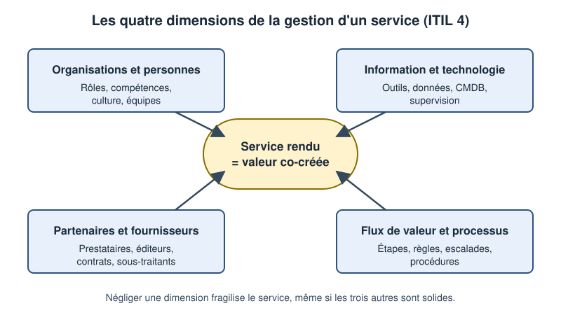
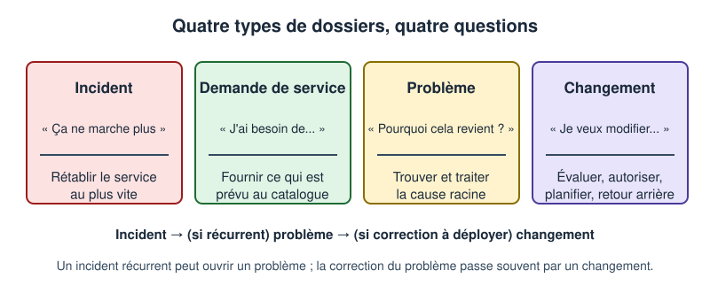
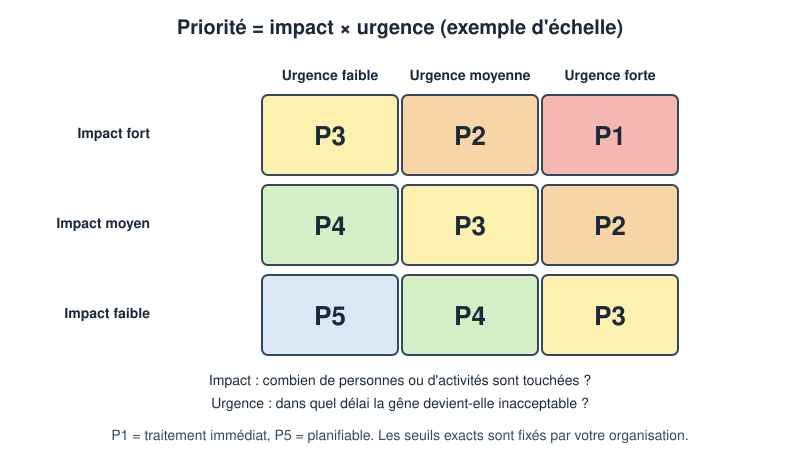
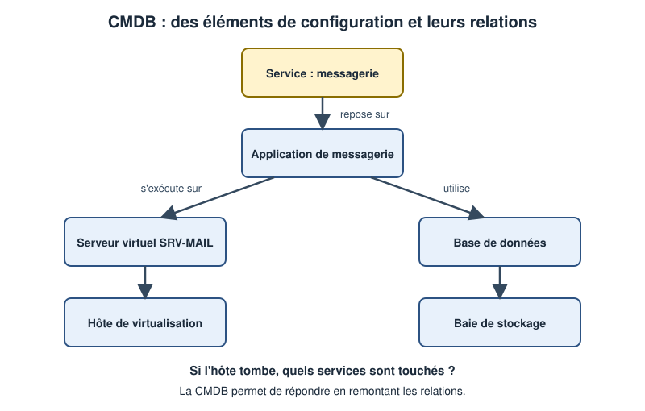

# Leçon — ITIL 4 pour le technicien : valeur, incident, demande, problème, changement, priorités, SLA et CMDB

- **Tags** : `transverse`, `tout-en-un`, `lecon`, `support`, `itil`, `itsm`, `incident`, `sla`, `cmdb`
- **Niveau** : débutant à intermédiaire (technicien support N1/N2, étudiant TSSR)
- **Durée estimée** : 3 h 30 (lecture 1 h 30, laboratoire 1 h, exercices et quiz 1 h)

---

## Objectifs pédagogiques

À l'issue de cette leçon, vous saurez :

1. Expliquer la notion de **valeur** et de **service** telle que la présente ITIL 4, et la relier à votre travail quotidien de technicien.
2. Citer les **quatre dimensions** de la gestion d'un service et les **principes directeurs** utiles au support.
3. **Distinguer** sans hésiter un incident, une demande de service, un problème et un changement, et choisir le bon type de dossier.
4. Calculer une **priorité** à partir de l'impact et de l'urgence, et en déduire des échéances de **SLA**.
5. Décrire le rôle d'une **CMDB** et l'utiliser pour estimer l'impact d'une panne.
6. Reproduire, dans un laboratoire local sans risque, une petite chaîne de calcul de priorité et d'analyse d'impact.

## Prérequis et durée

- Avoir déjà traité quelques demandes d'utilisateurs (ou suivi la leçon sur la méthode de dépannage structurée) ; savoir ouvrir un terminal Linux.
- Une **machine virtuelle jetable** (Linux, par exemple Debian ou Ubuntu) pour la mise en pratique. Aucune machine de production n'est nécessaire ni souhaitable.
- Durée totale : environ 3 h 30.

> **Avertissement de marque** : ITIL® est une marque déposée de PeopleCert. Cette leçon est une introduction pédagogique indépendante, rédigée avec nos propres mots ; elle ne remplace ni la documentation officielle ni une formation certifiante.

## L'essentiel en bref

- Un service informatique n'existe que pour permettre à d'autres personnes d'atteindre **leurs** objectifs : la **valeur** se **co-crée** entre le fournisseur et l'utilisateur.
- Quatre types de dossiers à ne jamais confondre : **incident** (rétablir), **demande** (fournir), **problème** (comprendre la cause), **changement** (modifier de façon maîtrisée).
- La **priorité** combine **impact** (qui et quoi est touché) et **urgence** (dans quel délai cela devient intolérable). Le **SLA** transforme la priorité en engagements chiffrés.
- La **CMDB** décrit les éléments du système d'information et leurs **relations** ; c'est elle qui permet de répondre à « si ceci tombe, qu'est-ce qui est touché ? ».



*Figure 1 — Les quatre dimensions : un service solide demande les quatre à la fois.*

---

## 1. De quoi parle-t-on ? Un cadre de bonnes pratiques, pas une religion

ITIL est un **ensemble de bonnes pratiques** pour organiser la gestion des services informatiques (on parle d'ITSM, *IT Service Management*). Il ne vous dit pas quel logiciel installer, ni combien de personnes embaucher : il propose un **vocabulaire commun** et des pratiques éprouvées que chaque organisation adapte à sa taille.

Une analogie : dans un **restaurant**, la salle (accueil, commandes, réclamations) est le **service desk**, la cuisine ce sont les équipes techniques, le menu est le **catalogue de services**, le plan de la cuisine avec ses dépendances est la **CMDB**, et la réunion qui analyse pourquoi le même plat revient trois fois est la **gestion des problèmes**. Le technicien est le visage du service pour l'utilisateur **et** le relais vers les experts.

## 2. La valeur et le service

### 2.1 Définitions simples

- **Valeur** : les avantages perçus, l'utilité et l'importance de quelque chose pour une personne ou une organisation. La valeur n'est pas dans le serveur : elle est dans ce que l'utilisateur peut faire grâce à lui.
- **Service** : un moyen de permettre la co-création de valeur en facilitant les résultats que le client veut obtenir, **sans** qu'il ait à gérer lui-même les coûts et les risques spécifiques associés.
- **Co-création** : le résultat dépend des deux côtés. Si vous réparez l'imprimante mais que l'utilisateur ne sait pas la sélectionner, la valeur n'est pas créée.

Exemple : la messagerie. L'utilisateur ne veut pas gérer des serveurs, des sauvegardes, des certificats, des filtres antispam : il veut **échanger avec ses clients**. Le service de messagerie lui épargne les coûts et les risques liés à cette mécanique.

### 2.2 Résultats, coûts, risques

Trois questions rattachent un dossier à la valeur : quel **résultat** la personne cherche-t-elle (envoyer un devis avant midi) ? quel **coût** en temps ou en effort (une heure d'indisponibilité pour dix commerciaux) ? quel **risque** (perte de données si l'on réinstalle sans sauvegarde) ?

### 2.3 Les quatre dimensions

ITIL 4 invite à considérer toute activité de service sous quatre angles (figure 1) :

1. **Organisations et personnes** : rôles, compétences, culture, communication.
2. **Information et technologie** : outils, données, connaissances, automatisation.
3. **Partenaires et fournisseurs** : prestataires, éditeurs, contrats de support.
4. **Flux de valeur et processus** : enchaînement des activités qui produisent le résultat.

Cas pratique : un incident récurrent sur un logiciel métier. Dimension *technologie* : bug dans la version installée. Dimension *partenaire* : l'éditeur doit fournir un correctif. Dimension *personnes* : les utilisateurs n'ont pas été formés au contournement. Dimension *processus* : aucune règle ne prévoit de tester les mises à jour avant déploiement. Corriger une seule dimension laisse le problème revenir.

### 2.4 Les principes directeurs utiles au support

ITIL 4 en propose sept ; trois guident surtout le technicien : **se concentrer sur la valeur** (que doit pouvoir faire l'utilisateur à la fin ?), **collaborer et favoriser la visibilité** (un ticket à jour permet aux autres d'aider) et **rester simple et pratique** (une procédure de douze étapes ne sera pas suivie). Les autres : commencer là où l'on est, progresser par itérations, penser de façon globale, optimiser et automatiser.

## 3. Le système de valeur et la chaîne de valeur (vue d'ensemble)

ITIL 4 rassemble principes, gouvernance, **chaîne de valeur** (planifier, améliorer, impliquer, concevoir et assurer la transition, obtenir ou construire, fournir et soutenir) et **pratiques**. Votre travail quotidien se situe surtout dans « impliquer » (accueillir, qualifier) et « fournir et soutenir » (traiter, résoudre). Les pratiques qui vous concernent : gestion des incidents, des demandes, des problèmes, habilitation des changements, centre de services, niveaux de service, configuration, connaissances.

## 4. Incident, demande, problème, changement : quatre dossiers, quatre questions



*Figure 2 — Un même utilisateur peut déclencher les quatre types : l'important est de choisir le bon.*

### 4.1 Incident : rétablir au plus vite

**Définition** : une interruption non planifiée d'un service, ou une dégradation de sa qualité. Objectif : **restaurer le service normal**, quitte à employer un **contournement** (*workaround*). Exemple : « Je n'arrive plus à ouvrir mes fichiers partagés ». Piège classique : chercher la cause racine pendant que dix personnes ne travaillent plus. Rétablissez d'abord, comprenez ensuite.

### 4.2 Demande de service : fournir ce qui est prévu

**Définition** : une demande d'un utilisateur pour obtenir une prestation **prévue au catalogue** : information, accès, équipement, installation.

- Objectif : exécuter une procédure connue, dans un délai annoncé, avec les validations nécessaires.
- Exemples : création d'un compte, accès à un dossier partagé (avec accord du responsable), installation d'un logiciel du catalogue, prêt d'un ordinateur portable.
- Ce n'est **pas** une panne : rien n'est cassé. D'où une gestion distincte, souvent avec des **formulaires** et des **circuits de validation**.

### 4.3 Problème : comprendre la cause

**Définition** : la cause, réelle ou supposée, d'un ou plusieurs incidents.

- Objectif : **trouver et traiter la cause racine** pour éviter la récurrence, ou à défaut documenter une **erreur connue** accompagnée de son contournement.
- Déclencheurs : incidents répétitifs, incident majeur dont la cause n'est pas élucidée, tendance détectée par la supervision.
- Un problème n'a pas de délai de rétablissement aussi pressant qu'un incident ; il a un **propriétaire** et un plan d'analyse.

### 4.4 Changement : modifier de façon maîtrisée

ITIL 4 parle d'**habilitation des changements** : permettre que des modifications aient lieu avec un bon niveau de risque maîtrisé, sans freiner inutilement.

- **Changement standard** : à faible risque, préautorisé, suit une procédure connue (exemple : installer un logiciel validé sur un poste).
- **Changement normal** : évalué, planifié, autorisé par une **autorité de changement** adaptée au risque (exemple : migration d'un serveur de fichiers).
- **Changement d'urgence** : nécessaire pour traiter rapidement un incident grave, avec un processus accéléré mais **tracé** et revu a posteriori.

Un bon changement comprend toujours : la **raison**, l'**évaluation du risque**, un **plan de test**, un **plan de retour arrière**, une **fenêtre de réalisation**, une **communication** aux personnes concernées et une **vérification** après coup.

### 4.5 Comment choisir ? Un arbre de décision rapide

1. **Quelque chose qui fonctionnait ne fonctionne plus (ou mal) ?** → incident.
2. **L'utilisateur demande quelque chose de prévu, rien n'est cassé ?** → demande de service.
3. **Le même incident revient, ou la cause est inconnue et importante ?** → ouvrir (ou rattacher à) un problème.
4. **Il faut modifier la production (configuration, version, matériel) ?** → changement, y compris si la modification découle d'un incident ou d'un problème.

Les dossiers sont **liés** : l'incident T-1 est rattaché au problème P-1, dont la correction passe par le changement C-1. On suit ainsi l'histoire complète.

## 5. Priorités : impact, urgence et matrice

### 5.1 Deux dimensions indépendantes

Un message en majuscules n'est pas forcément plus grave qu'un message poli. On évalue donc l'**impact** (étendue des conséquences : personnes touchées, activité, enjeu financier ou réglementaire) et l'**urgence** (délai au-delà duquel les conséquences deviennent inacceptables).

### 5.2 La matrice



*Figure 3 — Exemple d'échelle : P1 en haut à droite, P5 en bas à gauche. Votre organisation fixe ses propres seuils.*

Exemples :

- Panne du serveur de messagerie pendant la matinée de clôture comptable : impact **fort** (toute l'entreprise), urgence **forte** → **P1**.
- Une imprimante de couloir en panne alors qu'il y en a une autre à vingt mètres : impact **faible**, urgence **faible** → **P5**.
- L'application de facturation est inaccessible pour une seule personne qui doit envoyer une facture critique aujourd'hui : impact **faible** mais urgence **forte** → **P3**.

> **Bon réflexe** : la priorité est **recalculée** si la situation évolue. Un ticket P4 devient P2 si l'on découvre que dix personnes sont touchées.

## 6. SLA, OLA et contrats de support

### 6.1 Trois sigles à ne pas mélanger

| Sigle | Signification | Qui s'engage envers qui ? |
|---|---|---|
| **SLA** | Accord de niveau de service | Le service informatique envers ses utilisateurs ou clients |
| **OLA** | Accord de niveau opérationnel | Une équipe interne envers une autre (par exemple le support N2 envers le N1) |
| **UC** | Contrat de soutien (contrat fournisseur) | Un fournisseur externe envers l'entreprise |

Un SLA tenable repose sur des OLA et des contrats fournisseurs compatibles : promettre quatre heures aux utilisateurs alors que le fournisseur de la baie n'intervient qu'en vingt-quatre heures n'a pas de sens.

### 6.2 Ce que contient un SLA utile

Le **périmètre**, les **horaires** de service, les **cibles par priorité** (prise en charge et résolution), les indicateurs et la revue, les exclusions (maintenance planifiée) et les règles de **suspension** du chronomètre.

### 6.3 Exemple fictif de cibles

| Priorité | Prise en charge | Résolution ou contournement | Fréquence de point d'avancement |
|---|---|---|---|
| P1 | 15 minutes | 4 heures | toutes les 30 minutes |
| P2 | 1 heure | 8 heures | toutes les 2 heures |
| P3 | 4 heures | 1 jour | quotidienne |
| P4 | 8 heures | 3 jours | à l'étape clé |
| P5 | 16 heures | 5 jours | à la clôture |

Ces chiffres sont **inventés** pour l'exemple. Les vôtres dépendent du contexte, des horaires d'ouverture et des moyens.

### 6.4 Le piège du chronomètre

Le chronomètre démarre **à l'ouverture**, n'est suspendu que pour une attente légitime et tracée, et on **alerte avant** l'échéance. On ne « clôture pas pour respecter le SLA » : un ticket fermé à tort rouvre et la confiance s'érode.

## 7. La CMDB : savoir de quoi est fait le système d'information

### 7.1 Principe

La **CMDB** (*Configuration Management Database*) est une base qui répertorie les **éléments de configuration** (en anglais *CI*, *configuration items*) et leurs **relations**. Un élément peut être un serveur, un poste, une application, une base de données, un service, un contrat, un équipement réseau.

La valeur n'est pas dans la liste, mais dans les **liens** : « ce service repose sur cette application, qui s'exécute sur ce serveur virtuel, hébergé sur cet hôte, qui utilise cette baie ».



*Figure 4 — Un graphe de dépendances permet de répondre à la question « qui est touché si cet élément tombe ? ».*

### 7.2 À quoi cela sert-il concrètement au technicien ?

- **Estimer l'impact** d'une panne : l'hôte tombe, quels services sont dégradés ?
- **Évaluer un changement** : si je redémarre ce commutateur, qui est concerné ?
- **Diagnostiquer** plus vite : connaître le chemin d'un service oriente l'investigation.

### 7.3 Attributs, inventaire et pièges

Chaque élément porte au minimum : identifiant unique, nom et type, propriétaire, état, environnement (production ou test) et relations. Un **inventaire** automatique découvre ce qui existe ; la CMDB lui ajoute les **relations** et la vision service. Deux écueils : la **dérive** (une CMDB fausse est pire que pas de CMDB : alimentez-la automatiquement et mettez-la à jour à chaque changement) et l'**excès** (commencez par les services critiques et leurs dépendances directes).

## Mise en pratique guidée

Objectif : manipuler, en local, **trois petits outils en lecture seule ou auto-contenus** — calcul de priorité et d'échéances, analyse d'impact d'une CMDB sous forme de fichier CSV. Aucun service réseau n'est installé et rien n'est modifié sur le système.

> **Précautions** : travaillez dans une **machine virtuelle jetable**. Avant toute modification sensible dans une autre situation (installer des paquets, changer un service), prenez un **instantané** de la VM, gardez un **accès console de secours**, testez, et sachez **revenir en arrière**. Ici, vous ne créez que des fichiers dans un dossier dédié que vous supprimez à la fin (retour arrière).

### Étape 1 — Créer un dossier de travail

```bash
mkdir -p ~/lab-itil && cd ~/lab-itil
```

👉 Explication : `mkdir -p` crée le dossier sans erreur s'il existe déjà ; `cd` s'y place. Tout ce que vous produisez reste dans ce dossier.

### Étape 2 — Écrire le calculateur de priorité et d'échéances

```bash
cat > priorite.sh <<'EOF'
#!/usr/bin/env bash
# Usage : ./priorite.sh <impact: fort|moyen|faible> <urgence: faible|moyenne|forte> "<AAAA-MM-JJ HH:MM>"
set -euo pipefail
impact=${1:?impact}; urgence=${2:?urgence}; ouverture=${3:?ouverture}

case "$impact/$urgence" in
  fort/forte) p=P1 ;;
  fort/moyenne|moyen/forte) p=P2 ;;
  fort/faible|moyen/moyenne|faible/forte) p=P3 ;;
  moyen/faible|faible/moyenne) p=P4 ;;
  faible/faible) p=P5 ;;
  *) echo "Combinaison inconnue : $impact/$urgence" >&2; exit 1 ;;
esac

case "$p" in
  P1) tto=15;  ttr=240 ;;
  P2) tto=60;  ttr=480 ;;
  P3) tto=240; ttr=1440 ;;
  P4) tto=480; ttr=4320 ;;
  P5) tto=960; ttr=7200 ;;
esac

echo "Priorité      : $p"
debut=$(date -d "$ouverture" +%s)
echo "Prise en charge avant : $(date -d "@$((debut + tto * 60))" '+%F %H:%M')"
echo "Résolution avant      : $(date -d "@$((debut + ttr * 60))" '+%F %H:%M')"
EOF
chmod +x priorite.sh
```

👉 Explication : le script reprend la matrice de la figure 3 dans un `case`, associe à chaque priorité des délais en minutes (valeurs fictives du paragraphe 6.3, résolution simplifiée) puis calcule les échéances avec `date`. Il compte en **temps continu** : il ignore volontairement les heures ouvrées pour rester simple. `set -euo pipefail` arrête le script en cas d'erreur.

### Étape 3 — Tester la matrice

```bash
./priorite.sh fort forte "2026-11-02 09:00"
./priorite.sh moyen faible "2026-11-02 09:00"
./priorite.sh x y "2026-11-02 09:00"; echo "code retour : $?"
```

👉 Explication : les deux premiers appels doivent afficher respectivement **P1** (prise en charge à 09:15, résolution à 13:00) et **P4** (prise en charge à 17:00, résolution le 2026-11-05 à 09:00). Le troisième vérifie le comportement face à une saisie invalide : message d'erreur et code retour 1.

### Étape 4 — Décrire une mini-CMDB sous forme de fichier

```bash
cat > cmdb.csv <<'EOF'
ci,type,depend_de
svc-messagerie,service,app-mail
app-mail,application,srv-mail
app-mail,application,db-mail
srv-mail,serveur,hote-01
db-mail,base,san-01
svc-intranet,service,app-web
app-web,application,hote-01
EOF
```

👉 Explication : chaque ligne signifie « cet élément dépend de celui-ci ». C'est une CMDB minimaliste : des éléments, un type, une relation. Les noms sont fictifs.

### Étape 5 — Écrire l'analyse d'impact

```bash
cat > impact.sh <<'EOF'
#!/usr/bin/env bash
# Usage : ./impact.sh <élément en panne> [fichier.csv]
set -euo pipefail
cible=${1:?élément en panne}; fichier=${2:-cmdb.csv}
a_traiter=("$cible")
while [ ${#a_traiter[@]} -gt 0 ]; do
  courant=${a_traiter[0]}
  a_traiter=("${a_traiter[@]:1}")
  while IFS=, read -r ci type dep; do
    if [ "$dep" = "$courant" ]; then
      echo "$type : $ci"
      a_traiter+=("$ci")
    fi
  done < <(tail -n +2 "$fichier")
done | sort -u
EOF
chmod +x impact.sh
```

👉 Explication : le script part de l'élément en panne, cherche tous les éléments qui **en dépendent**, puis recommence pour chacun (parcours « en largeur » du graphe). `tail -n +2` saute l'en-tête du CSV ; `sort -u` supprime les doublons.

### Étape 6 — Interroger l'impact

```bash
./impact.sh hote-01
echo "---"
./impact.sh san-01
```

👉 Explication : pour `hote-01`, vous devez voir apparaître le serveur `srv-mail`, l'application `app-web`, l'application `app-mail` et les services `svc-intranet` et `svc-messagerie`. Pour `san-01`, seuls la base `db-mail`, l'application `app-mail` et le service `svc-messagerie` sont touchés. Vous avez répondu, avec un simple fichier, à la question « si ceci tombe, qui est touché ? ».

### Retour arrière et nettoyage

```bash
cd ~ && rm -r ~/lab-itil
```

👉 Explication : supprime le dossier de travail et tout ce qu'il contient. Si vous avez pris un instantané de la VM avant la leçon, vous pouvez aussi le restaurer.

## Exercices

1. **Vocabulaire** — Classez chacune de ces phrases : incident, demande, problème ou changement. (a) « Le partage réseau ne répond plus. » (b) « Je voudrais un second écran. » (c) « Depuis un mois, la visioconférence saccade chaque mardi. » (d) « Nous passons le contrôleur de domaine à la version supérieure samedi. »
2. **Valeur** — Pour le service de messagerie, donnez un exemple de résultat attendu par l'utilisateur, un coût qu'il n'a pas à supporter et un risque dont le service le protège.
3. **Priorité** — Calculez la priorité d'un incident touchant tout un service de dix personnes avec une urgence moyenne, puis celle d'une seule personne avec urgence faible. Justifiez avec la matrice de la figure 3.
4. **Échéances** — Un ticket P2 est ouvert le lundi à 14 h 30. Avec les cibles du paragraphe 6.3 (temps continu), donnez les deux échéances. Puis expliquez ce qui change si le ticket attend deux heures une réponse de l'utilisateur.
5. **CMDB** — Dessinez sur papier le graphe correspondant à `cmdb.csv`, puis prévoyez les éléments touchés par la panne de `srv-mail`. Vérifiez avec `./impact.sh srv-mail`.
6. **Changement** — Rédigez le plan d'un changement standard : « installer une mise à jour de sécurité sur un poste ». Précisez tests, retour arrière et communication.

## Corrigés des exercices

1. (a) incident ; (b) demande de service (si un écran figure au catalogue ; sinon demande à valider) ; (c) incident récurrent à rattacher à un **problème** ; (d) changement (probablement normal, vu le risque).
2. Résultat : échanger avec des clients et collègues. Coût évité : administration des serveurs, des sauvegardes, des certificats. Risque évité : perte de courriels ou compromission faute de mises à jour.
3. Dix personnes dans un service : impact **moyen** ; urgence moyenne → **P3** (case milieu). Une seule personne, urgence faible : impact **faible** → **P5**.
4. Ouverture lundi 14 h 30 ; P2 : prise en charge dans l'heure, soit lundi 15 h 30 ; résolution sous 8 h, soit lundi 22 h 30 en temps continu. Si le ticket attend deux heures l'utilisateur, le chronomètre de résolution est **suspendu** pendant ces deux heures : l'échéance recule d'autant (lundi 0 h 30 le lendemain), à condition que la suspension soit justifiée et tracée.
5. `srv-mail` touche `app-mail` et `svc-messagerie`. La base `db-mail` n'est pas touchée : elle est un parent, pas un dépendant. `./impact.sh srv-mail` affiche « application : app-mail » et « service : svc-messagerie ».
6. Exemple : raison (correctif de sécurité publié) ; risque faible ; tests : sur un poste pilote, puis un groupe ; retour arrière : point de restauration ou désinstallation du correctif ; communication : informer l'utilisateur de l'éventuel redémarrage ; vérification : inventaire montrant la version attendue.

## Quiz

**1. Quelle est la meilleure définition de la valeur selon ITIL 4 ?**
a) Le coût du serveur ; b) Le prix du contrat ; c) Le nombre de tickets clos ; d) Les avantages perçus, l'utilité et l'importance pour l'utilisateur.
*Réponse : d. La valeur se mesure à ce que l'utilisateur peut accomplir, pas à l'infrastructure ni à un compteur.*

**2. Un utilisateur demande l'installation d'un logiciel du catalogue. C'est :**
a) un incident ; b) une demande de service ; c) un problème ; d) un changement d'urgence.
*Réponse : b. Rien n'est cassé, la prestation est prévue ; c'est une demande (souvent associée à un changement standard).*

**3. Quel est l'objectif premier de la gestion des incidents ?**
a) Rétablir le service normal ; b) Trouver la cause racine ; c) Faire baisser le coût ; d) Former l'utilisateur.
*Réponse : a. On rétablit d'abord, éventuellement par contournement ; la cause racine relève du problème.*

**4. Un même incident revient trois fois par semaine. Que faire en plus de le traiter ?**
a) Rien ; b) Le clore sans suite ; c) Ouvrir ou rattacher à un problème ; d) Le requalifier en demande.
*Réponse : c. La récurrence appelle une analyse de cause racine.*

**5. La priorité est obtenue en combinant :**
a) Le nom du demandeur et l'heure ; b) Le type d'équipement ; c) Le coût et la durée ; d) L'impact et l'urgence.
*Réponse : d. Impact (étendue) et urgence (délai tolérable) sont indépendants.*

**6. Une seule personne, mais une facture critique à envoyer dans l'heure : impact faible, urgence forte. Avec la matrice proposée :**
a) P1 ; b) P3 ; c) P5 ; d) impossible à dire.
*Réponse : b. Faible/forte donne P3 dans la matrice de la figure 3.*

**7. Qu'est-ce qu'un OLA ?**
a) Un logiciel de supervision ; b) Un contrat avec un client ; c) Un accord entre une équipe interne et une autre ; d) Un type de changement.
*Réponse : c. L'OLA décrit les engagements internes qui soutiennent le SLA.*

**8. Quand peut-on suspendre légitimement le chronomètre d'un SLA ?**
a) Pendant l'attente d'une information de l'utilisateur ou d'un tiers, selon les règles du SLA ; b) Dès que le ticket est difficile ; c) À la fin de la journée ; d) Jamais, sous aucun prétexte.
*Réponse : a. La suspension est prévue pour les attentes légitimes, tracées.*

**9. Qu'apporte la CMDB que ne donne pas une simple liste de matériel ?**
a) Les prix ; b) Les photos des machines ; c) Les mots de passe ; d) Les relations de dépendance entre éléments.
*Réponse : d. Ce sont les liens qui permettent d'évaluer l'impact d'une panne ou d'un changement.*

**10. Un changement de type « standard » est :**
a) Un changement sans risque que l'on peut faire sans trace ; b) Un changement d'urgence ; c) Un changement à faible risque, préautorisé, suivant une procédure connue ; d) Un changement interdit.
*Réponse : c. Il est préautorisé mais reste tracé.*

## Erreurs fréquentes et dépannage

| Symptôme | Cause probable | Remède |
|---|---|---|
| Tout est classé « incident » | Confusion entre panne et demande | Utiliser l'arbre de décision du paragraphe 4.5 et un catalogue de demandes clair |
| Trop de tickets en P1 | Impact et urgence évalués à l'émotion | Questions d'évaluation écrites, revue hebdomadaire des P1 |
| La CMDB est fausse | Mises à jour manuelles oubliées | Alimentation automatique, mise à jour obligatoire à la clôture d'un changement |
| `date: date ... incorrecte` dans le script | Format de date non reconnu | Utiliser `"AAAA-MM-JJ HH:MM"` entre guillemets |

## À retenir

- Un service vise la **valeur co-créée** ; pensez résultats, coûts, risques.
- **Incident** = rétablir ; **demande** = fournir ; **problème** = comprendre ; **changement** = modifier de façon maîtrisée. Ils se **lient** entre eux.
- **Priorité = impact × urgence** ; elle se recalcule quand la situation évolue.
- Un **SLA** est un engagement **mesurable et tenable**, soutenu par des OLA et des contrats fournisseurs.
- La **CMDB** vaut par ses **relations** et par son **exactitude**.
- Tracez tout : un dossier clair est un dossier que quelqu'un d'autre peut reprendre.

## Pour aller plus loin

- Site de l'éditeur du cadre ITIL (PeopleCert) : <https://www.peoplecert.org/>
- Manuel de référence de Bash : <https://www.gnu.org/software/bash/manual/>
- Manuel de GNU Coreutils (commande `date`) : <https://www.gnu.org/software/coreutils/manual/>
- Chapitre « Postmortem Culture » du livre *Site Reliability Engineering* (Google) : <https://sre.google/sre-book/postmortem-culture/>

## Crédits des images

Aucune image externe n'est utilisée.

| Fichier | Source (URL Commons) | Auteur | Licence (nom + URL) | Modifications |
|---|---|---|---|---|
| `images/itil-1.svg` | Création originale du projet Pack Master | Projet Pack Master | CC0 1.0 — <https://creativecommons.org/publicdomain/zero/1.0/deed.fr> | Sans objet |
| `images/itil-2.svg` | Création originale du projet Pack Master | Projet Pack Master | CC0 1.0 — <https://creativecommons.org/publicdomain/zero/1.0/deed.fr> | Sans objet |
| `images/itil-3.svg` | Création originale du projet Pack Master | Projet Pack Master | CC0 1.0 — <https://creativecommons.org/publicdomain/zero/1.0/deed.fr> | Sans objet |
| `images/itil-4.svg` | Création originale du projet Pack Master | Projet Pack Master | CC0 1.0 — <https://creativecommons.org/publicdomain/zero/1.0/deed.fr> | Sans objet |

Schémas créés à la main en SVG, dédiés au domaine public (CC0). Aucune image libre adaptée n'a été retenue sur Wikimedia Commons pour ce sujet.

## Historique de vérification

| Date | OS/logiciel | Testeur | Verdict |
|---|---|---|---|
| 2026-11-01 | Scripts `priorite.sh`, `impact.sh` (Bash, `date`, `sort`, `tail`) sous Linux — exécutés réellement dans un dossier local jetable, supprimé ensuite ; résultats conformes à ceux annoncés aux étapes 3 et 6 | Rédacteur (assistant) | Scripts testés localement ; contenu conceptuel et procédure complète en VM : Non testé sur plateforme cible |
