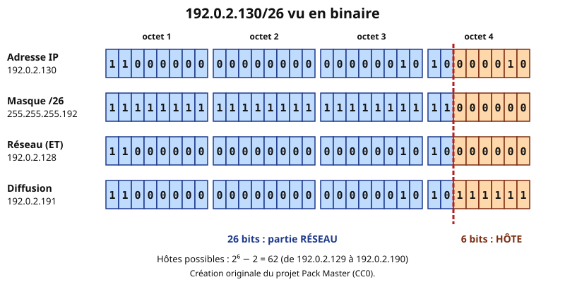
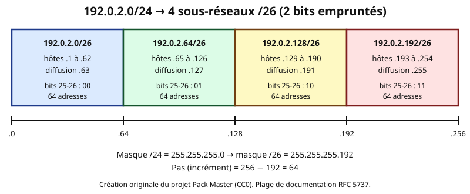
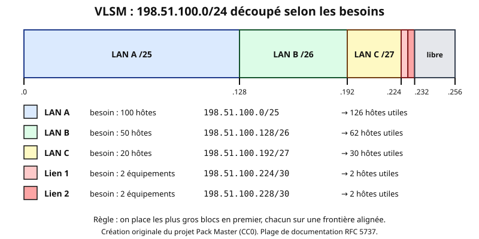

# Leçon — Adressage IPv4, masques, CIDR, VLSM et calcul de sous-réseaux

- **Tags** : `transverse`, `tout-en-un`, `lecon`, `reseau`, `ipv4`, `cidr`, `vlsm`, `sous-reseaux`, `masque`
- **Niveau** : débutant à intermédiaire ([[Glossary:TSSR]], support, administration système)
- **Durée estimée** : 4 h (lecture 1 h 30, calculs guidés 1 h 30, laboratoire et exercices 1 h)

---

## Objectifs pédagogiques

À la fin de cette leçon, vous saurez :

- convertir une adresse IPv4 entre **notation décimale pointée** et **binaire** ;
- expliquer le rôle du **masque** et passer d'un masque décimal à la **notation [[Glossary:CIDR]]** (`/n`) et inversement ;
- calculer, pour n'importe quelle adresse, son **adresse réseau**, son **adresse de diffusion**, sa **plage d'hôtes** et leur nombre ;
- découper un réseau en **sous-réseaux de taille égale** ;
- concevoir un plan d'adressage **[[Glossary:VLSM]]** (masques de longueurs variables) sans chevauchement ;
- **agréger** plusieurs réseaux contigus en un seul préfixe ;
- reconnaître les plages **privées et spéciales** (RFC 1918, 169.254.0.0/16, documentation…) ;
- décider si deux machines sont **dans le même réseau** ou si un routeur est nécessaire.

## Prérequis et durée

- Connaître la notion d'adresse [[Glossary:IP]] et de réseau local (voir la leçon [Modèle OSI et TCP/IP](lecon-osi-tcpip.md)).
- Savoir faire des additions, soustractions et multiplications simples ; connaître les puissances de 2 jusqu'à 2⁸ (c'est le seul « par cœur » à retenir, voir section 1).
- Durée : environ 4 h. Aucun matériel spécifique : un terminal avec Python 3, ou PowerShell, suffit. Les calculs du laboratoire sont purement informatiques et ne touchent à aucune configuration réseau.

## L'essentiel en bref

- Une adresse IPv4 = **32 bits** = 4 octets (0 à 255) écrits en décimal : `192.0.2.130`.
- Le **masque** sépare la partie **réseau** (bits à 1) de la partie **hôte** (bits à 0). `/26` signifie « 26 bits à 1 ».
- **Adresse réseau** = adresse ET masque. **Diffusion** = tous les bits hôte à 1. **Hôtes utilisables** = 2^h − 2, avec h le nombre de bits hôte.
- Méthode rapide : le **pas** (incrément) = 256 − valeur de l'octet du masque ; les réseaux démarrent aux multiples du pas.
- **CIDR** supprime les « classes » : on précise la longueur du préfixe. **VLSM** autorise des préfixes différents dans un même plan d'adressage.
- On alloue les blocs **du plus grand au plus petit**, chacun aligné sur sa taille.
- Adresses d'exemple de cette leçon : 192.0.2.0/24, 198.51.100.0/24, 203.0.113.0/24 (RFC 5737, réservées à la documentation).

---

## 1. Anatomie d'une adresse IPv4

### 1.1 32 bits, 4 octets

Une adresse IPv4 est un nombre de 32 bits, découpé en **quatre octets** de 8 bits, chacun écrit en décimal (0 à 255) et séparé par un point. Cette écriture n'est qu'un confort de lecture : les machines manipulent les bits.

Analogie : une adresse IP ressemble à une adresse postale. Le début désigne la **ville** (le réseau) et la fin désigne la **maison** (l'hôte). Le masque indique **où s'arrête le nom de la ville**.

### 1.2 Conversion décimal ↔ binaire

Chaque bit d'un octet a un poids : de gauche à droite **128, 64, 32, 16, 8, 4, 2, 1**.

Pour convertir **203** en binaire : 203 − 128 = 75 (bit 128 = 1) ; 75 − 64 = 11 (64 = 1) ; 32 trop grand (0) ; 16 trop grand (0) ; 11 − 8 = 3 (8 = 1) ; 4 trop grand (0) ; 3 − 2 = 1 (2 = 1) ; 1 − 1 = 0 (1 = 1). Résultat : `11001011`.

Pour l'opération inverse, on additionne les poids des bits à 1 : `00101101` = 32 + 8 + 4 + 1 = **45**.

| Décimal | Binaire | | Décimal | Binaire |
|---|---|---|---|---|
| 0 | 00000000 | | 128 | 10000000 |
| 2 | 00000010 | | 192 | 11000000 |
| 51 | 00110011 | | 224 | 11100000 |
| 100 | 01100100 | | 240 | 11110000 |
| 113 | 01110001 | | 255 | 11111111 |

### 1.3 Les valeurs d'octet de masque à connaître

Un masque est toujours une suite de 1 **puis** une suite de 0. Dans un octet partiel, seules 9 valeurs sont possibles :

| Bits à 1 dans l'octet | 0 | 1 | 2 | 3 | 4 | 5 | 6 | 7 | 8 |
|---|---|---|---|---|---|---|---|---|---|
| Valeur décimale | 0 | 128 | 192 | 224 | 240 | 248 | 252 | 254 | 255 |

---

## 2. Réseau, hôte et masque

### 2.1 Le masque

Le masque a la même taille que l'adresse (32 bits). Les bits à **1** désignent la partie **réseau**, les bits à **0** la partie **hôte**.

- `255.255.255.0` = 24 bits à 1 = `/24`
- `255.255.255.192` = 26 bits à 1 = `/26`
- `255.255.240.0` = 20 bits à 1 = `/20`

La notation `/n` s'appelle **CIDR** (*Classless Inter-Domain Routing*, RFC 4632). Elle indique simplement le nombre de bits du préfixe réseau.

### 2.2 Le ET logique : trouver l'adresse réseau

Pour obtenir l'adresse du réseau, on applique un **ET bit à bit** entre l'adresse et le masque (1 ET 1 = 1, tout le reste = 0).



*Figure 1 — 192.0.2.130/26 en binaire : le ET avec le masque donne 192.0.2.128 ; hôtes à 1 : 192.0.2.191 (création originale Pack Master, CC0).*

Lecture de la figure :

- **Adresse réseau** (bits hôte tous à 0) : 192.0.2.**128** — elle identifie le réseau, on ne l'affecte à aucune machine.
- **Adresse de diffusion** (*broadcast*, bits hôte tous à 1) : 192.0.2.**191** — elle vise tous les hôtes du réseau.
- **Hôtes utilisables** : de 192.0.2.129 à 192.0.2.190.

### 2.3 Combien d'hôtes ?

Avec **h** bits hôte, on dispose de 2^h adresses, dont 2 sont réservées (réseau et diffusion) : **2^h − 2 hôtes utilisables**. Avec `/26`, h = 32 − 26 = 6, donc 2⁶ − 2 = 62.

| CIDR | Masque | Bits hôte | Adresses | Hôtes utilisables |
|---|---|---|---|---|
| /8 | 255.0.0.0 | 24 | 16 777 216 | 16 777 214 |
| /16 | 255.255.0.0 | 16 | 65 536 | 65 534 |
| /20 | 255.255.240.0 | 12 | 4 096 | 4 094 |
| /22 | 255.255.252.0 | 10 | 1 024 | 1 022 |
| /24 | 255.255.255.0 | 8 | 256 | 254 |
| /25 | 255.255.255.128 | 7 | 128 | 126 |
| /26 | 255.255.255.192 | 6 | 64 | 62 |
| /27 | 255.255.255.224 | 5 | 32 | 30 |
| /28 | 255.255.255.240 | 4 | 16 | 14 |
| /29 | 255.255.255.248 | 3 | 8 | 6 |
| /30 | 255.255.255.252 | 2 | 4 | 2 |
| /31 | 255.255.255.254 | 1 | 2 | 2 (liaison point à point, RFC 3021) |
| /32 | 255.255.255.255 | 0 | 1 | 1 (une seule adresse : hôte ou route) |

### 2.4 Les « classes » : un héritage à connaître

Avant 1993, on découpait l'espace en **classes** : A (/8, premier octet 1-126), B (/16, 128-191), C (/24, 192-223). Ce système gaspillait des adresses. Il a été remplacé par **CIDR**. Vous rencontrerez encore le vocabulaire (« un réseau de classe C » pour un /24), mais ne raisonnez plus avec les classes : raisonnez avec le **préfixe**.

---

## 3. Plages particulières à reconnaître

| Plage | Usage |
|---|---|
| 10.0.0.0/8, 172.16.0.0/12 (172.16.0.0 à 172.31.255.255), 192.168.0.0/16 | **Adresses privées** (RFC 1918), non routées sur Internet |
| 127.0.0.0/8 | **Bouclage** (*loopback*) : 127.0.0.1 désigne la machine elle-même |
| 169.254.0.0/16 | **Lien local** (APIPA, RFC 3927) : auto-attribuée quand aucun [[Glossary:DHCP]] ne répond |
| 100.64.0.0/10 | Espace de **[[Glossary:NAT]] opérateur** (CGNAT, RFC 6598) |
| 192.0.2.0/24, 198.51.100.0/24, 203.0.113.0/24 | **Documentation** (RFC 5737) |
| 224.0.0.0/4 | **Multicast** |
| 0.0.0.0 | « Adresse non spécifiée » ; `0.0.0.0/0` = route par défaut |
| 255.255.255.255 | Diffusion limitée au lien local |

Réflexe de dépannage : si un poste affiche **169.254.x.y**, il n'a pas obtenu de bail DHCP.

---

## 4. Méthode pas à pas pour calculer un sous-réseau

### 4.1 La méthode du « pas »

Étant donné `adresse/préfixe` :

1. **Repérez l'octet « intéressant »** : celui où le masque n'est ni 255 ni 0. (Pour /24, /16, /8, il n'y en a pas : le calcul est immédiat.)
2. **Calculez le pas** : 256 − valeur du masque dans cet octet.
3. **Trouvez le multiple du pas** immédiatement inférieur ou égal à l'octet de l'adresse : c'est l'octet de l'**adresse réseau** (les octets suivants sont à 0).
4. **Diffusion** : octet réseau + pas − 1 ; les octets suivants à 255.
5. **Hôtes** : première adresse = réseau + 1 ; dernière = diffusion − 1 ; nombre = 2^h − 2.

### 4.2 Exemples chiffrés

**Exemple 1 — 192.0.2.130/26.** Masque 255.255.255.192 ; octet intéressant : le 4ᵉ ; pas = 256 − 192 = **64**. Multiples : 0, 64, 128, 192. 130 est entre 128 et 191 → réseau **192.0.2.128**, diffusion 128 + 64 − 1 = **192.0.2.191**, hôtes **.129 à .190** (62).

**Exemple 2 — 198.51.100.77/27.** Masque …224 ; pas = 32. Multiples : 0, 32, 64, 96… 77 → 64. Réseau **198.51.100.64**, diffusion **198.51.100.95**, hôtes **.65 à .94** (30).

**Exemple 3 — 203.0.113.200/28.** Masque …240 ; pas = 16. 200 = 12 × 16 + 8 → multiple 192. Réseau **203.0.113.192**, diffusion **203.0.113.207**, hôtes **.193 à .206** (14).

**Exemple 4 — 192.0.2.5/30.** Pas = 4 ; 5 → 4. Réseau **192.0.2.4**, diffusion **192.0.2.7**, hôtes **.5 et .6** : un /30 sert aux liaisons entre deux routeurs.

**Exemple 5 — 198.51.100.100/25.** Pas = 128 ; 100 → 0. Réseau **198.51.100.0**, diffusion **198.51.100.127**, hôtes **.1 à .126** (126).

**Exemple 6 — masque dans le 3ᵉ octet : 172.16.37.9/20.** Masque 255.255.240.0 ; octet intéressant : le 3ᵉ ; pas = 256 − 240 = **16** ; 37 → multiple 32. Réseau **172.16.32.0**, diffusion : 32 + 16 − 1 = 47 → **172.16.47.255**, hôtes **172.16.32.1 à 172.16.47.254**, soit 2¹² − 2 = **4094**.

**Exemple 7 — 172.16.133.77/18.** Masque 255.255.192.0 ; pas = 64 sur le 3ᵉ octet ; 133 → 128. Réseau **172.16.128.0**, diffusion **172.16.191.255** (128 + 64 − 1 = 191), hôtes 2¹⁴ − 2 = **16 382**.

### 4.3 Vérification rapide

Une adresse réseau est toujours un **multiple de la taille du bloc** ; une diffusion est toujours « un multiple + taille − 1 ». Si votre réseau n'est pas aligné, vous vous êtes trompé.

### 4.4 Deux machines sont-elles dans le même réseau ?

On calcule l'adresse réseau de chacune avec **le même masque** ; si les deux résultats sont identiques, elles se parlent directement (couche 2). Sinon, la communication passe par un **routeur**.

- 192.0.2.70/26 et 192.0.2.120/26 : réseaux .64 et .64 → **même réseau**.
- 192.0.2.60/26 et 192.0.2.70/26 : réseaux .0 et .64 → **réseaux différents**, malgré des adresses proches.

---

## 5. Découper un réseau en sous-réseaux égaux

### 5.1 Principe : emprunter des bits

Pour obtenir plusieurs sous-réseaux, on **emprunte des bits** à la partie hôte et on les ajoute au préfixe. Avec **n** bits empruntés, on obtient **2^n** sous-réseaux.



*Figure 2 — 192.0.2.0/24 découpé en quatre /26 : 2 bits empruntés, pas de 64 (création originale Pack Master, CC0).*

### 5.2 Méthode en quatre questions

1. **De combien de sous-réseaux ai-je besoin ?** Prenez la puissance de 2 supérieure ou égale.
2. **Combien d'hôtes dans le plus gros ?** Cherchez le plus petit h tel que 2^h − 2 ≥ besoin.
3. **Nouveau préfixe** = 32 − h (doit aussi être ≥ préfixe d'origine + n).
4. **Listez** les blocs avec le pas.

### 5.3 Exemple complet : 203.0.113.0/24 pour 6 services

Il faut au moins 6 sous-réseaux → 2³ = 8 (3 bits empruntés) → préfixe 24 + 3 = **/27** (30 hôtes chacun, pas = 32).

| N° | Réseau | Hôtes utilisables | Diffusion |
|---|---|---|---|
| 0 | 203.0.113.0/27 | .1 – .30 | .31 |
| 1 | 203.0.113.32/27 | .33 – .62 | .63 |
| 2 | 203.0.113.64/27 | .65 – .94 | .95 |
| 3 | 203.0.113.96/27 | .97 – .126 | .127 |
| 4 | 203.0.113.128/27 | .129 – .158 | .159 |
| 5 | 203.0.113.160/27 | .161 – .190 | .191 |
| 6 | 203.0.113.192/27 | .193 – .222 | .223 |
| 7 | 203.0.113.224/27 | .225 – .254 | .255 |

On gagne en structure, mais on perd en souplesse : chaque service reçoit 30 adresses, même s'il n'en utilise que 5. C'est ce que corrige le VLSM.

---

## 6. VLSM : des sous-réseaux de tailles différentes

### 6.1 Principe

**VLSM** (*Variable Length Subnet Masking*) consiste à utiliser des masques **différents** dans un même plan d'adressage, pour que chaque réseau reçoive une taille adaptée à son besoin. C'est une conséquence directe de CIDR.

### 6.2 Méthode (à suivre dans l'ordre)

1. **Lister les besoins** (hôtes, **plus** passerelle, **plus** marge de croissance).
2. **Trier du plus grand au plus petit.**
3. Pour chaque besoin, choisir le **plus petit bloc** dont 2^h − 2 ≥ besoin.
4. **Allouer** chaque bloc à la **première adresse libre alignée** sur sa taille.
5. **Contrôler** l'absence de chevauchement et noter ce qui reste libre.

### 6.3 Exemple : 198.51.100.0/24

Besoins : [[Glossary:LAN]] A = 100 hôtes, LAN B = 50, LAN C = 20, deux liaisons point à point entre routeurs (2 adresses chacune).

| Réseau | Besoin | Bloc choisi | Plage | Hôtes utiles |
|---|---|---|---|---|
| LAN A | 100 | /25 (128 adresses) | 198.51.100.0 – .127 | 126 |
| LAN B | 50 | /26 (64 adresses) | 198.51.100.128 – .191 | 62 |
| LAN C | 20 | /27 (32 adresses) | 198.51.100.192 – .223 | 30 |
| Lien 1 | 2 | /30 (4 adresses) | 198.51.100.224 – .227 | 2 |
| Lien 2 | 2 | /30 (4 adresses) | 198.51.100.228 – .231 | 2 |
| Libre | — | — | 198.51.100.232 – .255 | 24 adresses |



*Figure 3 — Plan VLSM de 198.51.100.0/24 (création originale Pack Master, CC0).*

**Pourquoi du plus grand au plus petit ?** Un bloc de 128 adresses doit commencer à 0 ou 128 : si on place d'abord des petits blocs en désordre, on fragmente l'espace et le gros bloc ne trouve plus d'emplacement aligné.

Sans VLSM (masque unique /25 partout), on n'aurait pu faire que 2 sous-réseaux ; avec le VLSM, on en loge 5 et il reste de la place.

### 6.4 Les pièges du VLSM

- **Oublier la passerelle** (le routeur consomme une adresse) et les équipements d'infrastructure (imprimantes, serveurs, points d'accès).
- **Ne pas prévoir de croissance** : un /27 pour 28 hôtes est déjà saturé.
- **Chevauchement** : deux blocs qui se recouvrent provoquent des comportements imprévisibles ; vérifiez toujours les bornes.

---

## 7. Agrégation (supernetting)

L'opération inverse du découpage : regrouper des réseaux contigus en **un seul préfixe**, afin d'alléger les tables de routage.

**Exemple.** Regrouper 172.16.8.0/24, 172.16.9.0/24, 172.16.10.0/24 et 172.16.11.0/24.

1. Quatre réseaux = 2² : on retire **2 bits** au préfixe → /22.
2. Le premier réseau (8) doit être un **multiple de 4** (pas du /22 sur le 3ᵉ octet : 256 − 252 = 4) : 8 = 2 × 4, c'est le cas.
3. Résultat : **172.16.8.0/22**, qui couvre 172.16.8.0 à 172.16.11.255.

Contre-exemple : 172.16.9.0/24 à 172.16.12.0/24 ne s'agrègent **pas** en un /22 (9 n'est pas un multiple de 4).

---

## Mise en pratique guidée

**Cadre** : un terminal quelconque avec Python 3 (ou PowerShell). Aucune modification du système, aucune connexion réseau : ce sont des calculs. Comparez chaque résultat avec votre calcul manuel.

### Étape 1 — Afficher vos propres adresses (lecture seule)

```bash
ip -br address
```

👉 Explication : liste les interfaces avec leur adresse et leur préfixe (ex. `192.0.2.10/24`) ; vous pouvez appliquer la méthode du pas aux adresses relevées.

```powershell
Get-NetIPAddress -AddressFamily IPv4 | Select-Object InterfaceAlias, IPAddress, PrefixLength
```

👉 Explication : équivalent Windows : adresse et longueur de préfixe de chaque interface.

### Étape 2 — Calculer réseau, masque, diffusion et hôtes avec Python

```bash
python3 -c "
import ipaddress
i = ipaddress.ip_interface('192.0.2.130/26')
n = i.network
print('réseau    :', n.network_address)
print('masque    :', n.netmask)
print('diffusion :', n.broadcast_address)
print('hôtes     :', n.num_addresses - 2)
print('plage     :', list(n.hosts())[0], '->', list(n.hosts())[-1])
"
```

👉 Explication : la bibliothèque standard `ipaddress` fait le même calcul que la méthode du pas. Vous devez obtenir 192.0.2.128, 255.255.255.192, 192.0.2.191, 62, puis 192.0.2.129 → 192.0.2.190.

### Étape 3 — Lister les sous-réseaux d'un /24

```bash
python3 -c "
import ipaddress
for s in ipaddress.ip_network('203.0.113.0/24').subnets(new_prefix=27):
    print(s, s.netmask, s.broadcast_address)
"
```

👉 Explication : génère les huit /27 du tableau de la section 5.3 ; vérifiez que les pas valent bien 32.

### Étape 4 — Tester l'appartenance à un réseau

```bash
python3 -c "
import ipaddress
r = ipaddress.ip_network('192.0.2.64/26')
for a in ['192.0.2.70', '192.0.2.120', '192.0.2.60']:
    print(a, ipaddress.ip_address(a) in r)
"
```

👉 Explication : reproduit l'exemple de la section 4.4 : les deux premières adresses appartiennent au /26, la troisième non.

### Étape 5 — Vérifier une agrégation

```bash
python3 -c "
import ipaddress
r = [ipaddress.ip_network('172.16.%d.0/24' % i) for i in range(8, 12)]
print(list(ipaddress.collapse_addresses(r)))
"
```

👉 Explication : fusionne les réseaux contigus ; le résultat doit être `172.16.8.0/22`. Remplacez `range(8, 12)` par `range(9, 13)` pour constater qu'aucune agrégation unique n'est possible.

### Étape 6 — Convertir en binaire sous PowerShell

```powershell
130, 192, 203 | ForEach-Object { [Convert]::ToString($_, 2).PadLeft(8, '0') }
```

👉 Explication : affiche l'écriture binaire sur 8 bits de chaque nombre : `10000010`, `11000000`, `11001011`.

---

## Exercices

**Exercice 1.** Convertissez 203.0.113.45 en binaire, puis 11000110.00110011.01100100.00001010 en décimal.

**Exercice 2.** Donnez le CIDR de 255.255.255.248 et de 255.255.240.0, puis le masque décimal de /27.

**Exercice 3.** Pour 192.0.2.200/29 : adresse réseau, diffusion, plage d'hôtes, nombre d'hôtes.

**Exercice 4.** Pour 198.51.100.150/26 : mêmes questions.

**Exercice 5.** Pour 172.16.77.30/21 : adresse réseau, diffusion et nombre d'hôtes.

**Exercice 6.** Les machines 192.0.2.60/26 et 192.0.2.70/26 peuvent-elles communiquer sans routeur ? Même question pour 192.0.2.70/26 et 192.0.2.120/26.

**Exercice 7 (sous-réseaux égaux).** Découpez 203.0.113.0/24 en au moins 5 sous-réseaux égaux. Donnez le préfixe, le nombre d'hôtes par sous-réseau et les adresses des 5 premiers.

**Exercice 8 (VLSM).** À partir de 192.0.2.0/24, allouez : un réseau de 60 hôtes, un de 28, un de 12 et deux liaisons point à point. Donnez les blocs, puis l'espace libre restant. Enfin, agrégez 172.16.8.0/24 à 172.16.11.0/24.

---

## Corrigés des exercices

**Exercice 1.** 203 = `11001011`, 0 = `00000000`, 113 = `01110001`, 45 = `00101101` → `11001011.00000000.01110001.00101101`. Dans l'autre sens : `11000110` = 198, `00110011` = 51, `01100100` = 100, `00001010` = 10 → **198.51.100.10**.

**Exercice 2.** 255.255.255.248 = 24 + 5 = **/29** ; 255.255.240.0 = 16 + 4 = **/20** ; /27 = 24 + 3 bits = **255.255.255.224**.

**Exercice 3.** /29 : pas = 256 − 248 = 8 ; 200 = 25 × 8 → réseau **192.0.2.200**, diffusion **192.0.2.207**, hôtes **.201 à .206**, soit **6**.

**Exercice 4.** /26 : pas = 64 ; 150 → 128. Réseau **198.51.100.128**, diffusion **198.51.100.191**, hôtes **.129 à .190**, soit **62**.

**Exercice 5.** /21 : masque 255.255.248.0 ; pas = 8 sur le 3ᵉ octet ; 77 = 9 × 8 + 5 → multiple 72. Réseau **172.16.72.0**, diffusion : 72 + 8 − 1 = 79 → **172.16.79.255** ; h = 11 → 2¹¹ − 2 = **2046** hôtes.

**Exercice 6.** 60 appartient au bloc 0–63 et 70 au bloc 64–127 : **non**, il faut un routeur. 70 et 120 sont tous deux dans 64–127 : **oui**, même réseau 192.0.2.64/26.

**Exercice 7.** 5 sous-réseaux → 2³ = 8 (3 bits) → **/27**, **30 hôtes** par sous-réseau, pas 32. Les 5 premiers : 203.0.113.0, 203.0.113.32, 203.0.113.64, 203.0.113.96 et 203.0.113.128 (tous en /27).

**Exercice 8.** Tri : 60, 28, 12, 2, 2. 60 → /26 (62 hôtes) : **192.0.2.0/26** (0–63). 28 → /27 (30 hôtes) : **192.0.2.64/27** (64–95). 12 → /28 (14 hôtes) : **192.0.2.96/28** (96–111). Liens : **192.0.2.112/30** (112–115) et **192.0.2.116/30** (116–119). Libre : **192.0.2.120 à 192.0.2.255** (136 adresses). Agrégation : quatre /24 contigus dont le premier (8) est multiple de 4 → **172.16.8.0/22** (172.16.8.0 à 172.16.11.255).

---

## Quiz

**Q1.** Quel est le masque décimal de /26 ?
A) 255.255.255.128  B) 255.255.255.192  C) 255.255.255.224  D) 255.255.255.240

**Q2.** Combien d'hôtes utilisables dans un /27 ?
A) 32  B) 30  C) 31  D) 62

**Q3.** Quelle est l'adresse réseau de 198.51.100.77/27 ?
A) 198.51.100.0  B) 198.51.100.32  C) 198.51.100.64  D) 198.51.100.96

**Q4.** Quelle est l'adresse de diffusion de 192.0.2.130/26 ?
A) 192.0.2.131  B) 192.0.2.159  C) 192.0.2.191  D) 192.0.2.255

**Q5.** Laquelle de ces adresses est **privée** (RFC 1918) ?
A) 172.15.0.1  B) 172.31.255.254  C) 192.169.1.1  D) 100.64.0.1

**Q6.** Quel est le masque décimal de /20 ?
A) 255.255.248.0  B) 255.255.240.0  C) 255.255.224.0  D) 255.255.255.240

**Q7.** En VLSM, par quel besoin faut-il commencer l'allocation ?
A) Le plus petit  B) Le plus récent  C) Le plus grand  D) Peu importe

**Q8.** Quatre réseaux /24 contigus, dont le premier est 172.16.8.0, s'agrègent en :
A) 172.16.8.0/21  B) 172.16.8.0/22  C) 172.16.8.0/23  D) 172.16.8.0/24

**Q9.** Un poste affiche l'adresse 169.254.12.7. Que peut-on en déduire ?
A) Il est en IPv6  B) Il n'a pas obtenu de bail DHCP  C) Il est en NAT opérateur  D) Il est sur Internet en direct

**Q10.** Combien d'hôtes un /30 peut-il accueillir ?
A) 1  B) 2  C) 4  D) 6

### Réponses justifiées

1. **B** — /26 = 24 + 2 bits → 128 + 64 = 192. 128 correspond à /25, 224 à /27, 240 à /28.
2. **B** — 2⁵ − 2 = 30. 32 est le nombre total d'adresses, 62 correspond à un /26.
3. **C** — Pas de 32 : multiples 0, 32, 64, 96 ; 77 est dans le bloc 64–95.
4. **C** — Réseau .128, pas 64 → diffusion 128 + 64 − 1 = 191.
5. **B** — La plage privée 172.16.0.0/12 va de 172.16.0.0 à 172.31.255.255. 172.15 est public ; 192.169 est public ; 100.64.0.0/10 est l'espace CGNAT, distinct des adresses privées RFC 1918.
6. **B** — 20 = 16 + 4 → 4 bits dans le 3ᵉ octet = 240.
7. **C** — On place les plus gros blocs en premier pour respecter l'alignement et éviter la fragmentation.
8. **B** — 4 = 2² réseaux, on retire 2 bits au /24, soit /22 ; 8 est bien multiple de 4.
9. **B** — 169.254.0.0/16 est l'adressage automatique de lien local, signe d'un DHCP injoignable.
10. **B** — 2² − 2 = 2 hôtes ; 4 est le nombre d'adresses du bloc ; 6 correspond à un /29.

---

## Erreurs fréquentes et dépannage

| Erreur ou symptôme | Cause probable | Que faire |
|---|---|---|
| Oublier de retirer 2 adresses | Confusion entre adresses totales et hôtes | Utiliser 2^h − 2 (sauf /31 et /32) |
| Une adresse réseau ou de diffusion affectée à un poste | Mauvais calcul de la plage | Recalculer ; une adresse hôte n'est jamais le premier ni le dernier du bloc |
| Bloc non aligné (ex. /26 commençant à .30) | Début d'allocation au hasard | Le début d'un bloc doit être un multiple de sa taille |
| Deux sous-réseaux qui se chevauchent | Allocation sans tableau de suivi | Dresser la liste des bornes, trier, comparer |
| Poste qui n'atteint pas la passerelle | Masque différent entre le poste et la passerelle | Comparer préfixe et adresse réseau des deux équipements |
| Passerelle hors du sous-réseau du poste | Mauvaise saisie de la passerelle | Vérifier que la passerelle est dans la plage d'hôtes du poste |
| Adresse en 169.254.x.y | DHCP injoignable | Vérifier câble/Wi-Fi, relais DHCP, service DHCP |
| Mélange de masque décimal et de CIDR | Écriture inversée (ex. /255.255.255.0) | Écrire soit `255.255.255.0`, soit `/24` |
| Réseau saturé après quelques mois | Pas de marge de croissance | Prévoir 20 à 30 % de marge dans le plan VLSM |

Commandes de contrôle utiles : `ip -br address`, `ip route`, `Get-NetIPConfiguration`, `Get-NetRoute`. Ces commandes sont en lecture seule.

---

## À retenir

- IPv4 = 32 bits ; le masque marque la frontière réseau/hôte ; `/n` = n bits de réseau.
- **Pas = 256 − octet du masque** ; réseau = multiple du pas ; diffusion = réseau + pas − 1.
- **Hôtes = 2^h − 2** ; masques à retenir : /24 (.0), /25 (.128), /26 (.192), /27 (.224), /28 (.240), /29 (.248), /30 (.252).
- Pour découper en 2^n sous-réseaux, on emprunte n bits.
- **VLSM** : trier les besoins du plus grand au plus petit, aligner, vérifier l'absence de chevauchement, garder de la marge.
- **Agrégation** : blocs contigus, nombre de blocs puissance de 2, premier bloc aligné.
- Plages à reconnaître : privées RFC 1918, 127/8, 169.254/16, 100.64/10, documentation RFC 5737.

---

## Pour aller plus loin

- RFC 791 — *Internet Protocol* : https://www.rfc-editor.org/rfc/rfc791
- RFC 4632 — *Classless Inter-domain Routing (CIDR)* : https://www.rfc-editor.org/rfc/rfc4632
- RFC 1918 — *Address Allocation for Private Internets* : https://www.rfc-editor.org/rfc/rfc1918
- RFC 5737 — *IPv4 Address Blocks Reserved for Documentation* : https://www.rfc-editor.org/rfc/rfc5737
- RFC 3021 — *Using 31-Bit Prefixes on IPv4 Point-to-Point Links* : https://www.rfc-editor.org/rfc/rfc3021
- RFC 6598 — *IANA-Reserved IPv4 Prefix for Shared Address Space* : https://www.rfc-editor.org/rfc/rfc6598
- RFC 3927 — *Dynamic Configuration of IPv4 Link-Local Addresses* : https://www.rfc-editor.org/rfc/rfc3927
- Documentation du module Python `ipaddress` : https://docs.python.org/3/library/ipaddress.html

---

## Crédits des images

| Fichier | Source (URL de la page Commons) | Auteur | Licence (nom + URL) | Modifications |
|---|---|---|---|---|
| `images/ipv4-cidr-1.svg` | Création originale du projet Pack Master | Projet Pack Master | CC0 (domaine public) — https://creativecommons.org/publicdomain/zero/1.0/ | Sans objet |
| `images/ipv4-cidr-2.svg` | Création originale du projet Pack Master | Projet Pack Master | CC0 (domaine public) — https://creativecommons.org/publicdomain/zero/1.0/ | Sans objet |
| `images/ipv4-cidr-3.svg` | Création originale du projet Pack Master | Projet Pack Master | CC0 (domaine public) — https://creativecommons.org/publicdomain/zero/1.0/ | Sans objet |

Les créations originales sont « dédiées au domaine public (CC0) ». Aucune image tierce n'est utilisée dans cette leçon.

---

## Historique de vérification

| Date | OS/logiciel | Testeur | Verdict |
|---|---|---|---|
| 2026-11-01 | Linux et Windows (commandes réseau et Python) | Rédaction assistée (Copilot) | Non testé sur plateforme cible |

Note : les résultats chiffrés des exemples et des exercices ont été recalculés localement avec le module Python `ipaddress`, et les quatre extraits Python des étapes 2 à 5 ont été exécutés pour de vrai (calculs purs, sans accès réseau) avec les sorties annoncées ; les commandes d'observation (`ip`, PowerShell) n'ont pas été exécutées.
