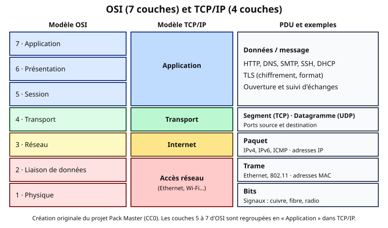
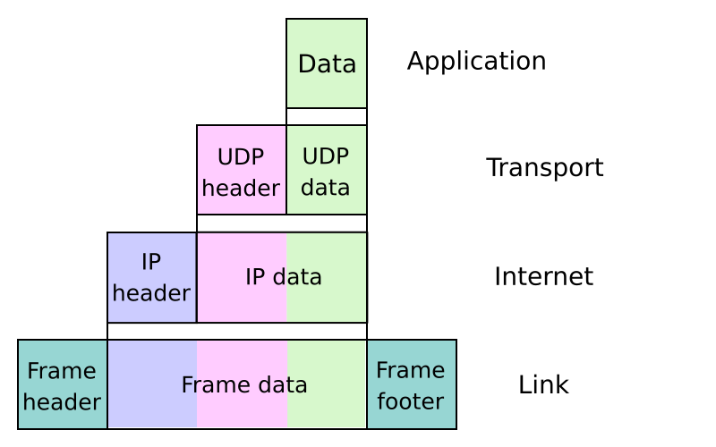
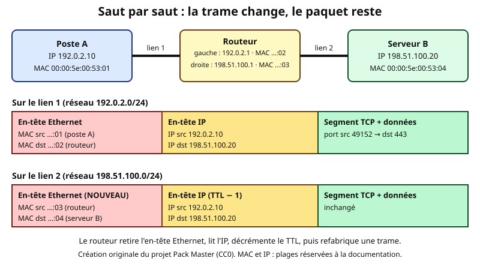
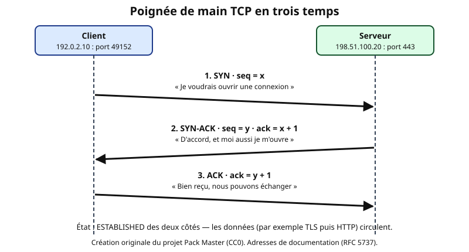

# Leçon — Modèle OSI et TCP/IP : couches, encapsulation et PDU

- **Tags** : `transverse`, `tout-en-un`, `lecon`, `reseau`, `osi`, `tcp-ip`, `encapsulation`, `pdu`
- **Niveau** : débutant à intermédiaire ([[Glossary:TSSR]], support, administration système)
- **Durée estimée** : 3 h 30 (lecture 1 h 30, laboratoire 1 h, exercices et quiz 1 h)

---

## Objectifs pédagogiques

À la fin de cette leçon, vous saurez :

- expliquer pourquoi les réseaux sont conçus en **couches** et ce que chaque couche apporte ;
- citer les 7 couches du modèle **OSI** et les 4 couches du modèle **[[Glossary:TCP]]/IP**, puis les mettre en correspondance ;
- décrire l'**encapsulation** et la **décapsulation** étape par étape, avec les en-têtes ajoutés à chaque niveau ;
- nommer correctement le **PDU** (unité de données de protocole) de chaque couche : message, segment, datagramme, paquet, trame, bits ;
- distinguer ce qui **change** (adresses MAC) et ce qui **reste** (adresses [[Glossary:IP]]) lorsqu'un paquet traverse un routeur ;
- comparer **TCP** et **[[Glossary:UDP]]** et décrire la poignée de main en trois temps ;
- calculer la taille d'une trame Ethernet, la **[[Glossary:MTU]]** et le **MSS** ;
- utiliser le modèle comme grille de **diagnostic** (de la couche 1 vers la couche 7).

## Prérequis et durée

- Savoir ouvrir un terminal (Linux) ou PowerShell (Windows).
- Notion de base : un ordinateur, un câble ou une connexion Wi-Fi, une page web.
- Aucune connaissance préalable des protocoles n'est nécessaire.
- Durée : environ 3 h 30. Le laboratoire peut être fait sur une machine virtuelle jetable (Linux de préférence) ; toutes les commandes proposées sont en lecture seule, sauf la capture réseau qui demande des droits d'administration dans le laboratoire.

## L'essentiel en bref

- Un **modèle en couches** découpe la communication réseau en petites responsabilités indépendantes : chaque couche ne parle qu'à ses voisines directes et à sa « jumelle » sur l'autre machine.
- **OSI** (7 couches) est un modèle de **référence pédagogique** ; **TCP/IP** (4 couches) est le modèle **réellement implémenté** sur Internet.
- À l'émission, chaque couche **encapsule** : elle ajoute un en-tête (et parfois une fin) autour des données reçues de la couche du dessus. À la réception, chaque couche **décapsule**.
- Les noms des PDU : **données/message** (application), **segment** (TCP) ou **datagramme** (UDP), **paquet** (IP), **trame** (Ethernet/Wi-Fi), **bits** (physique).
- Les adresses **MAC** ne servent que sur un lien local ; les adresses **IP** voyagent de bout en bout ; les **ports** désignent le service visé.
- Pour dépanner : on remonte les couches une à une (câble, lien, adresse, route, port, application).

---

## 1. Pourquoi découper en couches ?

### 1.1 L'analogie du courrier

Imaginez que vous envoyiez une lettre importante à un collègue d'une autre ville.

1. Vous rédigez le **contenu** (la lettre). C'est la couche application : seul compte le sens du message.
2. Vous la glissez dans une **enveloppe** portant le nom du destinataire et la mention « confidentiel ». C'est comparable à la couche transport, qui identifie *quel service* doit recevoir les données et *comment* garantir leur arrivée.
3. Le service courrier de votre entreprise place cette enveloppe dans un **sac postal** destiné à une ville donnée. C'est la couche réseau : on choisit une *adresse globale* et un itinéraire.
4. Le camion qui transporte le sac sur la route ne connaît que le **prochain entrepôt** et la route entre les deux. C'est la couche liaison : on ne s'occupe que du *saut suivant*.
5. Enfin, la route, le camion, le carburant : c'est la couche physique.

À chaque étape, la personne qui s'occupe du sac postal n'a **pas besoin de lire la lettre**, et l'expéditeur de la lettre n'a **pas besoin de savoir** quel camion sera utilisé. C'est précisément l'intérêt des couches.

### 1.2 Ce que les couches apportent

La **modularité** (on remplace le Wi-Fi par de la fibre sans toucher au navigateur), l'**interopérabilité** entre fabricants et le **dépannage** par niveau. Un commutateur travaille surtout au niveau 2, un routeur au niveau 3, un pare-feu applicatif aux niveaux 4 à 7.

---

## 2. Le modèle OSI, couche par couche

Le modèle **OSI** (*Open Systems Interconnection*) a été normalisé à la fin des années 1970 et au début des années 1980 (norme ISO/IEC 7498-1). Il décrit 7 couches, numérotées **de bas en haut**.



*Figure 1 — Correspondance OSI / TCP/IP et noms des PDU (création originale Pack Master, CC0).*

### 2.1 Les sept couches

**Couche 7 — Application.** Elle fournit des services directement exploitables par les logiciels : [[Glossary:HTTP]] pour le web, [[Glossary:DNS]] pour les noms, [[Glossary:SMTP]]/IMAP pour le courrier, [[Glossary:SSH]] pour l'accès distant, [[Glossary:DHCP]] pour l'attribution d'adresses. Ne la confondez pas avec « l'application » au sens du logiciel : un navigateur *utilise* la couche application, il n'*est* pas cette couche.

**Couche 6 — Présentation.** Elle s'occupe de la **représentation** des données : encodage des caractères (UTF-8), compression, chiffrement. Dans la pratique actuelle, [[Glossary:TLS]] (le « S » de HTTPS) est souvent rattaché ici, mais cette attribution reste discutable.

**Couche 5 — Session.** Elle gère l'**ouverture, le maintien et la fermeture de dialogues** entre applications (reprise après coupure, points de synchronisation). Dans la pile TCP/IP, ces fonctions sont assurées par les applications elles-mêmes.

**Couche 4 — Transport.** Elle assure le transport **de bout en bout** entre deux processus : numéros de **ports**, fiabilité (TCP), contrôle de flux et de congestion, ou au contraire légèreté (UDP). PDU : **segment** (TCP) ou **datagramme** (UDP).

**Couche 3 — Réseau.** Elle propose un **adressage logique** (IP) et le **routage** entre réseaux différents. PDU : **paquet**. Équipement type : routeur.

**Couche 2 — Liaison de données.** Elle permet la communication entre deux équipements **directement reliés** (sur un même lien ou segment). Adressage physique (MAC), détection d'erreurs (somme de contrôle), délimitation des trames. PDU : **trame**. Équipements : commutateur, point d'accès Wi-Fi, carte réseau.

**Couche 1 — Physique.** Elle transporte les **bits** sous forme de signaux électriques, lumineux ou radio : connecteurs, câbles, fréquences, débits. PDU : **bits** (ou symboles).

OSI n'est **pas** un protocole installé sur vos machines : c'est une **grille de lecture**. Les protocoles réels ne se rangent pas toujours proprement dans une case ([[Glossary:ARP]] flotte entre 2 et 3, TLS entre 4 et 7) ; utilisez le modèle pour **raisonner**, pas pour « classer à tout prix ».

---

## 3. Le modèle TCP/IP (ou modèle Internet)

Le modèle **TCP/IP** a été défini pour ARPANET, avant OSI, avec une approche plus pragmatique. Il compte **4 couches** (certains ouvrages en décrivent 5 en séparant liaison et physique).

| Couche TCP/IP | Rôle | Équivalent OSI | Exemples de protocoles |
|---|---|---|---|
| **Application** | Services pour l'utilisateur et les programmes | 7, 6, 5 | HTTP, HTTPS, DNS, DHCP, SMTP, SSH, [[Glossary:NTP]] |
| **Transport** | Dialogue de bout en bout, ports | 4 | TCP, UDP, (QUIC au-dessus d'UDP) |
| **Internet** | Adressage et routage | 3 | IPv4, IPv6, [[Glossary:ICMP]] |
| **Accès réseau** (ou « liaison ») | Transmission sur le lien local | 2 et 1 | Ethernet, Wi-Fi (802.11), PPP |

Pour dépanner, on parle en numéros OSI (« problème de couche 2 ») ; pour comprendre Internet, TCP/IP est plus fidèle.

---

## 4. L'encapsulation et la décapsulation

### 4.1 Le principe

Quand une application envoie des données, **chaque couche les enveloppe** :

1. L'**application** produit un message (par exemple une requête HTTP).
2. Le **transport** ajoute son en-tête (ports source et destination, numéros de séquence…) : on obtient un **segment**.
3. La couche **Internet** ajoute son en-tête (adresses IP source et destination, [[Glossary:TTL]]…) : on obtient un **paquet**.
4. L'**accès réseau** ajoute un en-tête (adresses MAC, type) et une **fin de trame** (somme de contrôle FCS) : on obtient une **trame**.
5. La carte réseau convertit la trame en **signaux**.

À la réception, c'est l'inverse : la **décapsulation**. Chaque couche lit *son* en-tête, le retire, et remet le contenu à la couche supérieure.



*Figure 2 — Encapsulation des données à travers les couches (exemple avec UDP). Image « UDP encapsulation » de Cburnett (colorisation : Kbrose), Wikimedia Commons, CC BY-SA 3.0. Texte en anglais.*

> Sur cette figure, lisez de haut en bas : « Data » devient « UDP data », puis « IP data », puis « Frame data ». Le contenu d'une couche est toujours l'**intégralité** de la couche supérieure, en-tête compris.

### 4.2 Ce que contient chaque en-tête

| Niveau | Champs importants | Rôle |
|---|---|---|
| **Ethernet (couche 2)** | MAC destination, MAC source, EtherType (ex. 0x0800 = IPv4, 0x86DD = IPv6), FCS en fin de trame | Livrer la trame sur le lien local, indiquer quel protocole est à l'intérieur |
| **IP (couche 3)** | IP source, IP destination, TTL (ou *Hop Limit* en IPv6), protocole (ex. 6 = TCP, 17 = UDP, 1 = ICMP) | Acheminer le paquet de bout en bout |
| **TCP (couche 4)** | Port source, port destination, numéros de séquence et d'accusé, drapeaux (SYN, ACK, FIN…), fenêtre | Établir la connexion, ordonner, fiabiliser |
| **UDP (couche 4)** | Port source, port destination, longueur, somme de contrôle | Identifier le service, rien de plus |

### 4.3 Qui lit quoi ?

- Un **commutateur (switch) classique** lit l'en-tête Ethernet (MAC destination) et transmet la trame sans regarder plus loin.
- Un **routeur** lit l'en-tête Ethernet **pour accepter** la trame, la **décapsule** jusqu'au paquet IP, consulte sa table de routage, puis **fabrique une nouvelle trame** pour le saut suivant.

---

## 5. Les PDU en détail et les tailles à connaître

Rappel : **datagramme = UDP**, **segment = TCP**, **paquet = IP**, **trame = Ethernet** (le mot « datagramme » désigne parfois aussi un paquet IP).

### 5.1 Tailles typiques sur Ethernet

| Élément | Taille |
|---|---|
| En-tête Ethernet (MAC dst 6 + MAC src 6 + EtherType 2) | **14 octets** |
| FCS (fin de trame) | **4 octets** |
| En-tête IPv4 (sans options) | **20 octets** |
| En-tête IPv6 | **40 octets** |
| En-tête TCP (sans options) | **20 octets** |
| En-tête UDP | **8 octets** |
| **MTU** Ethernet standard (taille maximale de la charge utile de la trame) | **1500 octets** |

La **MTU** (*Maximum Transmission Unit*) est la plus grosse charge utile qu'un lien accepte dans une trame. Elle contient donc l'en-tête IP **et** tout ce qui suit.

### 5.2 Calcul du MSS

Le **MSS** (*Maximum Segment Size*) est la quantité maximale de **données applicatives** dans un segment TCP.

- MTU = 1500 octets
- moins en-tête IPv4 : 20
- moins en-tête TCP : 20
- **MSS = 1500 − 20 − 20 = 1460 octets** (en IPv6 : 1500 − 40 − 20 = **1440**).

### 5.3 Exemple chiffré : envoyer 4000 octets

Une application envoie **4000 octets** de données via TCP/IPv4 sur Ethernet (MTU 1500, sans option TCP).

1. Découpage : 4000 = 1460 + 1460 + 1080 → **3 segments**.
2. Chaque segment reçoit 20 octets TCP, puis 20 octets IP, puis 14 + 4 octets Ethernet.
3. Taille des trames : 1460 + 20 + 20 + 14 + 4 = **1518 octets** (deux fois), puis 1080 + 58 = **1138 octets**.
4. Total sur le fil (hors préambule et espace inter-trames) : 1518 + 1518 + 1138 = **4174 octets**, soit 174 octets de surcoût (3 × 58).

On appelle ce surcoût l'**overhead**. Il est d'environ 4,3 % ici ; il devient énorme pour de petits messages (un paquet de 10 octets de données génère 58 octets d'en-têtes).

---

## 6. Le voyage d'un paquet : MAC, IP et routeur

### 6.1 Deux types d'adresses, deux rôles

- L'adresse **MAC** (48 bits, notée `00:00:5e:00:53:01`) identifie une interface **sur un lien**. Elle est lue et réécrite à chaque saut.
- L'adresse **IP** identifie une interface **dans l'ensemble du réseau**. Elle reste (hors traduction d'adresses [[Glossary:NAT]]) de bout en bout.

Analogie : l'adresse IP est l'**adresse postale** du destinataire final, tandis que l'adresse MAC est le **nom du prochain facteur** qui prendra le colis.

### 6.2 Cas d'étude : un poste vers un serveur via un routeur



*Figure 3 — Saut par saut : la trame change, le paquet reste (création originale Pack Master, CC0).*

Le poste A (192.0.2.10/24) veut joindre le serveur B (198.51.100.20/24). Ils sont dans **deux réseaux différents** : il faut un routeur (192.0.2.1 côté poste A, 198.51.100.1 côté serveur B).

1. A constate, grâce à son masque, que 198.51.100.20 n'est **pas** dans son réseau local. Il enverra donc le paquet à sa **passerelle par défaut** (192.0.2.1).
2. A a besoin de la **MAC de la passerelle** : il envoie une requête **ARP** (« qui possède 192.0.2.1 ? ») en diffusion sur le lien, et la passerelle répond avec sa MAC. A mémorise la correspondance dans son **cache ARP**.
3. A construit la trame : MAC destination = MAC du routeur, **IP destination = 198.51.100.20** (pas celle du routeur !).
4. Le routeur reçoit la trame, constate que la MAC lui est destinée, **décapsule** jusqu'au paquet IP, **décrémente le TTL**, trouve la route, puis résout (par ARP) la MAC du serveur B.
5. Il **refabrique une trame** avec MAC source = la sienne, MAC destination = celle de B, et la même IP source/destination.

Point clé à mémoriser : **l'IP destination ne change pas, la MAC destination change à chaque saut.**

### 6.3 Le TTL : une sécurité anti-boucle

Le champ **TTL** (*Time To Live*) de l'en-tête IPv4 est décrémenté de 1 par chaque routeur. À 0, le paquet est détruit et le routeur renvoie un message ICMP « Time Exceeded ». C'est ce qu'exploite la commande `traceroute` (ou `tracert`) pour révéler le chemin : elle envoie des paquets avec TTL 1, 2, 3… et note qui répond.

---

## 7. La couche transport : ports, TCP et UDP

### 7.1 Les ports

Un **port** est un nombre de 16 bits (0 à 65535) qui désigne un **service** sur une machine. L'IP identifie *la machine* ; le port identifie *le service* ; le couple (IP, port) est un **point de terminaison**. Une connexion TCP est définie de façon unique par le quadruplet **(IP source, port source, IP destination, port destination)**.

| Plage | Nom | Usage |
|---|---|---|
| 0 – 1023 | Ports système (« bien connus ») | 22 SSH, 53 DNS, 80 HTTP, 443 HTTPS, 25 SMTP |
| 1024 – 49151 | Ports enregistrés | Services et applications divers |
| 49152 – 65535 | Ports dynamiques (éphémères) | Ports source choisis par le client (la plage exacte varie selon l'OS) |

### 7.2 TCP contre UDP

| Critère | **TCP** | **UDP** |
|---|---|---|
| Mode | Orienté connexion | Sans connexion |
| Fiabilité | Accusés de réception, retransmission, ordre garanti | Aucune garantie |
| Contrôle de flux et de congestion | Oui | Non (à la charge de l'application) |
| En-tête | 20 octets minimum | 8 octets |
| Usages typiques | Web, courrier, SSH, transfert de fichiers | DNS (requêtes courtes), voix, vidéo en direct, jeux, DHCP |

Analogie : TCP, c'est un **courrier recommandé avec accusé de réception** ; UDP, c'est **une carte postale** : plus rapide et moins coûteuse, sans garantie d'arrivée.

### 7.3 La poignée de main TCP en trois temps



*Figure 4 — Établissement d'une connexion TCP (création originale Pack Master, CC0).*

1. **SYN** : le client propose un numéro de séquence initial `x`.
2. **SYN-ACK** : le serveur accuse réception (`x + 1`) et propose son propre numéro `y`.
3. **ACK** : le client accuse réception (`y + 1`). La connexion est **établie**.

La fermeture propre utilise des paquets **FIN** (et ACK) dans chaque sens ; un **RST** coupe brutalement une connexion.

---

## 8. Utiliser le modèle pour diagnostiquer

Une démarche robuste consiste à **monter les couches** en vérifiant chaque niveau :

| Couche | Question | Outil ou test (lecture seule) |
|---|---|---|
| 1 – Physique | Le câble est-il branché ? Le Wi-Fi est-il associé ? | Voyant, état du lien (`ip -br link`, `Get-NetAdapter`) |
| 2 – Liaison | La carte est-elle active ? Voit-on les voisins ? | `ip neigh`, `arp -a` |
| 3 – Réseau | A-t-on une adresse, un masque, une passerelle ? Le chemin existe-t-il ? | `ip -br address`, `ip route`, `ping`, `traceroute` |
| 4 – Transport | Le port est-il ouvert ? Un pare-feu bloque-t-il ? | `ss -tln`, `Test-NetConnection` |
| 7 – Application | Le service répond-il correctement ? | `curl -v`, journaux du service |

Deux stratégies : **de bas en haut** (utile quand « rien ne marche ») ou **diviser pour régner** (tester d'abord la passerelle, puis un site externe par IP, puis par nom, pour trancher entre réseau et DNS).

Exemple : `ping 192.0.2.1` fonctionne, `ping 198.51.100.20` échoue, `ping` d'un nom échoue aussi. Les couches 1 à 3 locales sont donc probablement bonnes ; le défaut se situe après la passerelle (route, pare-feu, serveur) ; le DNS est un sujet distinct, à tester séparément.

---

## Mise en pratique guidée

**Cadre** : machine virtuelle Linux jetable (ou poste de laboratoire), sans données de production. Les commandes d'observation ci-dessous sont en lecture seule. Seule la capture (étape 6) nécessite des droits d'administration. **Ne lancez rien sur des machines qui ne vous appartiennent pas.**

### Étape 1 — Observer la couche 1 et 2 de votre machine

```bash
ip -br link
```

👉 Explication : liste les interfaces avec leur état (UP/DOWN) et leur adresse MAC ; correspond aux couches 1-2. Aucune modification.

```powershell
Get-NetAdapter | Select-Object Name, Status, MacAddress, LinkSpeed
```

👉 Explication : équivalent Windows : état de l'adaptateur, adresse MAC et débit négocié.

### Étape 2 — Observer la couche 3 : adresse, masque et passerelle

```bash
ip -br address
ip route
```

👉 Explication : affiche les adresses IP (avec préfixe) et la table de routage ; repérez la ligne `default via ...` qui désigne la passerelle par défaut.

```powershell
Get-NetIPConfiguration
```

👉 Explication : montre adresse IPv4/IPv6, passerelle et serveurs DNS de chaque interface ; lecture seule.

### Étape 3 — Observer le cache ARP (voisins)

```bash
ip neigh show
```

👉 Explication : affiche les correspondances IP ↔ MAC déjà apprises ; si la liste est vide, générez un peu de trafic (étape 4) puis relancez.

```powershell
arp -a
```

👉 Explication : affiche le cache ARP Windows ; comparez la MAC de la passerelle avec celle vue dans le cache Linux ou sur le routeur.

### Étape 4 — Tester la couche 3 avec ICMP

```bash
ping -c 3 192.0.2.1
```

👉 Explication : envoie 3 requêtes ICMP Echo vers une adresse de documentation (à remplacer par la passerelle réelle de votre laboratoire) ; teste le chemin au niveau IP uniquement.

```powershell
ping -n 3 192.0.2.1
```

👉 Explication : équivalent Windows avec 3 requêtes (remplacez l'adresse par celle de votre passerelle).

### Étape 5 — Voir les connexions de la couche 4

```bash
ss -tn
ss -tln
```

👉 Explication : `ss -tn` liste les connexions TCP établies (état, adresses, ports) ; `ss -tln` liste les ports TCP en écoute (`LISTEN`). Lecture seule.

```powershell
Get-NetTCPConnection -State Established | Select-Object LocalAddress, LocalPort, RemoteAddress, RemotePort -First 10
```

👉 Explication : affiche dix connexions TCP établies avec le quadruplet (adresse locale, port local, adresse distante, port distant).

### Étape 6 — Capturer et reconnaître l'encapsulation (VM jetable uniquement)

Dans un terminal avec droits d'administration, sur la [[Glossary:VM]] du laboratoire :

```bash
sudo tcpdump -nn -e -c 8 -i eth0 'tcp port 80 or icmp'
```

👉 Explication : capture 8 paquets (`-c 8`) sans résolution de noms (`-nn`), avec les en-têtes de liaison et donc les MAC (`-e`), sur l'interface `eth0` (remplacez-la par le nom relevé à l'étape 1), limités à HTTP et ICMP. Il ne génère aucun trafic : il écoute seulement. À arrêter avec Ctrl+C si besoin.

Dans un second terminal, générez du trafic :

```bash
curl -sI http://example.com/ -o /dev/null -w '%{http_code}\n'
```

👉 Explication : envoie une requête HTTP `HEAD` vers le domaine réservé example.com et n'affiche que le code de réponse ; sert à produire du trafic observable.

Dans la capture, repérez : **l'adresse MAC** (couche 2), **les adresses IP** (couche 3), **les ports** et les **drapeaux** `[S]`, `[S.]`, `[.]` (couche 4, poignée de main), puis les **données HTTP** (couche 7). Observez aussi que sur le fil, en HTTP non chiffré, le contenu est lisible, ce qui explique l'intérêt de TLS.

### Étape 7 — Observer le chemin avec TTL

```bash
traceroute -n example.com
```

👉 Explication : affiche les routeurs successifs en faisant varier le TTL (si `traceroute` n'est pas installé, utilisez `tracepath -n example.com`). Chaque ligne est un saut ; des `* * *` signalent un équipement qui ne répond pas, pas forcément une panne.

```powershell
tracert -d example.com
```

👉 Explication : équivalent Windows, sans résolution de noms (`-d`).

---

## Exercices

**Exercice 1 (reconnaissance).** Associez chaque protocole à sa couche OSI : HTTP, TCP, IPv4, Ethernet, TLS, UDP, ICMP, DNS.

**Exercice 2 (PDU).** Donnez le nom du PDU à chaque couche : application, transport TCP, transport UDP, réseau, liaison, physique.

**Exercice 3 (encapsulation).** Une application envoie un message de 100 octets via UDP/IPv4 sur Ethernet. Donnez la taille du segment/datagramme, du paquet et de la trame (avec FCS).

**Exercice 4 (MSS et découpage).** En IPv4/TCP sur Ethernet (MTU 1500, sans option), calculez le MSS. Combien de segments faut-il pour envoyer 10 000 octets de données ? Quelle est la taille de la dernière trame ?

**Exercice 5 (MAC ou IP ?).** Un poste 192.0.2.10 envoie un paquet à 198.51.100.20 via un routeur. Pour chacun des deux liens, dites quelles adresses (IP et MAC source/destination) sont utilisées, en désignant les équipements.

**Exercice 6 (dépannage).** Un utilisateur dit « Internet ne marche plus ». `ping` vers la passerelle réussit ; `ping` vers une adresse IP publique joignable (par exemple le résolveur de votre fournisseur) réussit ; `ping www.example.com` échoue avec « nom introuvable ». Dans quelle couche (ou quel service) cherchez-vous, et quelle commande testez-vous ensuite ?

**Exercice 7 (poignée de main).** Le client choisit un numéro de séquence initial 5000, le serveur 9000. Donnez les numéros `seq` et `ack` des trois segments de la poignée de main.

---

## Corrigés des exercices

**Exercice 1.** HTTP : 7 ; DNS : 7 ; TLS : 6 (ou entre 4 et 7 selon les interprétations) ; TCP : 4 ; UDP : 4 ; IPv4 : 3 ; ICMP : 3 (il est transporté dans IP, mais fait partie du niveau réseau) ; Ethernet : 2 (et 1 pour la partie physique).

**Exercice 2.** Application : données/message ; TCP : segment ; UDP : datagramme ; réseau : paquet ; liaison : trame ; physique : bits.

**Exercice 3.** Datagramme UDP : 100 + 8 = **108 octets**. Paquet IPv4 : 108 + 20 = **128 octets**. Trame : 128 + 14 + 4 = **146 octets**.

**Exercice 4.** MSS = 1500 − 20 − 20 = **1460**. 10 000 / 1460 = 6 segments complets (6 × 1460 = 8760) et un reste de 10 000 − 8760 = 1240. Il faut donc **7 segments**. La dernière trame mesure 1240 + 20 + 20 + 14 + 4 = **1298 octets**.

**Exercice 5.** Lien 1 (réseau 192.0.2.0/24) : IP src 192.0.2.10 (poste A), IP dst 198.51.100.20 (serveur B) ; MAC src = celle de A, MAC dst = celle du routeur (côté 192.0.2.1). Lien 2 (réseau 198.51.100.0/24) : mêmes adresses IP ; MAC src = celle du routeur (côté 198.51.100.1), MAC dst = celle du serveur B. Le TTL a baissé de 1.

**Exercice 6.** La connectivité IP vers l'extérieur fonctionne (couche 3 correcte). Seule la résolution de noms échoue : on suspecte la configuration des **serveurs DNS** du poste ou le service DNS lui-même. Test suivant : afficher les DNS configurés (`resolvectl status` ou `cat /etc/resolv.conf` sous Linux, `Get-DnsClientServerAddress` sous Windows) puis interroger un autre serveur DNS autorisé du laboratoire.

**Exercice 7.** SYN : `seq=5000`. SYN-ACK : `seq=9000`, `ack=5001`. ACK : `seq=5001`, `ack=9001`.

---

## Quiz

**Q1.** Quel est le PDU de la couche 2 du modèle OSI ?
A) Paquet  B) Trame  C) Segment  D) Bits

**Q2.** Combien de couches compte le modèle TCP/IP dans sa présentation à 4 niveaux ?
A) 3  B) 4  C) 5  D) 7

**Q3.** Quelle couche OSI est responsable du routage entre réseaux ?
A) Liaison de données  B) Transport  C) Réseau  D) Session

**Q4.** Lorsqu'un paquet traverse un routeur, quelle information change ?
A) L'adresse IP source  B) L'adresse IP destination  C) Les adresses MAC  D) Le port destination

**Q5.** Quelle est la valeur usuelle de la MTU Ethernet ?
A) 576 octets  B) 1280 octets  C) 1500 octets  D) 9000 octets

**Q6.** En IPv4 sur Ethernet, quel MSS TCP obtient-on avec une MTU de 1500 et sans option ?
A) 1500  B) 1480  C) 1460  D) 1440

**Q7.** Quel protocole est en mode « sans connexion » et ne garantit pas la livraison ?
A) TCP  B) UDP  C) HTTP  D) TLS

**Q8.** Que représente le drapeau SYN-ACK dans une poignée de main TCP ?
A) La demande de fermeture  B) La réponse du serveur qui accepte et ouvre son sens  C) La demande de retransmission  D) Une réinitialisation brutale

**Q9.** Un commutateur (switch) de niveau 2 se base principalement sur :
A) Les adresses IP  B) Les ports TCP  C) Les adresses MAC  D) Les noms DNS

**Q10.** `ping` vers la passerelle réussit, `ping` vers une adresse IP publique joignable réussit, mais l'accès par nom échoue. Quel élément est le plus suspect ?
A) Le câble  B) La carte réseau  C) Le DNS  D) Le masque de sous-réseau

### Réponses justifiées

1. **B** — La couche liaison de données manipule des **trames** ; le paquet appartient à la couche 3, le segment à la couche 4, les bits à la couche 1.
2. **B** — La présentation classique de TCP/IP comporte 4 couches (application, transport, internet, accès réseau). Certains livres en comptent 5 en séparant liaison et physique, mais le 4 est la réponse attendue ici.
3. **C** — La couche **réseau** gère l'adressage logique et le routage.
4. **C** — Les adresses MAC sont réécrites à chaque saut ; les adresses IP et le port restent identiques (hors NAT). Le TTL change aussi, mais ce n'est pas une option.
5. **C** — 1500 octets est la valeur standard ; 9000 correspond aux trames « jumbo », non standard par défaut ; 576 et 1280 sont des tailles minimales IPv4 et IPv6.
6. **C** — 1500 − 20 (IPv4) − 20 (TCP) = 1460.
7. **B** — UDP est sans connexion ; TCP est fiable ; HTTP et TLS ne sont pas des protocoles de transport.
8. **B** — Le serveur accuse réception du SYN et envoie le sien.
9. **C** — Un switch classique apprend et utilise les adresses MAC.
10. **C** — La connectivité IP est correcte, seule la résolution de noms échoue : on regarde le DNS.

---

## Erreurs fréquentes et dépannage

| Erreur ou symptôme | Cause probable | Que faire |
|---|---|---|
| Confusion entre trame, paquet et segment | Les noms changent à chaque couche | Réciter de haut en bas « **S**egment (couche 4), **P**aquet (3), **T**rame (2) » : les initiales S-P-T se retiennent facilement |
| Croire que l'IP destination change à chaque routeur | Confusion avec la MAC | L'IP reste de bout en bout (sauf NAT) ; seule la MAC est réécrite |
| Penser que « ping OK » signifie « le service fonctionne » | `ping` ne teste que la couche 3 (ICMP) | Tester ensuite le port (`Test-NetConnection`, `ss`, `curl -v`) |
| Ping échoue alors que le serveur est bien là | ICMP filtré par un pare-feu | Tester le port TCP du service plutôt que ICMP |
| Pages qui se bloquent seulement quand elles sont volumineuses | Problème de MTU ou ICMP filtré (Path MTU Discovery) | Tester avec des paquets de tailles différentes, autoriser ICMP « fragmentation needed » / « packet too big » |
| `Connection refused` | Aucun service n'écoute sur ce port (RST immédiat) | Vérifier `ss -tln`, le démarrage du service et la liaison sur la bonne adresse |
| `Connection timed out` | Paquets jetés silencieusement (pare-feu, mauvaise route) | Vérifier routes, pare-feu et SYN-SENT avec `ss -tn` |

Rappel de bonne pratique : ne capturez le trafic que sur vos propres machines ou avec autorisation écrite ; les captures peuvent contenir des données sensibles.

---

## À retenir

- Les couches **isolent les responsabilités** : chacune s'appuie sur les services de la précédente.
- **OSI = 7 couches (référence), TCP/IP = 4 couches (réalité)** ; 5-6-7 d'OSI = Application de TCP/IP ; 1-2 d'OSI = Accès réseau.
- **PDU** : données → **segment/datagramme** → **paquet** → **trame** → **bits**.
- **Encapsulation** à l'émission (on ajoute un en-tête par couche), **décapsulation** à la réception.
- **MAC = saut par saut**, **IP = de bout en bout**, **port = service visé**.
- **MTU 1500** ; **MSS TCP IPv4 = 1460**, IPv6 = 1440 ; Ethernet ajoute 18 octets (14 + FCS 4).
- **TCP** = fiable, connecté, poignée de main SYN / SYN-ACK / ACK ; **UDP** = léger, sans garantie.
- Pour dépanner : **monter les couches** et tester une hypothèse à la fois.

---

## Pour aller plus loin

- RFC 791 — *Internet Protocol* (IPv4) : https://www.rfc-editor.org/rfc/rfc791
- RFC 9293 — *Transmission Control Protocol (TCP)* : https://www.rfc-editor.org/rfc/rfc9293
- RFC 826 — *Address Resolution Protocol* : https://www.rfc-editor.org/rfc/rfc826
- RFC 8200 — *Internet Protocol, Version 6 (IPv6) Specification* : https://www.rfc-editor.org/rfc/rfc8200
- RFC 9000 — *QUIC : A UDP-Based Multiplexed and Secure Transport* : https://www.rfc-editor.org/rfc/rfc9000
- Manuel de la commande `ip` (iproute2) : https://man7.org/linux/man-pages/man8/ip.8.html

---

## Crédits des images

| Fichier | Source (URL de la page Commons) | Auteur | Licence (nom + URL) | Modifications |
|---|---|---|---|---|
| `images/osi-tcpip-1.svg` | https://commons.wikimedia.org/wiki/File:UDP_encapsulation.svg | en:User:Cburnett (œuvre originale) ; colorisation par en:User:Kbrose | CC BY-SA 3.0 — https://creativecommons.org/licenses/by-sa/3.0/ | Aucune (fichier SVG utilisé tel que téléchargé). Cette image reste sous licence CC BY-SA 3.0. |
| `images/osi-tcpip-2.svg` | Création originale du projet Pack Master | Projet Pack Master | CC0 (domaine public) — https://creativecommons.org/publicdomain/zero/1.0/ | Sans objet |
| `images/osi-tcpip-3.svg` | Création originale du projet Pack Master | Projet Pack Master | CC0 (domaine public) — https://creativecommons.org/publicdomain/zero/1.0/ | Sans objet |
| `images/osi-tcpip-4.svg` | Création originale du projet Pack Master | Projet Pack Master | CC0 (domaine public) — https://creativecommons.org/publicdomain/zero/1.0/ | Sans objet |

Les créations originales sont « dédiées au domaine public (CC0) ».

---

## Historique de vérification

| Date | OS/logiciel | Testeur | Verdict |
|---|---|---|---|
| 2026-11-01 | Linux et Windows (commandes réseau citées) | Rédaction assistée (Copilot) | Non testé sur plateforme cible |

Note : seuls les calculs chiffrés de la leçon (MSS, tailles de trames, découpage) ont été recalculés localement avec Python (opérations arithmétiques sans accès réseau) ; aucune commande réseau n'a été exécutée pour cette rédaction.
