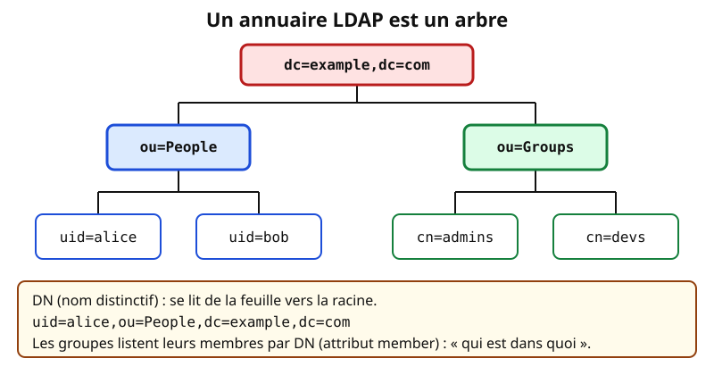
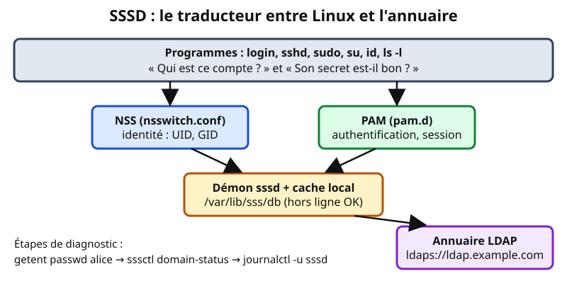
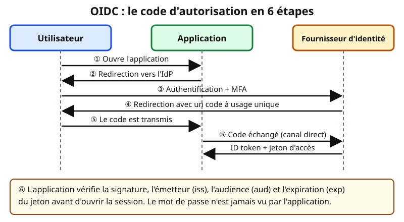
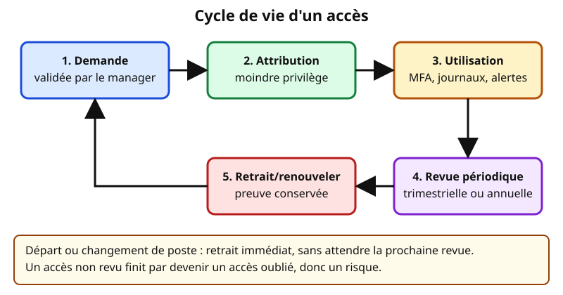

# Leçon — Annuaires et SSO : LDAP, SSSD, OIDC/SAML, MFA, moindre privilège et revue des accès

- **Tags** : `transverse`, `tout-en-un`, `lecon`, `identites`, `ldap`, `sssd`, `oidc`, `saml`, `sso`, `mfa`, `iam`, `moindre-privilege`
- **Niveau** : intermédiaire
- **Durée estimée** : 4 h (cours 1 h 30, laboratoire 1 h 15, exercices et quiz 1 h 15)

---

## Objectifs pédagogiques

À la fin de cette leçon, vous saurez :

1. Distinguer **identification**, **authentification** et **autorisation**.
2. Lire un annuaire LDAP (DN, objectClass, filtres) et l'interroger sans modifier.
3. Expliquer **SSSD**, **NSS** et **PAM** et diagnostiquer une panne simple.
4. Décrire les flux **OIDC** et **SAML**.
5. Choisir un facteur de **MFA** et en connaître les faiblesses.
6. Appliquer le **moindre privilège** (rôles, arrivée / mobilité / départ).
7. Mener une **revue périodique des accès** exploitable.

## Prérequis et durée

- Conseillé : les leçons [Comptes, groupes, permissions et sudo](lecon-comptes-linux.md) et [SSH, clés et bastion](lecon-ssh-cles.md).
- Une **VM Debian/Ubuntu jetable** pour la section 9 ; adresses et mots de passe du cours sont fictifs. Durée : environ 4 h.

> **Règle de sécurité** : aucune installation ni modification d'annuaire en production. Les commandes de consultation sont sans danger mais utilisent un compte de service : ne le partagez pas et ne le copiez jamais dans un dépôt.

## L'essentiel en bref

- Un **annuaire** centralise les identités (qui est qui, dans quels groupes) ; **LDAP** est le protocole pour l'interroger ; **SSSD** les rend utilisables par Linux.
- **SSO** : on s'authentifie **une fois** auprès d'un fournisseur d'identité (IdP) et les applications lui font confiance. **OIDC** et **SAML** en sont les deux grands protocoles web.
- Le **MFA** combine au moins deux facteurs indépendants ; les clés FIDO2 résistent au hameçonnage, les SMS le moins.
- **Moindre privilège** : chacun reçoit les droits nécessaires à sa tâche, pour la durée nécessaire, via des **rôles** plutôt que des cas particuliers.
- L'**IAM** (gestion des identités et des accès) est un **processus** : demander, approuver, attribuer, **revoir**, retirer. Une revue d'accès sans suite concrète n'est qu'une formalité.

---

## 1. Trois mots à ne pas confondre

| Notion | Question | Exemple |
|---|---|---|
| **Identification** | « Qui dites-vous être ? » | saisir `alice@example.com` |
| **Authentification** | « Pouvez-vous le prouver ? » | mot de passe, code TOTP, clé FIDO2 |
| **Autorisation** | « Qu'avez-vous le droit de faire ? » | membre du groupe `compta` : lecture du dossier |

Analogie : à l'entrée d'un festival, vous annoncez votre nom, montrez une pièce d'identité, puis le bracelet détermine les zones accessibles. La **traçabilité** (journaux) répond à « qui a fait quoi, quand ». Un utilisateur *authentifié* n'est pas *autorisé* à tout.

## 2. LDAP : les bases

### 2.1 L'annuaire est un arbre

**LDAP** (*Lightweight Directory Access Protocol*, RFC 4511) lit et modifie un annuaire organisé en **arbre** (le **DIT**), optimisé pour la lecture fréquente de petites entrées.



*Figure 1 — Un annuaire LDAP fictif pour example.com. Schéma original du projet (CC0).*

- **Entrée** : un nœud (personne, groupe, unité). **DN** (*Distinguished Name*) : son adresse complète, lue de la feuille vers la racine (`uid=alice,ou=People,dc=example,dc=com`). **RDN** : sa partie propre (`uid=alice`).
- **Base** : point de départ d'une recherche (`dc=example,dc=com`, dérivé du domaine DNS).
- **objectClass** : le « modèle » de l'entrée (`inetOrgPerson`, `posixAccount`, `groupOfNames`), qui impose et autorise des **attributs** (`cn`, `mail`, `uidNumber`, `member`…). Leur ensemble forme le **schéma**.
- **Opérations** : *bind* (s'authentifier), *search*, *add / modify / delete* (réservées aux administrateurs).

**Sécurité du bind** : un bind « simple » envoie le mot de passe tel quel. Il doit **toujours** passer par **LDAPS** (port 636) ou **StartTLS** (port 389), avec vérification du certificat par l'autorité de l'entreprise.

### 2.2 Les filtres de recherche (RFC 4515)

| Filtre | Signification |
|---|---|
| `(uid=alice)` | l'entrée dont l'uid vaut alice |
| `(&(objectClass=inetOrgPerson)(mail=*@example.com))` | ET : personnes avec un mail de ce domaine |
| `(\|(uid=alice)(uid=bob))` | OU : alice ou bob |
| `(!(loginShell=/usr/sbin/nologin))` | NON : comptes avec un vrai shell |

### 2.3 Interroger en lecture seule

```bash
ldapsearch -H ldaps://ldap.example.com -D "uid=svc-lecture,ou=Services,dc=example,dc=com" -W -b "ou=People,dc=example,dc=com" -s sub "(uid=alice)" cn mail uidNumber
```

👉 Explication : cherche `alice` sous `ou=People` et n'affiche que trois attributs. `-H` fixe l'URI **chiffrée**, `-D` un compte de service **en lecture seule**, `-W` demande son mot de passe **au clavier** (jamais `-w`, visible dans les processus), `-b` la base, `-s sub` tout le sous-arbre.

```bash
ldapwhoami -H ldaps://ldap.example.com -D "uid=svc-lecture,ou=Services,dc=example,dc=com" -W
```

👉 Explication : vérifie que le compte s'authentifie ; distingue un problème de **connexion** d'un problème de **droits de lecture**.

```bash
ldapsearch -H ldaps://ldap.example.com -D "uid=svc-lecture,ou=Services,dc=example,dc=com" -W -b "ou=Groups,dc=example,dc=com" "(cn=admins)" member
```

👉 Explication : liste les membres du groupe `admins`, base d'une revue d'accès (section 8), au format **LDIF**.

### 2.4 LDAP et Active Directory

Active Directory **parle LDAP** (avec Kerberos pour l'authentification) ; son schéma diffère (`sAMAccountName`, `memberOf`) mais DN, objectClass et filtres sont identiques.

## 3. SSSD : relier un serveur Linux à l'annuaire

### 3.1 NSS, PAM et SSSD

- **« Qui est ce compte ? »** (UID, groupes) : **NSS**, via `/etc/nsswitch.conf`.
- **« Son mot de passe est-il bon ? »** : **PAM**, via `/etc/pam.d/`.

**SSSD** répond aux deux en interrogeant l'annuaire, avec un **cache local** : si l'annuaire tombe, les comptes déjà vus peuvent encore se connecter.



*Figure 2 — Pile SSSD sur un serveur Linux. Schéma original du projet (CC0).*

### 3.2 Une configuration minimale

`/etc/sssd/sssd.conf` doit appartenir à root et être en **0600**, sinon SSSD refuse de démarrer :

```text
[sssd]
services = nss, pam
domains = example.com

[domain/example.com]
id_provider = ldap
auth_provider = ldap
ldap_uri = ldaps://ldap.example.com
ldap_search_base = dc=example,dc=com
ldap_tls_cacert = /etc/ssl/certs/ca-example.pem
ldap_tls_reqcert = demand
cache_credentials = true
enumerate = false
```

👉 Explication : exemple fictif. `id_provider` sert NSS, `auth_provider` PAM ; `ldaps://` chiffre ; `ldap_tls_reqcert = demand` exige un certificat valide ; `cache_credentials` permet la connexion hors ligne ; `enumerate = false` évite de charger tout l'annuaire. Un secret de bind éventuel vient d'un gestionnaire de secrets.

```text
# /etc/nsswitch.conf (extrait)
passwd:  files sss
group:   files sss
shadow:  files sss
```

👉 Explication : NSS consulte les fichiers locaux puis SSSD ; un compte local d'urgence reste utilisable si l'annuaire tombe.

### 3.3 Vérifier et diagnostiquer

```bash
getent passwd alice
id alice
```

👉 Explication : si SSSD fonctionne, `alice` apparaît avec ses UID/GID alors qu'elle n'est pas dans `/etc/passwd`.

```bash
sudo sssctl domain-status example.com
sudo sssctl user-checks alice
sudo journalctl -u sssd --since "30 minutes ago"
```

👉 Explication : état du domaine (en ligne ou hors ligne), simulation des appels NSS/PAM pour alice avec l'étape en échec, puis messages récents. Lecture seule. Pour plus de détails, augmentez temporairement `debug_level`, puis **remettez-le**.

```bash
sudo sss_cache --everything
```

👉 Explication : invalide le cache pour forcer une nouvelle interrogation, utile quand un changement de groupe « n'apparaît pas encore ».

### 3.4 Autoriser, pas seulement authentifier

Par défaut, tout compte de l'annuaire peut se connecter à **toutes** les machines : ce n'est pas du moindre privilège.

```text
access_provider = simple
simple_allow_groups = linux-admins, projet-web
```

👉 Explication : seuls les membres de ces groupes ouvrent une session ici. L'annuaire devient l'endroit unique pour accorder et retirer des accès.

## 4. Le SSO : une authentification, plusieurs applications

### 4.1 Le principe

Avec le **SSO**, un **fournisseur d'identité** (IdP) authentifie l'utilisateur et les applications lui font confiance, au lieu de gérer chacune leurs mots de passe. Analogie : le passeport, émis par un État auquel les autres pays font confiance. Avantage : un seul point pour imposer le MFA, révoquer, journaliser. **Risque** : l'IdP devient critique.

### 4.2 OIDC

**OpenID Connect** ajoute l'**authentification** à **OAuth 2.0** (RFC 6749, cadre d'**autorisation**) grâce à un **ID token**, un JWT signé (RFC 7519).



*Figure 3 — Le flux « code d'autorisation » d'OIDC en six étapes. Schéma original du projet (CC0).*

- **Code d'autorisation + PKCE** (RFC 7636) : flux recommandé.
- **Jetons** : *ID token* (qui est l'utilisateur), *access token* (accès aux API), *refresh token* (à protéger comme un mot de passe).
- **Revendications** : `iss` (émetteur), `sub` (identifiant stable), `aud` (destinataire), `exp` (expiration), `iat`, `nonce` (anti-rejeu).
- **Découverte** : `/.well-known/openid-configuration` publie points d'accès et clés de signature.

```bash
curl -s https://idp.example.com/.well-known/openid-configuration | head -c 600
```

👉 Explication : lit le document public de découverte d'un IdP de laboratoire (`authorization_endpoint`, `token_endpoint`, `jwks_uri`).

```text
{ "iss": "https://idp.example.com", "sub": "a1b2c3", "aud": "app-wiki",
  "exp": 1793500000, "iat": 1793496400, "nonce": "n-0S6_WzA2Mj",
  "email": "alice@example.com", "groups": ["wiki-editeurs"] }
```

👉 Explication : ID token décodé (valeurs fictives). L'application **doit** vérifier la signature (clés du `jwks_uri`), `iss`, `aud` (elle-même), `exp` et `nonce`. Ne collez jamais un vrai jeton dans un site de décodage en ligne.

### 4.3 SAML

**SAML 2.0** (OASIS) est plus ancien et très présent dans les applications d'entreprise et le SaaS : l'IdP émet une **assertion XML signée** transmise via le navigateur. Vocabulaire : **SP** (l'application), **métadonnées** XML (`entityID`, certificats, URL), **ACS** (URL où le SP reçoit l'assertion). Déroulé : le SP redirige vers l'IdP, qui authentifie (MFA compris) et renvoie l'assertion que le SP valide.

| | **SAML 2.0** | **OIDC** |
|---|---|---|
| Format | assertions XML | jetons JSON (JWT) |
| Usage | entreprise, SaaS historiques | web moderne, mobile, API |
| Configuration | métadonnées XML | document `.well-known` |

Les IdP modernes font **les deux** : OIDC en priorité, SAML si l'éditeur n'offre que cela. Pannes SAML classiques : **certificat expiré**, **horloge décalée**, **ACS mal saisi**.

### 4.4 Le compte d'urgence

Gardez un compte local *break-glass*, au mot de passe très long conservé dans un coffre, avec alerte à chaque usage : sans lui, la panne de l'IdP bloque aussi ceux qui doivent le réparer.

## 5. L'authentification multifacteur (MFA)

Un facteur est une catégorie de preuve : **ce que je sais** (mot de passe), **ce que je possède** (téléphone, clé), **ce que je suis** (biométrie). Le MFA combine **au moins deux catégories** : deux mots de passe ne font pas un MFA.

| Méthode | Faiblesses |
|---|---|
| SMS | interception, échange de SIM, hameçonnage |
| **TOTP** (RFC 6238) | hameçonnable, sauvegarde du secret |
| Notification *push* | **fatigue MFA** ; coupler à une saisie de nombre |
| **FIDO2 / WebAuthn** | coût, clés de secours ; **résiste au hameçonnage** |

Bonnes pratiques : MFA d'abord pour les **comptes à privilèges** ; **récupération** documentée (codes de secours, deuxième clé) ; surveillance des demandes répétées ; pour les comptes de service, secrets ou certificats **limités et tournants**.

## 6. Le moindre privilège

Chaque identité reçoit **uniquement** les droits nécessaires, **pour la durée nécessaire**. Analogie : le badge d'un livreur n'ouvre pas la salle des serveurs et expire le soir.

- **Rôles (RBAC)** : on attribue le rôle « Support niveau 1 », pas des droits individuels ; changer de poste = changer de rôle. **ABAC** ajoute le contexte (lieu, appareil, heure).
- **Séparation des tâches** : qui demande n'approuve pas.
- **Comptes distincts** : un compte ordinaire pour le quotidien, un compte **administrateur** séparé.
- **Élévation à la demande** (*just-in-time*) : droit accordé quelques heures avec justification.
- **Comptes de service** : un par application, propriétaire identifié.

| Événement | Action | Piège |
|---|---|---|
| **Arrivée** | rôle de base lié au poste | copier les droits d'un collègue |
| **Mobilité** | **retirer** les anciens droits en ajoutant les nouveaux | accumulation (*privilege creep*) |
| **Départ** | désactiver compte, jetons, clés SSH, VPN | comptes orphelins |

## 7. IAM : la vue d'ensemble

L'**IAM** (*Identity and Access Management*) regroupe politiques, processus et outils du cycle de vie des accès : **source de vérité** (souvent les RH), **annuaire**, **IdP**, **coffre** de secrets, **journaux** et **revue**. Son point faible est rarement technique : personne n'est responsable de mettre les droits à jour quand les gens bougent.

## 8. La revue périodique des accès

### 8.1 Pourquoi

La **revue d'accès** (*recertification*) fait confirmer régulièrement que chaque accès reste **justifié**. Elle attrape droits hérités et comptes dormants.



*Figure 4 — Cycle de vie d'un accès. Schéma original du projet (CC0).*

### 8.2 Méthode en sept étapes

1. **Périmètre** : d'abord les accès sensibles (administration, données personnelles, finances).
2. **Extraire** comptes et groupes.
3. **Relecteurs** : le responsable hiérarchique ou le propriétaire de l'application, **pas** le titulaire de l'accès.
4. **Présenter** une liste lisible : qui, quel droit, depuis quand, dernière utilisation.
5. **Décider** : conserver, modifier, retirer ; l'absence de réponse **ne vaut pas** approbation.
6. **Appliquer** les retraits sous délai et le **prouver**.
7. **Conserver les preuves** et mesurer (retraits, orphelins, délai).

Fréquence usuelle : **trimestrielle** (privilèges), **annuelle** (droits ordinaires), **immédiate** au départ ou changement de poste.

### 8.3 Commandes de lecture seule

```bash
getent group sudo linux-admins projet-web
lastlog | head -n 20
getent passwd | awk -F: '$3 == 0 {print $1}'
```

👉 Explication : membres des groupes sensibles (annuaire compris) ; dernière connexion de chaque compte (une date très ancienne signale un **compte dormant**) ; comptes d'UID 0 (seul `root` devrait apparaître).

## 9. Mise en pratique guidée (labo local ou VM jetable)

**Objectif** : monter un petit annuaire OpenLDAP, y créer un utilisateur et un groupe, puis faire reconnaître cet utilisateur par Linux via SSSD, sur **une VM jetable unique** (snapshot avant de commencer).

> Mots de passe jetables uniquement. Ce laboratoire désactive volontairement TLS : **interdit hors labo**.

**Étape 1 — Installer le serveur d'annuaire et les outils.**

```bash
sudo apt update
sudo apt install --yes slapd ldap-utils
sudo dpkg-reconfigure slapd
```

👉 Explication : installe OpenLDAP puis lance l'assistant : domaine DNS `example.com`, organisation `Exemple`, mot de passe administrateur jetable, base `MDB`.

**Étape 2 — Créer l'arborescence, un utilisateur et un groupe.** Générez d'abord une empreinte pour le mot de passe de test d'Alice :

```bash
slappasswd
```

👉 Explication : demande un mot de passe au clavier et affiche une empreinte `{SSHA}...` à copier dans le LDIF ; le clair n'est jamais écrit.

Créez ensuite `lab.ldif` (remplacez l'empreinte) :

```text
dn: ou=People,dc=example,dc=com
objectClass: organizationalUnit
ou: People

dn: ou=Groups,dc=example,dc=com
objectClass: organizationalUnit
ou: Groups

dn: uid=alice,ou=People,dc=example,dc=com
objectClass: inetOrgPerson
objectClass: posixAccount
objectClass: shadowAccount
uid: alice
cn: Alice Exemple
sn: Exemple
uidNumber: 20001
gidNumber: 20001
homeDirectory: /home/alice
loginShell: /bin/bash
userPassword: {SSHA}EMPREINTE_A_REMPLACER

dn: cn=linux-users,ou=Groups,dc=example,dc=com
objectClass: posixGroup
cn: linux-users
gidNumber: 20001
memberUid: alice
```

👉 Explication : LDIF fictif. `posixAccount` donne UID, GID, dossier et shell ; `posixGroup` définit le groupe (`memberUid`). Les UID 20001 évitent les collisions avec les comptes locaux.

```bash
ldapadd -x -D "cn=admin,dc=example,dc=com" -W -f lab.ldif
ldapsearch -x -b "dc=example,dc=com" "(uid=alice)" uid cn uidNumber
```

👉 Explication : `ldapadd` charge le fichier avec l'administrateur de l'annuaire ; `ldapsearch` vérifie qu'Alice existe. `-x` (bind simple) est acceptable ici car tout reste sur la VM.

**Étape 3 — Installer et configurer SSSD.**

```bash
sudo apt install --yes sssd sssd-ldap sssd-tools libnss-sss libpam-sss
sudo install -m 0600 -o root -g root /dev/null /etc/sssd/sssd.conf
```

👉 Explication : installe SSSD et ses modules, puis crée le fichier de configuration avec les droits exigés.

```bash
printf '[sssd]\nservices = nss, pam\ndomains = example.com\n\n[domain/example.com]\nid_provider = ldap\nauth_provider = ldap\nldap_uri = ldap://127.0.0.1\nldap_search_base = dc=example,dc=com\nldap_id_use_start_tls = false\nldap_auth_disable_tls_never_use_in_production = true\ncache_credentials = true\nenumerate = false\n' | sudo tee /etc/sssd/sssd.conf
sudo systemctl restart sssd
```

👉 Explication : configuration de **laboratoire** (lecture anonyme, sans TLS), interdite en production où l'on utilise `ldaps://` ou StartTLS avec vérification du certificat.

**Étape 4 — Brancher NSS et tester.**

```bash
sudo sed -i 's/^passwd:.*/passwd: files sss/; s/^group:.*/group: files sss/' /etc/nsswitch.conf
getent passwd alice
id alice
sudo sssctl domain-status example.com
```

👉 Explication : ajoute `sss` à NSS (sauvegardez le fichier avant) puis vérifie qu'Alice est visible. Sinon : `journalctl -u sssd` et `sss_cache --everything`.

**Étape 5 — Tester l'authentification (optionnel).**

```bash
sudo pam-auth-update --enable mkhomedir
su - alice
```

👉 Explication : active la création du dossier personnel, puis ouvre une session en tant qu'Alice ; sortez avec `exit`. En cas d'échec, relisez les lignes `pam_sss` du journal.

**Étape 6 — Revue d'accès miniature.** Notez membres et dernière connexion, puis décidez « conserver / retirer » dans un tableau (qui, droit, justification, décision, date).

```bash
getent group linux-users
lastlog -u alice
```

👉 Explication : lecture seule : qui est dans le groupe, et le compte sert-il encore ?

**Étape 7 — Retour arrière.** Restaurez le snapshot de la VM.

## Exercices

1. **Lecture de DN.** Décomposez `cn=linux-admins,ou=Groups,dc=example,dc=com` : RDN, base, classe d'entrée probable.
2. **Filtres.** Écrivez un filtre LDAP pour : (a) les personnes dont l'uid commence par `a` ; (b) les personnes qui ont un mail **et** un shell différent de `/usr/sbin/nologin`.
3. **Sécurité du bind.** Citez trois défauts d'une commande `ldapsearch -x -H ldap://ldap.example.com -D ... -w MonMotDePasse`.
4. **Diagnostic SSSD.** `getent passwd alice` ne renvoie rien alors que `ldapsearch` la trouve. Donnez cinq vérifications, dans un ordre logique.
5. **OIDC.** Un ID token porte `aud: "app-compta"` mais votre application est `app-wiki`, et `exp` est passé de 10 minutes. Que faites-vous, et pourquoi ?
6. **SAML ou OIDC ?** Pour (a) un SaaS RH qui n'expose que SAML ; (b) une application web interne récente avec API ; (c) une application mobile : proposez un protocole et justifiez.
7. **MFA.** Vous devez protéger les comptes administrateurs d'un bastion et les comptes du personnel d'une association. Choisissez une méthode pour chaque cas et un parcours de récupération.
8. **Revue d'accès.** Identifiez les accès à retirer et justifiez par le moindre privilège :
   - Alice (support niveau 1) : droit « admin base de données », connectée il y a 2 jours.
   - Bob (comptabilité) : groupe `compta`, connecté hier.
   - Carole, ex-prestataire : groupe `projet-web`, dernière connexion il y a 14 mois.
   - Dan (informatique) : groupe `linux-admins`, connecté il y a 3 jours.
   - `svc-sauvegarde`, compte de service : propriétaire introuvable.
   - Emma (direction) : lecture `compta`, jamais connectée.

## Corrigés des exercices

1. **RDN** : `cn=linux-admins`. **Parent** : `ou=Groups,dc=example,dc=com` (racine `dc=example,dc=com`). **Classe probable** : `groupOfNames` ou `posixGroup`.
2. (a) `(&(objectClass=inetOrgPerson)(uid=a*))` ; (b) `(&(objectClass=inetOrgPerson)(mail=*)(!(loginShell=/usr/sbin/nologin)))`.
3. (1) `ldap://` en clair : mot de passe non chiffré (utiliser `ldaps://` ou StartTLS) ; (2) `-w` expose le mot de passe dans les processus et l'historique (utiliser `-W`) ; (3) compte nominatif ou administrateur au lieu d'un compte de service en lecture seule.
4. (1) `systemctl status sssd` ; (2) `sssctl domain-status example.com` ; (3) `sss` dans `/etc/nsswitch.conf` ; (4) `sssd.conf` en 0600, `ldap_uri` et `ldap_search_base` corrects, `sssctl config-check` ; (5) `sss_cache --everything` puis `journalctl -u sssd` (TLS, bind, schéma : sans `posixAccount`/`uidNumber`, SSSD ignore l'entrée).
5. **Refuser le jeton** : `aud` désigne une autre application et `exp` est dépassé. Un jeton correctement signé n'est pas forcément pour vous : signature, `iss`, `aud`, `exp` et `nonce` sont tous obligatoires.
6. (a) **SAML** : c'est le seul protocole proposé par l'éditeur. (b) **OIDC** : plus simple, adapté aux API et aux applications modernes. (c) **OIDC** avec flux code + PKCE : adapté aux applications publiques, sans secret embarqué.
7. Bastion : **clés FIDO2**, avec une seconde clé de secours en coffre et un compte d'urgence documenté. Association : **TOTP**, avec codes de secours et réinitialisation après identification en personne ou par téléphone. Pas de SMS pour les comptes privilégiés.
8. **À traiter** : (1) Alice : droit admin base de données hors de son rôle, retirer ou convertir en élévation temporaire ; (2) Carole : ex-prestataire inactive depuis 14 mois, **désactiver** ; (3) `svc-sauvegarde` : **rattacher à un responsable**, sinon suspendre ; (4) Emma : accès jamais utilisé, retirer ou faire confirmer le besoin. **À conserver** : Bob (rôle cohérent, usage régulier) ; Dan (administrateur actif, avec MFA et revue trimestrielle).

## Quiz

**Q1. Quelle notion répond à « qu'avez-vous le droit de faire ? »**
A. L'identification — B. L'authentification — C. L'autorisation — D. La journalisation.

**Q2. Que désigne le DN d'une entrée LDAP ?**
A. Son mot de passe — B. Son adresse complète dans l'arbre — C. Son schéma — D. Son port réseau.

**Q3. Pourquoi privilégier `ldaps://` ou StartTLS ?**
A. Pour accélérer les recherches — B. Pour chiffrer le bind simple et le contenu — C. Pour éviter le schéma — D. Pour supprimer le cache.

**Q4. Dans la pile Linux, qui répond à la question « qui est ce compte ? »**
A. PAM — B. NSS — C. sudo — D. systemd.

**Q5. Que se passe-t-il quand l'annuaire est injoignable et que `cache_credentials = true` ?**
A. Plus aucune connexion — B. Les comptes déjà connus peuvent se connecter selon le cache — C. Tous les comptes sont ouverts — D. SSSD supprime les comptes.

**Q6. Dans un ID token OIDC, quelle revendication indique à quelle application le jeton est destiné ?**
A. `iss` — B. `sub` — C. `aud` — D. `iat`.

**Q7. Quelle affirmation sur SAML est exacte ?**
A. Il transporte des assertions XML signées — B. Il est réservé aux API mobiles — C. Il n'utilise jamais le navigateur — D. Il remplace le MFA.

**Q8. Quelle méthode de MFA résiste le mieux au hameçonnage ?**
A. SMS — B. TOTP — C. Notification push simple — D. Clé FIDO2/WebAuthn.

**Q9. Quel est le meilleur exemple de moindre privilège pour un administrateur ?**
A. Un compte unique pour tout — B. Un compte admin séparé, avec élévation limitée dans le temps — C. Partager le mot de passe administrateur — D. Désactiver les journaux.

**Q10. Que faire d'un relecteur qui ne répond pas à la revue d'accès ?**
A. Considérer l'accès comme validé — B. Relancer, puis escalader ou retirer l'accès — C. Ne rien faire — D. Donner plus de droits.

### Réponses justifiées du quiz

- **Q1 : C.** L'autorisation détermine les actions permises.
- **Q2 : B.** Le DN est l'adresse unique de l'entrée, de la feuille à la racine.
- **Q3 : B.** Le bind simple transmet le mot de passe tel quel : il faut un canal chiffré.
- **Q4 : B.** NSS gère l'identité ; PAM l'authentification et les sessions.
- **Q5 : B.** Le cache authentifie les comptes déjà vus, pour un temps limité.
- **Q6 : C.** `aud` désigne le destinataire ; `iss` l'émetteur, `sub` l'utilisateur, `iat` l'émission.
- **Q7 : A.** SAML transporte des assertions XML signées via le navigateur.
- **Q8 : D.** FIDO2 lie la preuve au site légitime : un faux site ne peut pas la rejouer.
- **Q9 : B.** Compte séparé et élévation temporaire appliquent le moindre privilège.
- **Q10 : B.** Le silence n'est pas une approbation : relancer, puis escalader ou retirer.

## Erreurs fréquentes et dépannage

| Symptôme | Cause probable | Remède |
|---|---|---|
| `getent passwd alice` vide | `sss` absent de `nsswitch.conf`, SSSD arrêté, schéma incomplet | vérifier la config, `sssctl config-check`, `journalctl -u sssd` |
| SSSD refuse de démarrer | `sssd.conf` pas en 0600 root, erreur de syntaxe | `chmod 600`, `sssctl config-check` |
| Erreur TLS | CA non reconnue, nom différent du certificat | installer la CA, utiliser le nom du certificat |
| Un nouveau groupe n'est pas vu | cache SSSD | `sss_cache --everything`, reconnexion |
| `Invalid credentials (49)` à `ldapsearch` | mauvais DN ou mot de passe | `ldapwhoami`, vérifier le DN complet du compte de service |
| SAML « assertion invalide » | horloge décalée, certificat expiré | NTP, renouveler le certificat, vérifier l'ACS |
| OIDC « redirect_uri mismatch » | URL de retour différente de celle déclarée | aligner exactement, chemin compris |
| Droits qui s'accumulent | pas de retrait lors des mobilités | processus mobilité + revue périodique |
| Revue « validée en bloc » | listes illisibles | listes courtes, par rôle, avec dernière utilisation |

**Méthode** : isoler la couche (DNS → TLS → bind → recherche → attributs → cache → PAM) avec l'outil le plus proche (`ldapwhoami`, `ldapsearch`, `sssctl user-checks`, `getent`) ; ne désactivez jamais la vérification TLS ailleurs que sur une VM de test.

## À retenir

- Identification, authentification, autorisation et traçabilité sont distinctes.
- LDAP : arbre, **DN**, objectClass, filtres ; toujours en **TLS** ; compte de lecture dédié ; `-W` et non `-w`.
- SSSD relie NSS et PAM à l'annuaire, avec cache ; limiter l'accès par groupe ; `getent`, `sssctl`, `journalctl -u sssd`.
- SSO : **OIDC** (JWT, code + PKCE) pour le moderne, **SAML** (XML) pour l'historique ; valider signature, `iss`, `aud`, `exp`, `nonce`.
- MFA : deux catégories de facteurs au moins ; FIDO2 > TOTP > push > SMS ; récupération et compte d'urgence.
- Moindre privilège : rôles, séparation des tâches, comptes distincts, élévation temporaire ; arrivée, mobilité, départ.
- Revue d'accès : relecteurs indépendants, listes lisibles, décisions appliquées **et prouvées**.

## Pour aller plus loin

- RFC 4511 (protocole LDAP) : <https://www.rfc-editor.org/rfc/rfc4511>
- RFC 4515 (filtres LDAP) : <https://www.rfc-editor.org/rfc/rfc4515> ; RFC 2849 (LDIF) : <https://www.rfc-editor.org/rfc/rfc2849>
- Documentation OpenLDAP : <https://www.openldap.org/doc/>
- Documentation SSSD : <https://sssd.io/docs/>
- OpenID Connect Core 1.0 : <https://openid.net/specs/openid-connect-core-1_0.html>
- RFC 6749 (OAuth 2.0) : <https://www.rfc-editor.org/rfc/rfc6749> ; RFC 7636 (PKCE) : <https://www.rfc-editor.org/rfc/rfc7636> ; RFC 7519 (JWT) : <https://www.rfc-editor.org/rfc/rfc7519> ; RFC 6238 (TOTP) : <https://www.rfc-editor.org/rfc/rfc6238>
- OASIS SAML 2.0, aperçu technique : <https://docs.oasis-open.org/security/saml/Post2.0/sstc-saml-tech-overview-2.0.html>
- NIST SP 800-63B (authentification et cycle de vie) : <https://pages.nist.gov/800-63-3/sp800-63b.html>
- Leçons précédentes : [Comptes, groupes, permissions et sudo](lecon-comptes-linux.md) et [SSH, clés et bastion](lecon-ssh-cles.md).

## Crédits des images

| Fichier | Source | Auteur | Licence | Modifications |
|---|---|---|---|---|
| `images/annuaires-sso-1.svg` | Création originale du projet Pack Master | Projet Pack Master | Dédiée au domaine public (CC0) — <https://creativecommons.org/publicdomain/zero/1.0/deed.fr> | Sans objet |
| `images/annuaires-sso-2.svg` | Création originale du projet Pack Master | Projet Pack Master | Dédiée au domaine public (CC0) — <https://creativecommons.org/publicdomain/zero/1.0/deed.fr> | Sans objet |
| `images/annuaires-sso-3.svg` | Création originale du projet Pack Master | Projet Pack Master | Dédiée au domaine public (CC0) — <https://creativecommons.org/publicdomain/zero/1.0/deed.fr> | Sans objet |
| `images/annuaires-sso-4.svg` | Création originale du projet Pack Master | Projet Pack Master | Dédiée au domaine public (CC0) — <https://creativecommons.org/publicdomain/zero/1.0/deed.fr> | Sans objet |

## Historique de vérification

| Date | OS/logiciel | Testeur | Verdict |
|---|---|---|---|
| 2026-11-01 | Debian/Ubuntu, OpenLDAP, SSSD (cible du cours) | Rédaction assistée (Copilot) | Non testé sur plateforme cible |

Précision : aucune commande n'a été exécutée contre un annuaire ou un IdP (`ldapsearch` et `sssctl` absents de l'environnement de rédaction). Le laboratoire reste à valider sur VM jetable.
