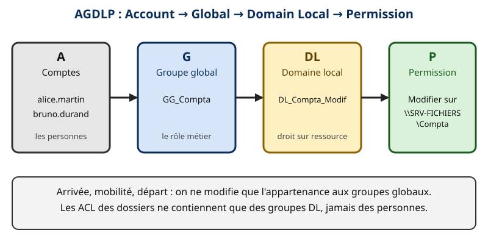
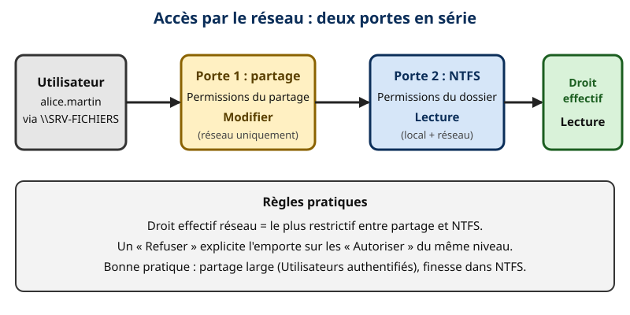
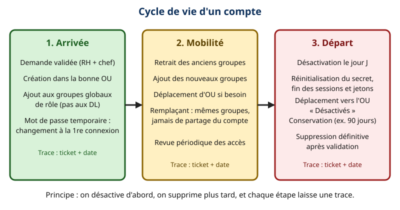

# Leçon — Comptes, groupes et délégation : AGDLP, droits NTFS et partage, comptes de service, cycle de vie

- **Tags** : `transverse`, `tout-en-un`, `lecon`, `identites`, `active-directory`, `groupes`, `agdlp`, `ntfs`, `delegation`, `comptes-de-service`
- **Niveau** : Intermédiaire ([[Glossary:TSSR]] / administrateur systèmes)
- **Durée estimée** : 3 h 30 (lecture 1 h 10, laboratoire 1 h 40, exercices et quiz 40 min)

---

## Objectifs pédagogiques

À la fin de cette leçon, vous saurez :

1. distinguer comptes **utilisateur**, **ordinateur**, **de service** et groupes de **sécurité** ou de **distribution** ;
2. choisir l'**étendue** d'un groupe (domaine local, globale, universelle) et appliquer **[[Glossary:AGDLP]]** ou **AGUDLP** ;
3. combiner **droits [[Glossary:NTFS]]** et **droits de partage** et prédire le droit effectif ;
4. **déléguer** une tâche d'administration à une équipe sans lui donner les droits d'administrateur du domaine ;
5. choisir et créer un **compte de service géré** (gMSA) plutôt qu'un compte classique ;
6. conduire proprement le **cycle de vie** d'un compte : arrivée, mobilité ou remplacement, départ.

## Prérequis et durée

- Connaître le vocabulaire d'Active Directory (domaine, [[Glossary:OU]], [[Glossary:DC]]) vu dans la leçon sur [[Glossary:AD]] DS.
- Laboratoire à deux [[Glossary:VM]] sur un réseau isolé : `SRV-DC01` (192.0.2.10, domaine `example.test`) et `SRV-FICHIERS` (192.0.2.20, serveur de fichiers membre du domaine), versions d'évaluation officielles, détruisibles. Faites un **instantané** avant de commencer.
- Durée : environ 3 h 30.

Les adresses sont des adresses de documentation, les noms d'utilisateurs sont fictifs, et **aucun mot de passe n'est écrit** : les commandes le demandent de façon interactive.

## L'essentiel en bref

- On n'attribue **jamais** des droits à des personnes : on les attribue à des **groupes**, et on place les personnes dans des groupes.
- **AGDLP** : **A**ccounts → **G**lobal groups (rôles) → **D**omain **L**ocal groups (droits sur une ressource) → **P**ermissions.
- **Droit effectif par le réseau = le plus restrictif** entre le partage et le NTFS ; en local, seul le NTFS compte.
- La **délégation** donne un droit précis sur une OU (par exemple réinitialiser les mots de passe) à un groupe, sans l'ajouter à *Admins du domaine*.
- Un **compte de service géré de groupe (gMSA)** a un mot de passe long, géré et renouvelé automatiquement par le domaine.
- Un compte se **désactive avant de se supprimer** ; chaque étape du cycle de vie laisse une trace.

---

## 1. Les types d'objets d'identité

- **Compte utilisateur** : une personne (nominatif : un compte = une personne).
- **Compte ordinateur** : une machine jointe ; son mot de passe est renouvelé automatiquement.
- **Compte de service** : un programme, jamais utilisé par un humain.
- **Groupe de sécurité** : ensemble d'objets auquel on accorde des droits (il figure dans les [[Glossary:ACL]]) ; un **groupe de distribution** n'est qu'une liste de diffusion.

Bonnes pratiques de nommage : `prenom.nom` pour les personnes, `adm-prenom.nom` pour le compte d'administration **distinct** de la même personne, `svc-application` ou `gmsa-application` pour les services, `GG_` pour les groupes globaux et `DL_` pour les groupes de domaine local. Ce préfixe n'est pas une obligation technique : c'est ce qui permet de lire l'architecture d'un coup d'œil.

Règle de séparation : un administrateur utilise **deux comptes** : un compte normal pour la messagerie et le web, un compte d'administration pour les consoles et serveurs. Si le premier est piégé par un courriel malveillant, le second reste intact.

## 2. Les groupes et leur étendue

### 2.1 Les trois étendues

| Étendue | Peut contenir | S'utilise pour | Réplication |
| --- | --- | --- | --- |
| **Globale (G)** | Comptes et groupes globaux **du même domaine** | Regrouper des personnes par **rôle** | Appartenance stockée dans le domaine |
| **Domaine local (DL)** | Comptes, globaux et universels de **tout** domaine de la forêt, DL du même domaine | Accorder un **droit** sur une ressource | Appartenance stockée dans le domaine |
| **Universelle (U)** | Comptes, globaux et universels de la forêt | Relier des rôles de plusieurs domaines | Appartenance dans le catalogue global |

Analogie : le groupe **global** est une **équipe** (« les comptables ») ; le groupe **de domaine local** est une **clé** (« le droit de modifier le dossier Compta ») ; l'universel est un **annuaire inter-sites** qui sert quand l'équipe s'étend sur plusieurs domaines.

### 2.2 AGDLP



*Modèle AGDLP : les personnes entrent dans un groupe de rôle, le groupe de rôle entre dans un groupe de droit, et seul ce dernier apparaît dans l'ACL. Création originale du projet Pack Master.*

On suit toujours la même chaîne :

1. **A** — On crée les comptes (`alice.martin`, `bruno.durand`).
2. **G** — On les met dans un groupe **global de rôle** (`GG_Compta`).
3. **DL** — On crée un groupe de domaine local par **ressource et par niveau de droit** (`DL_Compta_Modif`, `DL_Compta_Lecture`), et on y place `GG_Compta`.
4. **P** — On accorde la permission **au groupe DL** sur le dossier.

Intérêt : quand Alice change de service, on modifie une seule chose, son appartenance aux groupes **globaux** ; les ACL des dossiers ne changent jamais. Et si une nouvelle équipe (`GG_Achats`) doit aussi modifier le dossier, on l'ajoute à `DL_Compta_Modif`.

### 2.3 AGUDLP et AGLP

- **AGUDLP** : même principe, avec un groupe **universel** entre le global et le DL, quand les rôles viennent de plusieurs domaines. Le groupe universel est stocké dans le catalogue global : on y met des **groupes globaux**, rarement des comptes, pour limiter la réplication.
- **AGLP** : sur un serveur de fichiers membre, le « DL » peut être un **groupe local du serveur** : plus simple, mais invisible hors de ce serveur et plus difficile à auditer.

### 2.4 Pièges de conception

- **Jeton d'accès** : l'appartenance aux groupes est lue à l'**ouverture de session**. Après un ajout, l'utilisateur doit se reconnecter (ou fermer sa session) pour que le droit apparaisse.
- **Taille du jeton** : de très nombreuses appartenances imbriquées peuvent dépasser la taille maximale du jeton Kerberos ; limitez l'imbrication à deux ou trois niveaux.

## 3. Droits NTFS et droits de partage

### 3.1 Deux couches distinctes

Lorsqu'un utilisateur accède à `\\SRV-FICHIERS\Compta`, **deux portes** s'enchaînent :

1. les **permissions de partage** (lecture, modification, contrôle total), qui ne s'appliquent **qu'aux accès par le réseau** ;
2. les **permissions NTFS** (finesse fichier par fichier), qui s'appliquent **toujours**, en local comme par le réseau.



*Le droit effectif par le réseau est l'intersection des deux listes : on garde le plus restrictif. Création originale du projet Pack Master.*

**Règle** : par le réseau, le droit effectif est **le plus restrictif** des deux. Exemple : partage *Modifier* + NTFS *Lecture* = **Lecture**. Le **Refuser** explicite l'emporte sur les **Autoriser** au sein d'une même couche.

### 3.2 Les permissions NTFS de base

Les permissions de base sont *Contrôle total*, *Modification*, *Lecture et exécution*, *Affichage du contenu du dossier*, *Lecture* et *Écriture*. Elles sont **héritées** par défaut depuis le dossier parent. Les marqueurs `(OI)` et `(CI)` d'`icacls` signifient « hérité par les fichiers » (Object Inherit) et « hérité par les sous-dossiers » (Container Inherit). Un dossier a aussi un **propriétaire**, qui peut toujours modifier les permissions.

### 3.3 La bonne pratique

1. Créer un partage **simple** (par exemple *Utilisateurs authentifiés : Modification*, ou les groupes DL eux-mêmes) ;
2. Mettre la **finesse dans NTFS**, en n'accordant que des groupes `DL_*` ;
3. **Retirer l'héritage** à la racine du partage, et supprimer le groupe *Utilisateurs* par défaut ;
4. Activer l'**énumération basée sur l'accès** (ABE) pour ne montrer aux utilisateurs que les dossiers auxquels ils ont accès ;
5. Garder **Administrateurs** et **SYSTEM** en Contrôle total (sinon sauvegardes et antivirus échouent).

### 3.4 Lire sans modifier

```powershell
icacls D:\Partages\Compta
Get-SmbShareAccess -Name "Compta"
```

👉 Explication : `icacls` affiche les permissions NTFS du dossier ; `Get-SmbShareAccess` affiche celles du partage. Lecture seule : c'est le premier réflexe d'un audit.

```powershell
whoami /groups
```

👉 Explication : liste les groupes présents dans le jeton de la session courante. Si un groupe attendu manque, l'utilisateur doit se reconnecter.

## 4. La délégation de contrôle

### 4.1 Pourquoi déléguer ?

Sans délégation, le support technique qui doit réinitialiser un mot de passe reçoit les droits d'administrateur du domaine : disproportionné et dangereux. La **délégation** applique le **principe du moindre privilège** : on accorde un droit précis, sur une OU précise, à un groupe précis.

Analogie : on remet au gardien un **passe** du local à poubelles, pas le passe général.

### 4.2 Comment ça marche

Chaque objet AD possède une ACL (des **entrées de contrôle d'accès**, ACE). Déléguer, c'est **ajouter des ACE** sur une OU, avec une portée d'héritage vers les objets enfants. L'assistant **Délégation de contrôle** (clic droit sur l'OU dans « Utilisateurs et ordinateurs Active Directory ») fournit les tâches courantes :

- créer, supprimer et gérer les comptes d'utilisateurs ;
- réinitialiser les mots de passe et forcer leur changement à la prochaine ouverture de session ;
- lire toutes les informations d'utilisateur ;
- modifier l'appartenance à un groupe ;
- joindre un ordinateur au domaine.

On délègue à un **groupe** (par exemple `GG_Support_N1`), jamais à une personne.

### 4.3 Inspecter une délégation

```powershell
dsacls "OU=Utilisateurs,OU=Entreprise,DC=example,DC=test"
```

👉 Explication : affiche l'ACL de l'OU, entrée par entrée, y compris les délégations ; lecture seule. Cherchez les lignes citant `EXAMPLE\GG_Support_N1`.

### 4.4 Exemple : le support peut réinitialiser les mots de passe

```powershell
dsacls "OU=Utilisateurs,OU=Entreprise,DC=example,DC=test" /I:S /G "EXAMPLE\GG_Support_N1:CA;Reset Password;user"
dsacls "OU=Utilisateurs,OU=Entreprise,DC=example,DC=test" /I:S /G "EXAMPLE\GG_Support_N1:RPWP;pwdLastSet;user"
```

👉 Explication : accorde à `GG_Support_N1` le droit de réinitialiser le mot de passe (droit étendu `Reset Password`) et de modifier l'attribut `pwdLastSet` (pour forcer le changement), uniquement sur les objets `user` situés **sous** l'OU (`/I:S`, héritage aux sous-objets). L'assistant graphique produit le même résultat ; la ligne de commande est utile pour documenter et reproduire.

### 4.5 Limites et risques

- **Les comptes protégés** (membres d'*Admins du domaine*, etc.) sont exclus de l'héritage par le processus **AdminSDHolder**/SDProp : un compte du support ne pourra pas réinitialiser leur mot de passe, et c'est voulu.
- **Ne pas déléguer au niveau du domaine** : on perd la maîtrise du périmètre.
- **Documenter** chaque délégation (qui, où, quel droit, pourquoi) et la **revoir** régulièrement.
- Pour retirer une délégation : `dsacls <OU> /R "EXAMPLE\GG_Support_N1"` (supprime les entrées du principal) ; testez d'abord dans le laboratoire.

## 5. Les comptes de service

### 5.1 Le problème

Un service (sauvegarde, base de données, application web) doit s'authentifier. L'erreur courante : créer un compte `svc-xyz`, avec un mot de passe qui n'expire jamais, utilisé sur plusieurs serveurs et parfois **membre d'Admins du domaine**. C'est une cible de choix pour un attaquant.

### 5.2 Les options, de la meilleure à la plus fragile

1. **Compte de service géré de groupe (gMSA)** : le mot de passe (240 caractères aléatoires) est généré et renouvelé par le domaine (30 jours par défaut) ; les serveurs autorisés le récupèrent. Personne ne le connaît. Utilisable sur plusieurs serveurs.
2. **Compte de service géré autonome (sMSA)** : même idée, lié à **un seul** serveur.
3. **Comptes virtuels / services intégrés** (`NT SERVICE\<nom>`, `NetworkService`) pour des services locaux.
4. **Compte utilisateur classique** : en dernier recours, avec mot de passe long et unique, documenté, jamais en *Admins du domaine*, et surveillé.

### 5.3 Créer un gMSA

La création demande une **clé racine KDS**, créée une fois par forêt.

```powershell
Add-KdsRootKey -EffectiveTime ((Get-Date).AddHours(-10))
```

👉 Explication : crée la clé racine du service de distribution de clés, avec une date d'effet déjà passée pour pouvoir l'utiliser **tout de suite**. **Laboratoire uniquement** : en production, laissez le délai de réplication (10 heures) s'écouler.

```powershell
New-ADGroup -Name "GG_Serveurs_Web" -GroupScope Global -GroupCategory Security -Path "OU=Groupes,OU=Entreprise,DC=example,DC=test"
Add-ADGroupMember -Identity "GG_Serveurs_Web" -Members "SRV-WEB01$"
New-ADServiceAccount -Name "gmsa-web" -DNSHostName "gmsa-web.example.test" -PrincipalsAllowedToRetrieveManagedPassword "GG_Serveurs_Web" -Path "OU=Comptes-de-service,OU=Entreprise,DC=example,DC=test"
```

👉 Explication : crée un groupe contenant les **comptes ordinateur** autorisés (le `$` final désigne un compte machine), puis le gMSA, et autorise ce groupe à lire son mot de passe. Les commandes modifient l'annuaire du laboratoire.

Sur le serveur autorisé :

```powershell
Install-ADServiceAccount -Identity "gmsa-web"
Test-ADServiceAccount -Identity "gmsa-web"
```

👉 Explication : installe le gMSA sur le serveur et vérifie qu'il peut récupérer son mot de passe (réponse `True` attendue). On configure ensuite le service pour s'exécuter sous `EXAMPLE\gmsa-web$` **avec un mot de passe vide**.

### 5.4 Auditer les comptes de service

```powershell
Search-ADAccount -PasswordNeverExpires -UsersOnly | Select-Object Name, Enabled, LastLogonDate
Get-ADServiceAccount -Filter * | Select-Object Name, Enabled
```

👉 Explication : repère les comptes dont le mot de passe n'expire jamais, souvent des comptes de service à migrer vers des gMSA, puis liste les comptes de service gérés existants. Lecture seule.

## 6. Cycle de vie des comptes



*Cycle de vie d'un compte : on désactive d'abord, on supprime plus tard, et chaque étape est tracée. Création originale du projet Pack Master.*

La clé est un **processus écrit**, déclenché par une demande **validée** (RH, responsable) et tracée dans un ticket.

### 6.1 Arrivée

1. Réception de la demande validée : identité, service, rôle, date de début, date de fin éventuelle (contractuels, stagiaires).
2. Création du compte dans la **bonne OU**, avec un mot de passe temporaire à changer à la première connexion.
3. Ajout aux **groupes globaux de rôle** (pas aux DL).
4. Remise sécurisée des informations (jamais le mot de passe par courriel en clair).
5. Pour les temporaires, posez une **date d'expiration** de compte.

```powershell
New-ADUser -Name "Alice Martin" -GivenName "Alice" -Surname "Martin" -SamAccountName "alice.martin" -UserPrincipalName "alice.martin@example.test" -Path "OU=Utilisateurs,OU=Entreprise,DC=example,DC=test" -AccountPassword (Read-Host -AsSecureString "Mot de passe temporaire") -ChangePasswordAtLogon $true -Enabled $true
Add-ADGroupMember -Identity "GG_Compta" -Members "alice.martin"
```

👉 Explication : crée le compte avec un mot de passe saisi de façon masquée et un changement obligatoire à la première connexion, puis l'ajoute au groupe de rôle. Ces commandes modifient l'annuaire du laboratoire.

### 6.2 Mobilité interne

Alice passe de la comptabilité aux achats :

```powershell
Remove-ADGroupMember -Identity "GG_Compta" -Members "alice.martin" -Confirm:$false
Add-ADGroupMember -Identity "GG_Achats" -Members "alice.martin"
```

👉 Explication : retire l'ancien rôle **avant** d'ajouter le nouveau ; sinon les droits s'accumulent (c'est la « dérive des privilèges »). Déplacez aussi le compte dans l'OU adaptée si des [[Glossary:GPO]] diffèrent.

### 6.3 Remplacement

Charlie remplace Bruno. **On ne renomme jamais le compte de Bruno** pour Charlie : il hériterait de l'historique, du [[Glossary:SID]], des droits, des boîtes aux lettres et des journaux de Bruno. On crée un **nouveau compte**, on lui donne les **mêmes groupes de rôle**, on transfère la propriété des fichiers et des tâches planifiées, puis on traite le départ de Bruno.

```powershell
Get-ADUser -Identity "bruno.durand" -Properties MemberOf | Select-Object -ExpandProperty MemberOf
```

👉 Explication : liste les groupes de Bruno pour inspirer ceux de Charlie, **à relire à la main** : certains droits peuvent être spécifiques à Bruno. Lecture seule.

### 6.4 Départ

Le jour du départ, dans cet ordre :

1. **Désactiver** le compte, sans le supprimer ;
2. réinitialiser le mot de passe, fermer les sessions, révoquer les jetons et accès distants ([[Glossary:VPN]], messagerie mobile) ;
3. noter le motif et le numéro de ticket dans la description ;
4. déplacer le compte dans `OU=Desactives` ;
5. conserver pour la durée définie par la politique (par exemple 90 jours), puis supprimer après validation.

```powershell
Disable-ADAccount -Identity "bruno.durand"
Set-ADUser -Identity "bruno.durand" -Description "Désactivé 2026-11-01 - ticket INC-0001"
Move-ADObject -Identity (Get-ADUser "bruno.durand").DistinguishedName -TargetPath "OU=Desactives,OU=Entreprise,DC=example,DC=test"
```

👉 Explication : désactive le compte, trace la raison et le ticket, puis le range dans l'OU des comptes désactivés. Ces commandes modifient l'annuaire du laboratoire ; l'OU `Desactives` doit exister.

### 6.5 Revue périodique

```powershell
Search-ADAccount -AccountInactive -TimeSpan 90.00:00:00 -UsersOnly | Select-Object Name, LastLogonDate, Enabled
```

👉 Explication : repère les comptes sans connexion depuis 90 jours. L'attribut `LastLogonDate` (dérivé de `lastLogonTimestamp`) n'est répliqué qu'à intervalles de 9 à 14 jours : c'est une **indication**, pas une preuve à la minute près. Lecture seule.

La **corbeille Active Directory**, une fois activée (opération irréversible, à l'échelle de la forêt), permet de restaurer un objet supprimé par erreur.

---

## Mise en pratique guidée

**Objectif** : construire une chaîne AGDLP complète, vérifier le droit effectif par le réseau, déléguer la réinitialisation de mots de passe et faire vivre un compte.

> Les commandes sont données à titre pédagogique et n'ont pas été exécutées pour rédiger la leçon. Utilisez uniquement un laboratoire jetable.

### Étape 1 — Groupes et comptes (sur le DC)

```powershell
$grp = "OU=Groupes,OU=Entreprise,DC=example,DC=test"
New-ADGroup -Name "GG_Compta" -GroupScope Global -GroupCategory Security -Path $grp
New-ADGroup -Name "DL_Compta_Modif" -GroupScope DomainLocal -GroupCategory Security -Path $grp
Add-ADGroupMember -Identity "DL_Compta_Modif" -Members "GG_Compta"
```

👉 Explication : crée le groupe de rôle `GG_Compta` et le groupe de droit `DL_Compta_Modif`, puis place le premier dans le second (le « G » dans le « DL »). Ajoutez ensuite `alice.martin` à `GG_Compta` comme en section 6.1.

### Étape 2 — Dossier, NTFS et partage (sur SRV-FICHIERS)

```powershell
New-Item -ItemType Directory -Path "D:\Partages\Compta" -Force
icacls "D:\Partages\Compta" /inheritance:r /grant "BUILTIN\Administrators:(OI)(CI)F" /grant "NT AUTHORITY\SYSTEM:(OI)(CI)F" /grant "EXAMPLE\DL_Compta_Modif:(OI)(CI)M"
```

👉 Explication : crée le dossier, **supprime l'héritage** et n'accorde que Contrôle total aux administrateurs et au système, plus *Modification* au groupe DL. Adaptez `D:` à un lecteur existant du laboratoire.

```powershell
New-SmbShare -Name "Compta" -Path "D:\Partages\Compta" -ChangeAccess "EXAMPLE\DL_Compta_Modif" -FullAccess "BUILTIN\Administrators" -FolderEnumerationMode AccessBased
```

👉 Explication : publie le partage avec les mêmes groupes et l'énumération basée sur l'accès : les utilisateurs ne voient pas les partages dont ils n'ont pas l'usage.

### Étape 3 — Vérifier les accès

Depuis le poste, ouvrez une session `alice.martin` (nouvelle session après l'ajout au groupe) et accédez à `\\SRV-FICHIERS\Compta`. Créez un fichier : accepté. Avec un compte hors `GG_Compta` : refusé ou partage invisible. Puis, sur le serveur :

```powershell
icacls "D:\Partages\Compta"
Get-SmbShareAccess -Name "Compta"
```

👉 Explication : vérifie que l'ACL ne contient que des groupes. Réduisez ensuite temporairement le partage à *Lecture* (`Revoke-SmbShareAccess` puis `Grant-SmbShareAccess -AccessRight Read`) et constatez que l'écriture est refusée malgré NTFS *Modification* : c'est l'effet de l'intersection.

### Étape 4 — Délégation

Créez `GG_Support_N1`, ajoutez-y un compte de test, appliquez les deux commandes `dsacls` de la section 4.4, puis, depuis un poste d'administration (RSAT) connecté sous ce compte de test, réinitialisez le mot de passe d'un utilisateur de l'OU. Tentez la même opération sur un membre de *Admins du domaine* : elle doit échouer (compte protégé).

### Étape 5 — Cycle de vie et nettoyage

Jouez les scénarios des sections 6.1 à 6.4 avec deux comptes fictifs, vérifiez avec `Search-ADAccount -AccountDisabled -UsersOnly`, puis restaurez l'instantané ou supprimez les VM.

---

## Exercices

1. **(Vocabulaire)** Dans AGDLP, que représentent les lettres ? Donnez un exemple concret pour chacune.
2. **(Conception)** Le service Achats (6 personnes) doit lire le dossier `Contrats` et modifier le dossier `Commandes`. Proposez les groupes et les permissions.
3. **(Droit effectif)** Partage : *Lecture*. NTFS : *Modification*. Quel droit par le réseau ? Et en ouvrant la session directement sur le serveur ?
4. **(Deny)** Un utilisateur est dans `DL_Compta_Modif` (Modifier) et dans `DL_Compta_Refus` (Refuser l'écriture). Que se passe-t-il ? Quelle est la précaution à retenir sur le Refuser ?
5. **(Délégation)** Rédigez la fiche de délégation (qui, où, quel droit, comment tester) pour que le support puisse débloquer les comptes.
6. **(Service)** Un service tourne sous `svc-appli` (mot de passe sans expiration, membre d'*Admins du domaine*). Listez trois risques et la migration recommandée.
7. **(Cycle de vie)** Daniel quitte l'entreprise vendredi ; Éva reprend son poste lundi. Donnez les étapes dans l'ordre, avec les commandes principales.

## Corrigés des exercices

1. A : comptes (`alice.martin`) ; G : groupe global de rôle (`GG_Compta`) ; DL : groupe de domaine local, droit sur la ressource (`DL_Compta_Modif`) ; P : permission *Modifier* sur `\\SRV-FICHIERS\Compta`.
2. `GG_Achats` (les 6 comptes) ; `DL_Contrats_Lecture` et `DL_Commandes_Modif` ; `GG_Achats` est membre des deux ; NTFS : *Lecture et exécution* au premier, *Modification* au second, appliqués sur chaque dossier.
3. Par le réseau : **Lecture** (le plus restrictif). En local : **Modification**, car le partage ne s'applique pas aux accès locaux.
4. L'écriture est refusée : le Refuser explicite l'emporte. Précaution : l'utiliser rarement ; on préfère ne pas accorder le droit, car un Refuser mal placé est difficile à diagnostiquer.
5. Qui : `GG_Support_N1`. Où : `OU=Utilisateurs,OU=Entreprise` et ses sous-OU. Droit : lecture/écriture de `lockoutTime` (`dsacls … /I:S /G "EXAMPLE\GG_Support_N1:RPWP;lockoutTime;user"`). Test : verrouiller un compte de test puis le débloquer depuis un poste RSAT ; vérifier qu'un compte hors de l'OU reste inaccessible. Revue : trimestrielle.
6. Risques : compromission du compte = compromission du domaine ; mot de passe jamais renouvelé et connu de plusieurs personnes ; impossibilité d'attribuer les actions à une personne. Migration : gMSA (ou compte à privilèges minimaux), suppression de l'appartenance à *Admins du domaine*, droits strictement nécessaires.
7. Vendredi : `Disable-ADAccount`, réinitialisation, description + ticket, `Move-ADObject` vers `OU=Desactives`, sauvegarde et transfert des fichiers. Lundi : `New-ADUser` pour Éva, ajout aux groupes de rôle équivalents, remise sécurisée. Aucun renommage du compte de Daniel.

## Quiz

**Q1.** Que doit contenir une ACL selon AGDLP ? A) Des comptes — B) Des groupes DL — C) Des groupes de distribution — D) Des ordinateurs uniquement

**Q2.** Quel groupe regroupe des personnes par rôle ? A) DL — B) Global — C) Local du poste — D) Distribution

**Q3.** Partage *Modifier*, NTFS *Lecture* : droit effectif par le réseau ? A) Modifier — B) Lecture — C) Contrôle total — D) Aucun

**Q4.** Le partage s'applique-t-il à un accès local ? A) Oui — B) Non, seul NTFS — C) Seulement pour les administrateurs — D) Seulement en lecture

**Q5.** Un utilisateur ajouté à un groupe ne voit pas encore le droit. Pourquoi ? A) Le [[Glossary:DNS]] est cassé — B) Son jeton d'accès n'a pas été renouvelé — C) Le groupe est de distribution — D) Le schéma est verrouillé

**Q6.** Principe d'une délégation de contrôle ? A) Donner les droits d'administrateur — B) Donner un droit précis sur une OU à un groupe — C) Supprimer l'OU — D) Dupliquer la GPO

**Q7.** Pourquoi un gMSA est-il préférable à un compte de service classique ? A) Il est plus lent — B) Son mot de passe est long et renouvelé automatiquement — C) Il n'a pas de SID — D) Il peut ouvrir une session interactive

**Q8.** Premier geste lors du départ d'un salarié ? A) Supprimer le compte — B) Désactiver le compte — C) Renommer le compte — D) Ajouter à Admins du domaine

**Q9.** Pourquoi ne pas renommer le compte de l'ancien titulaire pour le remplaçant ? A) Impossible techniquement — B) Il hériterait du SID, des droits et de l'historique — C) Ça coûte une licence — D) Le DNS en pâtit

**Q10.** Que fait `icacls D:\Partages\Compta` seul ? A) Modifie les ACL — B) Affiche les ACL — C) Supprime l'héritage — D) Crée le partage

### Réponses justifiées

1. **B** — AGDLP place uniquement des groupes DL dans les ACL, les personnes n'y figurent jamais.
2. **B** — Le groupe global est l'« équipe » ; il ne contient que des objets du même domaine.
3. **B** — Le droit effectif par le réseau est le plus restrictif des deux couches.
4. **B** — Les permissions de partage ne s'appliquent qu'aux accès réseau.
5. **B** — L'appartenance aux groupes est lue à l'ouverture de session ; il faut se reconnecter.
6. **B** — Principe du moindre privilège : un droit précis, sur un périmètre précis.
7. **B** — Mot de passe de 240 caractères géré par le domaine, jamais connu d'une personne.
8. **B** — On désactive d'abord, pour pouvoir restaurer ou enquêter, et on supprime plus tard.
9. **B** — Le SID et les droits associés suivraient le nouveau titulaire, avec les traces de l'ancien.
10. **B** — Sans option de modification, `icacls` n'affiche que les permissions.

## Erreurs fréquentes et dépannage

| Symptôme | Cause probable | Vérification (lecture seule) | Action |
| --- | --- | --- | --- |
| Droit ajouté, mais accès refusé | Jeton non renouvelé | `whoami /groups` | Se reconnecter |
| Accès lecture seule alors que NTFS = Modifier | Partage plus restrictif | `Get-SmbShareAccess` | Ajuster le partage (ou le NTFS) |
| Un utilisateur voit tout | ACL contient *Utilisateurs* ou *Tout le monde* | `icacls` | Retirer l'héritage et ces entrées |
| Délégation sans effet sur un administrateur | Compte protégé (AdminSDHolder) | `Get-ADUser X -Properties AdminCount` | Comportement normal |
| Service en échec après changement de mot de passe | Compte de service classique | Journal des événements du service | Migrer vers un gMSA |
| Droits qui s'accumulent chez un même salarié | Retrait des anciens groupes oublié | `Get-ADPrincipalGroupMembership X` | Revue périodique ; retrait systématique |
| `Test-ADServiceAccount` renvoie False | Clé KDS absente ou trop récente, serveur absent du groupe | `Get-KdsRootKey`, appartenance du serveur | Attendre ou corriger l'appartenance, redémarrer |

## À retenir

- Droits : toujours aux **groupes**, jamais aux personnes.
- **AGDLP** : personnes → groupe global (rôle) → groupe DL (droit) → permission. AGUDLP en multi-domaine.
- **Droit effectif réseau** = le plus restrictif entre partage et NTFS ; le Refuser l'emporte au sein d'une couche.
- Le jeton d'accès se renouvelle à l'ouverture de session.
- **Délégation** : droit précis, OU précise, groupe précis ; documenter et revoir.
- Services : **gMSA** d'abord ; jamais d'*Admins du domaine*.
- Cycle de vie : valider, créer, tracer ; **désactiver avant de supprimer** ; ne jamais réaffecter un compte.

## Pour aller plus loin

- Microsoft Learn — Groupes de sécurité Active Directory : <https://learn.microsoft.com/windows-server/identity/ad-ds/manage/understand-security-groups>
- Microsoft Learn — Vue d'ensemble des gMSA : <https://learn.microsoft.com/windows-server/security/group-managed-service-accounts/group-managed-service-accounts-overview>
- Microsoft Learn — Contrôle d'accès Windows : <https://learn.microsoft.com/windows/security/identity-protection/access-control/access-control>
- Microsoft Learn — Vue d'ensemble de NTFS : <https://learn.microsoft.com/windows-server/storage/file-server/ntfs-overview>
- Microsoft Learn — Commande `icacls` : <https://learn.microsoft.com/windows-server/administration/windows-commands/icacls>
- Microsoft Learn — Bonnes pratiques de sécurisation d'Active Directory : <https://learn.microsoft.com/windows-server/identity/ad-ds/plan/security-best-practices/best-practices-for-securing-active-directory>
- Microsoft Learn — Module PowerShell ActiveDirectory : <https://learn.microsoft.com/powershell/module/activedirectory/>

## Crédits des images

| Fichier | Source | Auteur | Licence | Modifications |
| --- | --- | --- | --- | --- |
| `images/comptes-groupes-delegation-1.svg` | Création originale du projet Pack Master | Projet Pack Master | Dédiée au domaine public (CC0) — <https://creativecommons.org/publicdomain/zero/1.0/> | Sans objet |
| `images/comptes-groupes-delegation-2.svg` | Création originale du projet Pack Master | Projet Pack Master | Dédiée au domaine public (CC0) — <https://creativecommons.org/publicdomain/zero/1.0/> | Sans objet |
| `images/comptes-groupes-delegation-3.svg` | Création originale du projet Pack Master | Projet Pack Master | Dédiée au domaine public (CC0) — <https://creativecommons.org/publicdomain/zero/1.0/> | Sans objet |

Aucune image tierce n'a été retenue : la recherche sur Wikimedia Commons n'a pas fourni de ressource libre adaptée à ce sujet. Les trois schémas sont donc des créations originales.

## Historique de vérification

| Date | OS/logiciel | Testeur | Verdict |
| --- | --- | --- | --- |
| 2026-11-01 | Windows Server (AD DS, serveur de fichiers), client Windows | Rédaction assistée (Copilot) | Non testé sur plateforme cible |

Remarque : aucune commande n'a été exécutée sur Windows. Seule la validité XML des schémas SVG a été contrôlée localement.
