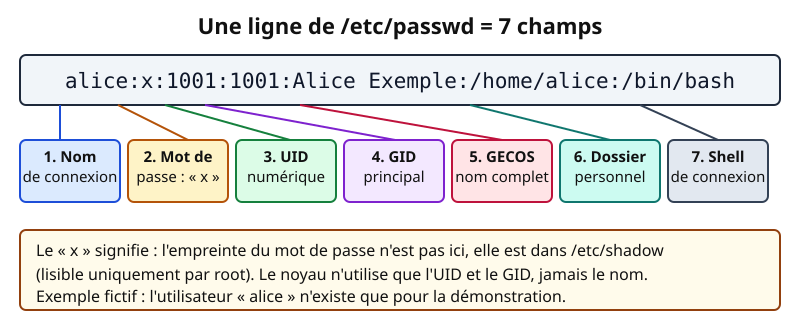
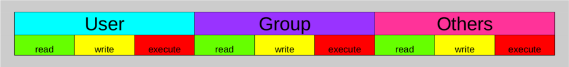
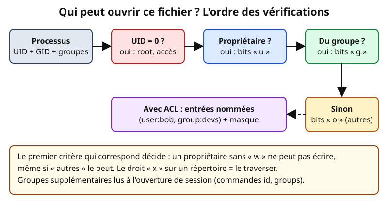
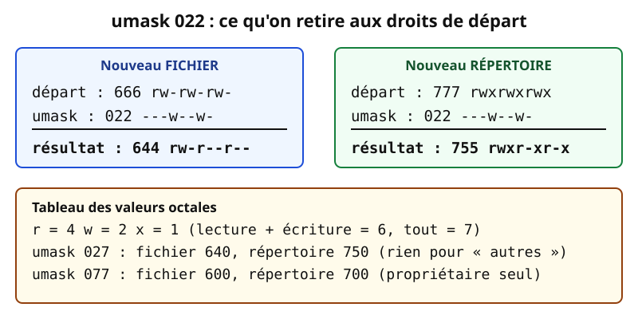

# Leçon — Comptes, groupes, permissions et sudo sous Linux

- **Tags** : `transverse`, `tout-en-un`, `lecon`, `identites`, `linux`, `permissions`, `sudo`, `acl`
- **Niveau** : débutant à intermédiaire
- **Durée estimée** : 3 h 30 (cours 1 h 30, laboratoire 1 h, exercices et quiz 1 h)

---

## Objectifs pédagogiques

À la fin de cette leçon, vous saurez :

1. Distinguer un **compte** (un nom) d'un **UID** (un numéro) et dire ce que le noyau utilise vraiment.
2. Lire `/etc/passwd`, `/etc/group` et `/etc/shadow`.
3. Créer, verrouiller et supprimer comptes et groupes (`useradd`, `usermod`, `groupadd`, `passwd`, `userdel`).
4. Lire et écrire des permissions avec `chmod`, `chown`, `chgrp`, y compris `setgid` et `sticky`.
5. Prévoir les droits d'un nouveau fichier grâce à l'`umask`.
6. Accorder un droit précis avec les **[[Glossary:ACL]] POSIX**.
7. Déléguer avec **sudo** prudemment : `/etc/sudoers.d/`, `visudo`, moindre privilège.

## Prérequis et durée

- Savoir utiliser un terminal (`cd`, `ls`, `cat`).
- Une **machine virtuelle jetable** Debian ou Ubuntu dont vous êtes administrateur.
- Durée totale : environ 3 h 30 ; le laboratoire (section 8) se fait sur la [[Glossary:VM]].

> **Règle de sécurité** : les commandes de modification (`useradd`, `chmod -R`, `setfacl`, sudoers…) sont réservées au laboratoire ; les commandes de consultation (`id`, `ls -l`, `getent`, `getfacl`, `sudo -l`) sont sans danger.

## L'essentiel en bref

- Linux manipule des **numéros** (UID, [[Glossary:GID]]) ; les noms sont des étiquettes.
- Un fichier a **un propriétaire, un groupe et trois jeux de droits** (propriétaire, groupe, autres) en lecture (`r`), écriture (`w`), exécution (`x`).
- Les **ACL** ajoutent des entrées nommées ; l'**umask** *retire* des droits à la création (666 fichier, 777 répertoire).
- **sudo** délègue *une commande précise* sans distribuer le mot de passe de root.
- Principes : **moindre privilège**, **traçabilité** (un compte par personne), **réversibilité**.

---

## 1. Comptes, UID et GID : la carte d'identité du noyau

### 1.1 Une analogie : le badge et le nom sur la porte

Le nom sur votre porte (« Alice Exemple ») sert aux humains, mais la serrure s'ouvre avec le **numéro de votre badge**. Linux fonctionne ainsi : le noyau compare des numéros, les noms ne servent qu'à l'affichage.

- **UID** (*User IDentifier*) : numéro d'utilisateur. Exemple : `1001`.
- **GID** (*Group IDentifier*) : numéro de groupe. Exemple : `1001`.
- Un processus porte un UID effectif, un GID principal et une liste de **groupes supplémentaires**. C'est ce triplet qui est testé à chaque accès à un fichier.

### 1.2 Les plages d'identifiants

Par convention (valeurs par défaut de `/etc/login.defs`, modifiables selon la distribution) :

| Plage d'UID | Usage habituel |
|---|---|
| 0 | `root`, super-utilisateur : le noyau lui accorde presque tout |
| 1 à 999 | comptes **système** et de services (`www-data`, `sshd`, `_apt`…) |
| 1000 et plus | comptes **humains** créés par l'administrateur |
| 65534 | `nobody` : compte « sans pouvoir », utilisé pour les accès anonymes |

Un compte de service ne doit pas ouvrir de session : son shell est `/usr/sbin/nologin` ou `/bin/false`, ce qui limite les dégâts d'un service compromis.

### 1.3 Voir son identité

```bash
id
```

👉 Explication : affiche votre UID, votre GID principal et la liste complète des groupes auxquels vous appartenez, sous la forme `uid=1001(alice) gid=1001(alice) groupes=1001(alice),27(sudo)`. Les groupes supplémentaires ne sont lus qu'à l'ouverture de session.

```bash
whoami
groups
```

👉 Explication : `whoami` donne le nom lié à l'UID effectif ; `groups` liste les groupes du processus courant. Ces deux commandes sont strictement en lecture.



*Figure 1 — Anatomie d'une ligne de `/etc/passwd`. Schéma original du projet (CC0).*

## 2. Les fichiers de comptes : /etc/passwd, /etc/group, /etc/shadow

### 2.1 /etc/passwd : l'annuaire local des comptes

Chaque ligne décrit un compte en sept champs séparés par `:` (voir la figure 1) :

```text
alice:x:1001:1001:Alice Exemple:/home/alice:/bin/bash
```

👉 Explication : exemple fictif. Le « x » signifie que l'empreinte du mot de passe est dans `/etc/shadow`. `/etc/passwd` est lisible par tous, car des programmes comme `ls -l` traduisent les UID en noms.

### 2.2 /etc/group : les groupes et leurs membres

```text
projet:x:2000:alice,bob
```

👉 Explication : nom du groupe, mot de passe de groupe (inutilisé), GID, **membres supplémentaires**. Un utilisateur dont le GID principal vaut 2000 est membre même s'il n'est pas listé.

### 2.3 /etc/shadow : les secrets, à l'abri

`/etc/shadow` contient les **empreintes** (hachages salés), les dates de changement et d'expiration. Il est réservé à root (et au groupe `shadow` sur Debian) :

```bash
ls -l /etc/passwd /etc/shadow
```

👉 Explication : sur une Debian standard, `/etc/passwd` est en 644 et `/etc/shadow` en 640 (groupe `shadow`) : l'un sert à traduire des numéros, l'autre protège les empreintes contre le craquage hors ligne. Ne partagez jamais un `shadow` réel.

### 2.4 Interroger via NSS plutôt que lire les fichiers

Les fichiers ne sont qu'**une** source possible : avec un annuaire (voir la leçon [Annuaires et SSO](lecon-annuaires-sso.md)), les comptes peuvent venir d'ailleurs. La bonne commande est :

```bash
getent passwd alice
getent group projet
```

👉 Explication : `getent` interroge les sources de `/etc/nsswitch.conf` (fichiers, [[Glossary:SSSD]], [[Glossary:LDAP]]…) ; un `grep` sur `/etc/passwd` ne voit que les comptes locaux.

## 3. Gérer comptes et groupes

### 3.1 Créer un compte

```bash
sudo useradd --create-home --shell /bin/bash --comment "Alice Exemple" alice
sudo passwd alice
```

👉 Explication : `useradd` crée l'entrée `/etc/passwd`, le groupe privé et le dossier personnel (copié depuis `/etc/skel`). `passwd` demande le mot de passe **au clavier** : ne le passez jamais en argument (historique, liste des processus). Sur Debian/Ubuntu, `adduser alice` est l'équivalent interactif.

### 3.2 Groupes : créer, ajouter, retirer

```bash
sudo groupadd --gid 2000 projet
sudo usermod --append --groups projet alice
sudo gpasswd --delete alice projet
```

👉 Explication : création du groupe avec un GID explicite (utile pour un stockage partagé entre machines), ajout d'alice (l'option `--append` est **vitale**), puis retrait avec `gpasswd`.

### 3.3 Verrouiller, expirer, supprimer

```bash
sudo passwd --lock alice
sudo chage --expiredate 2026-12-31 alice
sudo chage --list alice
sudo userdel --remove alice
```

👉 Explication : `--lock` rend la connexion par mot de passe impossible, mais une clé [[Glossary:SSH]] peut rester valide : pour un départ, bloquez aussi SSH. `chage` règle l'expiration. `userdel --remove` supprime aussi le dossier personnel : irréversible, à faire après sauvegarde.

**Cycle de vie** : on verrouille, on conserve les données le temps voulu, puis on supprime. Un fichier orphelin s'affiche avec un simple numéro ; si l'UID est réattribué, la nouvelle personne hérite de ses fichiers.

## 4. Permissions : propriétaire, groupe, autres

### 4.1 Les trois cases de droits



*Figure 2 — Les neuf bits de permission classiques : utilisateur (propriétaire), groupe, autres. Chaque bloc possède lecture, écriture, exécution.*

Lecture d'une sortie de `ls -l` :

```text
-rw-r----- 1 alice projet 2048 oct. 30 11:45 rapport.txt
```

👉 Explication : type (`-` fichier, `d` répertoire, `l` lien), puis `rw-` (alice : lire, écrire), `r--` (groupe `projet` : lire) et `---` (autres : rien), puis liens, propriétaire, groupe, taille, date, nom.

### 4.2 Ce que « r », « w » et « x » veulent dire

| Droit | Sur un **fichier** | Sur un **répertoire** |
|---|---|---|
| `r` (4) | lire le contenu | lister les noms contenus |
| `w` (2) | modifier le contenu | créer, renommer, supprimer des entrées (avec `x`) |
| `x` (1) | exécuter comme programme | **traverser** le répertoire (accéder aux éléments par leur nom) |

Image du **classeur** : `r` lit les étiquettes des tiroirs, `x` ouvre un tiroir dont on connaît le nom, `w` ajoute ou retire des tiroirs. Supprimer un fichier dépend donc des droits du **répertoire**.



*Figure 3 — Le premier critère qui correspond décide. Schéma original du projet (CC0).*

### 4.3 chmod : notation symbolique et octale

```bash
chmod u+rw,g+r,o-rwx rapport.txt
chmod 640 rapport.txt
```

👉 Explication : même résultat (`rw-r-----`). En octal, on additionne r=4, w=2, x=1 par case. Le symbolique convient pour *modifier un détail*, l'octal pour *fixer un état complet*.

```bash
chmod --recursive --changes g+rX /srv/projet
```

👉 Explication : le `X` majuscule n'ajoute `x` qu'aux répertoires (et aux fichiers déjà exécutables). Avant tout `--recursive`, relisez le chemin : une faute sur `/` est un classique des catastrophes. `--changes` liste les modifications réelles.

### 4.4 chown et chgrp

```bash
sudo chown alice:projet rapport.txt
sudo chgrp projet /srv/projet
```

👉 Explication : seul root change le propriétaire ; le propriétaire peut changer le groupe vers un groupe dont il est membre. Un `chown -R` mal ciblé s'annule mal sans sauvegarde.

### 4.5 Les bits spéciaux utiles

| Bit | Octal | Effet utile | Exemple |
|---|---|---|---|
| **setgid** sur répertoire | 2000 | les nouveaux fichiers héritent du **groupe du répertoire** | `chmod g+s /srv/projet` |
| **sticky** sur répertoire | 1000 | seul le propriétaire du fichier (ou du répertoire) peut le supprimer | `/tmp` (affiché `drwxrwxrwt`) |
| **setuid** sur exécutable | 4000 | le programme s'exécute avec l'UID de son propriétaire | `passwd` |

Le **setgid** sur répertoire est la clé d'un dossier d'équipe cohérent. Le **setuid** est dangereux : un binaire setuid root vulnérable donne root. On n'en crée pas, on **audite** ceux qui existent.

```bash
find / -xdev -perm -4000 -type f -print 2>/dev/null
```

👉 Explication : lecture seule : liste les exécutables setuid de la partition racine ; tout élément inattendu mérite une enquête.

## 5. L'umask : les droits de départ

Un programme qui crée un fichier demande **666**, un répertoire **777** ; le système retire ensuite les bits de l'**umask** du processus.



*Figure 4 — Effet de l'umask 022. Schéma original du projet (CC0).*

```bash
umask
umask 077
touch test-prive.txt
ls -l test-prive.txt
```

👉 Explication : le premier `umask` affiche la valeur actuelle (souvent `0022`). `umask 077` ne vaut que pour **le shell courant** : le fichier sera en `rw-------`. Pour le rendre permanent : `~/.profile`, ou `/etc/login.defs` (`UMASK`) selon la distribution.

| umask | Fichier | Répertoire | Cas d'usage |
|---|---|---|---|
| 022 | 644 | 755 | défaut classique : lisible par tous |
| 027 | 640 | 750 | serveur : « autres » n'a rien |
| 007 | 660 | 770 | dossier d'équipe (avec setgid) |
| 077 | 600 | 700 | données personnelles |

L'umask filtre à la **création** ; il ne modifie jamais l'existant.

## 6. Les ACL POSIX : quand trois cases ne suffisent plus

### 6.1 Le problème

Comment donner à Carole, hors du groupe `projet`, un accès en **lecture seule** à `/srv/projet` sans l'inscrire ni ouvrir le dossier à tous ? Les ACL (*Access Control Lists*) ajoutent une **entrée nommée** aux trois classiques.

### 6.2 Lire et écrire une ACL

```bash
getfacl /srv/projet
```

👉 Explication : lecture seule : affiche les entrées de base (`user::`, `group::`, `other::`) et les entrées nommées (`user:carole:r-x`). ext4 et [[Glossary:XFS]] gèrent les ACL par défaut.

```bash
sudo setfacl --modify user:carole:rX /srv/projet
sudo setfacl --default --modify group:projet:rwX /srv/projet
```

👉 Explication : carole reçoit lecture et traversée ; l'ACL **par défaut** (`--default`) est héritée par les futurs fichiers.

```bash
sudo setfacl --remove user:carole /srv/projet
sudo setfacl --remove-all /srv/projet
```

👉 Explication : retrait d'une entrée, puis de toutes les ACL étendues. Un `+` en fin de droits dans `ls -l` (`drwxrwx---+`) signale une ACL.

### 6.3 Le masque, ce piège discret

Le **masque** (`mask::`) plafonne les droits effectifs des entrées nommées et du groupe, et `chmod g-w` le modifie ! Si une entrée « ne marche pas », lisez les lignes `#effective:` de `getfacl`. Les ACL sont un **complément** : pour les besoins récurrents, préférez des groupes bien nommés.

## 7. sudo : déléguer sans donner les clés de root

### 7.1 Pourquoi sudo plutôt que « su - » ?

Partager le mot de passe de root (ou `su -`) supprime la traçabilité et complique la révocation. Avec **sudo**, chacun s'authentifie avec **son** mot de passe, la commande est journalisée et les droits sont **découpés**.

Analogie : chaque agent reçoit la clé de son seul local, et un registre note qui est entré et quand.

### 7.2 Utiliser sudo : consultation

```bash
sudo -l
```

👉 Explication : liste ce que **vous** pouvez lancer avec sudo, sans rien exécuter. `(ALL : ALL) ALL` = équivalent root.

```bash
sudo --validate
sudo --reset-timestamp
```

👉 Explication : `--validate` prolonge la fenêtre d'authentification ; `--reset-timestamp` l'oublie (utile avant de quitter son poste).

### 7.3 Écrire une règle sudoers prudemment

Règles d'or :

1. Jamais d'éditeur ordinaire sur `/etc/sudoers` : `visudo` vérifie la syntaxe (une faute peut vous exclure de sudo).
2. Un **fichier par sujet** dans `/etc/sudoers.d/`, en `0440`, propriétaire root.
3. Gardez **une session root ouverte** pendant les essais.
4. Des **groupes** (`%projet`) plutôt que des noms individuels.
5. Des **commandes précises en chemin absolu**, pas `ALL`.

```bash
sudo visudo -f /etc/sudoers.d/90-projet-web
```

👉 Explication : ouvre un fichier dédié avec contrôle de syntaxe. Le préfixe numérique fixe l'ordre de lecture ; **la dernière règle qui correspond l'emporte**.

```text
# Les membres du groupe « projet » peuvent relancer un service précis.
%projet ALL=(root) /usr/bin/systemctl restart nginx.service, /usr/bin/systemctl status nginx.service
```

👉 Explication : contenu du fichier : les membres du groupe `projet` peuvent devenir `root` pour lancer **exactement** ces deux commandes, et rien d'autre.

```bash
sudo visudo --check --file /etc/sudoers.d/90-projet-web
sudo chmod 0440 /etc/sudoers.d/90-projet-web
```

👉 Explication : `--check` valide la syntaxe ; `chmod 0440` pose les droits attendus.

### 7.4 Les pièges classiques de sudoers

- **`NOPASSWD: ALL`** : plus de preuve d'identité ni de limite. À réserver à l'automatisation, avec une commande précise.
- **Jokers (`*`)** : `/usr/bin/vi /etc/nginx/*` autorise un `vi` qui lance un shell (`:!sh`). Préférez `sudoedit`.
- **Éditeurs, pagineurs, interpréteurs (`vim`, `less`, `python`, `find`, `tar`)** savent lancer d'autres programmes : les autoriser revient à donner un shell.
- **Chemin relatif** : toujours en absolu, sinon un binaire homonyme du `PATH` peut être exécuté.
- **Groupes `sudo` / `wheel`** : `sudo` (Debian, Ubuntu) et `wheel` ([[Glossary:RHEL]]) sont liés à une règle sudoers ; les lister révèle vos administrateurs.

```bash
getent group sudo wheel
```

👉 Explication : membres des deux groupes d'administration usuels ; l'un peut ne pas exister.

### 7.5 Traçabilité

sudo journalise chaque appel (`/var/log/auth.log` sur Debian, journal `systemd` ailleurs) : preuve d'une action, et donnée utile à la revue d'accès pour savoir si un droit sert.

## 8. Mise en pratique guidée (labo local ou VM jetable)

**Scénario** : le dossier `/srv/projet` doit permettre à Alice et Bob d'écrire, à Carole de lire, et aux autres de ne rien voir. Bob doit pouvoir relancer un service sans devenir root.

> Pré-requis : VM Debian/Ubuntu jetable avec snapshot, compte pouvant utiliser `sudo`.

**Étape 1 — Créer le groupe et les comptes.**

```bash
sudo groupadd --gid 2000 projet
for u in alice bob carole; do sudo useradd --create-home --shell /bin/bash "$u"; done
sudo usermod --append --groups projet alice
sudo usermod --append --groups projet bob
getent group projet
```

👉 Explication : crée le groupe et trois comptes de test, ajoute alice et bob, puis vérifie. Aucun mot de passe n'est défini : on prendra leur identité avec `sudo -u`.

**Étape 2 — Créer le dossier avec setgid.**

```bash
sudo mkdir -p /srv/projet
sudo chown root:projet /srv/projet
sudo chmod 2770 /srv/projet
ls -ld /srv/projet
```

👉 Explication : droits `rwxrws---` : le `s` confirme le setgid, « autres » n'a rien.

**Étape 3 — Donner la lecture à Carole par ACL.**

```bash
sudo setfacl --modify user:carole:rX /srv/projet
sudo setfacl --default --modify user:carole:rX /srv/projet
getfacl /srv/projet
```

👉 Explication : vérifiez `user:carole:r-x` et les lignes `default:`.

**Étape 4 — Tester les droits en prenant chaque identité.**

```bash
sudo -u alice sh -c 'umask 007; echo "Note d alice" > /srv/projet/note.txt; ls -l /srv/projet/note.txt'
sudo -u bob sh -c 'echo "Ajout de bob" >> /srv/projet/note.txt && echo OK-bob'
sudo -u carole sh -c 'cat /srv/projet/note.txt; echo "essai" >> /srv/projet/note.txt'
```

👉 Explication : alice crée un fichier (groupe hérité : `projet`), bob y écrit, carole lit mais la dernière ligne **doit échouer** (« Permission non accordée ») : c'est le résultat attendu. Notez le `+` de l'ACL dans `ls -l`.

**Étape 5 — Déléguer sans donner root.**

```bash
echo '%projet ALL=(root) /usr/bin/systemctl status ssh.service' | sudo tee /etc/sudoers.d/90-projet-test
sudo visudo --check --file /etc/sudoers.d/90-projet-test
sudo chmod 0440 /etc/sudoers.d/90-projet-test
sudo -l -U bob
```

👉 Explication : crée, valide et protège la règle, puis affiche ce que bob peut lancer. Le service peut s'appeler `sshd.service` selon la distribution. En cas d'erreur de validation, supprimez aussitôt le fichier.

**Étape 6 — Nettoyer la VM.**

```bash
sudo rm /etc/sudoers.d/90-projet-test
sudo rm -rf /srv/projet
for u in alice bob carole; do sudo userdel --remove "$u"; done
sudo groupdel projet
```

👉 Explication : supprime ce que le labo a créé ; relisez chaque chemin, ou restaurez le snapshot.

## Exercices

1. **Lecture.** Dans `-rwxr-x--- 1 deploy ops 4096 nov. 1 09:00 script.sh`, qui peut exécuter le script ? Qui peut le modifier ?
2. **Conversion.** Écrivez en octal `rw-r-----`, puis `rwxr-xr-x`, puis `rw-rw----`. Traduisez 750 et 600 en notation symbolique.
3. **umask.** Un administrateur a défini `umask 027`. Quels droits auront un nouveau fichier et un nouveau répertoire ?
4. **Répertoire partagé.** Quelle séquence de `chgrp` et `chmod` fait en sorte que les fichiers créés dans `/srv/compta` appartiennent toujours au groupe `compta` et ne soient lisibles que par ce groupe ?
5. **ACL.** Comment donner à l'utilisateur `diane` un droit de lecture seule sur `/srv/compta`, y compris sur les futurs fichiers, sans la placer dans le groupe `compta` ?
6. **sudoers.** Écrivez une règle qui autorise le groupe `support` à exécuter uniquement la commande suivante avec les droits de root (commande exacte : `/usr/bin/journalctl --no-pager -u nginx.service`). Citez deux raisons pour lesquelles `ALL` serait une mauvaise idée.
7. **Audit.** Quelles commandes de lecture seule utiliseriez-vous pour répondre à : « Qui peut devenir root sur cette machine ? »
8. **Diagnostic.** Après `sudo usermod -G projet alice`, alice a perdu l'accès à ses groupes précédents. Expliquez ce qui s'est passé et corrigez.

## Corrigés des exercices

1. Les droits sont `rwx` pour `deploy` (lire, modifier, exécuter), `r-x` pour le groupe `ops` (lire et exécuter) et `---` pour les autres. **Peuvent exécuter** : `deploy` et les membres d'`ops`. **Peut modifier** : `deploy` uniquement. Root peut tout, indépendamment de ces bits.
2. `rw-r-----` = **640** ; `rwxr-xr-x` = **755** ; `rw-rw----` = **660**. 750 = `rwxr-x---` ; 600 = `rw-------`.
3. Fichier : 666 − 027 = **640** (`rw-r-----`). Répertoire : 777 − 027 = **750** (`rwxr-x---`).
4. ```bash
   sudo chgrp compta /srv/compta
   sudo chmod 2770 /srv/compta
   ```
   👉 Explication : le setgid (2) transmet le groupe `compta` aux nouveaux fichiers, 770 ferme l'accès aux autres.
5. ```bash
   sudo setfacl --modify user:diane:rX /srv/compta
   sudo setfacl --default --modify user:diane:rX /srv/compta
   ```
   👉 Explication : la première ligne vise l'existant (ajoutez `--recursive` pour la profondeur), la seconde les futurs fichiers.
6. ```text
   %support ALL=(root) /usr/bin/journalctl --no-pager -u nginx.service
   ```
   👉 Explication : la règle ne donne que cette commande. `ALL` serait mauvais car (a) c'est un shell root complet : toute erreur du groupe devient une faille système ; (b) la revue d'accès devient impossible. Sans `--no-pager`, `journalctl` ouvrirait un pagineur capable de lancer un shell.
7. ```bash
   getent group sudo wheel
   sudo -l -U nom_utilisateur
   sudo grep -r -v '^#' /etc/sudoers /etc/sudoers.d/
   ```
   👉 Explication : groupes administrateurs, droits par compte, règles actives (lecture en administrateur). Complétez par `getent passwd` pour repérer tout compte d'UID 0 autre que root.
8. `-G` **remplace** la liste des groupes supplémentaires, `-aG` l'**ajoute**. Correction : `sudo usermod -aG groupe1,groupe2 alice`, en s'appuyant sur une trace (`id alice` d'avant, sauvegarde de `/etc/group`).

## Quiz

**Q1. Que compare le noyau lors d'un accès à un fichier ?**
A. Le nom du compte et le nom du groupe — B. L'UID et les GID du processus avec ceux du fichier — C. Le nom du shell — D. Le mot de passe de l'utilisateur.

**Q2. Le « x » dans le deuxième champ de `alice:x:1001:…` signifie :**
A. que le compte est expiré — B. que l'utilisateur n'a pas de shell — C. que l'empreinte du mot de passe est dans /etc/shadow — D. que le mot de passe est « x ».

**Q3. Sur un répertoire, le droit `x` permet :**
A. d'exécuter son contenu — B. de le traverser — C. de le supprimer — D. de lister ses noms.

**Q4. Quelle commande fait en sorte que les nouveaux fichiers d'un répertoire héritent de son groupe ?**
A. `chmod u+s` — B. `chmod +t` — C. `chmod g+s` — D. `chmod 000`.

**Q5. Avec `umask 027`, un nouveau fichier créé par un programme qui demande 666 aura :**
A. 640 — B. 750 — C. 027 — D. 600.

**Q6. Quelle option de `usermod` est essentielle pour ajouter un groupe sans effacer les autres ?**
A. `-g` — B. `-L` — C. `-aG` — D. `-d`.

**Q7. Pourquoi utiliser `visudo` pour modifier sudoers ?**
A. Il est plus rapide — B. Il chiffre le fichier — C. Il valide la syntaxe avant d'enregistrer — D. Il ajoute NOPASSWD.

**Q8. Quelle règle sudoers respecte le mieux le moindre privilège ?**
A. `%support ALL=(ALL) NOPASSWD: ALL` — B. `support ALL=(ALL) ALL` — C. `%support ALL=(root) /usr/bin/vim *` — D. `%support ALL=(root) /usr/bin/journalctl --no-pager -u nginx.service`.

**Q9. Dans une ACL, le « masque » :**
A. chiffre l'ACL — B. n'existe que pour root — C. fixe le plafond des droits effectifs des entrées nommées et du groupe — D. remplace l'umask.

**Q10. `getent passwd alice` plutôt que `grep alice /etc/passwd` permet :**
A. de modifier le compte — B. de lire shadow — C. de contourner sudo — D. de voir les comptes issus de l'annuaire (SSSD, LDAP) en plus des comptes locaux.

### Réponses justifiées du quiz

- **Q1 : B.** Le noyau compare des numéros ; les noms sont des étiquettes.
- **Q2 : C.** L'empreinte est déportée dans `/etc/shadow`, non lisible par tous.
- **Q3 : B.** Sur un répertoire, `x` = traverser ; `r` liste, `w` crée ou supprime.
- **Q4 : C.** `g+s` (setgid) fait hériter le groupe ; `u+s` concerne le propriétaire, `+t` est le sticky bit.
- **Q5 : A.** 666 − 027 = 640, soit `rw-r-----`.
- **Q6 : C.** `-aG` ajoute ; `-G` seul remplace toute la liste.
- **Q7 : C.** `visudo` verrouille le fichier et vérifie la syntaxe.
- **Q8 : D.** Une seule commande, en chemin absolu, pour un groupe ; les autres donnent un shell root ou un éditeur capable d'en lancer un.
- **Q9 : C.** Le masque borne les droits des entrées nommées et du groupe ; `chmod g-w` le modifie.
- **Q10 : D.** `getent` passe par NSS et voit toutes les sources ; `grep` ne lit que le fichier local.

## Erreurs fréquentes et dépannage

| Symptôme | Cause probable | Remède |
|---|---|---|
| « Permission non accordée » alors que le fichier est lisible | un répertoire parent sans `x` pour vous | `namei -l /chemin/complet` |
| Le nouveau groupe n'est pas pris en compte | groupes lus à la connexion | se reconnecter, ou `newgrp projet` |
| Un compte perd ses groupes | `usermod -G` sans `-a` | `usermod -aG` ; restaurer depuis la sauvegarde |
| Le groupe d'un nouveau fichier est « mauvais » | pas de setgid sur le répertoire | `chmod g+s répertoire` |
| Une entrée ACL n'a aucun effet | masque trop restrictif | lire `#effective:` ; recalculer avec `setfacl --mask` |
| Erreur de syntaxe sudoers | fichier édité à la main | session root ouverte, `visudo --check`, corriger |
| sudoers.d ignoré | droits non conformes, nom contenant `.` ou `~` | fichier `0440`, nom sans point ni tilde |
| Un utilisateur supprimé laisse des fichiers « numériques » | UID sans compte | `find / -xdev -nouser` pour les retrouver (lecture seule) |
| `chmod -R 777` « pour que ça marche » | symptôme confondu avec la cause | jamais : cherchez la case manquante (`namei`, `getfacl`) |

**Méthode** : (1) `id` ; (2) `namei -l` pour les droits le long du chemin ; (3) `getfacl` ; (4) journaux. SELinux ou AppArmor peuvent aussi refuser un accès que les permissions autorisent.

## À retenir

- Le noyau raisonne en **UID/GID** ; `getent` résout les noms via NSS.
- `/etc/passwd` (public), `/etc/group`, `/etc/shadow` (empreintes, réservé).
- Trois cases × `rwx` ; sur un répertoire, `x` = traverser.
- setgid pour les dossiers d'équipe, sticky pour `/tmp`.
- L'umask *retire* des droits à la création ; le **masque** d'ACL plafonne les droits effectifs.
- sudo : un fichier par sujet, `visudo`, commandes précises en chemin absolu, pas de `ALL` ni de `NOPASSWD` par confort.
- Verrouiller avant de supprimer ; journaliser ; revoir qui a quoi.

## Pour aller plus loin

- Pages de manuel (`passwd(5)`, `shadow(5)`, `chmod(1)`, `acl(5)`, `sudoers(5)`, `visudo(8)`) : <https://man7.org/linux/man-pages/>
- Documentation officielle de sudo : <https://www.sudo.ws/docs/man/sudoers.man/>
- Documentation officielle Debian, gestion des utilisateurs : <https://www.debian.org/doc/manuals/debian-reference/ch04.en.html>
- Leçon suivante de la série : [SSH, clés et bastion](lecon-ssh-cles.md) ; puis [Annuaires et SSO](lecon-annuaires-sso.md).

## Crédits des images

| Fichier | Source | Auteur | Licence | Modifications |
|---|---|---|---|---|
| `images/comptes-linux-1.png` | <https://commons.wikimedia.org/wiki/File:Linux_file_permissions.png> | L31n42 (Wikimedia Commons) | CC0 1.0 — <https://creativecommons.org/publicdomain/zero/1.0/deed.fr> | Redimensionnée à 960 px (miniature Commons) |
| `images/comptes-linux-2.svg` | Création originale du projet Pack Master | Projet Pack Master | Dédiée au domaine public (CC0) — <https://creativecommons.org/publicdomain/zero/1.0/deed.fr> | Sans objet |
| `images/comptes-linux-3.svg` | Création originale du projet Pack Master | Projet Pack Master | Dédiée au domaine public (CC0) — <https://creativecommons.org/publicdomain/zero/1.0/deed.fr> | Sans objet |
| `images/comptes-linux-4.svg` | Création originale du projet Pack Master | Projet Pack Master | Dédiée au domaine public (CC0) — <https://creativecommons.org/publicdomain/zero/1.0/deed.fr> | Sans objet |

## Historique de vérification

| Date | OS/logiciel | Testeur | Verdict |
|---|---|---|---|
| 2026-11-01 | Debian/Ubuntu (cible du cours) ; OpenSSH, sudo, acl | Rédaction assistée (Copilot) | Non testé sur plateforme cible |

Précision : seules des commandes de lecture seule (`id`, `umask`, `getent passwd`, `ls -l`, `stat`) ont été exécutées en local, dans un bac à sable Flatpak non représentatif de Debian. Le laboratoire (`useradd`, `setfacl`, `visudo`) reste à valider sur VM jetable.
