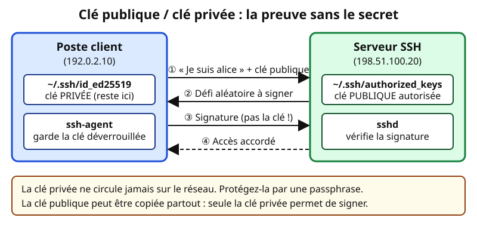
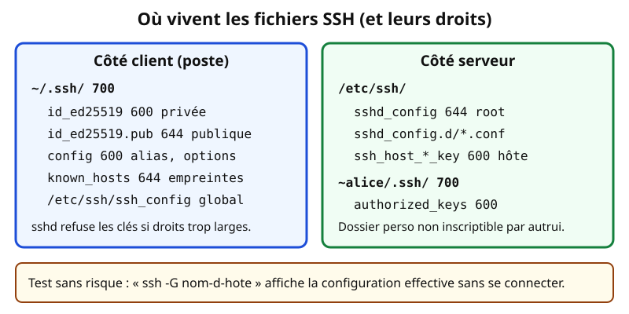
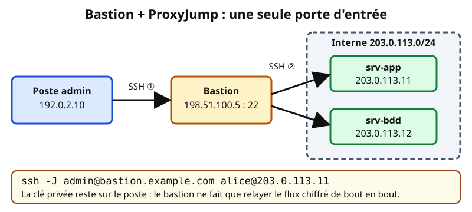

# Leçon — SSH : authentification par clés, configuration, durcissement et bastion

- **Tags** : `transverse`, `tout-en-un`, `lecon`, `identites`, `ssh`, `cles`, `durcissement`, `bastion`
- **Niveau** : débutant à intermédiaire
- **Durée estimée** : 3 h 30 (cours 1 h 15, laboratoire 1 h 15, exercices et quiz 1 h)

---

## Objectifs pédagogiques

À la fin de cette leçon, vous saurez :

1. Expliquer pourquoi une paire de clés SSH est plus sûre qu'un mot de passe, et ce qui voyage (ou non) sur le réseau.
2. Générer une clé moderne (Ed25519), la protéger par une passphrase et installer la clé publique sur un serveur.
3. Utiliser **ssh-agent** sans exposer inutilement vos clés.
4. Écrire un fichier `~/.ssh/config` lisible (alias, utilisateur, clé, saut) et le tester avec `ssh -G`.
5. Durcir `sshd_config` de façon raisonnable et **sans se bloquer dehors**.
6. Vérifier l'identité d'un serveur grâce à `known_hosts` et aux empreintes.
7. Passer par un **bastion** avec `ProxyJump` et comprendre pourquoi l'on évite le *agent forwarding*.

## Prérequis et durée

- Avoir lu la leçon [Comptes, groupes, permissions et sudo](lecon-comptes-linux.md) : les permissions de `~/.ssh` y sont essentielles.
- Une **VM jetable** Debian ou Ubuntu avec le serveur OpenSSH (`openssh-server`) et un client SSH sur votre poste (Linux, macOS ou Windows 10/11 avec OpenSSH intégré).
- Durée totale : environ 3 h 30. Le laboratoire (section 8) se déroule sur la VM, à l'aide d'un compte de test.

> **Règle de sécurité** : les adresses du cours (192.0.2.x, 198.51.100.x, 203.0.113.x) sont des adresses de documentation. Remplacez-les par celles de **votre** laboratoire. N'exécutez jamais de modification de `sshd_config` sur un serveur de production sans fenêtre de maintenance et sans seconde session ouverte.

## L'essentiel en bref

- SSH chiffre la connexion et authentifie **le serveur** (empreinte dans `known_hosts`) puis **l'utilisateur** (mot de passe ou clé).
- Avec une clé, le client **prouve** qu'il possède la clé privée en signant un défi : la clé privée ne quitte jamais le poste.
- Une clé privée doit avoir une **passphrase** ; `ssh-agent` évite de la ressaisir à chaque connexion.
- `~/.ssh/config` remplace de longues lignes de commande par des alias fiables.
- Durcir, c'est : pas de connexion directe de root, pas de mot de passe une fois les clés en place, une liste d'utilisateurs autorisés, des fonctionnalités inutiles désactivées.
- Un **bastion** est une porte d'entrée unique, surveillée ; `ProxyJump` permet de la traverser sans copier la clé privée dessus.

---

## 1. Comment SSH fonctionne : deux authentifications

### 1.1 Une analogie : la banque et le coffre

Dans une agence, on vérifie d'abord que c'est la **vraie** agence, puis le guichetier vérifie **votre** identité. SSH procède dans cet ordre :

1. **Le serveur s'identifie** par sa clé d'hôte ; le client compare l'empreinte à celle mémorisée dans `~/.ssh/known_hosts`. Un changement imprévu déclenche une alerte : attaque de l'homme du milieu, ou simple réinstallation.
2. **Le client s'authentifie** : mot de passe, clé publique, certificat, ou combinaison (clé + code à usage unique).

Tout le reste (commandes, `scp`/`sftp`, tunnels) circule dans un canal chiffré (RFC 4251 à 4254).

### 1.2 Pourquoi les clés valent mieux que les mots de passe

| Critère | Mot de passe | Paire de clés |
|---|---|---|
| Ce qui circule sur le réseau | le secret (chiffré, mais reçu par le serveur) | uniquement une **signature** |
| Devinable par force brute | oui, si faible ou réutilisé | pratiquement non (256 bits) |
| Vol côté serveur | le serveur détient l'empreinte | il ne détient que la clé **publique**, inutilisable seule |
| Automatisation | délicate | naturelle, avec restrictions |

Mais une clé privée copiée sans passphrase est aussi dangereuse qu'un mot de passe noté sur un papier.



*Figure 1 — Authentification par clé publique : le serveur envoie un défi, le client le signe avec sa clé privée, qui ne circule jamais. Schéma original du projet (CC0).*

## 2. Créer et déployer une paire de clés

### 2.1 Choisir l'algorithme

- **Ed25519** : court, rapide, moderne. C'est le choix par défaut actuel.
- **RSA 3072 bits ou plus** : pour les systèmes anciens qui ne connaissent pas Ed25519. Évitez RSA 1024 et 2048 pour les nouveaux déploiements.
- **Clés FIDO2 (`ed25519-sk`)** : la clé privée reste dans un jeton matériel, ce qui protège contre le vol de fichier.
- DSA est à abandonner.

### 2.2 Générer la clé

```bash
ssh-keygen -t ed25519 -a 100 -C "alice@example.com lab-2026" -f ~/.ssh/id_ed25519_lab
```

👉 Explication : crée la clé privée `id_ed25519_lab` et la clé publique `id_ed25519_lab.pub`. `-a 100` renforce la dérivation de la passphrase, `-C` ajoute un commentaire (utile pour savoir à qui appartient une ligne d'`authorized_keys`). Saisissez une **passphrase** longue : elle protège le fichier s'il est volé.

```bash
ls -l ~/.ssh
ssh-keygen -l -f ~/.ssh/id_ed25519_lab.pub
```

👉 Explication : vérifie les droits (la clé privée doit être en `-rw-------`) et affiche l'**empreinte** de la clé publique, sans rien divulguer de secret.

### 2.3 Installer la clé publique sur le serveur

```bash
ssh-copy-id -i ~/.ssh/id_ed25519_lab.pub alice@203.0.113.11
```

👉 Explication : se connecte une dernière fois par mot de passe et ajoute la clé publique à `authorized_keys` avec les bons droits. Sans `ssh-copy-id`, collez la ligne du `.pub` dans `authorized_keys` (600, dossier `.ssh` en 700).

```bash
ssh -i ~/.ssh/id_ed25519_lab alice@203.0.113.11
```

👉 Explication : teste la connexion par clé. Ne désactivez le mot de passe **qu'après** ce test concluant.

### 2.4 Restreindre une clé dans authorized_keys

Une ligne d'`authorized_keys` peut commencer par des **options** qui réduisent ce que la clé permet :

```text
from="192.0.2.0/24",restrict,command="/usr/local/bin/sauvegarde.sh" ssh-ed25519 AAAA...exemple... sauvegarde@example.com
```

👉 Explication : exemple fictif (clé tronquée). `from` limite les sources, `restrict` coupe les extras (agent, redirections, terminal, X11), `command` impose la seule commande lançable : le moindre privilège appliqué à SSH.

## 3. ssh-agent : saisir la passphrase une fois

### 3.1 Le principe

L'agent garde vos clés **déchiffrées en mémoire** et signe les défis à votre place : comme une porte de bureau déverrouillée le matin, qui se reverrouille à votre départ.

```bash
eval "$(ssh-agent -s)"
ssh-add -t 4h ~/.ssh/id_ed25519_lab
ssh-add -l
```

👉 Explication : démarre un agent (les bureaux en fournissent souvent un), charge la clé pour **4 heures** (`-t`), puis liste les empreintes chargées.

```bash
ssh-add -D
```

👉 Explication : vide l'agent ; à faire sur un poste partagé.

### 3.2 Le piège du *agent forwarding*

`-A` (ou `ForwardAgent yes`) met votre agent **à disposition du serveur distant**. Un administrateur (ou attaquant root) de ce serveur peut alors s'en servir pendant votre session : il ne vole pas la clé, il l'utilise. Ne l'activez **pas** par défaut ; **préférez `ProxyJump`** (section 7).

## 4. Le client : ~/.ssh/config

### 4.1 Un exemple commenté

```text
# ~/.ssh/config (droits 600)
Host bastion
    HostName bastion.example.com
    User admin
    IdentityFile ~/.ssh/id_ed25519_lab
    IdentitiesOnly yes

Host srv-app
    HostName 203.0.113.11
    User alice
    IdentityFile ~/.ssh/id_ed25519_lab
    IdentitiesOnly yes
    ProxyJump bastion

Host *
    ServerAliveInterval 30
    ServerAliveCountMax 3
    AddKeysToAgent no
```

👉 Explication : `Host` définit un alias ; `IdentitiesOnly yes` évite de proposer toutes les clés de l'agent ; `ProxyJump bastion` traverse le bastion ; `Host *` fixe les défauts. **La première valeur trouvée l'emporte** : mettez les blocs précis avant `Host *`.

### 4.2 Vérifier sans se connecter

```bash
ssh -G srv-app
```

👉 Explication : affiche la configuration **effective** de l'alias, sans connexion.

```bash
ssh -v srv-app
```

👉 Explication : mode bavard (`-vvv` pour plus de détails) : clés essayées, méthode retenue, cause d'un refus.



*Figure 2 — Où vivent les fichiers SSH et quelles permissions leur donner. Schéma original du projet (CC0).*

### 4.3 known_hosts : vérifier le serveur

À la première connexion, ne répondez pas « yes » par réflexe : comparez l'empreinte à une source fiable (console de la VM, administrateur).

```bash
ssh-keygen -l -f /etc/ssh/ssh_host_ed25519_key.pub
```

👉 Explication : **sur le serveur**, affiche l'empreinte de sa clé d'hôte, à comparer avec celle présentée au client. Commande de lecture seule.

```bash
ssh-keygen -R 203.0.113.11
```

👉 Explication : retire l'entrée d'un serveur dont la clé a légitimement changé. Seulement après vérification, sinon vous effacez l'alerte qui vous protège.

Ne mettez **jamais** `StrictHostKeyChecking no` dans une configuration durable : cela désactive la vérification du serveur.

## 5. Durcir le serveur : sshd_config

### 5.1 La démarche

Réduire la surface d'attaque sans rendre le service inutilisable : **1.** sauvegarder ; **2.** tester les clés ; **3.** modifier par petites étapes ; **4.** valider la syntaxe ; **5.** garder une session ouverte ; **6.** recharger et tester dans une **nouvelle** session.

### 5.2 Un socle raisonnable

Sur Debian et Ubuntu, déposez vos réglages dans un fichier dédié de `/etc/ssh/sshd_config.d/` (inclus par `sshd_config`). Là aussi, **la première valeur rencontrée l'emporte** : nommez votre fichier avec un préfixe numérique bas (par exemple `10-durcissement.conf`) pour qu'il passe avant les valeurs par défaut.

```text
# /etc/ssh/sshd_config.d/10-durcissement.conf
PermitRootLogin no
PubkeyAuthentication yes
PasswordAuthentication no
KbdInteractiveAuthentication no
AllowGroups ssh-users
MaxAuthTries 3
LoginGraceTime 30
X11Forwarding no
AllowAgentForwarding no
ClientAliveInterval 300
ClientAliveCountMax 2
```

👉 Explication : pas de root direct (compte nominatif puis `sudo`) ; clé seule (mot de passe et clavier-interactif coupés) ; groupe `ssh-users` uniquement ; 3 essais et 30 s pour s'authentifier ; ni X11 ni agent transféré ; sessions inactives coupées au bout d'environ 10 minutes. `KbdInteractiveAuthentication` s'appelait `ChallengeResponseAuthentication` avant OpenSSH 8.7. Laissez `AllowTcpForwarding` actif sur un bastion : `ProxyJump` en dépend.

### 5.3 Ce qui est utile, ce qui l'est moins

- **Utile** : couper les mots de passe, interdire root, limiter les utilisateurs, `LogLevel VERBOSE` (empreinte de la clé utilisée), filtrer les sources par pare-feu.
- **Cosmétique** : changer le port 22 réduit le bruit des journaux mais ne protège pas d'un scan.
- **Complément** : bannissement des essais répétés (`fail2ban`), mises à jour, MFA sur le bastion.
- **À éviter** : copier des listes d'algorithmes au hasard ; les défauts d'OpenSSH récent sont raisonnables.

### 5.4 Valider et recharger sans risque

```bash
sudo sshd -t
```

👉 Explication : teste la configuration **sans toucher au service** ; aucun message = pas d'erreur.

```bash
sudo sshd -T | grep -Ei 'permitrootlogin|passwordauthentication|allowgroups|maxauthtries'
```

👉 Explication : affiche les valeurs **effectivement appliquées** après fusion des fichiers.

```bash
sudo systemctl reload ssh
```

👉 Explication : recharge sans couper les sessions existantes (service `ssh` sur Debian/Ubuntu, `sshd` sur RHEL). Testez ensuite dans un **second terminal** avant de fermer le premier.

## 6. Bonne hygiène des clés

1. **Une clé par personne et par appareil** : jamais de clé partagée entre collègues.
2. **Une passphrase** sur toute clé interactive.
3. **Un inventaire** : qui possède quelle clé publique, installée où. Le commentaire (`-C`) y aide.
4. **Un retrait immédiat** au départ d'une personne : supprimer sa ligne de chaque `authorized_keys` (ou centraliser avec `AuthorizedKeysCommand` ou des certificats SSH à durée courte).
5. **Une rotation** périodique ou après soupçon de fuite.
6. **Jamais de clé privée dans Git, un ticket ou un message** ; sinon, elle est compromise.

Pour les grandes équipes, les **certificats SSH** (`ssh-keygen -s`) évitent les listes de clés : une autorité signe une clé publique pour une durée limitée. Sujet avancé, à connaître.

## 7. Bastion et ProxyJump

### 7.1 Le principe

On n'expose qu'**un point d'entrée**, le bastion (*jump host*), surveillé de près ; les serveurs internes n'acceptent le SSH que depuis lui. Analogie : un sas avec un agent de sécurité plutôt que dix portes sur la rue.



*Figure 3 — Le poste se connecte au bastion, qui relaie vers les serveurs internes. Schéma original du projet (CC0).*

### 7.2 Utiliser ProxyJump

```bash
ssh -J admin@bastion.example.com alice@203.0.113.11
```

👉 Explication : passe **par** le bastion. Le flux reste chiffré de bout en bout entre votre poste et le serveur ; la clé privée reste sur le poste, sans agent transféré.

```bash
ssh srv-app
```

👉 Explication : avec le `~/.ssh/config` de la section 4.1, la même chose en un mot ; `scp` et `sftp` l'acceptent aussi. L'ancienne `ProxyCommand ssh -W %h:%p` est remplacée par `ProxyJump`.

### 7.3 Durcir le bastion

- Un bastion **dédié**, minimal, mis à jour en priorité ; pas de comptes partagés ; **MFA** (clé + code, ou FIDO2).
- `AllowTcpForwarding yes` pour `ProxyJump`, restreint par `PermitOpen` dans un bloc `Match Group` si besoin.
- Journalisation centralisée (qui, quelle clé, quelle destination).
- Pare-feu : serveurs internes joignables en SSH **depuis le bastion seulement**.

Le bastion est un **point unique de défaillance** : prévoyez un accès de secours documenté (console de virtualisation).

## 8. Mise en pratique guidée (labo local ou VM jetable)

**Objectif** : sécuriser SSH sur une VM de test avec clé, groupe d'accès et configuration client, puis simuler un saut.

> Pré-requis : VM Debian/Ubuntu avec `openssh-server`, snapshot pris, **une console de secours** (ouverte directement dans l'hyperviseur) au cas où.

**Étape 1 — Créer l'utilisateur et le groupe d'accès (sur la VM).**

```bash
sudo groupadd ssh-users
sudo useradd --create-home --shell /bin/bash --groups ssh-users alice
sudo passwd alice
```

👉 Explication : crée le groupe `ssh-users` et le compte `alice` de laboratoire. Le mot de passe temporaire n'est utilisé que pour installer la clé ; choisissez-en un jetable et saisissez-le au clavier.

**Étape 2 — Générer la clé et l'installer (sur le poste client).**

```bash
ssh-keygen -t ed25519 -a 100 -C "alice@example.com lab" -f ~/.ssh/id_ed25519_lab
ssh-copy-id -i ~/.ssh/id_ed25519_lab.pub alice@192.0.2.50
ssh -i ~/.ssh/id_ed25519_lab alice@192.0.2.50 'id; hostname'
```

👉 Explication : génère la clé (avec passphrase), l'installe, et prouve qu'elle fonctionne en exécutant deux commandes inoffensives. Remplacez `192.0.2.50` par l'adresse de votre VM.

**Étape 3 — Écrire la configuration client.**

```bash
mkdir -p ~/.ssh && chmod 700 ~/.ssh
printf 'Host lab\n    HostName 192.0.2.50\n    User alice\n    IdentityFile ~/.ssh/id_ed25519_lab\n    IdentitiesOnly yes\n' >> ~/.ssh/config
chmod 600 ~/.ssh/config
ssh -G lab | grep -Ei '^(hostname|user|identityfile|port) '
```

👉 Explication : ajoute l'alias `lab` puis affiche la configuration effective sans se connecter. Vous devez retrouver le bon nom d'hôte, l'utilisateur et la clé.

**Étape 4 — Durcir (sur la VM), avec une session de secours ouverte.**

```bash
sudo cp -a /etc/ssh/sshd_config /etc/ssh/sshd_config.avant-lab
printf 'PermitRootLogin no\nPasswordAuthentication no\nKbdInteractiveAuthentication no\nAllowGroups ssh-users\nMaxAuthTries 3\nX11Forwarding no\n' | sudo tee /etc/ssh/sshd_config.d/10-durcissement.conf
sudo sshd -t && sudo sshd -T | grep -Ei 'passwordauthentication|permitrootlogin|allowgroups'
sudo systemctl reload ssh
```

👉 Explication : sauvegarde la configuration, écrit le fichier de durcissement, valide, vérifie les valeurs effectives puis recharge. N'enchaînez le rechargement qu'après avoir lu la sortie de `sshd -T` : si `passwordauthentication` n'est pas à `no`, un autre fichier surcharge votre réglage.

**Étape 5 — Vérifier depuis une nouvelle session.**

```bash
ssh lab 'echo connexion-par-cle-ok'
ssh -o PubkeyAuthentication=no -o PreferredAuthentications=password lab 'true'
```

👉 Explication : la première commande doit réussir (clé) ; la seconde **doit échouer** avec « Permission denied », ce qui prouve que le mot de passe est désactivé. Les deux sont sans danger.

**Étape 6 — Simuler un saut.** Sur une VM unique, vous pouvez valider la syntaxe en vous « sautant » sur vous-même :

```bash
ssh -J alice@192.0.2.50 alice@127.0.0.1 'hostname'
```

👉 Explication : la connexion passe par la VM puis revient sur elle-même par l'adresse de boucle locale. Cela n'a pas d'intérêt réseau, mais valide `ProxyJump`, la clé et les droits. Avec deux VM, utilisez la deuxième comme serveur interne.

**Étape 7 — Retour arrière.** Restaurez le snapshot, ou : `sudo rm /etc/ssh/sshd_config.d/10-durcissement.conf && sudo systemctl reload ssh`, puis supprimez le compte de test.

## Exercices

1. **Vocabulaire.** Donnez le rôle de chacun de ces éléments : `id_ed25519`, `id_ed25519.pub`, `authorized_keys`, `known_hosts`.
2. **Permissions.** Quelles permissions pour `~/.ssh`, la clé privée, `authorized_keys` et `config` ? Que se passe-t-il si la clé privée est en 644 ?
3. **Génération.** Écrivez la commande qui crée une clé Ed25519 nommée `id_ed25519_prod`, avec le commentaire « bob@example.com prod ».
4. **Configuration client.** Écrivez le bloc `Host` qui permet de taper `ssh db1` pour joindre `203.0.113.12` avec l'utilisateur `bob` et la clé `id_ed25519_prod`, en passant par l'alias `bastion`.
5. **Durcissement.** Parmi `PermitRootLogin no`, `Port 2222`, `PasswordAuthentication no`, `StrictHostKeyChecking no`, lesquelles sont des mesures réelles de durcissement ? Justifiez.
6. **Méthode.** Décrivez l'ordre des opérations pour désactiver l'authentification par mot de passe sans perdre l'accès.
7. **Clé d'automatisation.** Écrivez les options `authorized_keys` pour une clé de sauvegarde qui ne peut venir que de `192.0.2.0/24` et ne lancer que `/usr/local/bin/sauvegarde.sh`.
8. **Analyse de risque.** Un collègue active `ForwardAgent yes` pour tous les hôtes (`Host *`). Expliquez le risque et proposez une alternative.

## Corrigés des exercices

1. `id_ed25519` : clé **privée**, secrète, reste sur le poste. `id_ed25519.pub` : clé **publique**, copiable. `authorized_keys` : côté serveur, liste des clés publiques autorisées pour le compte. `known_hosts` : côté client, empreintes des serveurs déjà rencontrés.
2. `~/.ssh` en **700**, clé privée en **600**, `authorized_keys` en **600**, `config` en **600**. Avec une clé privée en 644, le client SSH refuse de l'utiliser (« UNPROTECTED PRIVATE KEY FILE ») car d'autres comptes pourraient la lire.
3. ```bash
   ssh-keygen -t ed25519 -a 100 -C "bob@example.com prod" -f ~/.ssh/id_ed25519_prod
   ```
   👉 Explication : même modèle que la section 2.2 avec un autre nom de fichier et un autre commentaire.
4. ```text
   Host db1
       HostName 203.0.113.12
       User bob
       IdentityFile ~/.ssh/id_ed25519_prod
       IdentitiesOnly yes
       ProxyJump bastion
   ```
   👉 Explication : l'alias `bastion` doit être défini ailleurs dans le fichier. Placez ce bloc avant `Host *`.
5. `PermitRootLogin no` et `PasswordAuthentication no` sont de vraies mesures. `Port 2222` est cosmétique (moins de bruit, pas de protection). `StrictHostKeyChecking no` est une **mauvaise** pratique : elle désactive la vérification du serveur et ouvre la voie à l'interception.
6. (1) Installer et tester la clé dans une session ; (2) sauvegarder `sshd_config` ; (3) écrire le réglage dans un fichier dédié ; (4) `sshd -t` puis `sshd -T` ; (5) garder une session ouverte ; (6) recharger ; (7) tester dans une **nouvelle** session par clé, et vérifier que le mot de passe échoue ; (8) fermer la session de secours seulement ensuite.
7. ```text
   from="192.0.2.0/24",restrict,command="/usr/local/bin/sauvegarde.sh" ssh-ed25519 AAAA... sauvegarde@example.com
   ```
   👉 Explication : la clé, tronquée ici, suit les options. Ajoutez le commentaire de propriétaire pour l'inventaire.
8. Un administrateur ou un attaquant root d'un serveur intermédiaire peut utiliser l'agent transféré pour s'authentifier **comme vous** ailleurs pendant la session. Alternative : `ProxyJump` (la clé reste locale), et `ForwardAgent` limité à un hôte de confiance précis si on ne peut vraiment pas l'éviter.

## Quiz

**Q1. Que voyage sur le réseau lors d'une authentification par clé publique ?**
A. La clé privée chiffrée — B. Une signature d'un défi — C. La passphrase — D. L'empreinte du mot de passe.

**Q2. Quelle est la permission attendue d'une clé privée ?**
A. 644 — B. 755 — C. 600 — D. 666.

**Q3. Que protège réellement la passphrase ?**
A. Le serveur contre le scan — B. Le fichier de clé privée en cas de vol — C. Le trafic réseau — D. `known_hosts`.

**Q4. Dans `~/.ssh/config`, quand une option apparaît dans plusieurs blocs, laquelle est retenue ?**
A. La dernière — B. La plus longue — C. La première trouvée — D. Une au hasard.

**Q5. Quelle commande affiche la configuration cliente effective sans se connecter ?**
A. `ssh -v` — B. `ssh -G alias` — C. `ssh-add -l` — D. `sshd -t`.

**Q6. Quel est le principal risque de `ForwardAgent yes` ?**
A. La connexion devient plus lente — B. Le serveur voit votre clé privée — C. Un administrateur du serveur peut utiliser votre agent pendant la session — D. Cela désactive le chiffrement.

**Q7. Quelle est la bonne séquence avant de recharger sshd ?**
A. `sshd -t` puis tester en nouvelle session — B. Recharger puis vérifier — C. Redémarrer la machine — D. Supprimer `known_hosts`.

**Q8. Pourquoi changer le port 22 est-il considéré comme secondaire ?**
A. Cela casse SSH — B. Cela ne protège pas d'un scan de ports, cela réduit seulement le bruit — C. Cela désactive les clés — D. Le port 22 est obligatoire.

**Q9. Quel est l'avantage de `ProxyJump` sur le *agent forwarding* ?**
A. La clé privée n'est jamais exposée sur le bastion — B. Il est plus rapide — C. Il dispense d'un bastion — D. Il chiffre mieux.

**Q10. Une alerte « REMOTE HOST IDENTIFICATION HAS CHANGED » apparaît. Que faites-vous d'abord ?**
A. `StrictHostKeyChecking no` — B. Supprimer `known_hosts` — C. Se connecter quand même — D. Vérifier si le serveur a été réinstallé et comparer l'empreinte par un canal fiable.

### Réponses justifiées du quiz

- **Q1 : B.** Le client signe le défi ; ni la clé privée ni la passphrase ne quittent le poste.
- **Q2 : C.** 600 : lecture et écriture pour le propriétaire seul ; sinon le client refuse la clé.
- **Q3 : B.** La passphrase chiffre le fichier de clé privée : elle protège en cas de vol de fichier.
- **Q4 : C.** La première valeur trouvée l'emporte : placez les cas précis avant `Host *`.
- **Q5 : B.** `ssh -G` calcule et affiche la configuration sans connexion ; `-v` se connecte.
- **Q6 : C.** L'agent transféré est utilisable par un root distant tant que vous êtes connecté.
- **Q7 : A.** `sshd -t` valide la syntaxe ; on teste ensuite dans une nouvelle session, avant de fermer l'ancienne.
- **Q8 : B.** Un scan trouve le nouveau port ; seul le bruit des journaux diminue.
- **Q9 : A.** Avec `ProxyJump`, le flux est relayé et la clé privée reste sur le poste.
- **Q10 : D.** L'alerte peut être légitime ou signaler une interception ; on vérifie d'abord, on ne la contourne jamais.

## Erreurs fréquentes et dépannage

| Symptôme | Cause probable | Remède |
|---|---|---|
| `Permission denied (publickey)` | clé non installée, mauvais utilisateur, droits trop larges | `ssh -vvv`, vérifier `~/.ssh` (700) et `authorized_keys` (600), propriétaire correct |
| `UNPROTECTED PRIVATE KEY FILE` | clé privée en 644 | `chmod 600 ~/.ssh/id_ed25519_lab` |
| `Too many authentication failures` | l'agent propose trop de clés | `IdentitiesOnly yes` et `IdentityFile` explicite |
| Connexion refusée après durcissement | `AllowGroups` sans le compte, ou mot de passe coupé trop tôt | session de secours ; `sshd -T` ; ajouter le compte au groupe |
| Le réglage n'est pas pris en compte | une valeur antérieure l'emporte (premier trouvé) | `sshd -T`, renommer le fichier avec un préfixe plus bas |
| `ProxyJump` échoue | le bastion interdit le forwarding | autoriser `AllowTcpForwarding` pour ce groupe, restreint par `PermitOpen` |
| Alerte de changement de clé d'hôte | réinstallation ou interception | comparer l'empreinte, puis `ssh-keygen -R` si légitime |
| `Connection timed out` | pare-feu, mauvaise route, service arrêté | `ss -tlnp` côté serveur, règles du pare-feu, journal `journalctl -u ssh` |

**Méthode** : (1) côté client `ssh -vvv` ; (2) côté serveur, les journaux (`/var/log/auth.log` ou `journalctl -u ssh`) ; (3) `sshd -T` pour la configuration réelle ; (4) permissions de `~` et `~/.ssh` (un dossier personnel inscriptible par tous fait refuser les clés).

## À retenir

- Le serveur s'authentifie par son empreinte (`known_hosts`) ; l'utilisateur par mot de passe ou **clé** : la clé privée ne circule jamais.
- Ed25519 + passphrase ; `ssh-agent` avec durée limitée ; un jeu de clés par personne et par appareil.
- Permissions : `~/.ssh` 700, clés privées et `authorized_keys` 600.
- `~/.ssh/config` : première valeur gagnante ; `ssh -G` pour contrôler, `ssh -v` pour diagnostiquer.
- Durcissement : pas de root direct, pas de mot de passe, `AllowGroups`, essais limités ; `sshd -t` puis `sshd -T`, session de secours, test dans une nouvelle session.
- Bastion + `ProxyJump` : point d'entrée unique ; éviter `ForwardAgent` ; journaliser et ajouter du MFA.
- Révoquer vite : supprimer les clés publiques d'un départ ; documenter l'accès de secours.

## Pour aller plus loin

- Manuel d'OpenSSH (`ssh(1)`, `ssh_config(5)`, `sshd_config(5)`, `ssh-keygen(1)`, `ssh-agent(1)`) : <https://www.openssh.com/manual.html>
- RFC 4251 (architecture du protocole SSH) : <https://www.rfc-editor.org/rfc/rfc4251>
- RFC 4252 (authentification SSH) : <https://www.rfc-editor.org/rfc/rfc4252>
- RFC 8709 (clés et signatures Ed25519 et Ed448 pour SSH) : <https://www.rfc-editor.org/rfc/rfc8709>
- Leçon précédente : [Comptes, groupes, permissions et sudo](lecon-comptes-linux.md) ; suivante : [Annuaires et SSO](lecon-annuaires-sso.md).

## Crédits des images

| Fichier | Source | Auteur | Licence | Modifications |
|---|---|---|---|---|
| `images/ssh-cles-1.svg` | Création originale du projet Pack Master | Projet Pack Master | Dédiée au domaine public (CC0) — <https://creativecommons.org/publicdomain/zero/1.0/deed.fr> | Sans objet |
| `images/ssh-cles-2.svg` | Création originale du projet Pack Master | Projet Pack Master | Dédiée au domaine public (CC0) — <https://creativecommons.org/publicdomain/zero/1.0/deed.fr> | Sans objet |
| `images/ssh-cles-3.svg` | Création originale du projet Pack Master | Projet Pack Master | Dédiée au domaine public (CC0) — <https://creativecommons.org/publicdomain/zero/1.0/deed.fr> | Sans objet |

## Historique de vérification

| Date | OS/logiciel | Testeur | Verdict |
|---|---|---|---|
| 2026-11-01 | Debian/Ubuntu + OpenSSH (cible du cours) | Rédaction assistée (Copilot) | Non testé sur plateforme cible |

Précision : seules `ssh -V` (OpenSSH 10.6p1) et `ssh -G host.example.com` ont été exécutées en local (lecture seule, aucune connexion), dans un bac à sable Flatpak. Aucune connexion distante n'a été tentée ; le laboratoire reste à valider sur VM jetable.
