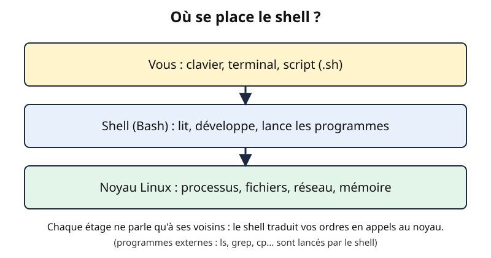
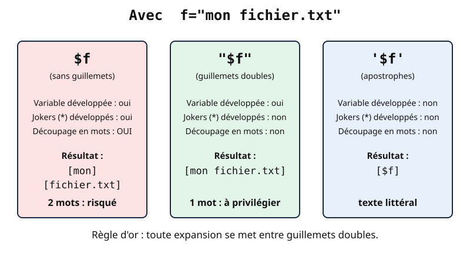
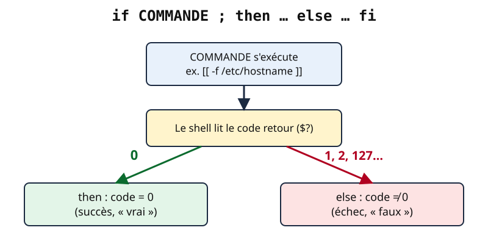
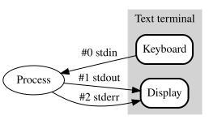

# Leçon — Bash pour débuter : shell, variables, quoting, codes retour, conditions, boucles, redirections et tubes

- **Tags** : `transverse`, `tout-en-un`, `lecon`, `automatisation`, `bash`, `shell`, `linux`, `scripting`, `redirections`, `quoting`
- **Niveau** : Débutant (aucune notion de programmation exigée ; savoir ouvrir un terminal Linux)
- **Durée estimée** : 4 h (cours 1 h 45, laboratoire 1 h 15, exercices et quiz 1 h)

---

## Objectifs pédagogiques

À la fin de cette leçon, vous serez capable de :

1. expliquer ce qu'est un **shell** et écrire puis lancer un premier script (`#!/usr/bin/env bash`, `chmod +x`) ;
2. utiliser des **variables**, des paramètres (`$1`, `"$@"`), la substitution `$(...)` et l'arithmétique `$((...))` ;
3. appliquer les règles de **quoting** pour éviter les erreurs liées aux espaces et aux jokers ;
4. lire un **code retour** (`$?`, `&&`, `||`, `exit`) ;
5. écrire des **conditions** (`if`, `[[ ]]`, `(( ))`, `case`) et des **boucles** (`for`, `while read`) ;
6. maîtriser les **redirections**, les **tubes** et les *here-documents* ;
7. assembler ces briques dans un script de contrôle.

## Prérequis et durée

- Savoir ouvrir un terminal Linux et se déplacer (`cd`, `ls`, `pwd`).
- Un **laboratoire jetable** : une [[Glossary:VM]] Linux (Debian, Ubuntu ou Rocky Linux), compte **non privilégié**. **Prenez un instantané avant de commencer** et gardez un accès console de secours : aucune commande n'exige `sudo`, mais l'instantané permet de repartir de zéro.
- Aucune adresse ni compte réels : uniquement des valeurs de documentation (192.0.2.0/24, 198.51.100.0/24, 203.0.113.0/24, 2001:db8::/32, `example.com`, `example.test`).

## L'essentiel en bref

- Le **shell** lit vos commandes, les « développe » (variables, jokers, substitutions) puis lance les programmes ; **Bash** est le plus répandu sous Linux.
- Un script Bash est un fichier texte dont la première ligne (`#!/usr/bin/env bash`) désigne l'interpréteur ; `chmod +x` le rend exécutable.
- Une variable s'affecte **sans espace** autour du `=` (`nom="Alice"`) et se lit avec `$nom` ; **toujours entre guillemets** : `"$nom"`.
- Les **apostrophes** protègent tout, les **guillemets** laissent passer les `$`, l'absence de guillemets déclenche le découpage en mots et les jokers.
- Chaque commande renvoie un **code retour** : `0` = succès, tout autre nombre = échec. C'est ce code, et non le texte affiché, que testent `if`, `&&` et `||`.
- Trois flux : entrée (0), sortie (1), erreur (2). Les redirections les dirigent vers des fichiers ; le **tube** `|` branche la sortie d'un programme sur l'entrée du suivant.

---

## 1. Le shell : l'interprète entre vous et le système

Quand vous tapez `ls -l /etc`, ce n'est pas le noyau Linux qui vous lit : c'est un programme appelé **shell**. Il découpe votre ligne en mots, remplace ce qui doit l'être (variables, jokers `*`, résultats de commandes), puis demande au noyau de lancer `ls`. Le shell est à la fois une **interface interactive** et un **langage de programmation** : on peut écrire ces mêmes lignes dans un fichier pour les rejouer.

**Analogie.** Un maître d'hôtel : il traduit votre commande, la transmet en cuisine (le noyau) et vous rapporte les plats.



*Figure 1 — Le shell se place entre l'utilisateur (clavier ou script) et le noyau. Création originale du projet Pack Master (CC0).*

Plusieurs shells coexistent : `sh` (norme POSIX), `dash` (un `sh` rapide, employé par Debian et Ubuntu pour les scripts système), `bash`, `zsh`, `fish`. Cette leçon traite **Bash**. Ses fonctions propres (`[[ ]]`, tableaux, `(( ))`) ne marchent pas dans un `sh` strict : c'est pourquoi un script qui les utilise annonce `bash` à la première ligne.

```bash
echo "$SHELL"
bash --version | head -n 1
ps -p $$ -o comm=
```

👉 Explication : affiche le shell de connexion par défaut de votre compte, la version de Bash installée, puis le programme qui exécute **votre terminal courant** (`$$` est le numéro de processus du shell en cours).

## 2. Votre premier script

Créez un dossier de travail puis un fichier :

```bash
mkdir -p ~/labo-bash && cd ~/labo-bash
cat > bonjour.sh <<'EOF'
#!/usr/bin/env bash
prenom="${1:-inconnu}"
echo "Bonjour, $prenom ! Vous êtes sur $HOSTNAME le $(date +%F)."
EOF
chmod +x bonjour.sh
./bonjour.sh Alice
```

👉 Explication : `cat > fichier <<'EOF' ... EOF` écrit le texte compris entre les deux `EOF` dans `bonjour.sh` ; `chmod +x` donne le droit d'exécution ; `./bonjour.sh Alice` lance le script en lui passant `Alice` comme premier argument.

À décortiquer :

- **`#!/usr/bin/env bash`** (le *shebang*) : le noyau lit cette première ligne et utilise le programme indiqué pour interpréter le fichier ; `env bash` cherche `bash` dans le `PATH`, plus portable que `/bin/bash` en dur.
- **`./`** : sans lui, le shell cherche `bonjour.sh` dans le `PATH`, où votre dossier courant ne figure pas.
- **`${1:-inconnu}`** : valeur du premier argument, ou `inconnu` s'il est absent ou vide.

```bash
bash bonjour.sh
bash -n bonjour.sh && echo "syntaxe correcte"
```

👉 Explication : la première ligne lance le script sans qu'il soit exécutable (le shebang est alors ignoré) ; `bash -n` **vérifie uniquement la syntaxe**, un bon réflexe avant un premier lancement.

## 3. Les variables

### 3.1 Affecter et lire

```bash
nom="Alice Martin"
age=42
echo "Nom : $nom, âge : $age"
echo "Nom : ${nom}, fichier : ${nom}_rapport.txt"
```

👉 Explication : l'affectation ne tolère **aucun espace** autour du `=` (`nom = "x"` ferait chercher une commande appelée `nom`). Les accolades `${nom}` délimitent le nom de la variable quand elle est suivie de lettres : sans elles, `$nom_rapport` désignerait une tout autre variable.

Usage courant : minuscules pour les variables d'un script, MAJUSCULES pour les constantes et l'environnement (`PATH`, `HOME`). Une variable n'est **visible des programmes lancés** que si on l'**exporte** :

```bash
export MA_VAR=1
LOCALE_SEULE="x"
bash -c 'echo "exportée : ${MA_VAR:-vide} ; non exportée : ${LOCALE_SEULE:-vide}"'
```

👉 Explication : le sous-shell hérite de `MA_VAR` mais pas de `LOCALE_SEULE`. Sortie : `exportée : 1 ; non exportée : vide`.

### 3.2 Valeurs par défaut et manipulation de texte

Bash sait transformer une valeur sans lancer de programme externe :

| Écriture | Effet | Exemple avec `f="rapport_2026.tar.gz"` |
|---|---|---|
| `${v:-défaut}` | valeur, ou `défaut` si vide/absente | `${absent:-x}` donne `x` |
| `${#v}` | longueur | `${#f}` donne `19` |
| `${v%motif}` | retire le motif **à la fin** (le plus court) | `${f%.tar.gz}` donne `rapport_2026` |
| `${v#motif}` | retire le motif **au début** (le plus court) | `${f#*_}` donne `2026.tar.gz` |
| `${v/ancien/nouveau}` | remplace la première occurrence | `${f/2026/2027}` donne `rapport_2027.tar.gz` |

Doubler le symbole (`%%`, `##`) retire le motif **le plus long** : `${chemin##*/}` donne le nom de fichier d'un chemin.

### 3.3 Substitution de commande et arithmétique

```bash
aujourdhui=$(date +%Y-%m-%d)
nb_lignes=$(wc -l < /etc/passwd)
echo "Nous sommes le $aujourdhui ; /etc/passwd compte $nb_lignes lignes."
total=$((7 + 5 * 2))
echo "Total : $total, reste de 10/3 : $((10 % 3))"
```

👉 Explication : `$(commande)` remplace l'expression par ce que la commande a **affiché** ; `$(( ))` évalue une expression sur des **entiers** (Bash ne sait pas calculer en décimal : `10 / 3` vaut `3`).

### 3.4 Paramètres de script et tableaux

Un script reçoit ses arguments dans `$1`, `$2`, ... ; `$#` donne leur nombre, `"$@"` la liste complète (chaque argument restant un mot distinct), `$0` le nom du script.

```bash
serveurs=(srv-web01 srv-db01 "srv backup")
echo "Il y a ${#serveurs[@]} serveurs ; le premier est ${serveurs[0]}."
for s in "${serveurs[@]}"; do echo "- $s"; done
```

👉 Explication : `${#serveurs[@]}` donne le nombre d'éléments ; `"${serveurs[@]}"` les développe **un mot par élément**, y compris celui qui contient une espace.

## 4. Le quoting : maîtriser les guillemets

C'est **la** source d'erreurs numéro un en Bash : après avoir lu une ligne, le shell la découpe sur les espaces. Les guillemets disent « ceci reste un seul mot ».

**Analogie.** Des **enveloppes** : sans enveloppe, le facteur (le shell) traite chaque mot comme une lettre distincte ; enveloppe ordinaire (guillemets) : il ouvre pour remplacer les variables mais garde le tout ensemble ; enveloppe scellée (apostrophes) : il ne touche à rien.

| Forme | `$variable` développée ? | `*` développé ? | Découpage en mots ? |
|---|---|---|---|
| `'texte'` (apostrophes) | non | non | non |
| `"texte"` (guillemets) | **oui** | non | non |
| `texte` (rien) | oui | **oui** | **oui** |



*Figure 2 — Les trois formes de quoting et ce que le shell développe. Création originale du projet Pack Master (CC0).*

Démonstration :

```bash
f="mon fichier.txt"
printf '[%s]\n' $f
printf '[%s]\n' "$f"
printf '[%s]\n' '$f'
```

👉 Explication : sans guillemets, `$f` est coupé en **deux** mots (`[mon]` puis `[fichier.txt]`) ; entre guillemets, on obtient un seul mot `[mon fichier.txt]` ; entre apostrophes, le texte littéral `[$f]` (aucun développement).

Les conséquences peuvent être graves : avec `dossier="sauvegardes 2026"`, un `rm -r $dossier` non cité viserait **deux** cibles distinctes (`sauvegardes` et `2026`) qui peuvent exister ailleurs. Écrivez toujours `rm -r -- "$dossier"` (le `--` marque la fin des options).

**Règle d'or : mettez entre guillemets doubles toute expansion** (`"$var"`, `"$(commande)"`, `"$@"`), sauf cas réfléchi. L'outil **ShellCheck** signale ces oublis automatiquement (voir la leçon sur les scripts robustes).

## 5. Les codes retour : la vraie réponse d'une commande

Chaque programme, en se terminant, renvoie au shell un **entier de 0 à 255**. Par convention, **0 signifie « tout s'est bien passé »** et toute autre valeur signale un échec (`1` erreur générale, `2` mauvais usage, `127` commande introuvable...). Le code du dernier programme est dans `$?`.

```bash
ls /etc > /dev/null; echo "ls /etc : $?"
ls /dossier-inexistant 2> /dev/null; echo "ls inexistant : $?"
true;  echo "true : $?"
false; echo "false : $?"
```

👉 Explication : un `ls` réussi renvoie `0`, sur un chemin absent une valeur non nulle (2 avec GNU `ls`) ; `true` et `false` renvoient 0 et 1. `$?` est **écrasé à chaque commande** : recopiez-le tout de suite (`code=$?`).

Les opérateurs `&&` et `||` s'appuient dessus :

```bash
mkdir -p rapports && echo "dossier prêt"
ls /inexistant 2>/dev/null || echo "introuvable, on continue"
test -f bonjour.sh && echo "présent" || echo "absent"
```

👉 Explication : `A && B` exécute B **seulement si A a réussi** ; `A || B` **seulement si A a échoué**. La dernière ligne imite un « si/sinon » mais n'est fiable que si l'action du milieu réussit toujours : préférez `if`.

Votre script a lui aussi un code retour : celui de sa **dernière commande**, ou celui que vous choisissez avec `exit N`. Planificateurs, supervision et autres scripts le liront : choisissez-le avec soin.

## 6. Les conditions

### 6.1 La structure `if`

```bash
if [[ -f /etc/hostname ]]; then
    echo "le fichier existe"
elif [[ -d /etc/hostname ]]; then
    echo "c'est un dossier"
else
    echo "absent"
fi
```

👉 Explication : `if` exécute une **commande** et regarde son code retour ; `[[ ... ]]` renvoie 0 si le test est vrai. Chaque `if` se ferme par `fi`.

### 6.2 Les tests utiles

| Test | Signification |
|---|---|
| `[[ -e "$p" ]]`, `-f`, `-d` | le chemin existe ; est un fichier ordinaire ; est un dossier |
| `[[ -z "$s" ]]`, `-n` | chaîne vide ; non vide |
| `[[ "$a" == "$b" ]]`, `!=` | égalité de chaînes (et motifs : `[[ $f == *.log ]]`) |
| `[[ "$a" =~ ^[0-9]+$ ]]` | correspondance à une expression régulière |
| `(( n > 5 ))`, `(( n % 2 == 0 ))` | comparaisons **numériques** |
| `[[ -f "$p" && -r "$p" ]]` | `&&` (et), `||` (ou), `!` (non) |

Les crochets simples `[ ... ]` (commande `test`) restent nécessaires en `sh` strict mais exigent des guillemets partout et utilisent `-gt`, `-eq` pour les nombres. Dans un script Bash, préférez `[[ ]]` et `(( ))`.

Piège : `==` dans `[[ ]]` compare du **texte** (`"07" == "7"` est faux) ; pour des nombres, utilisez `(( ))`.

### 6.3 `case` : choisir parmi plusieurs motifs

```bash
case "$1" in
    start|demarrer) echo "démarrage" ;;
    stop)           echo "arrêt" ;;
    *.log)          echo "un fichier de journal" ;;
    *)              echo "usage : $0 {start|stop}" >&2; exit 2 ;;
esac
```

👉 Explication : `case` compare une valeur à des **motifs** (avec jokers) ; `;;` termine chaque branche ; `*` est la branche « par défaut ».



*Figure 3 — Une condition lit le code retour d'une commande : 0 vaut « vrai ». Création originale du projet Pack Master (CC0).*

## 7. Les boucles

### 7.1 `for` : parcourir une liste

```bash
for ext in log conf tmp; do echo "extension : $ext"; done
for i in {1..3}; do echo "essai $i"; done
```

👉 Explication : parcourt une liste de mots ; `{1..3}` génère 1 2 3.

Pour parcourir des **fichiers**, utilisez un joker et non la sortie de `ls` :

```bash
for f in ~/labo-bash/*.sh; do
    [[ -e "$f" ]] || continue
    echo "script : ${f##*/}"
done
```

👉 Explication : le shell développe `*.sh` en une liste correcte même si les noms contiennent des espaces (à condition de citer `"$f"`) ; `-e ... || continue` protège du cas où rien ne correspond (le joker resterait littéral).

### 7.2 `while` et `until` : répéter selon une condition

```bash
n=0
while (( n < 3 )); do
    echo "n vaut $n"
    n=$((n + 1))
done
```

👉 Explication : `while` répète **tant que** la condition est vraie (`until` : **jusqu'à ce qu'**elle le devienne). `continue` passe à l'itération suivante, `break` sort de la boucle.

### 7.3 Lire un fichier ligne par ligne

```bash
cat > hotes.txt <<'EOF'
srv-web01 192.0.2.11
srv-db01 192.0.2.21
# commentaire ignoré
srv-bkp01 198.51.100.50
EOF
while read -r nom ip; do
    [[ -z "$nom" || "$nom" == \#* ]] && continue
    echo "$nom -> $ip"
done < hotes.txt
```

👉 Explication : `read -r nom ip` lit une ligne et la découpe en deux variables (`-r` : pas d'interprétation des antislashs) ; la **redirection `< hotes.txt` après `done`** alimente toute la boucle ; vides et commentaires sont ignorés. Sortie : trois lignes `nom -> ip`.

## 8. Redirections, tubes et documents en ligne

Tout programme dispose de trois canaux : l'**entrée standard** (`stdin`, 0), la **sortie standard** (`stdout`, 1) et la **sortie d'erreur** (`stderr`, 2). Par défaut, 1 et 2 arrivent tous deux à l'écran, donc indiscernables, mais ce sont bien deux canaux séparés.



*Figure 4 — Les flux standard d'un programme, schéma de TuukkaH et Danielpr85, domaine public (Wikimedia Commons).*

| Notation | Effet |
|---|---|
| `cmd > fichier` | sortie standard dans le fichier (**écrase**) |
| `cmd >> fichier` | **ajoute** à la fin |
| `cmd < fichier` | lit l'entrée depuis le fichier |
| `cmd 2> erreurs.txt` | redirige **uniquement** les erreurs |
| `cmd > tout.txt 2>&1` | sortie **et** erreurs dans le même fichier |
| `cmd > /dev/null` | jette la sortie |
| `cmd1 \| cmd2` | la sortie de `cmd1` devient l'entrée de `cmd2` |

```bash
{ echo "résultat"; echo "problème" >&2; } > sortie.txt 2> erreurs.txt
cat sortie.txt erreurs.txt
echo "ligne 1" > journal.txt
echo "ligne 2" >> journal.txt
wc -l < journal.txt
```

👉 Explication : les accolades regroupent deux commandes ; la première écrit sur stdout (vers `sortie.txt`), la seconde sur stderr (`>&2`, vers `erreurs.txt`). `>` écrase puis `>>` ajoute : `wc -l` affiche `2`.

**L'ordre compte** : `cmd > tout.txt 2>&1` signifie « envoie 1 vers le fichier, puis 2 là où va 1 » ; l'ordre inverse laisse l'erreur à l'écran.

Le **tube** compose de petits outils spécialisés, comme les postes d'une chaîne de montage :

```bash
ls /etc | grep -c conf
printf 'b\na\nb\n' | sort | uniq -c
echo "test" | tee -a trace.txt | tr 'a-z' 'A-Z'
```

👉 Explication : compte les noms de `/etc` contenant `conf` ; trie puis compte les doublons (`1 a`, `2 b`) ; `tee` copie le flux vers un fichier **tout en le laissant passer** (ici vers `tr`, qui met en majuscules). Seule la sortie standard traverse un tube.

Le **here-document** `<<` fournit du texte multi-lignes en entrée :

```bash
cat <<EOF
Bonjour $USER, nous sommes le $(date +%F).
EOF
cat <<'EOF'
Ici, $USER et $(date) restent littéraux.
EOF
```

👉 Explication : avec `<<EOF`, Bash développe variables et substitutions ; avec `<<'EOF'`, le texte est transmis tel quel (aide, fichier de configuration généré).

## 9. Assembler : un script de contrôle

Ce script vérifie la présence de plusieurs chemins et renvoie un code retour exploitable :

```bash
#!/usr/bin/env bash
# controle.sh - vérifie qu'une liste de chemins existe
manquants=0
for chemin in "$@"; do
    if [[ -e "$chemin" ]]; then
        printf 'OK       %s\n' "$chemin"
    else
        printf 'MANQUANT %s\n' "$chemin"
        manquants=$((manquants + 1))
    fi
done
echo "Total manquants : $manquants"
exit $(( manquants > 0 ? 1 : 0 ))
```

👉 Explication : la boucle parcourt tous les arguments (`"$@"`) ; chaque chemin est testé puis affiché avec `printf` ; la dernière ligne choisit le code retour (0 si tout est présent, 1 sinon) avec l'opérateur ternaire `condition ? a : b` de `(( ))`.

---

## Mise en pratique guidée

**Contexte.** VM Linux jetable, compte non privilégié, instantané pris ; tout se passe dans `~/labo-bash`, sans `sudo`.

**Étape 1 — Préparer.**

```bash
mkdir -p ~/labo-bash/donnees && cd ~/labo-bash
touch donnees/a.log donnees/b.log "donnees/mon fichier.txt"
```

👉 Explication : crée des fichiers dont un nom avec espace, pour éprouver votre quoting.

**Étape 2 — Écrire et vérifier.** Enregistrez `controle.sh` (§9) dans `~/labo-bash`, puis :

```bash
chmod +x controle.sh
bash -n controle.sh && echo "syntaxe correcte"
```

👉 Explication : rend le script exécutable et vérifie sa syntaxe sans l'exécuter.

**Étape 3 — Tester les deux cas.**

```bash
./controle.sh donnees/a.log "donnees/mon fichier.txt"; echo "code retour : $?"
./controle.sh donnees/a.log donnees/absent.log; echo "code retour : $?"
```

👉 Explication : le premier appel affiche deux `OK` et `code retour : 0` ; le second affiche `MANQUANT donnees/absent.log` et `code retour : 1`. Un fichier vu comme deux chemins trahit un guillemet manquant.

**Étape 4 — Rediriger et exploiter.**

```bash
./controle.sh donnees/* > rapport.txt 2> erreurs.txt; echo "code : $?"
grep -c '^OK' rapport.txt
if ./controle.sh donnees/a.log > /dev/null; then echo "tout est présent"; fi
```

👉 Explication : le rapport va dans un fichier (3 lignes `OK` attendues, `erreurs.txt` vide) ; `if` teste directement le code retour du script, dont le rapport est jeté dans `/dev/null`.

**Étape 5 — Retour arrière.**

```bash
cd ~ && rm -r ~/labo-bash
```

👉 Explication : supprime uniquement le dossier de l'exercice (vérifiez le chemin avant de supprimer) ; sinon, restaurez l'instantané.

## Exercices

1. **Premier script.** Écrivez `salut.sh` qui affiche `Bonjour, <argument> !` et, **sans argument**, `Bonjour, tout le monde !`. Rendez-le exécutable et testez-le avec et sans argument.
2. **Quoting.** Avec un fichier `mon rapport.txt`, écrivez la commande `cat` qui l'affiche ; expliquez pourquoi `cat $f` échoue si `f="mon rapport.txt"`.
3. **Codes retour.** Sans lancer le script, prédisez la sortie de `ls /nulle/part 2>/dev/null; echo $?; echo $?`. Pourquoi les deux nombres sont-ils différents ?
4. **Conditions.** `taille.sh` reçoit un nombre `n` et affiche `petit` (< 10), `moyen` (10 à 99) ou `grand` (≥ 100) ; un argument non numérique est refusé (message sur stderr, code 2).
5. **Boucle sur fichiers.** Affichez, pour chaque fichier `*.log` d'un dossier, son nom sans l'extension, sans utiliser `ls` ni `basename`.
6. **Lecture de fichier.** À partir d'un fichier `hotes.txt` de lignes `nom adresse`, affichez uniquement les hôtes dont l'adresse commence par `192.0.2.`, en ignorant lignes vides et commentaires.
7. **Redirections.** Écrivez une commande qui exécute `ls /etc /nulle/part` en envoyant les résultats dans `ok.txt` et les erreurs dans `ko.txt`, puis une autre qui met tout dans `tout.txt`.

## Corrigés des exercices

**1.**

```bash
#!/usr/bin/env bash
echo "Bonjour, ${1:-tout le monde} !"
```

👉 Explication : `${1:-...}` fournit une valeur par défaut si l'argument est absent. Puis `chmod +x salut.sh` et `./salut.sh Léa`.

**2.** `cat "mon rapport.txt"`. Avec `cat $f` non cité, le shell découpe en deux mots (`mon`, `rapport.txt`) ; `cat` cherche deux fichiers inexistants. Écrivez `cat "$f"`.

**3.** Affiche `2` puis `0`. `ls` échoue (code 2) ; le premier `echo` l'affiche, mais **l'`echo` réussit** et remet `$?` à 0.

**4.**

```bash
#!/usr/bin/env bash
n="${1:-}"
if [[ ! "$n" =~ ^[0-9]+$ ]]; then
    echo "usage : $0 NOMBRE" >&2
    exit 2
fi
if (( n < 10 )); then echo petit
elif (( n < 100 )); then echo moyen
else echo grand
fi
```

👉 Explication : l'expression régulière n'accepte que des chiffres ; l'erreur part sur stderr ; `(( ))` compare des nombres.

**5.**

```bash
for f in ./*.log; do
    [[ -e "$f" ]] || continue
    f="${f##*/}"
    echo "${f%.log}"
done
```

👉 Explication : `${f##*/}` retire le dossier, `${f%.log}` l'extension ; le test protège du cas « aucun fichier ».

**6.**

```bash
while read -r nom ip; do
    [[ -z "$nom" || "$nom" == \#* ]] && continue
    [[ "$ip" == 192.0.2.* ]] && echo "$nom"
done < hotes.txt
```

👉 Explication : après avoir écarté vides et commentaires, le test emploie un **motif** (`192.0.2.*`).

**7.**

```bash
ls /etc /nulle/part > ok.txt 2> ko.txt
ls /etc /nulle/part > tout.txt 2>&1
```

👉 Explication : la première sépare les flux 1 et 2 ; la seconde fusionne l'erreur dans la sortie (dans cet ordre).

## Quiz

**1. Première ligne d'un script qui utilise `[[ ]]` et les tableaux ?**
a) `#!/bin/sh` b) `#!/usr/bin/env bash` c) `#!/usr/bin/env python3`
**Réponse : b.** Fonctions propres à Bash ; `dash` les refuse.

**2. Que fait `nom = "Alice"` (avec espaces) ?**
a) affiche Alice b) affecte la variable c) cherche une commande nommée `nom`
**Réponse : c.** L'affectation exige l'absence d'espace autour du `=`.

**3. Avec `f="a b"`, combien de mots reçoit `printf '%s\n' $f` ?**
a) 1 b) 2 c) 0
**Réponse : b.** Sans guillemets, le shell découpe sur l'espace.

**4. Quelle forme n'effectue aucun développement de variable ?**
a) `'$x'` b) `"$x"` c) `$x`
**Réponse : a.** Les apostrophes transmettent le texte littéral.

**5. Quel code retour indique un succès ?**
a) 0 b) 1 c) 255
**Réponse : a.** 0 = succès, le reste = échec.

**6. `A && B` exécute B quand…**
a) A échoue b) toujours c) A réussit
**Réponse : c.** `&&` enchaîne sur le succès, `||` sur l'échec.

**7. Comment tester qu'un fichier ordinaire existe ?**
a) `[[ -d f ]]` b) `[[ -f f ]]` c) `[[ -z f ]]`
**Réponse : b.** `-d` : dossier ; `-z` : chaîne vide.

**8. Quelle commande met stdout ET stderr dans `tout.txt` ?**
a) `cmd 2>&1 > tout.txt` b) `cmd | tout.txt` c) `cmd > tout.txt 2>&1`
**Réponse : c.** L'ordre compte ; la forme a) laisse l'erreur à l'écran.

**9. Différence entre `>` et `>>` ?**
a) `>` écrase, `>>` ajoute b) aucune c) l'inverse
**Réponse : a.** Un `>` mal placé fait perdre des données.

**10. Pourquoi `while read -r l; do ...; done < fichier` plutôt que `for l in $(cat fichier)` ?**
a) c'est plus joli b) `for` est interdit c) `read` lit ligne par ligne, alors que `$(cat ...)` découpe sur les espaces
**Réponse : c.**

## Erreurs fréquentes et dépannage

| Symptôme | Cause probable | Remède |
|---|---|---|
| `Permission denied` au lancement | droit d'exécution manquant | `chmod +x script.sh` |
| `bad interpreter: No such file or directory` | fin de ligne Windows (CRLF) ou shebang erroné | convertir en fins de ligne Unix (`dos2unix`) et vérifier la ligne 1 |
| `nom: command not found` à l'affectation | espaces autour du `=` | `nom="valeur"` |
| `[[: not found` | script exécuté par `sh`/`dash` | lancer avec `bash script.sh` |
| Un nom de fichier avec espace est coupé en deux | variable non citée | `"$f"`, `"${tableau[@]}"`, `"$@"` |
| Les erreurs s'affichent malgré `> fichier` | seul stdout est redirigé | ajouter `2>&1` ou `2> erreurs.txt` |
| Une variable modifiée dans une boucle retrouve son ancienne valeur après `done` | la boucle placée après un tube tourne dans un sous-shell | utiliser `while ...; done < fichier` au lieu de `cat fichier \| while ...` |

## À retenir

- Un script commence par un **shebang**, se vérifie avec `bash -n` et se lance avec `./script.sh` après `chmod +x`.
- `variable="valeur"` sans espace ; lecture avec `"$variable"`, **toujours entre guillemets**.
- Apostrophes = littéral ; guillemets = variables développées ; rien = découpage et jokers.
- Code retour **0 = succès** ; `if`, `&&`, `||` testent des codes retour.
- `[[ ]]` pour chaînes et fichiers, `(( ))` pour les nombres, `case` pour plusieurs motifs.
- `>` écrase, `>>` ajoute, `2>&1` fusionne (dans le bon ordre), `|` enchaîne les programmes.

## Pour aller plus loin

- Manuel de référence de GNU Bash : <https://www.gnu.org/software/bash/manual/bash.html>
- Spécification du shell POSIX (Open Group) : <https://pubs.opengroup.org/onlinepubs/9699919799/utilities/V3_chap02.html>
- Page de manuel en ligne de `bash(1)` : <https://man7.org/linux/man-pages/man1/bash.1.html>
- Adresses réservées à la documentation (RFC 5737) : <https://www.rfc-editor.org/rfc/rfc5737>

## Crédits des images

| Fichier | Source (URL Commons) | Auteur | Licence (nom + URL) | Modifications |
|---|---|---|---|---|
| `images/bash-debutant-1.svg` | Création originale du projet Pack Master | Projet Pack Master | CC0 1.0 — <https://creativecommons.org/publicdomain/zero/1.0/deed.fr> | Aucune |
| `images/bash-debutant-2.svg` | <https://commons.wikimedia.org/wiki/File:Stdstreams-notitle.svg> | Danielpr85, d'après la source Graphviz de TuukkaH | Domaine public (Public domain, selon la fiche Commons) — <https://commons.wikimedia.org/wiki/File:Stdstreams-notitle.svg> | Aucune (fichier tel que téléchargé) |
| `images/bash-debutant-3.svg` | Création originale du projet Pack Master | Projet Pack Master | CC0 1.0 — <https://creativecommons.org/publicdomain/zero/1.0/deed.fr> | Aucune |
| `images/bash-debutant-4.svg` | Création originale du projet Pack Master | Projet Pack Master | CC0 1.0 — <https://creativecommons.org/publicdomain/zero/1.0/deed.fr> | Aucune |

Création originale du projet Pack Master, dédiée au domaine public (CC0). Licence de `bash-debutant-2.svg` vérifiée par l'[[Glossary:API]] de Wikimedia Commons le 2026-11-01 (« Public domain », attribution non requise mais indiquée).

## Historique de vérification

| Date | OS/logiciel | Testeur | Verdict |
|---|---|---|---|
| 2026-11-01 | GNU Bash 5.3 (Linux, poste de rédaction) | Rédaction assistée (agent Copilot) : exemples inoffensifs exécutés dans un dossier jetable, sans privilège (variables, quoting, codes retour, boucles, redirections, `controle.sh`) | Non testé sur plateforme cible (exemples exécutés avec succès en local uniquement) |
| 2026-11-01 | Debian 12 / Ubuntu 24-04 / Rocky Linux 9 (VM de laboratoire) | Rédaction assistée (agent Copilot) | Non testé sur plateforme cible |
