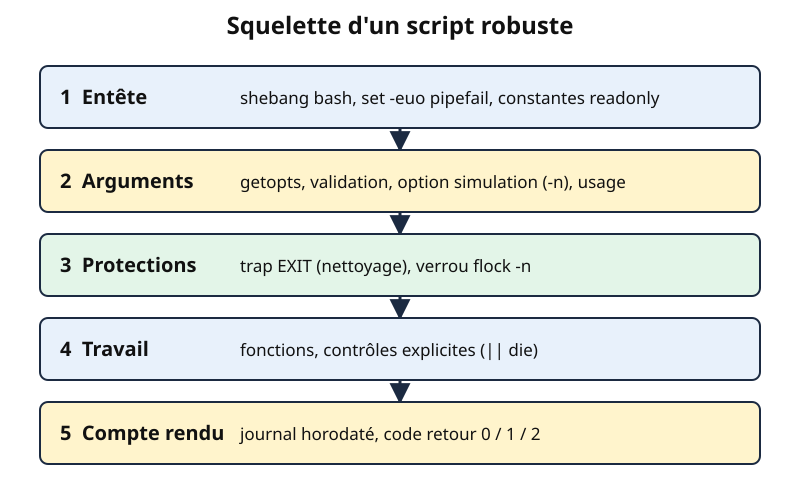
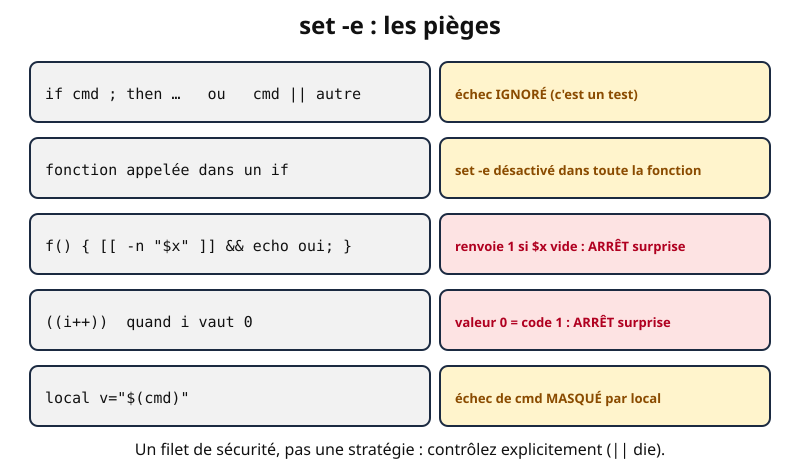

# Leçon — Scripts d'administration Bash robustes : arguments, fonctions, mode strict, trap, journaux, verrous, ShellCheck, cron et timers systemd

- **Tags** : `transverse`, `tout-en-un`, `lecon`, `automatisation`, `bash`, `shell`, `trap`, `shellcheck`, `cron`, `systemd`, `journalisation`
- **Niveau** : Intermédiaire (bases de Bash : variables, quoting, conditions, codes retour)
- **Durée estimée** : 4 h (cours 1 h 45, laboratoire 1 h 15, exercices et quiz 1 h)

---

## Objectifs pédagogiques

À la fin de cette leçon, vous serez capable de :

1. structurer un script d'administration (entête, constantes, fonctions, corps) et gérer ses **arguments** avec `getopts` ;
2. écrire des **fonctions** propres (`local`, `return`, messages sur stderr) ;
3. expliquer `set -euo pipefail` **et ses limites** pour ne pas lui accorder une confiance aveugle ;
4. nettoyer avec **`trap`** (fichiers temporaires, signaux) ;
5. **journaliser** de façon lisible (horodatage, niveau, PID, `logger`) ;
6. empêcher deux exécutions simultanées avec un **verrou** (`flock`) ;
7. contrôler la qualité avec **ShellCheck** ;
8. planifier avec **cron** ou un **timer systemd** et choisir entre les deux.

## Prérequis et durée

- Leçon « Bash pour débuter » : [lecon-bash-debutant.md](lecon-bash-debutant.md).
- Un **laboratoire jetable** : VM Linux (Debian, Ubuntu ou Rocky Linux), compte non privilégié, **instantané avant de commencer**, accès console de secours. Rien n'est modifié hors de votre dossier personnel, sauf mention explicite.
- Valeurs de documentation uniquement (192.0.2.0/24, 198.51.100.0/24, 203.0.113.0/24, 2001:db8::/32, `example.com`, `example.test`).

## L'essentiel en bref

- Un script « qui marche chez moi » n'est pas un script d'administration : celui-ci doit **échouer proprement**, être **rejouable**, laisser une **trace** et ne pas se chevaucher lui-même.
- `set -euo pipefail` : arrêt sur erreur (`-e`), sur variable non définie (`-u`), sur échec au milieu d'un tube (`pipefail`). C'est un **filet**, pas une garantie : `-e` a de nombreuses exceptions.
- `trap '...' EXIT` s'exécute quelle que soit la sortie : c'est le bon endroit pour supprimer les fichiers temporaires.
- Les messages d'erreur vont sur **stderr** ; le journal est horodaté ; le code retour est significatif.
- `flock` verrouille proprement et libère le verrou à la mort du processus ; un simple fichier « PID » peut devenir périmé.
- **ShellCheck** détecte statiquement la plupart des erreurs de quoting et de portabilité.
- Cron est simple mais minimaliste ; un **timer systemd** apporte journal, rattrapage (`Persistent=`) et dépendances.

---

## 1. Qu'est-ce qu'un script robuste ?

Lancé à la main un jour de calme, un script pardonne beaucoup ; lancé à 2 h 30 par un planificateur, sur une machine au disque plein, il ne pardonne rien. Un script robuste respecte quatre principes : **vérifier** ses hypothèses avant d'agir, **s'arrêter** dès qu'un doute apparaît, **nettoyer** derrière lui et **rendre compte**.

**Analogie.** Une check-list avant décollage : contrôles au sol (arguments), arrêt au premier voyant rouge (mode strict), avion rangé à l'arrivée (`trap`), carnet de bord (journal), un seul avion à la fois sur la piste (verrou).



*Figure 1 — Le squelette d'un script d'administration. Création originale du projet Pack Master (CC0).*

## 2. Le squelette et le mode strict

```bash
#!/usr/bin/env bash
set -euo pipefail

readonly PROG="${0##*/}"
```

👉 Explication : le shebang choisit Bash ; `set -euo pipefail` active le mode strict (détaillé ci-dessous) ; `${0##*/}` extrait le nom du script (utile dans les messages) et `readonly` empêche toute modification accidentelle.

| Option | Effet | Exemple |
|---|---|---|
| `-e` (`errexit`) | arrêt dès qu'une commande simple échoue | `cp absent.txt /srv/` arrête le script |
| `-u` (`nounset`) | variable non définie = erreur | `rm -r "$DOSSIR/tmp"` (faute de frappe) échoue au lieu de viser `/tmp` |
| `-o pipefail` | un tube échoue si **n'importe quel** maillon échoue | `grep x f \| sort` : l'échec de `grep` n'est plus masqué par `sort` |

Sans `-u`, `rm -rf "$RACINE/"` avec `RACINE` vide viserait la racine du système : accident célèbre du scripting. Pour tolérer une variable absente, donnez-lui une valeur par défaut : `"${ARG:-}"`.

## 3. Les arguments : `getopts`, validation et usage

Un script destiné à d'autres doit annoncer comment on l'utilise, refuser les entrées invalides et distinguer les erreurs d'usage (code 2 par convention) des erreurs d'exécution (code 1).

```bash
SRC=""; DEST=""; DRY_RUN=0

while getopts ':s:d:nh' opt; do
    case "$opt" in
        s) SRC="$OPTARG" ;;
        d) DEST="$OPTARG" ;;
        n) DRY_RUN=1 ;;
        h) usage; exit 0 ;;
        :) echo "option -$OPTARG : argument manquant" >&2; exit 2 ;;
        *) echo "option inconnue : -$OPTARG" >&2; exit 2 ;;
    esac
done
shift $((OPTIND - 1))
```

👉 Explication : dans `':s:d:nh'`, un deux-points après une lettre signifie « attend un argument » ; celui **en tête** active la gestion d'erreur personnalisée (cas `:` et `*`). `OPTARG` contient la valeur ; `shift $((OPTIND - 1))` retire les options traitées.

Ensuite, **validez avant d'agir** (`[[ -d "$SRC" ]]`, droits d'écriture, valeurs numériques) et prévoyez une option de **simulation** (`-n`, *dry-run*) : le script annonce ce qu'il ferait sans l'exécuter.

## 4. Les fonctions

Une fonction regroupe une action nommée et testable. Respectez trois règles :

```bash
verifier_espace() {
    local dossier="$1" seuil_ko="$2"
    local libre_ko
    libre_ko="$(df --output=avail -k -- "$dossier" | tail -n 1 | tr -d ' ')"
    (( libre_ko >= seuil_ko ))
}

if ! verifier_espace "$DEST" 102400; then
    die "moins de 100 Mio libres dans $DEST"
fi
```

👉 Explication : (1) **`local`** évite que les variables « fuient » dans le script ; (2) on **déclare puis affecte** (`local x; x="$(cmd)"`) : `local x="$(cmd)"` masquerait le code retour de `cmd` ; (3) une fonction oui/non **renvoie un code** (ici celui de `(( ))`) et s'utilise dans `if`.

`return N` quitte la fonction, `exit N` **tout** le script. Pour renvoyer un texte, la fonction l'affiche et l'appelant le capture avec `$(...)` : les diagnostics vont alors sur stderr.

## 5. `set -e` : ce qu'il fait… et ce qu'il ne fait pas

Beaucoup de scripts s'endorment sur `set -e`. Or le manuel de Bash précise qu'il est **ignoré** dans de nombreux contextes, ce qui produit des comportements surprenants :



*Figure 2 — Quelques exceptions du mode `errexit`. Création originale du projet Pack Master (CC0).*

| Situation | Comportement | Conséquence |
|---|---|---|
| Commande testée par `if`, `while`, `until`, `!`, ou membre non final d'un `&&` / `\|\|` | l'échec est **ignoré** | `if verifier; then` continue même si une commande **interne** à `verifier` échoue |
| Fonction appelée dans un `if` ou un `\|\|` | `set -e` est **désactivé dans toute la fonction** | les erreurs internes passent inaperçues |
| Dernière commande d'une liste `A && B` qui échoue sur A | la liste renvoie 1 | `f() { [[ -n "$x" ]] && echo oui; }` : **appeler `f` tue le script** si `$x` est vide |
| `((i++))` quand `i` vaut 0 | l'expression vaut 0, donc code 1 | arrêt injustifié : préférez `i=$((i + 1))` |
| `local v="$(cmd)"` | `local` réussit, donc l'échec de `cmd` est masqué | déclarez puis affectez séparément |
| `cmd1 \| cmd2` sans `pipefail` | seul le dernier maillon compte | ajoutez `pipefail` |

`pipefail` a un revers : `yes | head -n 1` termine avec le code 141 (SIGPIPE du premier maillon, jugé « en échec »).

Que faire ? Gérez les erreurs **explicitement** aux endroits qui comptent :

```bash
nb=$(grep -c "ERREUR" "$JOURNAL" || true)
cp -- "$SRC" "$DEST" || die "copie impossible : $SRC"
if ! tar -tzf "$ARCHIVE" > /dev/null; then
    die "archive illisible : $ARCHIVE"
fi
```

👉 Explication : `grep -c` renvoie 1 quand il compte zéro ligne ; `|| true` rend ce cas **volontairement** tolérable ; pour les actions critiques, `|| die "..."` produit un message clair au lieu d'un arrêt silencieux. Retenez la formule : **`set -e` est un filet de sécurité, pas une stratégie** ; les contrôles explicites restent la règle.

Pour comprendre un arrêt inattendu, ajoutez un piège `ERR` (avec `set -E` pour qu'il s'applique aux fonctions) :

```bash
set -Eeuo pipefail
trap 'echo "ERR ligne $LINENO : $BASH_COMMAND (code $?)" >&2' ERR
```

👉 Explication : affiche la ligne (`$LINENO`), la commande (`$BASH_COMMAND`) et le code de chaque échec non toléré. Sortie typique : `ERR ligne 5 : ls /nulle/part 2> /dev/null (code 2)`.

## 6. `trap` : nettoyer quoi qu'il arrive

`trap 'commandes' SIGNAL...` associe des commandes à un événement. Le pseudo-signal **`EXIT`** se déclenche à la sortie du script, quelle qu'en soit la cause : fin normale, `exit`, échec sous `set -e`, interruption par Ctrl+C ou `kill`.

```bash
TMP_DIR="$(mktemp -d)"
cleanup() {
    local code=$?
    rm -rf -- "$TMP_DIR"
    exit "$code"
}
trap cleanup EXIT
trap 'echo "interrompu" >&2; exit 130' INT TERM
```

👉 Explication : `mktemp -d` crée un dossier privé au nom imprévisible (jamais un `/tmp/fichier` fixe : collisions, liens symboliques piégés) ; `cleanup` mémorise `$?`, supprime le dossier et restitue le code ; `INT` (Ctrl+C) et `TERM` provoquent un `exit`, qui déclenche `EXIT`.

`SIGKILL` (`kill -9`) **ne peut pas être piégé** : le nettoyage n'a pas lieu, d'où l'intérêt de verrous qui se libèrent seuls (§8). Un second `trap` sur le même signal **remplace** le premier.

## 7. La journalisation

Un script de nuit qui n'écrit rien est un script dont on ne saura pas s'il a fonctionné. Un bon journal tient sur une ligne : **horodatage (avec fuseau), nom et PID, niveau, message**.

```bash
log() {
    local niveau="$1"; shift
    printf '%s [%s:%s] %s %s\n' "$(date '+%Y-%m-%dT%H:%M:%S%z')" "$PROG" "$$" "$niveau" "$*" \
        | tee -a "$LOG_FILE" >&2
}
die() { log ERREUR "$*"; exit 1; }
```

👉 Explication : `printf` construit une ligne uniforme (date ISO 8601, script, PID `$$`, niveau, texte) ; `tee -a` l'ajoute au fichier **et** la renvoie sur stderr, que cron ou systemd captureront ; `die` journalise puis quitte avec le code 1.

Pour intégrer le script au journal système, utilisez `logger` :

```bash
logger -t sauvegarde -p user.notice "terminée : 12 fichiers"
```

👉 Explication : écrit dans syslog/journald avec l'étiquette `sauvegarde` ; relecture par `journalctl -t sauvegarde`. Jamais de secret dans un journal ; prévoyez la **rotation** (`logrotate`) pour ne pas remplir le disque.

## 8. Les verrous : une instance à la fois

Si une sauvegarde de 25 minutes est lancée toutes les 15 minutes, deux copies tourneront en même temps et s'abîmeront mutuellement. Le verrou résout cela.

```bash
exec 9> "$LOCK_FILE"
flock -n 9 || die "une autre instance tourne déjà"
```

👉 Explication : `exec 9> fichier` ouvre le fichier de verrou sur le descripteur 9 pour **toute la durée du script** ; `flock -n 9` tente de prendre le verrou **sans attendre** (`-n`) et échoue si un autre processus le détient. Le noyau libère le verrou à la mort du processus, même brutale : pas de verrou « périmé ».

Évitez le fichier `script.pid` testé à la main : après un plantage il reste et bloque tout. Sans `flock`, `mkdir` d'un dossier-verrou est atomique, mais fragile après un arrêt brutal.

## 9. ShellCheck : le relecteur automatique

**ShellCheck** analyse le code sans l'exécuter et signale erreurs de quoting, variables inutilisées, constructions non portables, pièges classiques.

```bash
sudo apt install shellcheck
shellcheck sauvegarde.sh
shellcheck -s bash -S warning sauvegarde.sh
```

👉 Explication : installation depuis les dépôts Debian/Ubuntu (`sudo` réservé à la VM de laboratoire ; paquet EPEL sous Rocky Linux) ; puis analyse du script ; puis dialecte Bash forcé, avertissements et erreurs seulement. Un résultat vide signifie « rien à signaler ».

Un message typique ressemble à ceci :

```text
In demo.sh line 4:
rm -rf $dossier/tmp
       ^------^ SC2086 (info): Double quote to prevent globbing and word splitting.
```

👉 Explication : **SC2086** = « variable non citée » ; chaque règle a sa page sur le wiki du projet. Autres codes fréquents : SC2155 (`local x="$(cmd)"` masque l'échec), SC2164 (`cd` sans test), SC2046 (substitution non citée).

Pour ignorer volontairement un avertissement, **justifiez-le** : `# shellcheck disable=SC2086  # liste de mots voulue`. Intégrez-le à l'éditeur, à un hook Git ou à l'intégration continue ; il ne remplace pas les tests.

## 10. Planifier : cron ou timer systemd


*Figure 3 — Cron et timers systemd : quelques différences pratiques. Création originale du projet Pack Master (CC0).*

### 10.1 cron

Une ligne de crontab comporte cinq champs horaires puis la commande : **minute, heure, jour du mois, mois, jour de la semaine**.

```text
30 2 * * *   /opt/admin/sauvegarde.sh -s /srv/donnees -d /srv/sauvegardes >> /var/log/sauvegarde-cron.log 2>&1
*/15 * * * * /opt/admin/verifier.sh
```

👉 Explication : la première ligne s'exécute tous les jours à 02 h 30 et ajoute sorties et erreurs à un fichier ; la seconde toutes les 15 minutes. On édite sa crontab avec `crontab -e` (`crontab -l` pour la lire). Les fichiers de `/etc/cron.d/` ont **un champ utilisateur supplémentaire** avant la commande.

Pièges : l'**environnement de cron est minimal** (`PATH` réduit, pas de profil) : **chemins absolus** et `PATH=` en tête de crontab ; la sortie non redirigée part par courrier local (`MAILTO`) ou se perd ; un `%` s'écrit `\%` ; le changement d'heure peut sauter ou doubler une exécution nocturne.

### 10.2 Timers systemd

Un timer est une paire d'unités : un **service** (le travail) et un **timer** (le déclencheur). Voici une version « utilisateur », sans privilège, à placer dans `~/.config/systemd/user/` :

```ini
# sauvegarde.service
[Unit]
Description=Sauvegarde du dossier de laboratoire

[Service]
Type=oneshot
ExecStart=%h/labo-robuste/sauvegarde.sh -s %h/labo-robuste/donnees -d %h/labo-robuste/sauvegardes
```

👉 Explication : `Type=oneshot` = travail qui se termine ; `%h` = dossier personnel ; la sortie du script est conservée dans le journal (`journalctl`).

```ini
# sauvegarde.timer
[Unit]
Description=Déclenchement quotidien de la sauvegarde

[Timer]
OnCalendar=*-*-* 02:30:00
Persistent=true
RandomizedDelaySec=300

[Install]
WantedBy=timers.target
```

👉 Explication : `OnCalendar` : tous les jours à 02:30 ; `Persistent=true` **rattrape** l'exécution manquée si la machine était éteinte ; `RandomizedDelaySec` étale les départs.

```bash
systemd-analyze calendar "*-*-* 02:30:00"
systemctl --user daemon-reload
systemctl --user enable --now sauvegarde.timer
systemctl --user list-timers
journalctl --user -u sauvegarde.service -n 20
```

👉 Explication : vérifie l'expression de date (prochaine échéance incluse) ; recharge les unités ; active et démarre le timer ; liste les timers ; lit les 20 dernières lignes du journal du service. Hors session ouverte, il faudrait `loginctl enable-linger`. En usage système, les unités vont dans `/etc/systemd/system/` (avec un `User=` dédié), commandes sans `--user` mais avec droits administrateur.

**Choisir.** Cron pour le très simple ; timer dès qu'il faut **journal centralisé, rattrapage, dépendances ou test à la demande** (`systemctl start sauvegarde.service`).

---

## Mise en pratique guidée

**Contexte.** VM jetable, compte non privilégié, **instantané pris**. Tout reste dans `~/labo-robuste`. Le script ci-dessous rassemble les notions de la leçon ; enregistrez-le sous `~/labo-robuste/sauvegarde.sh`.

```bash
#!/usr/bin/env bash
# sauvegarde.sh - archive un dossier source vers un dossier de destination
set -euo pipefail

readonly PROG="${0##*/}"
readonly BASE_DIR="${BASE_DIR:-$HOME/labo-robuste}"
readonly LOG_FILE="${LOG_FILE:-$BASE_DIR/sauvegarde.log}"
readonly LOCK_FILE="${LOCK_FILE:-$BASE_DIR/sauvegarde.lock}"
SRC=""; DEST=""; DRY_RUN=0; VERBOSE=0; TMP_DIR=""

usage() {
    cat <<USAGE
Usage : $PROG -s SOURCE -d DESTINATION [-n] [-v] [-h]
  -s  dossier à sauvegarder       -d  dossier de destination
  -n  simulation (n'écrit rien)   -v  mode bavard      -h  aide
USAGE
}
log() {
    local niveau="$1"; shift
    local ligne
    ligne="$(date '+%Y-%m-%dT%H:%M:%S%z') [$PROG:$$] $niveau $*"
    printf '%s\n' "$ligne" >> "$LOG_FILE"
    if [[ "$niveau" == "ERREUR" ]] || (( VERBOSE )); then
        printf '%s\n' "$ligne" >&2
    fi
}
die() { log ERREUR "$*"; exit 1; }
cleanup() {
    local code=$?
    if [[ -n "$TMP_DIR" && -d "$TMP_DIR" ]]; then rm -rf -- "$TMP_DIR"; fi
    (( code == 0 )) || log ERREUR "arrêt anormal (code $code)"
    exit "$code"
}
trap cleanup EXIT
trap 'die "interrompu par un signal"' INT TERM

while getopts ':s:d:nvh' opt; do
    case "$opt" in
        s) SRC="$OPTARG" ;;
        d) DEST="$OPTARG" ;;
        n) DRY_RUN=1 ;;
        v) VERBOSE=1 ;;
        h) usage; exit 0 ;;
        :) usage >&2; die "option -$OPTARG : argument manquant" ;;
        *) usage >&2; die "option inconnue : -$OPTARG" ;;
    esac
done
shift $((OPTIND - 1))

[[ -n "$SRC" && -n "$DEST" ]] || { usage >&2; die "-s et -d sont obligatoires"; }
[[ -d "$SRC" ]]  || die "source introuvable : $SRC"
[[ -d "$DEST" ]] || die "destination introuvable : $DEST"

mkdir -p -- "$BASE_DIR"
exec 9>"$LOCK_FILE"
flock -n 9 || die "une autre instance tourne déjà"

TMP_DIR="$(mktemp -d)"
archive="$DEST/${SRC##*/}-$(date +%Y%m%d-%H%M%S).tar.gz"
log INFO "début : $SRC -> $archive"
if (( DRY_RUN )); then
    log INFO "simulation : aucune archive créée"
    exit 0
fi
tar -czf "$TMP_DIR/archive.tar.gz" -C "$SRC" .
tar -tzf "$TMP_DIR/archive.tar.gz" > /dev/null
mv -- "$TMP_DIR/archive.tar.gz" "$archive"
log INFO "terminé : $(du -k "$archive" | cut -f1) Kio"
```

👉 Explication : mode strict, `getopts`, `log`/`die`, `trap ... EXIT`, verrou `flock`, et un travail en deux temps (archive temporaire, vérification de lecture, puis `mv` final) : une archive incomplète n'atteint jamais son emplacement définitif. `die` puis `cleanup` produisent deux lignes d'erreur : c'est voulu.

**Étape 1 — Préparer le terrain.**

```bash
mkdir -p ~/labo-robuste/donnees ~/labo-robuste/sauvegardes
printf 'donnée A\n' > ~/labo-robuste/donnees/a.txt
chmod +x ~/labo-robuste/sauvegarde.sh
bash -n ~/labo-robuste/sauvegarde.sh && echo "syntaxe correcte"
```

👉 Explication : crée un jeu de données factice, rend le script exécutable et valide sa syntaxe sans l'exécuter.

**Étape 2 — Simuler, puis exécuter.**

```bash
cd ~/labo-robuste
./sauvegarde.sh -n -v -s donnees -d sauvegardes
./sauvegarde.sh -v -s donnees -d sauvegardes; echo "code : $?"
ls sauvegardes; cat sauvegarde.log
```

👉 Explication : la simulation n'écrit que dans le journal ; l'exécution réelle crée `sauvegardes/donnees-<date>.tar.gz`, code 0.

**Étape 3 — Provoquer les erreurs.**

```bash
./sauvegarde.sh -s /nulle/part -d sauvegardes; echo "code : $?"
./sauvegarde.sh -s; echo "code : $?"
```

👉 Explication : erreur claire, journalisée, code 1 ; ni archive ni dossier temporaire ne subsiste.

**Étape 4 — Éprouver le verrou.**

```bash
( exec 8> sauvegarde.lock; flock -n 8; ./sauvegarde.sh -s donnees -d sauvegardes; echo "code : $?" )
```

👉 Explication : le sous-shell tient le verrou ; le script répond « une autre instance tourne déjà » (code 1) ; le verrou est libéré à la fin du sous-shell.

**Étape 5 — Planifier (au choix).** `crontab -e` avec la ligne du §10.1 (chemins absolus adaptés), ou les unités du §10.2 puis `systemctl --user list-timers`.

**Étape 6 — Retour arrière.**

```bash
systemctl --user disable --now sauvegarde.timer
rm -r ~/labo-robuste ~/.config/systemd/user/sauvegarde.service ~/.config/systemd/user/sauvegarde.timer
```

👉 Explication : désactive le timer (ignorez l'erreur sans étape 5), supprime dossier et unités. Retirez aussi votre ligne de `crontab -e`. En dernier recours, restaurez l'instantané.

## Exercices

1. **Mode strict.** Que se passe-t-il à l'exécution de `set -u; echo "dossier : $DOSSIER"` ? Et avec `${DOSSIER:-/srv}` ?
2. **Arguments.** Ajoutez à un script un `getopts` pour `-f FICHIER` (obligatoire) et `-q` (silencieux), avec message d'usage et code 2 si `-f` manque.
3. **Fonction.** Écrivez `est_nombre` qui renvoie 0 si son argument est un entier positif, 1 sinon, puis utilisez-la dans un `if`.
4. **Piège `set -e`.** Expliquez pourquoi le script `set -e; f() { [[ -n "${X:-}" ]] && echo oui; }; f; echo fin` n'affiche pas `fin` et corrigez `f`.
5. **trap.** Écrivez un script qui crée un fichier temporaire avec `mktemp`, y écrit une ligne, puis s'arrête volontairement par `false` (sous `set -e`) ; le fichier doit être supprimé.
6. **Verrou.** Écrivez le bloc `flock` qui empêche deux exécutions simultanées et renvoie le code 3 avec un message en cas de conflit.
7. **Planification.** Écrivez la ligne cron « tous les lundis à 03:15 » puis l'`OnCalendar` systemd équivalent, et la commande qui vérifie ce dernier.

## Corrigés des exercices

**1.** Avec `-u`, Bash arrête le script avec une erreur « variable sans liaison » (*unbound variable*). Avec `${DOSSIER:-/srv}` : `dossier : /srv`.

**2.**

```bash
FICHIER=""; SILENCIEUX=0
while getopts ':f:q' o; do
    case "$o" in
        f) FICHIER="$OPTARG" ;;
        q) SILENCIEUX=1 ;;
        *) echo "usage : $0 -f FICHIER [-q]" >&2; exit 2 ;;
    esac
done
[[ -n "$FICHIER" ]] || { echo "usage : $0 -f FICHIER [-q]" >&2; exit 2; }
```

👉 Explication : `:` et `?` tombent dans la branche `*` (usage + code 2) ; l'absence de `-f` est aussi refusée.

**3.**

```bash
est_nombre() { [[ "${1:-}" =~ ^[0-9]+$ ]]; }
if est_nombre "$1"; then echo "entier"; else echo "pas un entier"; fi
```

👉 Explication : le code retour de `[[ ]]` est celui de la fonction ; on la teste directement.

**4.** Si `X` est vide, `[[ ... ]]` échoue, `&&` ne lance pas `echo`, et la fonction renvoie le code 1 : `set -e` arrête le script à l'appel de `f`. Correction : `f() { if [[ -n "${X:-}" ]]; then echo oui; fi; }` (le `if` sans `else` renvoie 0), ou terminer par `return 0`.

**5.**

```bash
#!/usr/bin/env bash
set -euo pipefail
f="$(mktemp)"
trap 'rm -f -- "$f"' EXIT
echo "contenu" > "$f"
false
```

👉 Explication : `false` provoque l'arrêt, mais le `trap EXIT` supprime quand même le fichier ; vérifiez-le avec `ls` sur le chemin affiché au préalable.

**6.**

```bash
exec 9> /tmp/mon-script.lock
flock -n 9 || { echo "déjà en cours" >&2; exit 3; }
```

👉 Explication : on ouvre le verrou sur le descripteur 9 et on quitte avec 3 s'il est pris (le chemin du verrou est à adapter ; en production, préférez un dossier dédié comme `/run/lock/`).

**7.** Cron : `15 3 * * 1 /opt/admin/sauvegarde.sh ...` (champ 5 = jour de la semaine, 1 = lundi). Timer : `OnCalendar=Mon *-*-* 03:15:00`, à vérifier par `systemd-analyze calendar "Mon *-*-* 03:15:00"`.

## Quiz

**1. Que fait `set -u` ?**
a) arrête le script sur toute erreur b) ignore les erreurs de tube c) provoque une erreur si une variable non définie est utilisée
**Réponse : c.** `-e` arrête sur erreur, `pipefail` concerne les tubes.

**2. Pourquoi `set -e` ne suffit-il pas ?**
a) il est ignoré dans plusieurs contextes (`if`, `&&`, fonctions appelées dans un test…) b) il ne fonctionne qu'en `sh` c) il est obsolète
**Réponse : a.** Les échecs peuvent passer inaperçus ; il faut des contrôles explicites.

**3. `local v="$(cmd)"` pose quel problème ?**
a) la variable devient globale b) le code retour de `cmd` est masqué par celui de `local` c) la syntaxe est invalide
**Réponse : b.** Déclarer puis affecter séparément.

**4. Quel événement un `trap ... EXIT` couvre-t-il ?**
a) toutes les sorties, y compris `exit`, erreur sous `set -e`, Ctrl+C b) uniquement la fin normale c) aussi `kill -9`
**Réponse : a.** `SIGKILL` ne peut pas être intercepté.

**5. Pourquoi préférer `flock` à un fichier PID ?**
a) il est plus rapide b) le noyau libère le verrou si le processus meurt, donc pas de verrou périmé c) il fonctionne sans fichier
**Réponse : b.**

**6. Où envoyer les messages d'erreur d'un script ?**
a) sur stdout b) uniquement dans un fichier c) sur stderr
**Réponse : c.** stdout reste réservé aux données ; stderr aux diagnostics (et au journal).

**7. Que signifie SC2086 dans ShellCheck ?**
a) boucle infinie b) variable non citée (découpage et jokers) c) fichier introuvable
**Réponse : b.**

**8. Que fait `Persistent=true` dans un timer ?**
a) garde le service actif b) répète toutes les secondes c) rattrape une exécution manquée quand la machine était éteinte
**Réponse : c.**

**9. Que désigne le quatrième champ d'une ligne cron ?**
a) le jour du mois b) le mois c) le jour de la semaine
**Réponse : b.** L'ordre est minute, heure, jour du mois, mois, jour de la semaine.

**10. Pourquoi utiliser des chemins absolus dans une tâche cron ?**
a) l'environnement de cron est minimal (`PATH` réduit, pas de profil) b) cron est plus rapide ainsi c) c'est obligatoire dans la syntaxe
**Réponse : a.**

## Erreurs fréquentes et dépannage

| Symptôme | Cause probable | Remède |
|---|---|---|
| Le script s'arrête sans message | `set -e` sur une commande « normale » qui renvoie 1 (`grep`, `((i++))`, `&&` final) | piège `ERR` ; `\|\| true` voulu ; `i=$((i + 1))` |
| `unbound variable` | variable absente ou faute de frappe | corriger le nom ou `"${VAR:-défaut}"` |
| Fichiers temporaires qui s'accumulent | pas de `trap EXIT`, ou arrêt par `kill -9` | `trap cleanup EXIT` ; purge périodique |
| Fonctionne à la main, échoue sous cron | `PATH` minimal, répertoire courant différent, variables absentes | chemins absolus, `cd` explicite, `PATH=` en tête de crontab |
| Deux instances simultanées | pas de verrou | `flock -n` |
| `flock: Bad file descriptor` | descripteur non ouvert avant le `flock` | `exec 9> fichier` d'abord |
| Le timer ne se déclenche jamais | unité non activée, `OnCalendar` mal écrit | `systemd-analyze calendar` ; `systemctl list-timers` ; `systemctl status` |

## À retenir

- `set -euo pipefail` aide mais **n'est pas une garantie** : contrôlez explicitement les actions critiques (`|| die`).
- `trap ... EXIT` pour nettoyer ; `mktemp` pour les temporaires ; `kill -9` n'est pas interceptable.
- Journal horodaté sur stderr/fichier/`logger` ; jamais de secret dedans.
- `flock -n` pour l'exclusion mutuelle.
- Passez ShellCheck et justifiez toute exception.
- Cron pour le simple, timer systemd pour le journal, le rattrapage et les dépendances ; toujours tester à la main d'abord.

## Pour aller plus loin

- Manuel de GNU Bash (`set`, `trap`, `getopts`) : <https://www.gnu.org/software/bash/manual/bash.html>
- ShellCheck, wiki des règles : <https://www.shellcheck.net/wiki/>
- `flock(1)` : <https://man7.org/linux/man-pages/man1/flock.1.html>
- `crontab(5)` : <https://man7.org/linux/man-pages/man5/crontab.5.html>
- `systemd.timer(5)` : <https://www.freedesktop.org/software/systemd/man/latest/systemd.timer.html>
- Adresses réservées à la documentation (RFC 5737) : <https://www.rfc-editor.org/rfc/rfc5737>

## Crédits des images

Aucune image libre adaptée n'a été retenue : les trois schémas ont été dessinés pour cette leçon.

| Fichier | Source (URL Commons) | Auteur | Licence (nom + URL) | Modifications |
|---|---|---|---|---|
| `images/bash-scripts-robustes-1.svg` | Création originale du projet Pack Master | Projet Pack Master | CC0 1.0 — <https://creativecommons.org/publicdomain/zero/1.0/deed.fr> | Aucune |
| `images/bash-scripts-robustes-2.svg` | Création originale du projet Pack Master | Projet Pack Master | CC0 1.0 — <https://creativecommons.org/publicdomain/zero/1.0/deed.fr> | Aucune |
| `images/bash-scripts-robustes-3.svg` | Création originale du projet Pack Master | Projet Pack Master | CC0 1.0 — <https://creativecommons.org/publicdomain/zero/1.0/deed.fr> | Aucune |

Création originale du projet Pack Master, dédiée au domaine public (CC0).

## Historique de vérification

| Date | OS/logiciel | Testeur | Verdict |
|---|---|---|---|
| 2026-11-01 | GNU Bash 5.3 (Linux, poste de rédaction) | Rédaction assistée (agent Copilot) : script `sauvegarde.sh` et extraits `set -e`, `trap`, `getopts`, `flock` exécutés dans un dossier jetable, sans privilège ; ShellCheck, cron et systemd non exécutés | Non testé sur plateforme cible (extraits Bash exécutés avec succès en local uniquement) |
| 2026-11-01 | Debian 12 / Ubuntu 24-04 / Rocky Linux 9 (VM), ShellCheck, cron, systemd | Rédaction assistée (agent Copilot) | Non testé sur plateforme cible |
