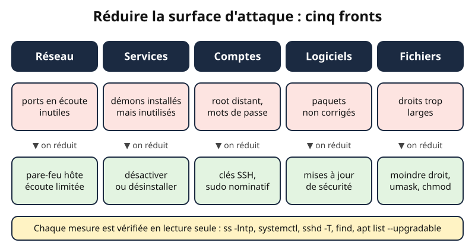
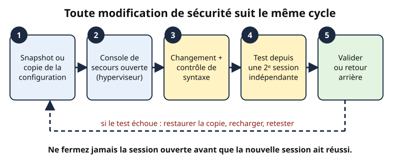
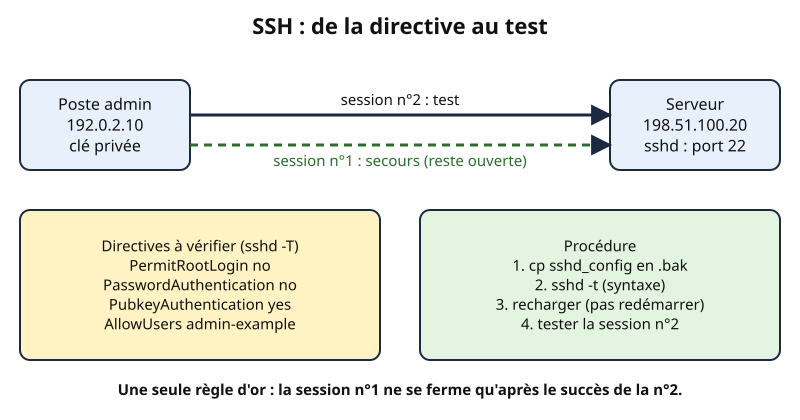
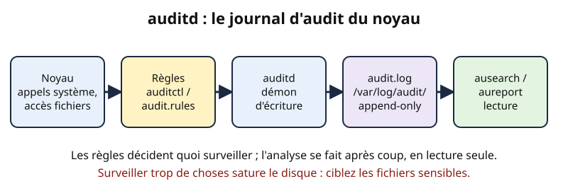

# Leçon — Durcissement d'un serveur Linux

- **Tags** : `transverse`, `tout-en-un`, `lecon`, `securite`, `durcissement`, `linux`, `ssh`, `auditd`, `cis`
- **Niveau** : intermédiaire (administrateur système junior à confirmé)
- **Durée estimée** : 3 h 30 (lecture 1 h 15, laboratoire 1 h 45, exercices et quiz 30 min)

---

## Objectifs pédagogiques

À la fin de cette leçon, vous saurez :

1. expliquer la **surface d'attaque** d'un serveur Linux et la réduire méthodiquement ;
2. contrôler **mises à jour, comptes, services, ports et permissions** avec des commandes en **lecture seule** ;
3. durcir **SSH** sans vous enfermer dehors (fichier dédié, contrôle de syntaxe, session de secours) ;
4. exploiter les **journaux** et décrire le **principe d'auditd** ;
5. situer les **recommandations CIS** comme référentiel de contrôle ;
6. conduire un changement avec le cycle **snapshot → console de secours → test → retour arrière**.

## Prérequis et durée

- Utiliser un terminal, lire un fichier de configuration, utiliser `sudo`.
- Notions de réseau : adresse IP, port TCP, service.
- Une **VM jetable** (Debian 12 ou Ubuntu Server LTS) avec **console d'hyperviseur** et **snapshot**. Adresses de documentation : `192.0.2.0/24`, `198.51.100.0/24`, `203.0.113.0/24` ; domaine `example.test`.
- Durée : environ 3 h 30.

> ⚠️ **Périmètre.** N'exécutez ces commandes que sur des machines dont vous êtes responsable, de préférence en laboratoire. Répétez toujours un changement sur une copie avant la production.

## L'essentiel en bref

- Un serveur sûr n'est pas un serveur « sans faille » : c'est un serveur qui **expose le strict nécessaire**, est **corrigé régulièrement**, **journalise** ce qu'il fait et dont on sait **vérifier l'état**.
- On durcit dans cet ordre : **inventorier**, **réduire**, **contrôler**, **surveiller**.
- Chaque changement est précédé d'un **snapshot**, d'un **accès console de secours**, et suivi d'un **test** depuis une seconde session, avec un **retour arrière** prévu.
- Les contrôles décrits ici sont **en lecture seule** : ils observent sans modifier.
- Le référentiel CIS donne une liste de contrôles ; c'est un **guide à adapter**, pas un script magique à lancer.

---

## 1. La surface d'attaque : comprendre avant de durcir

**Analogie.** Une maison a des portes, des fenêtres et une boîte aux lettres : c'est sa surface d'attaque. Durcir, ce n'est pas bâtir un bunker : on **condamne les ouvertures inutiles**, **renforce celles qui restent** et **installe une alarme**.

| Famille | Exemple d'ouverture | Réponse |
|---|---|---|
| Réseau | port en écoute inutilisé | fermer, filtrer (pare-feu hôte) |
| Services | démon installé « au cas où » | désactiver ou désinstaller |
| Comptes | compte oublié, `root` joignable à distance | supprimer, verrouiller, imposer les clés |
| Logiciels | paquet non corrigé | mises à jour de sécurité |
| Fichiers | configuration lisible par tous | droits minimaux |



*Figure 1 — Cinq fronts à réduire : pour chaque famille d'exposition, une mesure et une vérification. Création originale Pack Master (CC0).*

**Principe directeur : moindre privilège, moindre service.** Un service absent ne peut pas être attaqué.

**Exemple.** Le serveur web de `example.test` n'a besoin que du port 443 (public) et du port 22 (administration depuis `192.0.2.0/24`). S'il écoute aussi sur 3306 pour tout le monde, il suffit de lier la base à `127.0.0.1`.

### Inventorier avant de toucher

```bash
hostnamectl
cat /etc/os-release
uname -r
date -Is
ss -lntup
```

👉 Explication : relève identité, distribution, noyau et heure (à consigner dans le cahier de changement), puis liste les sockets en écoute avec leur processus (`-p` demande `sudo` pour voir ceux des autres utilisateurs) ; lecture seule.

`0.0.0.0:22` signifie « écoute sur toutes les interfaces IPv4 » ; `127.0.0.1:5432` « accessible uniquement depuis la machine », donc bien moins exposé.

## 2. La règle d'or : modifier sans se couper la branche

Les erreurs de sécurité les plus coûteuses viennent rarement des pirates : c'est l'administrateur qui, en fermant une porte, **s'enferme dehors**.



*Figure 2 — Le cycle de modification sûre. Création originale Pack Master (CC0).*

À chaque changement de ce document :

1. **Snapshot préalable** : instantané de l'hyperviseur ou, au minimum, copie du fichier (`cp -a fichier fichier.bak-AAAAMMJJ`) et sauvegarde récente.
2. **Accès console de secours** : console de l'hyperviseur, console série, IPMI/iDRAC/iLO. Il fonctionne **même sans réseau ni SSH** : testez-le *avant* de commencer.
3. **Changement + contrôle de syntaxe** : `sshd -t`, `nginx -t`, `visudo -c`…
4. **Test depuis une seconde session indépendante** : on ne ferme jamais la session ouverte avant que la nouvelle réussisse (comme l'alpiniste qui ne lâche une corde qu'une fois la suivante mousquetonnée).
5. **Validation ou retour arrière** : en cas d'échec, restaurer la copie, recharger, retester.

```bash
sudo cp -a /etc/ssh/sshd_config /etc/ssh/sshd_config.bak-20261101
```

👉 Explication : crée une copie datée en conservant propriétaire et droits (`-a`) ; c'est votre retour arrière.

## 3. Mises à jour : fermer les portes déjà connues

La majorité des compromissions exploitent des failles **déjà corrigées** mais non installées.

```bash
apt list --upgradable 2>/dev/null
apt-get -s upgrade | grep -i '^Inst' | head
ls -l /var/run/reboot-required 2>/dev/null || echo "pas de redémarrage signalé"
uname -r
```

👉 Explication : liste les mises à jour connues des index locaux, **simule** (`-s`) une mise à jour sans rien installer, puis vérifie si un redémarrage est attendu (sous Debian/Ubuntu) et quel noyau tourne. `apt update` rafraîchit les index : il modifie le cache APT, pas le système.

Famille Red Hat :

```bash
dnf check-update --security
dnf updateinfo list security
```

👉 Explication : `check-update` retourne le code 100 s'il existe des mises à jour (comportement normal) ; `updateinfo` énumère les avis de sécurité applicables.

**Automatiser avec discernement.** `unattended-upgrades` (Debian/Ubuntu) ou `dnf-automatic` (Red Hat) installent les correctifs de **sécurité** ; on **teste** les mises à jour majeures sur un groupe pilote et on ne redémarre pas un serveur de production en pleine journée.

## 4. Comptes et privilèges : qui peut faire quoi ?

**Analogie.** Les comptes sont les clés de l'immeuble : peu de clés, nominatives, retirées quand quelqu'un part.

```bash
awk -F: '$3 == 0 {print $1}' /etc/passwd
getent passwd | awk -F: '$7 !~ /(nologin|false)$/ {print $1, $3, $7}'
sudo awk -F: '($2 == "") {print $1}' /etc/shadow
```

👉 Explication : (1) liste les comptes d'UID 0 : seul `root` est normal ; (2) liste les comptes dotés d'un interpréteur de connexion réel (les comptes de service devraient avoir `nologin`) ; (3) repère les comptes sans mot de passe, résultat attendu : vide ; n'affiche que des noms, jamais d'empreintes.

```bash
getent group sudo wheel
sudo chage -l nom_utilisateur
last -n 10
```

👉 Explication : montre les membres des groupes d'administration (`sudo` sous Debian, `wheel` sous Red Hat), la politique d'expiration d'un compte (remplacez `nom_utilisateur`) et les dernières connexions.

**Bonnes pratiques.** Un compte par personne (sinon les journaux ne prouvent rien) ; `sudo` nominatif plutôt que `root` direct ; verrouiller les comptes inutilisés (`sudo usermod -L compte`) ; préférer les clés SSH ou une authentification centralisée avec MFA ; éditer `sudoers` uniquement avec `visudo`, qui contrôle la syntaxe, en gardant une session `root` ou la console ouverte.

## 5. SSH : la porte principale

SSH est le service d'administration le plus attaqué : un serveur exposé reçoit en quelques heures des centaines de tentatives automatiques sur `root`. Trois leviers : **authentification par clé**, **comptes autorisés limités**, **limitation réseau** (voir la leçon sur le pare-feu hôte).



*Figure 3 — Deux sessions SSH : l'une reste ouverte comme filet de sécurité, l'autre teste la nouvelle configuration. Création originale Pack Master (CC0).*

```bash
sudo sshd -T | grep -Ei '^(permitrootlogin|passwordauthentication|pubkeyauthentication|allowusers|maxauthtries|x11forwarding|port) '
```

👉 Explication : `sshd -T` affiche la configuration **effective** (fichiers inclus compris), en lecture seule ; c'est le seul moyen fiable de savoir ce que le démon applique.

| Directive | Valeur conseillée | Pourquoi |
|---|---|---|
| `PermitRootLogin` | `no` | passer par un compte nominatif puis `sudo` |
| `PasswordAuthentication` | `no` (après installation des clés) | supprime la devinette de mots de passe |
| `PubkeyAuthentication` | `yes` | active l'authentification par clé |
| `AllowUsers` | `admin-example` | seuls les comptes listés se connectent |
| `MaxAuthTries` | `3` | limite les essais par connexion |

**Piège majeur : l'ordre de lecture.** Dans OpenSSH, pour la plupart des directives, **la première valeur rencontrée l'emporte**. Sur Debian 12 et Ubuntu récents, `sshd_config` commence par `Include /etc/ssh/sshd_config.d/*.conf`, lus par ordre alphabétique. Une image cloud contient souvent `50-cloud-init.conf` avec `PasswordAuthentication yes` : un fichier `99-durcissement.conf` serait **ignoré**. Nommez le vôtre `10-durcissement.conf` et **vérifiez avec `sshd -T`**.

**Procédure sûre.** (1) Vérifiez qu'une connexion **par clé** fonctionne déjà pour le compte d'administration. (2) Gardez cette session ouverte (n°1) et la console de secours prête. (3) Écrivez le fichier :

```bash
sudo tee /etc/ssh/sshd_config.d/10-durcissement.conf >/dev/null <<'EOF'
PermitRootLogin no
PasswordAuthentication no
PubkeyAuthentication yes
MaxAuthTries 3
AllowUsers admin-example
EOF
sudo sshd -t && echo "syntaxe OK"
sudo systemctl reload ssh
```

👉 Explication : crée un fichier dédié (facile à retirer), valide la syntaxe (`sshd -t` est silencieux si tout va bien), puis **recharge** sans couper les sessions existantes (service `ssh` sous Debian/Ubuntu, `sshd` sous Red Hat). Adaptez `admin-example` à un compte réel du laboratoire.

(4) Depuis un **autre terminal**, ouvrez la session n°2 et testez aussi qu'un compte non autorisé est refusé. (5) **Retour arrière** : `sudo rm /etc/ssh/sshd_config.d/10-durcissement.conf && sudo systemctl reload ssh`.

> 💡 Changer le port 22 réduit le bruit des journaux mais **n'est pas une protection** : un scan le retrouve en quelques secondes.

## 6. Services inutiles : désinstaller plutôt que surveiller

Chaque service installé est du code supplémentaire à corriger. Visez la liste la plus courte, justifiée par le rôle de la machine.

```bash
systemctl list-unit-files --type=service --state=enabled --no-pager
systemctl list-units --type=service --state=running --no-pager
systemctl --failed --no-pager
```

👉 Explication : services activés au démarrage, services actifs, services en échec : trois vues en lecture seule.

Pour chacun : *À quoi sert-il ? Qui l'utilise ? Que se passe-t-il s'il disparaît ?* S'il est inutile :

```bash
sudo systemctl disable --now exemple.service
sudo systemctl mask exemple.service
```

👉 Explication : arrête et désactive le service, puis empêche qu'une dépendance le relance (remplacez `exemple.service`). Retour arrière : `unmask` puis `enable --now`. Le mieux reste de **désinstaller** le paquet (`sudo apt purge`). Un port sans service identifié dans `ss -lntup` est une alerte.

## 7. Permissions et fichiers : le dernier rempart

```bash
stat -c '%a %U:%G %n' /etc/passwd /etc/shadow /etc/group /etc/ssh/sshd_config
sudo find / -xdev -type f -perm -0002 -not -path '/proc/*' 2>/dev/null | head -20
sudo find / -xdev \( -nouser -o -nogroup \) 2>/dev/null | head -20
sudo find / -xdev -type f -perm -4000 -ls 2>/dev/null
```

👉 Explication : (1) droits en octal, propriétaire et chemin ; repères Debian : `/etc/passwd` en `644`, `/etc/shadow` en `640` (root:shadow) ; (2) fichiers modifiables par **n'importe qui** ; (3) fichiers sans propriétaire connu ; (4) fichiers **SUID**, qui s'exécutent avec les droits de leur propriétaire : comparez à la référence de la distribution, un SUID inattendu dans `/tmp` ou `/home` est suspect. `-xdev` évite de traverser les autres systèmes de fichiers ; tout est en lecture.

```bash
findmnt -no TARGET,OPTIONS /tmp
sysctl net.ipv4.ip_forward kernel.randomize_va_space
```

👉 Explication : lit les options de montage de `/tmp` (`nodev`, `nosuid`, `noexec` empêchent d'exécuter un binaire déposé là) et deux paramètres noyau : routage IPv4 inactif sauf pour un routeur, ASLR actif à `2`. Aucune modification.

Pensez aussi à l'`umask` : `027` évite que les nouveaux fichiers soient lisibles par tous.

## 8. Journaux et auditd : se souvenir de ce qui s'est passé

**Analogie.** Les journaux sont le registre d'entrée de l'immeuble ; l'audit est la caméra sur les portes sensibles.

```bash
journalctl -u ssh --since "1 hour ago" --no-pager | tail -n 20
journalctl -p warning -b --no-pager | tail -n 20
journalctl --disk-usage
timedatectl
```

👉 Explication : derniers événements SSH (service `sshd` sous Red Hat), messages d'avertissement depuis le démarrage, espace occupé par le journal, puis état de l'horloge (`System clock synchronized: yes` attendu).

Trois points de durcissement : **persistance** (`Storage=persistent` dans `/etc/systemd/journald.conf`, sinon les données peuvent être perdues au redémarrage), **rotation et taille** (`SystemMaxUse=`, `logrotate`), **centralisation** vers un serveur distant (par exemple `198.51.100.30`) pour qu'un intrus ne les efface pas : c'est le point le plus important après une compromission. Les fichiers d'authentification sont `/var/log/auth.log` (Debian/Ubuntu) ou `/var/log/secure` (Red Hat).

### auditd : le principe

Le **système d'audit du noyau** produit des événements pour ce que vous lui demandez de surveiller (écriture d'un fichier, appel système, exécution). Le démon **auditd** les écrit dans `/var/log/audit/audit.log` ; `ausearch` et `aureport` les interrogent.



*Figure 4 — Du noyau au rapport d'audit. Création originale Pack Master (CC0).*

Ce qui n'est pas demandé n'est pas enregistré ; mais trop de règles saturent le disque et noient les signaux : ciblez. Exemple de règles persistantes (`/etc/audit/rules.d/50-identite.rules`) :

```text
-w /etc/passwd -p wa -k identite
-w /etc/shadow -p wa -k identite
-w /etc/sudoers -p wa -k elevation
-w /etc/ssh/sshd_config -p wa -k ssh_config
```

👉 Explication : `-w` surveille un chemin, `-p wa` déclenche sur écriture et changement d'attribut, `-k` pose une étiquette de recherche.

```bash
sudo augenrules --load
sudo auditctl -l
sudo ausearch -k identite -i --start today
sudo aureport --summary
```

👉 Explication : charge les règles du répertoire `rules.d`, les liste, cherche par étiquette (`-i` traduit les identifiants en noms) puis produit une synthèse. Seule la première commande change l'état ; retour arrière : retirer le fichier de règles et recharger. N'activez pas `-e 2` (configuration verrouillée) pendant vos essais.

## 9. Les recommandations CIS : un référentiel, pas une baguette magique

Le **Center for Internet Security (CIS)** publie des **benchmarks** par système : chaque contrôle a une description, une justification, une méthode d'audit et une correction.

1. **Deux niveaux** : le niveau 1 (bon sens, peu d'impact) et le niveau 2 (environnements très sensibles, peut gêner l'exploitation).
2. **Deux profils** : *serveur* et *poste de travail*.
3. **Écart ≠ faute** : on évalue selon le rôle de la machine et on **documente la dérogation**.
4. **Auditer avant de corriger** : CIS-CAT, OpenSCAP (SCAP Security Guide) ou Lynis produisent un rapport ; la correction est planifiée et testée à part.
5. **Rejouer régulièrement** : un système durci dérive avec le temps.

Les benchmarks sont distribués selon les conditions du CIS : consultez-les sur le site officiel plutôt que de les recopier.

## 10. Un petit script de contrôle en lecture seule

Voici un script de collecte volontairement simple. Il n'écrit **rien** sur le système (sortie sur le terminal) et peut être exécuté par un compte standard ; certains contrôles sont ignorés s'ils exigent les droits administrateur.

```bash
#!/usr/bin/env bash
# Collecte en lecture seule : aucune modification du système.
set -u
echo "== Contexte =="; hostnamectl 2>/dev/null | head -n 5; date -Is
echo "== UID 0 =="; awk -F: '$3==0{print $1}' /etc/passwd
echo "== Ports en écoute =="; ss -lnt 2>/dev/null
echo "== Services en échec =="; systemctl --failed --no-pager 2>/dev/null | head -n 10
echo "== Mises à jour disponibles (index local) =="
apt list --upgradable 2>/dev/null | tail -n +2 | wc -l
echo "== Droits des fichiers sensibles =="
stat -c '%a %U:%G %n' /etc/passwd /etc/group /etc/ssh/sshd_config 2>/dev/null
echo "== Directives SSH effectives =="
sshd -T 2>/dev/null | grep -Ei '^(permitrootlogin|passwordauthentication) ' || echo "(sshd -T exige root)"
```

👉 Explication : regroupe les contrôles vus dans la leçon ; chaque bloc est une commande de lecture. À comparer avec l'état attendu du rôle de la machine ; archivez le résultat daté avant/après chaque durcissement.

---

## Mise en pratique guidée

**Cadre.** VM Debian 12 jetable `lab-durcissement`, réseau isolé (`192.0.2.0/24`), compte `admin-example` avec `sudo`. Durée : environ 1 h 45.

**Avant de commencer :** snapshot `avant-durcissement`, console de secours ouverte et testée.

**Étape 1 — État initial.** Exécutez le script de la section 10 et enregistrez la sortie dans `etat-initial.txt` (nombre de ports en écoute, mises à jour disponibles).

**Étape 2 — Simuler un service oublié.**

```bash
sudo apt install -y nginx
ss -lnt | grep ':80 '
sudo systemctl disable --now nginx
ss -lnt | grep ':80 ' || echo "port 80 fermé"
sudo apt purge -y nginx
```

👉 Explication : l'installation active seule un service et ouvre le port 80 (surface élargie) ; on le désactive, on prouve la fermeture du port, puis on supprime le paquet. Retour arrière : réinstaller ou restaurer le snapshot.

**Étape 3 — Durcir SSH.** Installez votre clé publique, vérifiez la connexion par clé, appliquez la section 5 en **gardant la session n°1 ouverte**, testez la session n°2, puis vérifiez que `ssh root@192.0.2.20` échoue et que `sudo sshd -T` reflète vos valeurs.

**Étape 4 — auditd.**

```bash
sudo apt install -y auditd
sudo systemctl enable --now auditd
sudo touch /etc/ssh/sshd_config
sudo ausearch -k ssh_config -i --start recent
```

👉 Explication : installe et active l'audit (après dépôt des règles de la section 8), simule une écriture sur le fichier surveillé (`touch` change la date, pas le contenu) et retrouve l'événement par étiquette.

**Étape 5 — Comparer.** Relancez le script vers `etat-final.txt`, puis :

```bash
diff -u etat-initial.txt etat-final.txt
```

👉 Explication : met en évidence ports, services et directives modifiés : c'est la preuve de l'effet du durcissement.

**Étape 6 — Retour arrière.** Restaurez le snapshot `avant-durcissement` (ou supprimez `10-durcissement.conf`, rechargez SSH, désinstallez `auditd`).

## Exercices

1. **(Facile)** Expliquez en deux phrases pourquoi on ferme les ports inutiles plutôt que d'attendre l'annonce d'une faille.
2. **(Facile)** Donnez la commande en lecture seule qui liste les comptes d'UID 0 et la sortie normale.
3. **(Facile)** `ss -lnt` montre `0.0.0.0:3306` et `127.0.0.1:5432`. Lequel est le plus exposé ?
4. **(Intermédiaire)** Votre `99-durcissement.conf` interdit les mots de passe SSH, mais `sshd -T` affiche `passwordauthentication yes`. Expliquez et corrigez.
5. **(Intermédiaire)** Rédigez le plan de changement (snapshot, secours, test, retour arrière) pour désactiver `exemple.service` en production.
6. **(Intermédiaire)** Écrivez la règle auditd surveillant `/etc/sudoers` (étiquette `elevation`) et la recherche associée.
7. **(Avancé)** Un rapport CIS signale 14 écarts sur un serveur de base de données : décrivez votre méthode de traitement.
8. **(Avancé)** Concevez une vérification périodique en lecture seule pour 20 serveurs, avec archivage et détection de dérive.

## Corrigés des exercices

1. Un port ouvert expose du code à maintenir ; fermer par défaut supprime toute une catégorie d'attaques, y compris les failles inconnues (« zero-day »).
2. `awk -F: '$3 == 0 {print $1}' /etc/passwd` ; seule la valeur `root` est normale.
3. `0.0.0.0:3306` : écoute sur toutes les interfaces, donc depuis le réseau. Si la base est locale, la lier à `127.0.0.1` ou la filtrer.
4. La **première valeur rencontrée l'emporte** : un fichier lu avant le vôtre (`50-cloud-init.conf` précède `99-…`) fixe `yes`. Renommez en `10-durcissement.conf`, `sudo sshd -t`, rechargez, vérifiez avec `sudo sshd -T`.
5. (a) snapshot ; (b) console testée ; (c) identifier les dépendances (`systemctl list-dependencies --reverse`, `ss -lntp`) ; (d) fenêtre de maintenance, `systemctl disable --now`, test fonctionnel ; (e) retour arrière : `systemctl enable --now` ou snapshot ; (f) désinstallation après quelques jours sans incident.
6. `-w /etc/sudoers -p wa -k elevation` dans `/etc/audit/rules.d/`, puis `sudo augenrules --load` ; recherche : `sudo ausearch -k elevation -i`. Ajouter `/etc/sudoers.d/`.
7. Trier par risque ; classer chaque écart (corriger, accepter avec justification, non applicable) ; corriger d'abord sur une copie, mesurer l'impact ; appliquer avec snapshot et retour arrière ; relancer l'audit ; archiver rapport et dérogations.
8. Script de lecture seule lancé par un outil d'administration, sortie horodatée archivée sur un serveur dédié, `diff` avec une référence, alerte sur tout nouveau port, compte UID 0, SUID ou directive SSH modifiée ; ticket pour tout écart non justifié.

## Quiz

**Q1. Quelle commande affiche la configuration SSH réellement appliquée ?**
a) `cat /etc/ssh/sshd_config` b) `sshd -T` c) `ssh -V` d) `systemctl status ssh`
**Réponse : b.** Elle montre la configuration effective, fichiers inclus compris.

**Q2. Pourquoi recharger SSH plutôt que le redémarrer ?**
a) c'est plus rapide b) le rechargement ne coupe pas les sessions en cours c) le redémarrage est interdit d) le rechargement vérifie les mots de passe
**Réponse : b.** Les sessions existantes survivent ; seules les nouvelles connexions utilisent la nouvelle configuration.

**Q3. Première étape avant une modification de sécurité ?**
a) appliquer la règle b) fermer la console c) snapshot et vérification de l'accès de secours d) redémarrer
**Réponse : c.** Sans eux, une erreur peut être irréversible.

**Q4. Un compte autre que `root` a l'UID 0 : c'est…**
a) normal b) à investiguer immédiatement c) un compte de service d) sans conséquence
**Réponse : b.** UID 0 donne tous les droits : c'est une porte dérobée classique.

**Q5. `0.0.0.0:22` dans `ss -lnt` signifie…**
a) écoute locale uniquement b) écoute sur toutes les interfaces IPv4 c) connexion établie d) port fermé
**Réponse : b.** `0.0.0.0` désigne toutes les interfaces en IPv4.

**Q6. Changer le port SSH de 22 à 2222 est…**
a) une protection forte b) interdit c) une réduction du bruit, pas une vraie protection d) obligatoire
**Réponse : c.** Un scan retrouve le port en quelques secondes.

**Q7. Dans auditd, `-k identite` fait quoi ?**
a) chiffre l'événement b) pose une étiquette de recherche c) désactive la règle d) change le propriétaire
**Réponse : b.** La clé facilite `ausearch -k identite`.

**Q8. Un contrôle CIS est non conforme : première réaction ?**
a) corriger aussitôt en production b) ignorer c) évaluer l'écart selon le rôle du serveur d) réinstaller
**Réponse : c.** L'écart se juge selon le contexte et se documente si on le conserve.

**Q9. Pourquoi centraliser les journaux ?**
a) gagner de la place b) empêcher un intrus de les effacer localement c) accélérer le noyau d) supprimer la rotation
**Réponse : b.** Une copie hors de la machine préserve la preuve.

**Q10. `apt-get -s upgrade` fait quoi ?**
a) installe les mises à jour b) simule la mise à jour sans rien installer c) supprime des paquets d) redémarre
**Réponse : b.** `-s` simule : on voit ce qui serait fait.

## Erreurs fréquentes et dépannage

| Symptôme | Cause probable | Remède |
|---|---|---|
| Plus de connexion SSH après durcissement | clé non installée, `AllowUsers` trop strict, `PasswordAuthentication no` avant la clé | console de secours : retirer `10-durcissement.conf`, recharger, corriger, retester |
| `sshd -T` ne montre pas votre valeur | fichier lu après un autre qui fixe la valeur (première valeur gagnante) | renommer avec un préfixe plus petit (`10-`), revérifier |
| `Permission denied (publickey)` | droits trop larges sur `~/.ssh` (`700`) ou `authorized_keys` (`600`), mauvais propriétaire | corriger droits et propriétaire |
| `sudo` ne marche plus | `sudoers` édité sans `visudo` | console ou session `root` : restaurer la copie, `visudo -c` |
| Disque plein après activation de l'audit | trop de règles, pas de rotation | cibler les règles, régler `max_log_file` dans `auditd.conf` |
| Un service désactivé redémarre | dépendance ou socket d'activation | `systemctl mask`, ou désactiver aussi l'unité `.socket` |
| `apt list --upgradable` vide alors que des correctifs existent | index non rafraîchis | `sudo apt update` puis relire |
| Un service applicatif casse après correction CIS | durcissement trop strict (montage `noexec`, droits) | consulter les journaux, annuler la mesure, documenter la dérogation |

**Démarche générale de dépannage :** lire le message exact, consulter `journalctl -u <service> -xe`, vérifier la syntaxe avec l'outil du service, revenir à la copie de sauvegarde, puis rejouer **un seul changement à la fois**.

---

## À retenir

- Durcir = **réduire** la surface (ports, services, comptes, logiciels, droits), **contrôler** et **surveiller**.
- On modifie toujours avec : **snapshot**, **console de secours**, **test depuis une seconde session**, **retour arrière**.
- `ss -lntup`, `systemctl`, `sshd -T`, `find`, `stat`, `apt list --upgradable` sont des **contrôles en lecture seule**.
- SSH : clés, pas de `root` distant, `AllowUsers`, `sshd -t`, `reload`, et attention à **l'ordre de lecture** des fichiers de configuration.
- Journaux : persistants, rotatifs, **centralisés**, horloge synchronisée.
- auditd : on surveille ce qui compte, avec des règles étiquetées ; trop de règles nuit.
- CIS : un **référentiel** à adapter au rôle de la machine ; on audite, on trie, on documente les dérogations, on revérifie.

---

## Pour aller plus loin

- Manuel de sécurisation Debian : <https://www.debian.org/doc/manuals/securing-debian-manual/>
- Documentation OpenSSH et page de manuel de `sshd_config` : <https://www.openssh.com/manual.html> et <https://man.openbsd.org/sshd_config>
- Pages de manuel du système d'audit : <https://man7.org/linux/man-pages/man8/auditd.8.html>, <https://man7.org/linux/man-pages/man8/auditctl.8.html>, <https://man7.org/linux/man-pages/man8/ausearch.8.html>
- Page de manuel de `ss` : <https://man7.org/linux/man-pages/man8/ss.8.html>
- Benchmarks CIS (site officiel) : <https://www.cisecurity.org/cis-benchmarks>
- ANSSI, recommandations de sécurité relatives à un système GNU/Linux : <https://cyber.gouv.fr/publications/recommandations-de-securite-relatives-un-systeme-gnulinux>
- NIST SP 800-123, *Guide to General Server Security* : <https://csrc.nist.gov/pubs/sp/800/123/final>

---

## Crédits des images

Aucune photographie ni image tierce n'est utilisée dans cette leçon : les quatre schémas sont des créations originales.

| Fichier | Source (URL de la page) | Auteur | Licence | Modifications |
|---|---|---|---|---|
| `images/durcissement-linux-1.svg` | Création originale du projet Pack Master | Projet Pack Master | CC0 / domaine public — <https://creativecommons.org/publicdomain/zero/1.0/deed.fr> | Sans objet (œuvre originale) |
| `images/durcissement-linux-2.svg` | Création originale du projet Pack Master | Projet Pack Master | CC0 / domaine public — <https://creativecommons.org/publicdomain/zero/1.0/deed.fr> | Sans objet |
| `images/durcissement-linux-3.svg` | Création originale du projet Pack Master | Projet Pack Master | CC0 / domaine public — <https://creativecommons.org/publicdomain/zero/1.0/deed.fr> | Sans objet |
| `images/durcissement-linux-4.svg` | Création originale du projet Pack Master | Projet Pack Master | CC0 / domaine public — <https://creativecommons.org/publicdomain/zero/1.0/deed.fr> | Sans objet |

*Création originale du projet Pack Master, dédiée au domaine public (CC0).*

---

## Historique de vérification

| Date | OS/logiciel | Testeur | Verdict |
|---|---|---|---|
| 2026-11-01 | Debian 12 / Ubuntu Server LTS, OpenSSH, auditd (commandes de la leçon) | Rédaction assistée (Copilot) | Non testé sur plateforme cible |

*Les commandes ont été relues pour leur syntaxe et leur caractère lecture seule, mais aucune n'a été exécutée sur une VM Debian ou Ubuntu cible lors de la rédaction. Validez-les dans votre laboratoire avant tout usage.*
