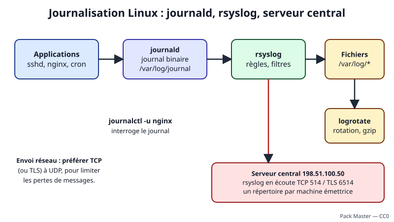
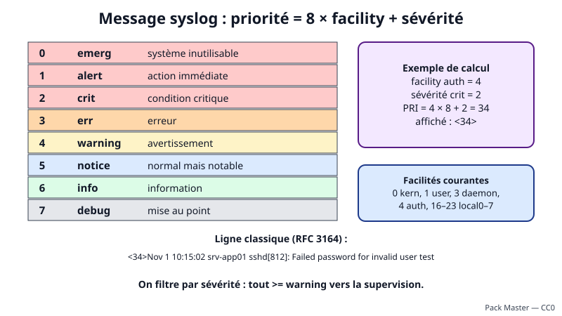
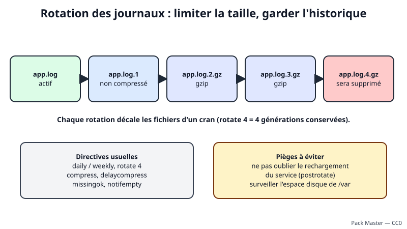
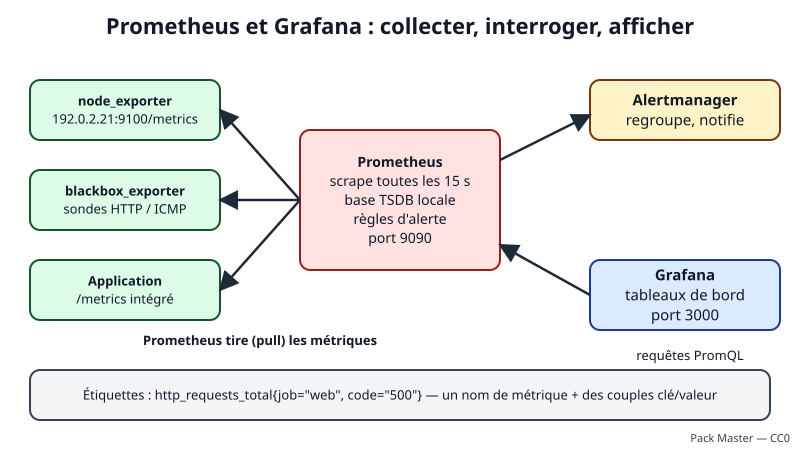

# Leçon — Journaux (syslog, journald, rotation, centralisation) et introduction à Prometheus + Grafana

- **Tags** : `transverse`, `tout-en-un`, `lecon`, `supervision`, `journaux`, `syslog`, `journald`, `rsyslog`, `logrotate`, `prometheus`, `grafana`, `promql`
- **Niveau** : intermédiaire (bases Linux)
- **Durée estimée** : 4 h (cours 1 h 30, mise en pratique 1 h 45, exercices et quiz 45 min)

---

## Objectifs pédagogiques

À la fin de cette leçon, vous saurez :

1. décoder un message **syslog** (facility, sévérité, [[Glossary:PRI]]) ;
2. interroger **journald** avec `journalctl` et régler sa persistance et sa taille ;
3. configurer **rsyslog** pour écrire des fichiers et relayer vers un serveur central ;
4. écrire une règle **logrotate** et la tester sans risque ;
5. expliquer le modèle **pull** de **Prometheus**, le rôle des **exporters** et des étiquettes ;
6. écrire des requêtes **PromQL** de base (`rate`, `sum by`, `predict_linear`) ;
7. construire un tableau de bord **Grafana** utile et sobre.

## Prérequis et durée

- Leçon « Principes de supervision et d'observabilité » ([voir la leçon](lecon-principes-supervision-observabilite.md)) ; la leçon « [[Glossary:SNMP]] et Zabbix » ([voir la leçon](lecon-snmp-zabbix.md)) est un plus.
- Une ou deux [[Glossary:VM]] Debian 12 **jetables**, snapshot préalable, accès console de secours, aucun lien avec la production.
- Durée : environ 4 h.

## L'essentiel en bref

- **syslog** normalise les messages : une **facility** (origine), une **sévérité** de 0 à 7, un texte ; `PRI = 8 × facility + sévérité`.
- **journald** collecte et indexe les journaux du système ; **rsyslog** les filtre, les écrit et les relaie ; **logrotate** limite la taille des fichiers.
- Centraliser les journaux protège contre l'effacement local et facilite la recherche ; préférez **[[Glossary:TCP]] ou [[Glossary:TLS]]** à [[Glossary:UDP]].
- **Prometheus** **tire** (*scrape*) des métriques exposées en [[Glossary:HTTP]] par des **exporters** et les interroge en **PromQL** ; **Grafana** les affiche.
- Un bon tableau de bord répond à **une question** et commence par les symptômes (erreurs, latence), pas par cinquante courbes.

---

## 1. syslog : le vocabulaire commun



*Figure 1 — Du processus au serveur central (schéma original du projet).*

**syslog** est à la fois un format de message et un protocole. La version historique est décrite par la RFC 3164 ; la RFC 5424 ajoute un horodatage précis, des données structurées et un identifiant de message ; la RFC 5426 définit le transport UDP, la RFC 6587 la trame TCP et la RFC 5425 le transport sécurisé par TLS.



*Figure 2 — Sévérités et calcul de la priorité (schéma original du projet).*

### 1.1 Facility, sévérité, PRI

Chaque message porte une **facility** (le type d'émetteur : `kern`, `user`, `daemon`, `auth`, `cron`, `local0` à `local7`…) et une **sévérité** de **0 (emerg)** à **7 (debug)**. Les deux sont combinées en un nombre, la **priorité** : `PRI = 8 × facility + sévérité`. Exemple : `auth` (4) et `crit` (2) donnent 4 × 8 + 2 = **34**, écrit `<34>` en tête du message.

Un message classique ressemble à : `Nov  1 10:15:02 srv-app01 sshd[812]: Failed password for invalid user test`. Il contient la date, le nom d'hôte, le programme avec son [[Glossary:PID]] et le texte. L'horodatage de la RFC 3164 n'a ni année ni fuseau : source d'erreurs, d'où l'intérêt de la RFC 5424 ou du format [[Glossary:JSON]].

### 1.2 Utiliser la sévérité

Transférez à la supervision **tout ce qui est ≥ warning** (sévérité ≤ 4), gardez `info` localement et limitez `debug` à des diagnostics temporaires : il gonfle les volumes et peut exposer des données sensibles.

---

## 2. journald et journalctl

**systemd-journald** reçoit les messages des services systemd, du noyau et du protocole syslog, et les stocke dans un **journal binaire indexé** avec des champs structurés (`_SYSTEMD_UNIT`, `_PID`, `PRIORITY`…). Avantages : recherche rapide, filtrage par service ou par priorité sans expression régulière, horodatage fiable. Inconvénient : on ne lit pas le fichier avec `cat` mais avec `journalctl`.

### 2.1 Commandes de lecture courantes

| Besoin | Commande |
|---|---|
| Journal du démarrage courant | `journalctl -b` |
| Démarrage précédent | `journalctl -b -1` |
| Un service | `journalctl -u ssh` |
| Erreurs et pires | `journalctl -p err` |
| Dernière heure | `journalctl --since "1 hour ago"` |
| Suivre en direct | `journalctl -f` |
| Sortie structurée | `journalctl -o json-pretty -n 1` |
| Espace occupé | `journalctl --disk-usage` |

### 2.2 Persistance et limites

Par défaut, selon la configuration, le journal peut être **volatil** (stocké dans `/run/log/journal`, perdu au redémarrage) ou **persistant** (`/var/log/journal`). Le paramètre `Storage=` de `/etc/systemd/journald.conf` (ou d'un fichier `.conf` de `/etc/systemd/journald.conf.d/`) tranche : `persistent`, `volatile` ou `auto`. Les limites principales : `SystemMaxUse=` (taille maximale), `MaxRetentionSec=` (âge maximal), `SystemKeepFree=` (espace à préserver). Nettoyage manuel : `journalctl --vacuum-size=200M` ou `--vacuum-time=2weeks`. Préférez un fichier de réglage dans `journald.conf.d/` à la modification du fichier principal.

### 2.3 journald et rsyslog cohabitent

journald est excellent pour la lecture locale, mais un fichier texte `/var/log/syslog` reste pratique pour les outils classiques, et **rsyslog** sait relayer vers un serveur distant avec des files d'attente robustes. Selon la distribution, rsyslog reçoit les messages soit par le socket syslog de journald, soit en lisant directement le journal : lisez la configuration livrée (`/etc/rsyslog.conf`) avant de la modifier.

---

## 3. rsyslog : filtrer, écrire, relayer

La configuration de **rsyslog** se trouve dans `/etc/rsyslog.conf` et `/etc/rsyslog.d/*.conf`. Une ligne de **sélecteur** historique associe `facility.sévérité` à une destination, par exemple `auth,authpriv.* /var/log/auth.log`. Les versions récentes autorisent le langage structuré (*RainerScript*), plus lisible pour les filtres complexes :

```text
if $syslogseverity <= 4 then {
    action(type="omfwd" target="198.51.100.50" port="514" protocol="tcp"
           queue.type="LinkedList" queue.filename="fwd_central"
           queue.maxDiskSpace="100m" queue.saveOnShutdown="on"
           action.resumeRetryCount="-1")
}
```

👉 Explication : exemple de configuration (pas une commande). Tout message de sévérité ≤ 4 (warning et plus grave) est envoyé en TCP vers le serveur central ; une **file d'attente sur disque** conserve les messages si le serveur est indisponible et les rejoue ensuite (`resumeRetryCount="-1"` : réessayer sans limite).

Autres notions utiles : les **modules** d'entrée (`imuxsock` pour le socket local, `imjournal` pour le journal, `imtcp` pour le réseau), les **modèles** (*templates*) qui fixent le format ou le chemin des fichiers, et les **rulesets** qui isolent le traitement d'une entrée précise. Après toute modification, **validez** la syntaxe (`rsyslogd -N1`) **avant** de redémarrer.

---

## 4. Rotation des journaux avec logrotate



*Figure 3 — Principe de la rotation (schéma original du projet).*

Un fichier de journal qui grossit sans limite finit par saturer le disque (et provoquer l'arrêt du service qui y écrit). **logrotate** renomme périodiquement les fichiers, les compresse et supprime les plus anciens. Sur Debian, il est lancé chaque jour par un minuteur systemd (`logrotate.timer`) ; la configuration est dans `/etc/logrotate.conf` et `/etc/logrotate.d/`.

### 4.1 Directives courantes

| Directive | Effet |
|---|---|
| `daily`, `weekly`, `monthly` | rythme de rotation |
| `rotate 4` | conserve 4 fichiers archivés |
| `maxsize 100M` | rotation anticipée si la taille est dépassée |
| `compress`, `delaycompress` | compresse (sauf la première archive, utile si le programme écrit encore dedans) |
| `missingok`, `notifempty` | pas d'erreur si absent, pas de rotation si vide |
| `create 0640 root adm` | recrée le fichier avec ces droits |
| `copytruncate` | copie puis vide le fichier d'origine (si le programme ne sait pas rouvrir son journal ; risque de perdre quelques lignes) |
| `postrotate … endscript` | commande exécutée après rotation (rechargement du service) |

### 4.2 Le piège du descripteur

Après un renommage, le programme continue d'écrire dans l'**ancien fichier** (il le tient ouvert) tant qu'on ne le prévient pas. D'où `postrotate` (signal ou rechargement du service) ou `copytruncate`. Sans cela, le nouveau fichier reste vide et l'ancien grossit sous un autre nom. Testez toujours avec `logrotate -d` (simulation) avant `logrotate -f` (forçage). L'état se lit dans `/var/lib/logrotate/status`.

---

## 5. Centraliser les journaux

### 5.1 Pourquoi

Un intrus efface les journaux de la machine compromise : la copie distante subsiste (**intégrité**). On corrèle plusieurs machines au même endroit (**recherche**), on applique une politique de **conservation** commune et on analyse même si la source est arrêtée (**disponibilité**).

### 5.2 Transport : UDP, TCP ou TLS

| Transport | Avantage | Limite |
|---|---|---|
| UDP 514 | simple, léger | aucun accusé, pertes silencieuses, adresse source falsifiable |
| TCP 514 | accusé de transport, files d'attente possibles | contenu en clair |
| TLS (souvent TCP 6514) | confidentialité, authentification des deux extrémités | gestion des certificats |

Pour des journaux d'authentification ou contenant des données personnelles, utilisez **TLS** (module `gtls` de rsyslog, documenté dans l'aide officielle). Sinon, au minimum TCP, depuis un réseau d'administration, avec un pare-feu qui n'autorise que les émetteurs attendus.

### 5.3 Organisation côté serveur

Un répertoire par machine et par programme (`/var/log/central/<hôte>/<programme>.log`) simplifie la recherche et la rotation. Prévoyez : espace disque dédié et surveillé, droits restreints (les journaux contiennent des adresses, identifiants, parfois des données personnelles : appliquez la politique de conservation applicable, notamment le [[Glossary:RGPD]]), horloges synchronisées par [[Glossary:NTP]], et rotation du répertoire central. Pour les volumes importants ou la recherche avancée, des outils comme Loki, Graylog ou OpenSearch prennent le relais ; les principes ci-dessus restent valables.

---

## 6. Prometheus : le modèle



*Figure 4 — Architecture Prometheus et Grafana (schéma original du projet).*

**Prometheus** est une base de **séries temporelles** et un système d'alerte, conçu pour les environnements dynamiques. Principes :

- **Modèle pull** : c'est Prometheus qui interroge périodiquement (*scrape*, par défaut toutes les 15 s à 1 min) l'adresse `/metrics` de chaque cible. Une cible muette est immédiatement visible : la métrique `up` vaut 0.
- **Exporters** : petits programmes qui traduisent l'état d'un système en métriques HTTP : `node_exporter` (machine Linux), `blackbox_exporter` (sondes HTTP, [[Glossary:DNS]], [[Glossary:ICMP]]), exporters de bases de données. Une application peut aussi exposer elle-même `/metrics`.
- **Étiquettes (labels)** : chaque série est un nom plus des couples clé/valeur, par exemple `node_filesystem_avail_bytes{instance="srv-app01:9100",mountpoint="/"}`. Elles permettent d'agréger, filtrer, regrouper.
- **Quatre types** : *counter* (cumulatif, nom terminé par `_total`), *gauge* (jauge), *histogram* (répartition en seaux `_bucket`) et *summary*.
- **Stockage local** (TSDB) avec une rétention courte par défaut (15 jours) ; pour le long terme, un stockage distant ou un autre outil.

**Sécurité** : `/metrics` peut révéler la version des logiciels et la topologie. Écoutez sur l'interface locale ou le réseau d'administration, placez un proxy inverse avec authentification et TLS si nécessaire, et n'exposez jamais `node_exporter` sur Internet.

### 6.1 Configuration minimale

```yaml
global:
  scrape_interval: 15s
scrape_configs:
  - job_name: node
    static_configs:
      - targets: ['127.0.0.1:9100']
```

👉 Explication : exemple de fichier `prometheus.yml` (pas une commande) : un travail (`job`) nommé `node`, une cible, une collecte toutes les 15 secondes. Prometheus ajoute automatiquement les étiquettes `job` et `instance`.

---

## 7. PromQL : les bases

**PromQL** est le langage de requête. Deux notions : un **vecteur instantané** (une valeur par série, à l'instant présent : `node_load1`) et un **vecteur d'intervalle** (les valeurs sur une durée : `node_cpu_seconds_total[5m]`), consommé par des fonctions comme `rate()`.

### 7.1 Sélecteurs et opérateurs

- `up` : toutes les séries `up` (1 = cible joignable).
- `node_filesystem_avail_bytes{mountpoint="/"}` : filtre par étiquette ; opérateurs `=`, `!=`, `=~` (expression régulière), `!~`.
- Arithmétique entre séries (`/`, `*`, `-`) et comparaisons (`> 0.9`), qui filtrent.

### 7.2 Compteurs : `rate` et `increase`

Un compteur n'a de sens que par sa vitesse. `rate(x[5m])` donne la variation moyenne **par seconde** sur 5 minutes ; `increase(x[1h])` donne l'augmentation sur une heure. Choisissez une fenêtre d'au moins **quatre fois** l'intervalle de collecte.

### 7.3 Agrégation

`sum`, `avg`, `min`, `max`, `count`, `topk` se combinent avec `by (étiquette)` (on garde ces étiquettes) ou `without (étiquette)` (on les retire).

### 7.4 Requêtes de référence

| Question | PromQL |
|---|---|
| Cibles hors service | `up == 0` |
| [[Glossary:CPU]] utilisé (%) | `100 - avg by (instance) (rate(node_cpu_seconds_total{mode="idle"}[5m])) * 100` |
| Mémoire utilisée (%) | `(1 - node_memory_MemAvailable_bytes / node_memory_MemTotal_bytes) * 100` |
| Disque `/` occupé (%) | `(1 - node_filesystem_avail_bytes{mountpoint="/"} / node_filesystem_size_bytes{mountpoint="/"}) * 100` |
| Trafic réseau sortant (bit/s) | `rate(node_network_transmit_bytes_total{device!="lo"}[5m]) * 8` |
| Disque plein dans moins de 24 h | `predict_linear(node_filesystem_avail_bytes{mountpoint="/"}[6h], 24*3600) < 0` |
| Latence p95 (si histogramme) | `histogram_quantile(0.95, sum by (le) (rate(http_request_duration_seconds_bucket[5m])))` |
| Taux d'erreurs HTTP (%) | `100 * sum(rate(http_requests_total{code=~"5.."}[5m])) / sum(rate(http_requests_total[5m]))` |

Les noms exacts dépendent des exporters et de leurs versions : vérifiez-les dans l'explorateur de métriques de Prometheus.

### 7.5 Règles d'alerte

Une **règle d'alerte** est une expression PromQL accompagnée d'une durée `for` (la durée de confirmation de la leçon sur les principes) et d'étiquettes de gravité :

```yaml
groups:
  - name: lab
    rules:
      - alert: DisqueRacineAPleinSous24h
        expr: predict_linear(node_filesystem_avail_bytes{mountpoint="/"}[6h], 24*3600) < 0
        for: 30m
        labels:
          severity: warning
        annotations:
          summary: "{{ $labels.instance }} : / sera plein dans moins de 24 h"
```

👉 Explication : exemple de fichier de règles (pas une commande). L'alerte naît si la tendance des 6 dernières heures prévoit un disque plein sous 24 h, de façon continue pendant 30 minutes. **Alertmanager** regroupe, déduplique, route et met en sourdine ces alertes vers courriel ou messagerie, et gère les inhibitions (comme les dépendances de Zabbix).

---

## 8. Grafana : des tableaux de bord utiles

**Grafana** est un outil de visualisation. Il ne stocke pas les métriques : il interroge des **sources de données** (Prometheus, Loki, bases [[Glossary:SQL]]…).

1. **Source de données** : déclarer Prometheus (URL, par exemple `http://127.0.0.1:9090`), tester.
2. **Tableau de bord** : un ensemble de **panneaux**. Types fréquents : série temporelle (tendance), *Stat* (valeur actuelle), *Gauge* (jauge avec seuils colorés), tableau, journaux.
3. **Variables** : une liste déroulante (`instance`) rend un tableau de bord réutilisable pour tous les hôtes.
4. **Seuils et unités** : réglez l'unité (octets, pourcentage, secondes) et les couleurs de seuil.
5. **Import** : de nombreux tableaux communautaires existent (par exemple pour `node_exporter`) ; relisez-les, supprimez ce que vous ne comprenez pas.

**Bonnes pratiques** : un tableau = une question (« la plateforme web va-t-elle bien ? ») ; en haut les symptômes (erreurs, latence, saturation), en bas le détail ; peu de panneaux (une dizaine) ; mêmes axes et unités ; chaque panneau a un titre explicite et, si utile, une description ; versionnez le JSON du tableau. Grafana sait aussi émettre des alertes, mais gardez **un seul** endroit de définition des alertes (Prometheus/Alertmanager **ou** Grafana) pour éviter les doublons. Sécurité : changez le mot de passe administrateur initial, créez des comptes nominatifs avec le rôle minimal, ne publiez pas de tableau anonyme, limitez l'écoute au réseau d'administration.

---

## Mise en pratique guidée

**Cadre de sécurité** : VM Debian 12 **jetable** (deux VM pour la centralisation : un « client » `198.51.100.21` et un « serveur central » `198.51.100.50`, adresses de documentation à adapter à votre réseau de laboratoire isolé). **Snapshot** avant de commencer, **accès console** de secours, **retour arrière** décrit en fin de section. Aucune étape ne touche une machine de production.

### Partie A — journald, logger, logrotate (sur une VM)

```bash
journalctl --disk-usage; ls -d /var/log/journal 2>/dev/null; journalctl -p err -b --no-pager | tail -n 5
```

👉 Explication : affiche l'espace occupé par le journal, indique si le stockage persistant existe, puis les cinq dernières erreurs du démarrage courant (lecture seule).

```bash
logger -p user.notice -t lab-lecon "message de test depuis la lecon"; journalctl -t lab-lecon -n 2 --no-pager
```

👉 Explication : émet un message syslog avec la facility `user` et la sévérité `notice`, puis le retrouve dans le journal grâce à son identifiant (`-t`).

```bash
sudo mkdir -p /etc/systemd/journald.conf.d
printf '[Journal]\nStorage=persistent\nSystemMaxUse=200M\nMaxRetentionSec=1month\n' | sudo tee /etc/systemd/journald.conf.d/90-lab.conf
sudo systemctl restart systemd-journald && journalctl --disk-usage
```

👉 Explication : crée un fichier de réglage qui rend le journal persistant, plafonne sa taille à 200 Mo et sa durée à un mois, puis recharge journald. Le retour arrière consiste à supprimer ce fichier et à relancer journald.

```bash
sudo install -d /var/log/lab-app && printf 'ligne 1\nligne 2\n' | sudo tee /var/log/lab-app/app.log
sudo tee /etc/logrotate.d/lab-app >/dev/null <<'EOF'
/var/log/lab-app/*.log {
    daily
    rotate 4
    missingok
    notifempty
    compress
    delaycompress
    create 0640 root adm
}
EOF
```

👉 Explication : crée un journal de test et une règle de rotation quotidienne avec quatre archives, compression différée et recréation du fichier avec des droits restreints.

```bash
sudo logrotate -d /etc/logrotate.d/lab-app && sudo logrotate -f /etc/logrotate.d/lab-app && ls -l /var/log/lab-app
```

👉 Explication : `-d` simule et décrit ce qui serait fait sans rien modifier ; `-f` force ensuite une rotation pour l'observer. On doit voir `app.log` (vide, recréé) et `app.log.1` (contenu précédent).

### Partie B — centralisation avec rsyslog (deux VM)

Sur le **serveur central** :

```bash
sudo apt update && sudo apt install -y rsyslog && sudo install -d -m 750 -o syslog -g adm /var/log/central
sudo tee /etc/rsyslog.d/10-central.conf >/dev/null <<'EOF'
module(load="imtcp")
template(name="PerHost" type="string" string="/var/log/central/%HOSTNAME%/%PROGRAMNAME%.log")
ruleset(name="central") {
    action(type="omfile" dynaFile="PerHost" fileCreateMode="0640")
}
input(type="imtcp" port="514" ruleset="central")
EOF
sudo rsyslogd -N1 && sudo systemctl restart rsyslog && ss -tln | grep ':514'
```

👉 Explication : installe rsyslog, prépare un répertoire dédié, déclare une réception TCP sur le port 514 liée à un ruleset qui écrit un fichier par hôte et par programme, valide la syntaxe, redémarre et vérifie l'écoute. Dans le pare-feu de la VM, n'autorisez le port 514/TCP que depuis `198.51.100.21`.

Sur le **client** :

```bash
sudo tee /etc/rsyslog.d/90-forward.conf >/dev/null <<'EOF'
if $syslogseverity <= 4 then {
    action(type="omfwd" target="198.51.100.50" port="514" protocol="tcp"
           queue.type="LinkedList" queue.filename="fwd_central"
           queue.maxDiskSpace="100m" queue.saveOnShutdown="on"
           action.resumeRetryCount="-1")
}
EOF
sudo rsyslogd -N1 && sudo systemctl restart rsyslog
logger -p user.warning -t lab-central "test de centralisation"
```

👉 Explication : relaie en TCP vers le serveur central tout message de sévérité warning ou plus grave, avec une file d'attente sur disque, valide et recharge la configuration, puis émet un message d'essai de niveau `warning`.

Sur le **serveur central** :

```bash
sudo find /var/log/central -name 'lab-central.log' -exec tail -n 3 {} \;
```

👉 Explication : doit afficher le message de test reçu du client. Si rien n'apparaît, voir le dépannage ; coupez ensuite le serveur central, émettez un message depuis le client, rallumez le serveur et constatez que la file d'attente rejoue le message.

### Partie C — Prometheus, node_exporter, Grafana (une VM, en local)

```bash
sudo apt install -y prometheus prometheus-node-exporter
sudo sed -i 's|^ARGS=.*|ARGS="--web.listen-address=127.0.0.1:9100"|' /etc/default/prometheus-node-exporter
sudo sed -i 's|^ARGS=.*|ARGS="--web.listen-address=127.0.0.1:9090"|' /etc/default/prometheus
sudo systemctl restart prometheus-node-exporter prometheus
```

👉 Explication : installe Prometheus et l'exporteur système depuis les dépôts Debian, puis force leur écoute sur la boucle locale uniquement (le réglage `ARGS` est lu par les services). Vérifiez les fichiers avec `cat` après la commande : si la ligne `ARGS` n'existe pas, ajoutez-la.

```bash
curl -s http://127.0.0.1:9100/metrics | grep -m3 '^node_load'
promtool check config /etc/prometheus/prometheus.yml
curl -s -G http://127.0.0.1:9090/api/v1/query --data-urlencode 'query=up'
```

👉 Explication : lit quelques métriques brutes de l'exporteur, valide la configuration Prometheus puis exécute la requête `up` par l'[[Glossary:API]] HTTP ; la réponse doit montrer `"value":[…,"1"]` pour les cibles joignables.

Installez ensuite Grafana depuis son **dépôt officiel** en suivant la page d'installation Debian de Grafana (clé de signature, fichier de dépôt, puis `sudo apt install grafana`), activez le service (`sudo systemctl enable --now grafana-server`), et dans `/etc/grafana/grafana.ini` réglez `http_addr = 127.0.0.1` dans la section `[server]`.

À l'interface (`http://127.0.0.1:3000`) : changez immédiatement le mot de passe administrateur initial ; ajoutez la source Prometheus (`http://127.0.0.1:9090`) puis *Save & test* ; créez un tableau avec trois panneaux : *Stat* « Cibles hors service » (`count(up == 0) or vector(0)`), série temporelle « CPU % » et *Gauge* « Disque / % » (requêtes du §7.4). Ajoutez une variable `instance` et un titre explicite par panneau.

### Retour arrière

```bash
sudo rm -f /etc/systemd/journald.conf.d/90-lab.conf /etc/logrotate.d/lab-app /etc/rsyslog.d/90-forward.conf /etc/rsyslog.d/10-central.conf
sudo rm -rf /var/log/lab-app
sudo systemctl restart systemd-journald rsyslog
sudo systemctl disable --now prometheus prometheus-node-exporter grafana-server
```

👉 Explication : supprime les fichiers de réglage du laboratoire et le journal de test, recharge les services et arrête Prometheus, l'exporteur et Grafana. Pour un retour intégral (paquets, répertoire `/var/log/central`), restaurez le snapshot de la VM.

---

## Exercices

1. Calculez le PRI d'un message `daemon` (3) de sévérité `err` (3). Quel PRI pour `local0` (16) en `info` (6) ?
2. Écrivez la commande `journalctl` qui affiche les erreurs (et plus graves) du service `ssh` depuis hier.
3. Pourquoi UDP est-il déconseillé pour centraliser des journaux d'authentification ? Proposez deux alternatives.
4. Après une rotation, une application continue d'écrire dans `app.log.1`. Expliquez et donnez deux remèdes.
5. Écrivez une règle logrotate : journaux `/var/log/shop/*.log`, hebdomadaire, 8 archives, compressés, sans erreur si absents.
6. Que signifie `up == 0` et pourquoi est-ce utile dans le modèle pull ?
7. Écrivez la requête PromQL de la mémoire utilisée en pourcentage pour une instance donnée.
8. Proposez la structure d'un tableau de bord « santé d'un serveur web » en cinq panneaux.

## Corrigés des exercices

1. 3 × 8 + 3 = **27** ; 16 × 8 + 6 = **134**.
2. `journalctl -u ssh -p err --since yesterday`.
3. UDP n'accuse pas réception, perd des messages sans bruit et accepte des adresses sources falsifiées. Alternatives : **TCP** avec file d'attente sur disque, ou **TLS** (voire un agent de collecte avec accusés de réception).
4. Le programme tient le fichier **ouvert** : le renommage ne change pas son descripteur. Remèdes : `postrotate` qui recharge ou signale le service ; ou `copytruncate`.
5. `/var/log/shop/*.log { weekly rotate 8 compress missingok }` (on ajoutera `notifempty` et `create` si besoin).
6. La cible n'a pas répondu au dernier scrape (valeur 0) : le silence est visible alors qu'en mode passif il serait ambigu.
7. `(1 - node_memory_MemAvailable_bytes{instance="srv-app01:9100"} / node_memory_MemTotal_bytes{instance="srv-app01:9100"}) * 100`.
8. Exemple : taux d'erreurs 5xx, latence p95, requêtes par seconde, CPU/mémoire (saturation), disque libre avec prévision.

---

## Quiz

**1. Quel est le PRI d'un message `auth` (4) de sévérité `crit` (2) ?** a) 6. b) 34. c) 42. d) 24.
> **Réponse : b.** 4 × 8 + 2 = 34.

**2. Quelle sévérité syslog est la plus grave ?** a) 0 (emerg). b) 3 (err). c) 7 (debug). d) 4 (warning).
> **Réponse : a.** Plus le nombre est petit, plus c'est grave.

**3. Que fait `journalctl -b -1` ?** a) Dernière ligne du journal. b) Journal du démarrage précédent. c) Supprime un fichier. d) Suit en direct.
> **Réponse : b.** `-b` choisit un démarrage, `-1` le précédent.

**4. Quel réglage limite la taille du journal persistant ?** a) `SystemMaxUse=`. b) `rotate 4`. c) `scrape_interval`. d) `queue.type`.
> **Réponse : a.** C'est un paramètre de `journald.conf`.

**5. Pourquoi `postrotate` ou `copytruncate` ?** a) Compresser plus vite. b) Que le programme écrive dans le nouveau fichier. c) Changer le fuseau. d) Chiffrer.
> **Réponse : b.** Sinon il continue d'écrire dans l'ancien descripteur.

**6. Transport le plus adapté aux journaux sensibles ?** a) UDP. b) TCP en clair. c) TLS. d) ICMP.
> **Réponse : c.** TLS offre confidentialité et authentification.

**7. Dans le modèle de Prometheus, qui initie la collecte ?** a) L'exporter. b) Prometheus (pull). c) Grafana. d) L'utilisateur.
> **Réponse : b.** Prometheus interroge périodiquement `/metrics`.

**8. Pour un compteur cumulatif, quelle fonction donne la vitesse par seconde ?** a) `sum()`. b) `rate()`. c) `up`. d) `topk()`.
> **Réponse : b.** `rate(x[5m])` calcule la moyenne par seconde.

**9. Rôle de Grafana ?** a) Stocker les métriques. b) Visualiser des données issues de sources. c) Collecter les journaux système. d) Remplacer rsyslog.
> **Réponse : b.** Il interroge des sources de données.

**10. Bonne pratique de tableau de bord ?** a) Cinquante panneaux. b) Une question, symptômes en haut. c) Tout en rouge. d) Sans titres.
> **Réponse : b.** Un tableau lisible répond à une question précise.

---

## Erreurs fréquentes et dépannage

| Symptôme | Cause probable | Remède |
|---|---|---|
| `journalctl` vide après redémarrage | Journal volatil | `Storage=persistent`, créer `/var/log/journal`, redémarrer journald |
| Rien n'arrive sur le serveur central | Pare-feu, port, `imtcp` non chargé, mauvaise cible | `ss -tln`, `rsyslogd -N1`, règles réseau, test avec `logger` |
| Message perdu pendant une coupure | UDP ou pas de file d'attente | TCP + `queue.*` |
| Fichiers aux heures décalées | Fuseau ou NTP | `timedatectl`, chrony |
| `logrotate` ne tourne pas | Erreur de syntaxe, droits du dossier | `logrotate -d`, journal de `logrotate.service` |
| Nouveau fichier vide après rotation | Programme non averti | `postrotate` ou `copytruncate` |
| Disque `/var` plein | Rétention trop longue, rotation absente | `journalctl --vacuum-size`, revoir `rotate`, `maxsize` |
| `up` vaut 0 | Exporter arrêté, mauvais port, pare-feu | `curl http://cible:9100/metrics`, page *Targets* de Prometheus |
| Graphique vide dans Grafana | Mauvaise source, requête, fenêtre ou métrique inexistante | *Explore*, tester la requête dans Prometheus |
| `rate()` renvoie rien | Fenêtre trop courte (< 2 points) | Fenêtre ≥ 4 × intervalle |
| Trop de séries (cardinalité) | Étiquette à valeurs illimitées (identifiant, URL complète) | Supprimer ou regrouper l'étiquette |

---

## À retenir

- syslog : facility + sévérité, **PRI = 8 × facility + sévérité** ; 0 est le plus grave.
- **journald** pour la lecture locale (`journalctl`) ; réglez `Storage`, `SystemMaxUse`, `MaxRetentionSec`.
- **rsyslog** filtre et relaie avec **file d'attente** ; validez avec `rsyslogd -N1`.
- **logrotate** : testez avec `-d`, prévoyez `postrotate` ou `copytruncate`, surveillez `/var`.
- Centralisez en **TCP ou TLS**, avec droits restreints, NTP et politique de conservation.
- Prometheus **tire** les métriques ; **PromQL** : `rate`, `sum by`, `predict_linear` ; alertes avec `for`.
- Grafana : un tableau, une question ; une seule source de définition des alertes.

## Pour aller plus loin

- RFC 5424 (protocole syslog) : <https://www.rfc-editor.org/rfc/rfc5424>
- RFC 5425 (syslog sur TLS) : <https://www.rfc-editor.org/rfc/rfc5425>
- systemd-journald et journald.conf : <https://www.freedesktop.org/software/systemd/man/latest/journald.conf.html>
- Documentation rsyslog : <https://www.rsyslog.com/doc/>
- Page de manuel logrotate : <https://man7.org/linux/man-pages/man8/logrotate.8.html>
- Documentation Prometheus : <https://prometheus.io/docs/introduction/overview/>
- Documentation Grafana : <https://grafana.com/docs/grafana/latest/>

## Crédits des images

| Fichier | Source | Auteur | Licence | Modifications |
|---|---|---|---|---|
| `images/journaux-prometheus-grafana-1.svg` | Création originale | Projet Pack Master | CC0 — <https://creativecommons.org/publicdomain/zero/1.0/deed.fr> | Aucune |
| `images/journaux-prometheus-grafana-2.svg` | Création originale | Projet Pack Master | CC0 | Aucune |
| `images/journaux-prometheus-grafana-3.svg` | Création originale | Projet Pack Master | CC0 | Aucune |
| `images/journaux-prometheus-grafana-4.svg` | Création originale | Projet Pack Master | CC0 | Aucune |

Création originale du projet Pack Master, dédiée au domaine public (CC0). Les images libres de Wikimedia Commons trouvées sur syslog étaient soit en langue étrangère, soit des icônes d'équipementier : elles n'ont pas été retenues.

## Historique de vérification

| Date | OS/logiciel | Testeur | Verdict |
|---|---|---|---|
| 2026-11-01 | Debian 12, rsyslog, journald, logrotate, Prometheus, Grafana | Rédaction assistée | Non testé sur plateforme cible |
