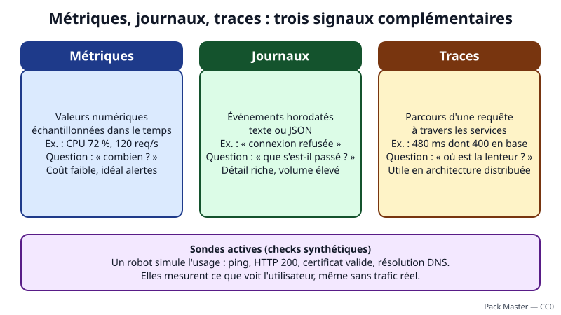
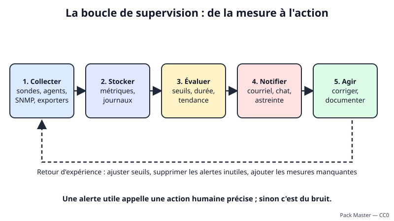
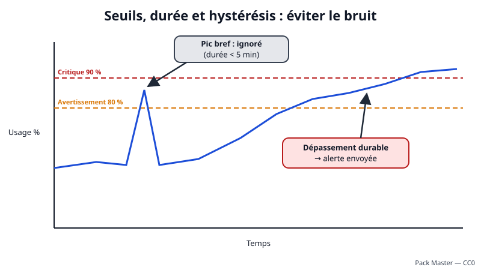
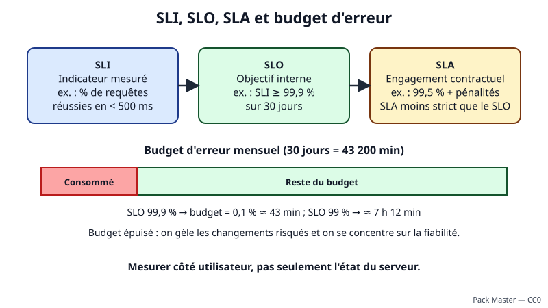

# Leçon — Principes de supervision et d'observabilité

- **Tags** : `transverse`, `tout-en-un`, `lecon`, `supervision`, `observabilite`, `metriques`, `journaux`, `traces`, `alertes`, `slo`
- **Niveau** : débutant à intermédiaire (administration système et réseau)
- **Durée estimée** : 3 h 30 (cours 1 h 45, mise en pratique 1 h 15, exercices et quiz 30 min)

---

## Objectifs pédagogiques

À la fin de cette leçon, vous saurez :

1. distinguer **supervision** et **observabilité** ;
2. choisir entre **métriques**, **journaux** et **traces** selon la question posée ;
3. différencier sondes actives et passives, approche boîte noire et boîte blanche ;
4. régler des **seuils** avec durée de confirmation et hystérésis ;
5. concevoir une **alerte utile** et réduire le **bruit** ;
6. définir **SLI**, **[[Glossary:SLO]]**, **[[Glossary:SLA]]** et calculer un **budget d'erreur** ;
7. écrire et tester une sonde shell aux codes de sortie 0/1/2/3.

## Prérequis et durée

- Savoir ouvrir un terminal Linux et lire un fichier (`cat`, `less`), connaître les notions de processus, de service et de port réseau.
- Avoir une machine virtuelle Debian ou Ubuntu **jetable** (laboratoire), avec un snapshot préalable. Aucun accès à un réseau de production n'est nécessaire.
- Durée totale : environ 3 h 30.

## L'essentiel en bref

- **Superviser**, c'est mesurer en continu et être prévenu **avant** l'utilisateur.
- Trois signaux se complètent : **métriques** (combien ?), **journaux** (que s'est-il passé ?), **traces** (où le temps est-il perdu ?).
- Une alerte n'est utile que si quelqu'un peut et doit agir tout de suite ; le reste est du **bruit**.
- Un seuil s'associe à une **durée** et à une marge de retour à la normale.
- Un **SLO** formalise l'objectif ; le **budget d'erreur** en découle.
- La supervision se supervise elle-même.

---

## 1. Pourquoi superviser ? De la surveillance à l'observabilité

Dans une voiture, le tableau de bord affiche vitesse, température et carburant : quand un voyant s'allume, on sait qu'il y a un problème, pas lequel. Le garagiste branche une valise de diagnostic pour chercher la **cause**. En informatique :

- la **supervision** (monitoring) répond à des questions **connues à l'avance** : le serveur répond-il au ping ? le disque dépasse-t-il 90 % ? le site renvoie-t-il un code 200 ? ;
- l'**observabilité** permet de répondre à des questions **imprévues** en explorant les données émises par le système (« pourquoi les paiements sont-ils lents, uniquement pour ce site, depuis 14 h ? »). Un système est observable quand ses métriques, journaux et traces suffisent à comprendre son comportement sans modifier le code en urgence.

La supervision est la **première ligne** (détecter), l'observabilité la **seconde** (diagnostiquer). On commence par la supervision de base, puis on enrichit à mesure que l'architecture se complexifie (conteneurs, microservices, dépendances externes).

### Ce que l'on gagne, et ce que l'on ne gagne pas

On gagne une **détection précoce**, un **rétablissement plus rapide**, une **preuve historique** et des données de **dimensionnement**. On ne remplace ni la sauvegarde, ni la sécurité, ni l'astreinte, et une supervision mal réglée devient nuisible : trop d'alertes inutiles et l'équipe ignore les vraies.

---

## 2. Les trois signaux : métriques, journaux, traces



*Figure 1 — Les trois signaux de l'observabilité et les sondes actives (schéma original du projet).*

### 2.1 Les métriques : « combien ? »

Une **métrique** est une valeur numérique mesurée à intervalles réguliers (taux de processeur, octets reçus, requêtes par seconde) ; stockée dans le temps, elle forme une **série temporelle**. Trois formes dominent : la **jauge** (valeur qui monte et descend, comme la mémoire libre), le **compteur** (valeur qui ne fait qu'augmenter, dont on étudie la **variation par seconde**) et l'**histogramme** (répartition de durées, qui permet de calculer un percentile). Les métriques sont compactes et idéales pour les courbes et les alertes, mais une valeur agrégée ne dit pas **quelle** requête est en cause. *Analogie : le compteur kilométrique et le thermomètre de la voiture.*

### 2.2 Les journaux : « que s'est-il passé ? »

Un **journal** (log) est un enregistrement horodaté d'un **événement** : connexion refusée, erreur applicative, démarrage d'un service. Il est écrit en texte libre ou en [[Glossary:JSON]] structuré. Il est riche en détails mais volumineux, coûteux à conserver et difficile à analyser sans outil de recherche. La troisième leçon de ce parcours approfondit syslog, journald et la centralisation.

### 2.3 Les traces : « par où la requête est-elle passée ? »

Dans une application répartie, une action de l'utilisateur déclenche une chaîne d'appels (portail, [[Glossary:API]], base, authentification). Une **trace** suit la requête de bout en bout ; chaque étape chronométrée est un **span**. On voit ainsi que sur 480 ms, 400 ont été passées dans la base. Les traces exigent d'**instrumenter** le code (par exemple avec OpenTelemetry) et servent surtout aux architectures distribuées ; pour un serveur de fichiers, métriques et journaux suffisent.

### 2.4 Comment les combiner

Une **métrique** (taux de 5xx) déclenche l'alerte ; le tableau de bord isole le service « facturation » ; ses **journaux** indiquent « trop de connexions à la base » ; une **trace** confirme l'attente dans le pool de connexions. Les pivots sont l'**identifiant de corrélation** (présent dans journaux et traces) et l'**heure** : toutes les machines doivent suivre une horloge fiable ([[Glossary:NTP]]).

---

## 3. Les sondes : comment obtenir les données

Une **sonde** est un petit programme ou une fonction qui effectue une mesure et en renvoie le résultat. Plusieurs classements existent.

### 3.1 Active ou passive

Une sonde **active** (synthétique) simule un utilisateur à intervalle fixe : ping, requête [[Glossary:HTTP]], vérification de certificat, résolution [[Glossary:DNS]]. Elle détecte une panne **même sans trafic réel** (la nuit) mais ne teste que le scénario programmé. Une collecte **passive** observe l'usage réel (journaux, traces, compteurs, messages spontanés) mais son silence est ambigu : « tout va bien » ou « l'émetteur est mort » ? Combinez les deux et ajoutez un test de **silence anormal** (« aucune donnée depuis 10 minutes »).

### 3.2 Boîte noire ou boîte blanche

En **boîte noire**, on teste de l'extérieur comme un client (« la page répond-elle en moins de 2 s ? ») : cela mesure ce que **vit l'utilisateur**. En **boîte blanche**, on lit des mesures internes (longueur de file, taux de succès du cache) : cela aide à **comprendre**. Règle pratique : **alerter** sur les symptômes vus de l'extérieur, **diagnostiquer** avec les mesures internes.

### 3.3 Agent ou sans agent

Un **agent** est un logiciel installé sur la machine supervisée ; sans agent, on utilise des protocoles déjà présents ([[Glossary:SNMP]], [[Glossary:SSH]], API HTTP, [[Glossary:ICMP]]). L'agent est plus riche mais doit être déployé et sécurisé (voir la leçon SNMP et Zabbix).

### 3.4 Que mesurer ? Signaux d'or, USE et RED

Trois grilles évitent de se perdre. Les **quatre signaux d'or** d'un service : **latence**, **trafic**, **erreurs**, **saturation**. La méthode **USE** pour une ressource (processeur, mémoire, disque, réseau) : **Utilisation**, **Saturation**, **Erreurs**. La méthode **RED** pour un service : **Rate** (débit), **Errors**, **Duration**. Pour un serveur web : requêtes/s, taux de 5xx, durée au 95ᵉ percentile ; pour son disque : occupation, temps d'attente, erreurs matérielles.

### 3.5 Quatre étages à couvrir

Superviser l'**infrastructure** (alimentation, réseau), le **système** (processeur, mémoire, disque, services), l'**application** (processus, port, taux d'erreurs) et le **métier** (commandes par minute, sauvegarde réussie). Si l'on s'arrête au système, on saura que le serveur est « vivant » alors que la caisse du magasin ne peut plus encaisser.

---

## 4. La boucle de supervision



*Figure 2 — De la mesure à l'action, avec boucle d'amélioration (schéma original du projet).*

Quel que soit l'outil (Zabbix, Prometheus, Nagios, Centreon, Checkmk…), on retrouve cinq étapes : **collecter** (sondes, agents, SNMP, exporters, journaux) ; **stocker** (base de séries temporelles, espace de recherche, avec une **rétention** qui est un choix de coût, par exemple 15 jours en résolution fine et 13 mois en moyennes horaires) ; **évaluer** par seuils ou tendances ; **notifier** (courriel, messagerie, astreinte selon l'urgence) ; **agir**, puis consigner la cause. La flèche de retour est la plus importante : après chaque incident, l'alerte est-elle arrivée à temps, a-t-elle été comprise, une mesure manquait-elle ?

### 4.1 Fréquence de collecte et piège des moyennes

Un compromis courant : **15 à 60 secondes** pour les métriques d'infrastructure, **1 à 5 minutes** pour les vérifications lourdes ou distantes. L'intervalle doit être plus court que la durée de confirmation de l'alerte. Une latence moyenne de 200 ms peut cacher 5 % de requêtes à 4 s : on préfère les **percentiles** (p95, p99), calculés à partir d'un histogramme ou de mesures brutes, jamais en moyennant des percentiles.

---

## 5. Les seuils : fixer, confirmer, assouplir



*Figure 3 — Seuils, durée de confirmation : ignorer les pics brefs, alerter sur les dépassements durables (schéma original du projet).*

Un **seuil** est la valeur à partir de laquelle un état change (de « normal » à « problème »). Mal choisi, il est la première source de bruit.

### 5.1 Types de seuils

Un seuil **statique** (« disque > 85 % ») est simple et convient aux limites physiques. Un seuil **relatif** compare à l'habitude (« trafic deux fois plus faible que la semaine dernière à la même heure »). Un seuil **prédictif** projette la tendance (« disque plein dans 4 jours ») : l'alerte arrive quand on a encore le temps d'agir.

### 5.2 Durée de confirmation et hystérésis

Un processeur à 100 % pendant 20 secondes est normal ; pendant 15 minutes, c'est un problème : on écrit « moyenne > 90 % **sur 10 minutes** ». La durée filtre les pics au prix d'un délai : courte pour une panne brutale, longue pour un phénomène progressif. Si la valeur oscille entre 79 et 81 % autour d'un seuil de 80 %, l'alerte s'ouvre et se ferme sans cesse : c'est le **flapping**. L'**hystérésis** l'évite : le problème s'ouvre à 80 % et ne se résout qu'après retour sous 75 % ou après N relevés sous le seuil. Beaucoup d'outils distinguent une **expression de problème** et une **expression de rétablissement**.

### 5.3 Deux niveaux valent mieux qu'un

Un seuil d'**avertissement** (80 %) déclenche une action en heures ouvrées (courriel, ticket) ; un seuil **critique** (90 %) exige une action immédiate (astreinte). Chaque niveau a ainsi un sens.

### 5.4 Choisir une valeur de départ

Observez le comportement normal une à deux semaines, fixez le seuil au-dessus avec une marge, puis **simulez** : combien d'alertes aurait-il produites sur 30 jours ? Quatre cents, c'est trop ; zéro alors qu'un incident a eu lieu, c'est trop lâche. Documentez la raison du chiffre.

---

## 6. Alertes utiles et lutte contre le bruit

### 6.1 Les cinq questions d'une bonne alerte

Une alerte est **urgente** (impact réel si personne n'agit dans l'heure), **actionnable** (quelqu'un peut agir), **nouvelle** (pas déjà signalée), **compréhensible** (quoi, où, depuis quand, quelle valeur) et **documentée** (un runbook existe). Sinon, l'événement relève d'un tableau de bord, d'un rapport ou d'un ticket de basse priorité, pas d'un réveil nocturne.

### 6.2 Anatomie d'un message d'alerte

```text
[CRITIQUE] srv-app01 (192.0.2.21) : /var à 94 % depuis 12 min (seuil 90 %)
Impact : l'application ne peut plus écrire ses journaux, arrêt probable sous 2 h
Procédure : « Disque plein » dans le wiki d'exploitation
```

👉 Explication : ce bloc est un modèle de message, pas une commande ; il donne gravité, hôte, valeur, durée, impact et procédure, de sorte qu'une personne réveillée à 3 h comprend sans chercher.

### 6.3 Sources du bruit et remèdes

| Source de bruit | Remède |
|---|---|
| Pic bref | durée de confirmation |
| Valeur qui oscille autour du seuil | hystérésis |
| Panne amont (un routeur tombe, 40 hôtes « tombent ») | **dépendances** entre hôtes |
| Même problème signalé dix fois | regroupement, déduplication |
| Maintenance planifiée | fenêtres de maintenance |
| Alerte ignorée depuis des mois | supprimer ou déclasser |
| Alerte sur une cause ([[Glossary:CPU]]) sans symptôme | alerter sur le symptôme (latence, erreurs) |

### 6.4 Gravité, escalade et fatigue d'alerte

Définissez peu de gravités (Information, Avertissement, Critique), chacune avec un canal et un délai de prise en charge. L'**escalade** prévient un second niveau si personne n'**acquitte** l'alerte en 15 minutes. Contre la **fatigue d'alerte**, comptez combien d'alertes ont donné lieu à une action : moins de la moitié impose un nettoyage mensuel des dix plus fréquentes.

### 6.5 Superviser la supervision

L'outil peut s'arrêter sans que personne ne le voie. Deux protections : une alerte « **battement de cœur** » (*watchdog*), message permanent vers un service externe dont **l'absence** déclenche l'alerte, et une **seconde instance** indépendante.

### 6.6 Sécurité de la supervision

L'outil connaît l'inventaire du parc et détient des accès : utilisez des comptes en **lecture seule**, chiffrez les échanges quand c'est possible, n'exposez pas l'administration sur Internet et protégez les secrets.

---

## 7. SLI, SLO, SLA et budget d'erreur



*Figure 4 — Du SLI au SLA, et budget d'erreur mensuel (schéma original du projet).*

### 7.1 Trois sigles, trois rôles

- **SLI** (*Service Level Indicator*) : l'**indicateur mesuré** (proportion de requêtes réussies en moins de 500 ms).
- **SLO** (*Service Level Objective*) : l'**objectif interne** (« 99,9 % sur 30 jours glissants »).
- **SLA** (*Service Level Agreement*) : l'**accord contractuel**, avec pénalités possibles (« 99,5 % par mois »).

Le SLO est **plus strict** que le SLA : on réagit avant la zone de pénalité.

### 7.2 Choisir de bons SLI

Un bon SLI reflète l'**expérience utilisateur** : disponibilité vue d'une sonde externe, latence p95, taux d'erreurs, réussite d'une sauvegarde. Un mauvais SLI mesure une cause interne (« processeur à 40 % ») sans lien démontré avec la satisfaction.

### 7.3 Disponibilité et temps d'arrêt tolérés

| Disponibilité visée | Arrêt maximal par 30 jours |
|---|---|
| 99 % | 7 h 12 min |
| 99,9 % | 43 min 12 s |
| 99,99 % | 4 min 19 s |

Le calcul est `(1 − disponibilité) × durée` : 0,001 × 43 200 min = 43,2 min. Chaque « neuf » supplémentaire coûte beaucoup plus cher : fixez le niveau nécessaire.

### 7.4 Le budget d'erreur

C'est la part d'erreurs que l'objectif autorise : 0,1 % pour un SLO de 99,9 %. Chaque incident ou déploiement dégradant la consomme. Tant qu'il en reste, l'équipe peut innover ; épuisé, on **gèle** les changements risqués et on se concentre sur la fiabilité. Le budget remplace la discussion subjective (« est-ce assez fiable ? ») par une règle partagée.

Exemple : 4 320 000 requêtes sur 30 jours, SLO de 99,9 % : **4 320 échecs** autorisés. Un incident de 20 minutes produit 1 800 erreurs, soit 41,7 % du budget. On peut alerter sur le **rythme de consommation** (« à ce rythme, budget épuisé dans 2 jours ») plutôt que sur chaque erreur.

---

## 8. Choisir l'outil en dernier

Écrivez d'abord **ce que vous voulez savoir** : inventoriez les services et leurs propriétaires, définissez un ou deux SLI par service, instrumentez, alertez sur les symptômes avec runbooks, revoyez chaque mois. Les deux leçons suivantes présentent **SNMP et Zabbix**, puis **journaux, Prometheus et Grafana**.

---

## Mise en pratique guidée

**Cadre de sécurité** : travaillez dans une [[Glossary:VM]] Debian/Ubuntu **jetable** de laboratoire, sans lien avec la production. Avant de commencer, faites un **snapshot** de la VM, gardez un accès **console** (hyperviseur) de secours. Rien ci-dessous ne modifie la configuration du système : les fichiers créés restent dans votre dossier personnel, et le **retour arrière** consiste à supprimer ce dossier ou à restaurer le snapshot.

### Étape 1 — Relever les signaux à la main

```bash
uptime && nproc && free -h && df -h / && ss -tln
```

👉 Explication : affiche la charge moyenne (à comparer au nombre de cœurs donné par `nproc`), la mémoire (colonne `available`), l'occupation de `/` et les ports [[Glossary:TCP]] en écoute. Ce sont les mesures USE de base.

### Étape 2 — Une sonde HTTP « boîte noire » locale

```bash
mkdir -p ~/lab-supervision/www && cd ~/lab-supervision/www && echo "ok" > index.html && python3 -m http.server 8080 --bind 127.0.0.1 &
```

👉 Explication : crée un dossier de laboratoire et une page minimale, puis lance en arrière-plan le serveur HTTP de Python, joignable uniquement sur 127.0.0.1:8080.

```bash
curl -s -o /dev/null -w "code=%{http_code} temps=%{time_total}s\n" http://127.0.0.1:8080/ ; curl -s -o /dev/null -w "code=%{http_code}\n" http://127.0.0.1:8080/inexistant
```

👉 Explication : la première requête mesure un SLI minimal (code et temps) ; la seconde provoque un 404 pour montrer qu'un service peut « répondre » tout en étant en erreur : une bonne sonde vérifie le **code**, voire le contenu.

### Étape 3 — Écrire une sonde avec seuil et durée de confirmation

Créez le script `~/lab-supervision/sonde_disque.sh` avec le contenu suivant (lecture de l'usage disque, compteur de dépassements consécutifs, codes de sortie 0/1/2/3 comme les plugins de supervision classiques) :

```bash
#!/usr/bin/env bash
# Codes de sortie des plugins de supervision : 0 OK, 1 WARNING, 2 CRITICAL, 3 UNKNOWN
set -euo pipefail

POINT="${1:-/}"
SEUIL="${2:-80}"
CONFIRMATION="${3:-3}"
ETAT_DIR="${ETAT_DIR:-$HOME/lab-supervision}"
ETAT="$ETAT_DIR/disque.etat"

mkdir -p "$ETAT_DIR"
usage=$(df --output=pcent "$POINT" 2>/dev/null | tail -n 1 | tr -dc '0-9' || true)
if [ -z "$usage" ]; then
  echo "UNKNOWN - impossible de lire l'usage de $POINT"
  exit 3
fi

consecutifs=0
if [ -f "$ETAT" ]; then consecutifs=$(cat "$ETAT"); fi

if [ "$usage" -ge "$SEUIL" ]; then
  consecutifs=$((consecutifs + 1))
else
  consecutifs=0
fi
echo "$consecutifs" > "$ETAT"

mesure="usage=${usage}%;${SEUIL}"
if [ "$consecutifs" -ge "$CONFIRMATION" ]; then
  echo "CRITICAL - $POINT à ${usage}% (seuil ${SEUIL}%, ${consecutifs} relevés consécutifs) | $mesure"
  exit 2
elif [ "$consecutifs" -ge 1 ]; then
  echo "WARNING - $POINT à ${usage}% (dépassement ${consecutifs}/${CONFIRMATION}) | $mesure"
  exit 1
fi
echo "OK - $POINT à ${usage}% | $mesure"
exit 0
```

👉 Explication : le script lit l'usage avec `df`, compare au seuil, mémorise dans un fichier d'état le nombre de dépassements consécutifs et ne passe en CRITICAL qu'après `CONFIRMATION` relevés. Le texte après le `|` suit le format des « données de performance » qu'un outil peut transformer en courbe.

```bash
chmod +x ~/lab-supervision/sonde_disque.sh
```

👉 Explication : rend le script exécutable.

### Étape 4 — Tester les quatre états

```bash
~/lab-supervision/sonde_disque.sh / 95 3; echo "code=$?"
for i in 1 2 3; do ~/lab-supervision/sonde_disque.sh / 1 3; echo "code=$?"; done
~/lab-supervision/sonde_disque.sh /point-inexistant 80 3; echo "code=$?"
~/lab-supervision/sonde_disque.sh / 95 3; echo "code=$?"
```

👉 Explication : le premier appel (seuil haut) donne OK (0). Avec un seuil artificiel de 1 %, les trois appels suivants donnent WARNING (1) deux fois puis CRITICAL (2) au troisième relevé consécutif : c'est la durée de confirmation. Un point inexistant doit donner UNKNOWN (3), jamais un faux OK. Le dernier appel remet le compteur à zéro : rétablissement.

### Étape 5 — Nettoyage et retour arrière

```bash
kill %1 2>/dev/null; rm -rf ~/lab-supervision
```

👉 Explication : arrête le serveur de test lancé dans **ce même terminal** (sinon repérez le [[Glossary:PID]] avec `pgrep -f "http.server 8080"` puis `kill <PID>`) et supprime le dossier de laboratoire. Au besoin, revenez au snapshot de la VM.

---

## Exercices

1. **Classer** : indiquez le signal adapté (métrique, journal, trace) : (a) connexions simultanées à 14 h ; (b) qui a échoué à se connecter à 3 h 12 ; (c) quelle étape ralentit le paiement.
2. **Sonde** : un site marchand reçoit peu de visiteurs la nuit. Quelle sonde détecte une panne à 4 h ? Justifiez.
3. **Seuils** : un disque passe de 62 % à 71 % en 3 jours. Quand un seuil à 80 % vous laisse-t-il le temps d'agir ? Proposez une alerte prédictive en une phrase.
4. **Bruit** : un routeur tombe et 60 alertes « hôte injoignable » arrivent. Citez deux mécanismes pour n'en recevoir qu'une.
5. **Alerte utile** : réécrivez « ALERTE CPU » selon les cinq questions du §6.1.
6. **SLO** : 99,95 % sur 30 jours. Combien de minutes d'arrêt tolérées ? Il en a connu 25 : que décidez-vous ?
7. **Script** : comment ajouter un seuil critique distinct à `sonde_disque.sh` (logique seulement) ?
8. **Conception** : pour un serveur de fichiers de 30 utilisateurs, proposez trois SLI avec SLO et deux alertes.

## Corrigés des exercices

1. (a) métrique ; (b) journal ; (c) trace.
2. Une sonde **active** : elle simule un client chaque minute ; une collecte passive ne distinguerait pas « calme » de « panne ».
3. Environ 3 points par jour : 80 % dans 3 jours, marge faible un week-end. Alerte prédictive : « avertir si, selon la tendance des 24 dernières heures, le disque sera plein dans moins de 5 jours ».
4. **Dépendances** (rien derrière le routeur tant qu'il est en panne) et **regroupement/déduplication** ; les fenêtres de maintenance sont aussi acceptées.
5. « [AVERTISSEMENT] srv-app01 : charge 8,2 pour 4 cœurs depuis 15 min, page de connexion à 3,4 s (objectif 1 s). Procédure : "Charge élevée". » Urgent, actionnable, précis, documenté.
6. 0,05 % × 43 200 min = **21,6 min** ; 25 min dépassent le budget (116 %) : gel des changements risqués, retour d'expérience, priorité à la fiabilité.
7. Ajouter `SEUIL_CRIT` : CRITICAL si `usage ≥ SEUIL_CRIT` pendant N relevés, WARNING si `usage ≥ SEUIL` pendant N relevés, sinon OK ; un compteur par seuil.
8. Exemple : partage accessible vu d'une sonde (SLO 99,5 %) ; ouverture d'un fichier test < 3 s (95 % des essais) ; sauvegarde nocturne finie avant 6 h (99 % des nuits). Critique : partage inaccessible 5 min ; avertissement : disque plein prévu sous 14 jours.

---

## Quiz

**1. Supervision et observabilité ?** a) Synonymes. b) La supervision répond à des questions prévues, l'observabilité aide à explorer l'imprévu. c) L'observabilité n'utilise que des journaux. d) La supervision est réservée au réseau.
> **Réponse : b.** Détecter l'attendu d'un côté, comprendre l'inattendu de l'autre.

**2. Que tirer d'un compteur d'octets qui ne fait qu'augmenter ?** a) Sa valeur brute. b) Sa variation par seconde. c) Son maximum. d) Son nom.
> **Réponse : b.** Seul le débit (variation) est significatif.

**3. Quel signal localise l'étape lente d'une requête traversant cinq services ?** a) Charge CPU. b) Trace distribuée. c) Journal du pare-feu. d) Ping.
> **Réponse : b.** Les spans décomposent la durée par service.

**4. Pourquoi associer une durée à un seuil ?** a) Économiser le disque. b) Ignorer les pics brefs. c) Chiffrer l'alerte. d) Accélérer la collecte.
> **Réponse : b.** La durée de confirmation filtre les dépassements transitoires.

**5. Qu'est-ce que le flapping ?** a) Une panne de disque. b) L'alternance rapide problème/rétablissement autour d'un seuil. c) Un type de trace. d) Un protocole.
> **Réponse : b.** L'hystérésis le corrige.

**6. Quelle alerte est la plus utile ?** a) « CPU à 91 % depuis 10 s ». b) « Paiement en erreur pour 8 % des requêtes depuis 6 min, procédure X ». c) « Disque de test à 55 % ». d) « Redémarrage planifié ».
> **Réponse : b.** Symptôme visible, urgent, actionnable, documenté.

**7. Budget d'erreur d'un SLO de 99,9 % sur 30 jours ?** a) 4 min. b) 43 min. c) 7 h. d) 3 jours.
> **Réponse : b.** 0,1 % de 43 200 min = 43,2 min.

**8. Relation saine entre SLO et SLA ?** a) SLO plus strict. b) SLO moins strict. c) Aucun lien. d) Identiques et cachés.
> **Réponse : a.** On réagit avant la zone de pénalité.

**9. Code de sortie d'un plugin qui ne peut pas mesurer ?** a) 0. b) 1. c) 2. d) 3.
> **Réponse : d.** 0 OK, 1 WARNING, 2 CRITICAL, 3 UNKNOWN.

**10. À quoi sert un watchdog ?** a) Mesurer le rythme cardiaque. b) Détecter l'arrêt de la supervision par l'absence d'un message attendu. c) Réduire les journaux. d) Chiffrer les mots de passe.
> **Réponse : b.** L'absence du signal périodique révèle une panne silencieuse.

---

## Erreurs fréquentes et dépannage

| Symptôme | Cause probable | Remède |
|---|---|---|
| Centaines d'alertes, personne ne lit | Seuils bas, pas de durée, alertes sur des causes | Revoir les dix plus fréquentes ; tableau de bord pour le non actionnable |
| Panne réelle non vue | Seuil lâche, silence pris pour un « OK » | Sonde active, alerte de donnée manquante |
| Alerte qui clignote | Flapping | Hystérésis, durée de rétablissement |
| Chronologie incohérente | Horloges désynchronisées | NTP/chrony partout |
| Moyenne correcte, utilisateurs mécontents | Moyenne qui masque les extrêmes | Suivre p95/p99 |
| Sonde shell toujours OK | Erreur non gérée | Traiter UNKNOWN, tester les quatre états |
| Supervision tombée sans alerte | Pas de watchdog | Watchdog, seconde instance |

---

## À retenir

- Supervision = détecter ; observabilité = comprendre ; trois signaux : métriques, journaux, traces.
- Alertez sur les **symptômes vus par l'utilisateur**, diagnostiquez avec les mesures internes.
- Seuil + durée + hystérésis ; deux niveaux (avertissement, critique).
- Alerte utile : **urgente, actionnable, nouvelle, compréhensible, documentée**.
- SLI = mesure, SLO = objectif, SLA = engagement ; le budget d'erreur arbitre changement et stabilité.
- Percentiles plutôt que moyennes ; supervisez et sécurisez la supervision.

## Pour aller plus loin

- Prometheus, aperçu : <https://prometheus.io/docs/introduction/overview/>
- OpenTelemetry, signaux : <https://opentelemetry.io/docs/concepts/signals/>
- Zabbix, documentation : <https://www.zabbix.com/documentation/current/>
- Google SRE (accès libre), « Monitoring Distributed Systems » et « Service Level Objectives » : <https://sre.google/sre-book/table-of-contents/>
- Lignes directrices des plugins (codes 0 à 3) : <https://nagios-plugins.org/doc/guidelines.html>

## Crédits des images

| Fichier | Source | Auteur | Licence | Modifications |
|---|---|---|---|---|
| `images/supervision-observabilite-1.svg` | Création originale | Projet Pack Master | CC0 — <https://creativecommons.org/publicdomain/zero/1.0/deed.fr> | Aucune |
| `images/supervision-observabilite-2.svg` | Création originale | Projet Pack Master | CC0 | Aucune |
| `images/supervision-observabilite-3.svg` | Création originale | Projet Pack Master | CC0 | Aucune |
| `images/supervision-observabilite-4.svg` | Création originale | Projet Pack Master | CC0 | Aucune |

Création originale du projet Pack Master, dédiée au domaine public (CC0) ; aucune image Wikimedia Commons n'était adaptée au sujet.

## Historique de vérification

| Date | OS/logiciel | Testeur | Verdict |
|---|---|---|---|
| 2026-11-01 | Debian/Ubuntu, procédure de laboratoire | Rédaction assistée | Non testé sur plateforme cible |
| 2026-11-01 | `sonde_disque.sh`, bash sur poste de rédaction Linux, fichier d'état jetable, aucune machine distante | Rédaction assistée | États 0/1/2/3 obtenus ; non testé sur VM de laboratoire |
