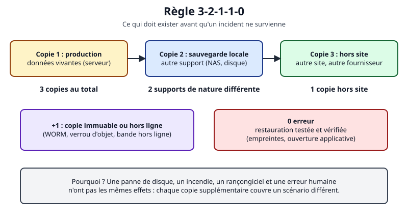
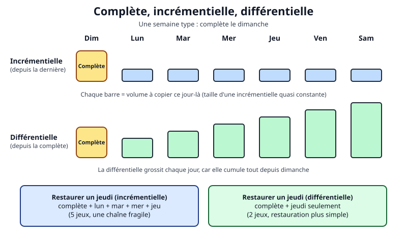
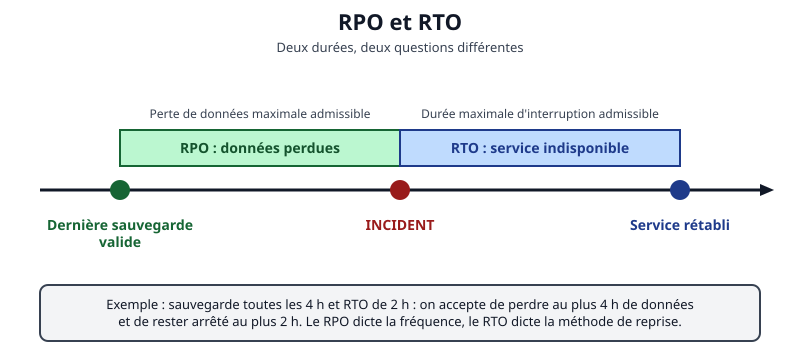
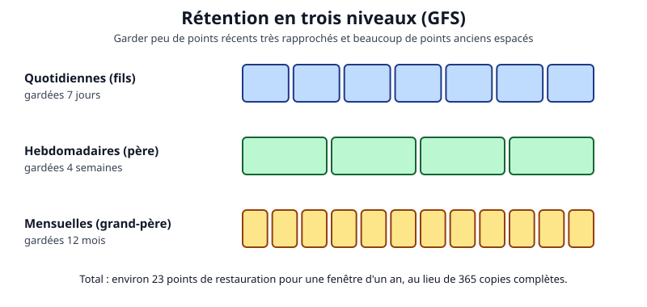

# Leçon — Stratégie de sauvegarde : 3-2-1-1-0, types de sauvegarde, RPO/RTO, rétention et immutabilité

- **Catégorie** : Tout-en-un / Exploitation, supervision et sauvegarde
- **Tags** : `transverse`, `tout-en-un`, `lecon`, `sauvegarde`, `strategie`, `rpo`, `rto`, `retention`, `immutabilite`
- **Niveau** : débutant à intermédiaire
- **Durée estimée** : 3 h 30 (cours 1 h 30, laboratoire 1 h 30, exercices et quiz 30 min)
- **Environnement** : laboratoire local ; manipulations dans `/tmp` avec des données factices

---

## Objectifs pédagogiques

À la fin de cette leçon, vous saurez :

1. distinguer sauvegarde, réplication, archivage et instantané ;
2. appliquer et justifier la règle **3-2-1**, puis **3-2-1-1-0** ;
3. comparer sauvegardes **complète**, **incrémentielle** et **différentielle** ;
4. traduire un besoin métier en **[[Glossary:RPO]]** et **[[Glossary:RTO]]** ;
5. définir une **rétention** et expliquer l'**immutabilité** ;
6. réaliser dans un laboratoire une chaîne complète → incrémentielle → différentielle → restauration vérifiée.

## Prérequis et durée

- Terminal Linux (`cd`, `ls`, redirections), notions de fichiers et de droits.
- Poste Linux ou [[Glossary:VM]] Debian/Ubuntu jetable avec `bash`, `tar` GNU, `sha256sum`, `find`, `diff` ; aucun droit administrateur requis.
- Durée conseillée : **3 h 30**.

⚠️ Travaillez sur une machine de laboratoire. Avant d'appliquer ces idées à un système réel : instantané de la VM, accès console de secours, test sur un sous-ensemble de données, retour arrière prévu.

## L'essentiel en bref

- Une sauvegarde est une copie **exploitable, séparée et testée** ; jamais restaurée, elle reste une hypothèse.
- **3-2-1** : 3 copies, 2 supports différents, 1 hors site. **3-2-1-1-0** ajoute 1 copie immuable ou hors ligne et 0 erreur après vérification.
- Complète = simple mais lourde ; incrémentielle = légère mais chaînée ; différentielle = compromis.
- **RPO** = données perdues admissibles (fréquence) ; **RTO** = interruption admissible (méthode de reprise).
- La **rétention** arbitre besoin, loi et coût ; l'**immutabilité** protège même contre un administrateur compromis.

---

## 1. Pourquoi sauvegarder ?

Imaginez une bibliothèque : un incendie détruit le bâtiment, un bibliothécaire distrait jette un carton, un vandale déchire des pages. Chaque risque demande une protection différente.

| Scénario | Exemple | Protection |
|---|---|---|
| Panne matérielle | Disque défaillant | Copie sur un autre support |
| Erreur humaine | `rm -r` au mauvais endroit | Plusieurs points de restauration |
| Sinistre sur site | Incendie, vol | Copie hors site |
| Malveillance | Rançongiciel qui chiffre aussi les sauvegardes | Copie immuable ou hors ligne |

**La redondance n'est pas la sauvegarde** : un [[Glossary:RAID]] ou un miroir recopie fidèlement vos erreurs. Quatre mots à ne pas confondre :

- **sauvegarde** : copie à un instant donné, conservée à part ;
- **réplication** : recopie continue pour la disponibilité (elle propage aussi les erreurs) ;
- **archivage** : conservation longue de données figées ;
- **instantané** : image rapide d'un état, en général sur le même stockage (voir la leçon sur les outils).



*Règle 3-2-1-1-0 : chaque élément couvre un scénario de perte différent.*

## 2. La règle 3-2-1 et ses extensions

- **3** copies (l'original compte) ;
- sur **2** types de supports ;
- dont **1** hors site.

Si chaque support a une chance sur 100 de tomber en panne dans l'année, perdre deux copies indépendantes en même temps est de l'ordre de 1 sur 10 000, et trois de 1 sur 1 000 000. Le calcul est idéalisé (même fournisseur, mêmes identifiants : les pannes ne sont pas indépendantes), mais il montre l'effet de chaque copie.

**Extensions modernes.** Les rançongiciels détruisent d'abord les sauvegardes. D'où **+1** copie immuable ou hors ligne, et **0** erreur : restauration testée, empreintes contrôlées.

Exemple pour une petite entreprise : copie 1 sur le serveur, copie 2 sur un [[Glossary:NAS]] local (restauration rapide), copie 3 chiffrée chez un prestataire (hors site), verrouillage d'objets de 30 jours sur cette dernière (immuable), test de restauration mensuel consigné.

Erreurs classiques : la « copie 2 » sur le même disque, montée avec les mêmes identifiants que la production, ou la clé de chiffrement rangée à côté de la sauvegarde.

## 3. Complète, incrémentielle, différentielle

- **Complète** : tout, à chaque fois. Un seul jeu suffit à restaurer ; place et temps élevés.
- **Incrémentielle** : ce qui a changé depuis la **dernière sauvegarde**. Économe, mais il faut la complète puis **toutes** les incrémentielles dans l'ordre : un maillon manquant bloque.
- **Différentielle** : ce qui a changé depuis la **dernière complète**. Elle grossit chaque jour, mais deux jeux suffisent.



*Volumes et chaînes de restauration sur une semaine.*

| Critère | Complète | Incrémentielle | Différentielle |
|---|---|---|---|
| Volume | Maximal | Minimal | Croissant |
| Jeux pour restaurer | 1 | 1 + N | 2 |
| Risque de chaîne | Très faible | Élevé | Faible |

Les outils modernes (Borg, restic) présentent chaque sauvegarde comme une complète logique en n'écrivant que les blocs nouveaux (déduplication). Les points de restauration partagent alors des blocs : une corruption peut en toucher plusieurs, d'où vérifications périodiques et copie indépendante.

Selon le niveau, on sauvegarde des **fichiers** (restauration fine), une **image** de disque ou de VM (reprise complète rapide) ou via l'outil de l'**application** (cohérence d'une base).

## 4. RPO et RTO

- **RPO** (*Recovery Point Objective*) : perte de données maximale admissible, mesurée entre la dernière sauvegarde valide et l'incident.
- **RTO** (*Recovery Time Objective*) : durée maximale d'interruption admissible, de l'incident au rétablissement.



*Le RPO se mesure avant l'incident, le RTO après.*

Analogie : un restaurant qui note les commandes sur un carnet. Le RPO est le temps de commandes à ressaisir si le carnet disparaît ; le RTO est la durée de fermeture de la cuisine avant que les clients partent.

| RPO visé | Sauvegarde requise |
|---|---|
| 24 h | Quotidienne |
| 1 h | Horaire ou journaux de transactions archivés |
| Secondes | Réplication, en plus de la sauvegarde |

| RTO visé | Reprise s'appuyant sur |
|---|---|
| Jours | Matériel de remplacement et copie hors site |
| Heures | Sauvegarde locale rapide, VM de secours |
| Minutes | Haute disponibilité |

Le RTO réel additionne détection, décision, accès, transfert, restauration et vérification. **Durée de transfert = volume (bits) / débit (bits/s)** : 2 To sur 100 Mbit/s demandent environ 44 heures. Les **métiers** chiffrent le coût d'une heure d'arrêt ; la [[Glossary:DSI]] propose des solutions et leur prix (voir la leçon PRA/PCA).

## 5. Rétention

La **rétention** fixe la durée de conservation. Schéma classique « grand-père, père, fils » : beaucoup de points récents rapprochés, peu de points anciens espacés.



*Rétention GFS : environ 23 points de restauration couvrent un an.*

Facteurs de décision :

1. **besoin métier** : une corruption silencieuse peut dormir des semaines ;
2. **obligations légales** : durées minimales (comptabilité) ou maximales (données personnelles), à valider avec le juriste et le [[Glossary:DPO]] ;
3. **droit à l'effacement** : une donnée effacée subsiste dans les sauvegardes jusqu'à expiration, ce qui se documente ;
4. **coût de stockage**.

La purge doit être automatique, testée, précédée d'un **essai à blanc**, et ne jamais s'exécuter si la dernière sauvegarde a échoué.

## 6. Immutabilité

Une copie **immuable** ne peut être ni modifiée ni supprimée avant une échéance, même par un administrateur ou un attaquant disposant de ses identifiants (principe **WORM**, *Write Once, Read Many*). Mises en œuvre : verrouillage d'objets sur stockage S3 compatible, instantanés verrouillés, dépôt en mode ajout seul avec clé [[Glossary:SSH]] restreinte, bande ou disque hors ligne, séparation des identités (le compte qui écrit ne peut pas supprimer). L'attribut `chattr +i` aide, mais `root` peut le retirer : barrière faible.

⚠️ Un droit de fichier (`chmod 0444`) n'est **pas** de l'immutabilité : dans un répertoire modifiable on peut supprimer le fichier. Le laboratoire le montre.

## 7. Politique et surveillance

Une politique de sauvegarde (1 à 2 pages) répond, pour chaque jeu de données : quoi, qui est responsable, fréquence, RPO/RTO, emplacements, rétention, chiffrement et emplacement des clés, immutabilité, méthode de vérification, alertes. Surveillez trois choses : le **succès** de la tâche, la **fraîcheur** de la dernière sauvegarde et sa **taille** (une chute brutale révèle un périmètre vide ou un montage manquant).

## Mise en pratique guidée

Laboratoire dans `/tmp/lab-strategie`, données factices, rien en dehors de ce dossier. Prérequis : `tar` GNU 1.30 ou plus.

### Étape 1 — Données et sauvegarde complète

```bash
mkdir -p /tmp/lab-strategie/source/docs /tmp/lab-strategie/depot
cd /tmp/lab-strategie
```
👉 Explication : crée l'arborescence (données `source`, sauvegardes `depot`) et s'y place.

```bash
for i in 1 2 3; do printf 'Contrat factice %s\n' "$i" > source/docs/contrat-$i.txt; done
head -c 200000 /dev/urandom > source/docs/archive.bin
```
👉 Explication : trois fichiers texte et un binaire aléatoire de 200 Ko (peu compressible).

```bash
tar --listed-incremental=depot/niveau0.snar -czf depot/dim-complete.tar.gz -C source .
cp depot/niveau0.snar depot/incr.snar
```
👉 Explication : GNU tar mémorise l'état des fichiers dans un `.snar`. Comme il n'existe pas encore, c'est une complète (niveau 0). On garde `niveau0.snar` intact et on copie un suivi `incr.snar` pour la chaîne incrémentielle.

### Étape 2 — Lundi et mardi : les deux méthodes divergent

```bash
sleep 1
printf 'Lundi : nouveau fichier\n' > source/docs/lundi.txt
tar --listed-incremental=depot/incr.snar -czf depot/lun-incr.tar.gz -C source .
cp depot/niveau0.snar depot/diff-lun.snar
tar --listed-incremental=depot/diff-lun.snar -czf depot/lun-diff.tar.gz -C source .
```
👉 Explication : la pause évite qu'un changement passe inaperçu (granularité des horodatages). L'incrémentielle utilise le suivi de la chaîne ; pour une différentielle on repart à chaque fois d'une copie de l'état de la complète.

```bash
sleep 1
printf 'Mardi : autre fichier\n' > source/docs/mardi.txt
printf 'modification\n' >> source/docs/contrat-1.txt
tar --listed-incremental=depot/incr.snar -czf depot/mar-incr.tar.gz -C source .
cp depot/niveau0.snar depot/diff-mar.snar
tar --listed-incremental=depot/diff-mar.snar -czf depot/mar-diff.tar.gz -C source .
for f in depot/*.tar.gz; do echo "== $f"; tar -tzf "$f" | grep -v '/$'; done
```
👉 Explication : on ajoute un fichier et on en modifie un autre, puis on produit les deux types et on liste les archives. `mar-incr` contient `contrat-1.txt` et `mardi.txt` ; `mar-diff` contient en plus `lundi.txt`.

### Étape 3 — Restaurer par les deux chaînes

```bash
mkdir -p restore-incr restore-diff
for a in dim-complete lun-incr mar-incr; do tar --listed-incremental=/dev/null -xzf "depot/$a.tar.gz" -C restore-incr; done
for a in dim-complete mar-diff; do tar --listed-incremental=/dev/null -xzf "depot/$a.tar.gz" -C restore-diff; done
```
👉 Explication : la chaîne incrémentielle enchaîne trois archives dans l'ordre, la différentielle deux. `--listed-incremental=/dev/null` indique à tar d'appliquer des archives incrémentielles.

```bash
diff -r source restore-incr && echo "Chaîne incrémentielle : identique"
diff -r source restore-diff && echo "Chaîne différentielle : identique"
```
👉 Explication : `diff -r` compare récursivement ; pas de différence et message affiché = restauration fidèle.

### Étape 4 — Empreintes et rétention

```bash
(cd depot && sha256sum *.tar.gz > SHA256SUMS && sha256sum -c SHA256SUMS)
```
👉 Explication : calcule puis revérifie une empreinte par archive. En production, conservez ce manifeste à part et recontrôlez-le périodiquement.

```bash
touch -d '10 days ago' depot/dim-complete.tar.gz depot/lun-incr.tar.gz
find depot -name '*.tar.gz' -mtime +7 -print
```
👉 Explication : vieillit deux archives puis **liste** celles de plus de 7 jours : c'est l'essai à blanc.

```bash
find depot -name '*.tar.gz' -mtime +7 -delete
ls depot
```
👉 Explication : supprime après validation de la liste. Supprimer la complète casse la chaîne : une purge réelle raisonne en **chaînes complètes**, jamais fichier par fichier.

### Étape 5 — RPO subi et droit de fichier

```bash
debut=$(date -d '2026-11-01 02:00' +%s)
incident=$(date -d '2026-11-01 13:30' +%s)
echo "RPO subi : $(( (incident - debut) / 60 )) minutes"
```
👉 Explication : une dernière sauvegarde valide à 02:00 et un incident à 13:30 donnent 690 minutes de données perdues, à comparer au RPO visé.

```bash
chmod 0444 depot/mar-incr.tar.gz
rm -f depot/mar-incr.tar.gz
ls depot
```
👉 Explication : malgré la lecture seule, le fichier disparaît : le droit de suppression dépend du répertoire. Ce n'est pas de l'immutabilité.

### Étape 6 — Nettoyage

```bash
cd /tmp && rm -rf /tmp/lab-strategie
```
👉 Explication : supprime le laboratoire (et lui seul). Sur une VM jetable avec droits administrateur, après instantané, vous pouvez essayer `chattr +i` sur un fichier de test : `chattr -i` est le retour arrière.

## Exercices

1. **(Facile)** Citez les trois copies de la règle 3-2-1 pour votre ordinateur personnel. Laquelle est hors site ?
2. **(Facile)** Sauvegarde nocturne à 01:00, panne à 16:00 : quel RPO subi ? Respecte-t-il un RPO cible de 4 h ?
3. **(Facile)** Combien de jeux faut-il pour restaurer le jeudi avec une complète le dimanche, en incrémentielle puis en différentielle ?
4. **(Moyen)** Ajoutez un mercredi au laboratoire (fichier `mercredi.txt`), faites les deux types de sauvegarde et restaurez avec chaque chaîne. Que contient chaque archive ?
5. **(Moyen)** Restaurer 800 Go sur 200 Mbit/s : durée minimale ? Un RTO de 8 h est-il atteignable ? Deux pistes.
6. **(Avancé)** Politique GFS pour un service dont les erreurs sont découvertes au plus tard après 5 semaines : combien de points au total ?
7. **(Avancé)** Après avoir refait les étapes 1 à 3, supprimez `lun-incr.tar.gz` puis tentez la restauration incrémentielle. Résultat ? Comment réduire ce risque ?

## Corrigés des exercices

1. Exemple : disque interne, disque externe [[Glossary:USB]], stockage chiffré distant (hors site). Ajoutez une copie déconnectée pour le « +1 ».
2. **15 heures** de perte : le RPO de 4 h n'est pas respecté ; il faut au moins une sauvegarde toutes les 4 h (ou l'archivage continu des journaux).
3. Incrémentielle : 5 jeux (dimanche à jeudi) ; différentielle : 2 jeux (dimanche + jeudi).
4. L'incrémentielle contient seulement `mercredi.txt` ; la différentielle contient `contrat-1.txt`, `lundi.txt`, `mardi.txt` et `mercredi.txt`.
   ```bash
   cd /tmp/lab-strategie
   sleep 1; printf 'Mercredi\n' > source/docs/mercredi.txt
   tar --listed-incremental=depot/incr.snar -czf depot/mer-incr.tar.gz -C source .
   cp depot/niveau0.snar depot/diff-mer.snar
   tar --listed-incremental=depot/diff-mer.snar -czf depot/mer-diff.tar.gz -C source .
   ```
   👉 Explication : même méthode que le mardi. Si vous avez purgé des archives à l'étape 4, refaites d'abord les étapes 1 à 3.
5. 800 × 8 × 10⁹ / (200 × 10⁶) = 32 000 s ≈ **8 h 53** avant restauration et vérification : non atteignable. Pistes : copie locale, débit supérieur, restauration prioritaire des données critiques, serveur de secours répliqué, RTO renégocié.
6. Exemple : 7 quotidiennes + 6 hebdomadaires + 12 mensuelles = **25 points** (la rétention d'exemple de 4 semaines serait insuffisante).
7. Le résultat est incomplet (`lundi.txt` manque) ou la restauration échoue. Réduire le risque : complètes régulières, empreintes vérifiées à chaque cycle, archives dupliquées, ou outil à déduplication.

## Quiz

**1. Que signifie « 3-2-1 » ?** A. 3 complètes, 2 incrémentielles, 1 différentielle ; B. 3 copies, 2 supports, 1 hors site ; C. 3 jours, 2 semaines, 1 mois ; D. 3 serveurs, 2 réseaux, 1 pare-feu.
**Réponse : B.** Définition de la règle ; les autres propositions mélangent d'autres notions.

**2. Pourquoi un RAID ne remplace-t-il pas une sauvegarde ?** A. Il est lent ; B. Il recopie aussi suppressions et corruptions logiques ; C. Il ne fonctionne que sous Linux ; D. Il chiffre les données.
**Réponse : B.** Il protège d'une panne de disque, pas d'une erreur répliquée instantanément.

**3. Jeux pour restaurer le jeudi en incrémentielle (complète le dimanche) ?** A. 1 ; B. 2 ; C. 5 ; D. 7.
**Réponse : C.** Dimanche, lundi, mardi, mercredi, jeudi.

**4. Un RPO d'une heure impose…** A. Une sauvegarde au moins horaire ou l'archivage des journaux ; B. Une sauvegarde hebdomadaire ; C. Une restauration en 1 h ; D. Un chiffrement [[Glossary:AES]].
**Réponse : A.** Le RPO fixe la fréquence ; la durée de restauration relève du RTO.

**5. Le RTO est…** A. La durée maximale d'interruption admissible ; B. La perte de données maximale ; C. Le nombre de copies ; D. La durée de rétention.
**Réponse : A.** Il se mesure de l'incident au rétablissement.

**6. Le « 0 » de 3-2-1-1-0 signifie…** A. Zéro copie cloud ; B. Zéro erreur après vérification et test de restauration ; C. Zéro coût ; D. Zéro chiffrement.
**Réponse : B.** On vise l'absence d'erreur prouvée.

**7. Quel élément est réellement immuable ?** A. Un fichier en `chmod 0444` dans un dossier modifiable ; B. Un dossier réseau monté avec les identifiants de production ; C. Un objet verrouillé en mode conformité 30 jours ; D. Un second dossier du même disque.
**Réponse : C.** Le verrouillage résiste même à un administrateur du compte ; les autres cas se contournent.

**8. Principal inconvénient de l'incrémentielle ?** A. Elle est la plus lourde ; B. Elle ne se chiffre pas ; C. La restauration dépend d'une chaîne ; D. Elle exige une bande.
**Réponse : C.** Chaque incrémentielle s'appuie sur la précédente.

**9. La purge doit…** A. Être aléatoire ; B. Suivre un essai à blanc et raisonner en chaînes ; C. Ne jamais être automatisée ; D. Supprimer la dernière sauvegarde d'abord.
**Réponse : B.** On vérifie ce qui sera supprimé sans casser une chaîne.

**10. Surveillance minimale d'une sauvegarde ?** A. Succès seul ; B. Succès, fraîcheur et taille ; C. Espace disque seul ; D. Aucune.
**Réponse : B.** Une tâche peut « réussir » en copiant un répertoire vide.

## Erreurs fréquentes et dépannage

| Symptôme | Cause probable | Correction |
|---|---|---|
| Incrémentielle vide | Changement dans la même seconde | `sleep 1` en laboratoire |
| Différentielle identique à l'incrémentielle | Même `.snar` réutilisé | Copier `niveau0.snar` avant chaque différentielle |
| Restauration impossible | Archive manquante ou désordre | Ordre chronologique, empreintes, nouvelle complète |
| `diff -r` signale des écarts | Fichiers modifiés après la sauvegarde, archive tronquée | `tar -tzf`, empreintes |
| La purge supprime trop | `-mtime` mal choisi, pas d'essai à blanc | `-print` d'abord, raisonner par chaîne |
| Sauvegarde « réussie » mais vide | Montage absent | Surveiller la taille, échouer si la source est vide |
| Sauvegardes détruites avec la production | Mêmes identifiants, copie accessible | Copie immuable ou hors ligne, identités séparées |

## À retenir

- Une sauvegarde non testée est une hypothèse.
- 3-2-1 couvre pannes et sinistres, +1 la malveillance, 0 l'illusion de sécurité.
- Le RPO dicte la fréquence, le RTO la technique de reprise ; calculez le transfert avant de promettre.
- La rétention arbitre besoin, loi et coût ; purgez à blanc d'abord.
- Surveillez succès, fraîcheur et taille.

## Pour aller plus loin

- Manuel GNU tar, sauvegardes incrémentielles : https://www.gnu.org/software/tar/manual/html_node/Incremental-Dumps.html
- CISA, « Data Backup Options » : https://www.cisa.gov/sites/default/files/publications/data_backup_options.pdf
- CISA, guide Stop Ransomware : https://www.cisa.gov/stopransomware/ransomware-guide
- Verrouillage d'objets Amazon S3 (exemple WORM) : https://docs.aws.amazon.com/AmazonS3/latest/userguide/object-lock.html
- [[Glossary:ANSSI]] : https://cyber.gouv.fr/
- BorgBackup : https://borgbackup.readthedocs.io/en/stable/ ; restic : https://restic.readthedocs.io/en/stable/

## Crédits des images

Aucune image de Wikimedia Commons n'a pu être retenue (l'[[Glossary:API]] refusait les requêtes lors de la rédaction). Création originale du projet Pack Master, dédiée au domaine public (CC0).

| Fichier | Source (URL Commons) | Auteur | Licence (nom + URL) | Modifications |
|---|---|---|---|---|
| `strategie-sauvegarde-1.svg` à `-4.svg` (4 fichiers) | Sans objet (création originale) | Projet Pack Master | CC0 1.0 — https://creativecommons.org/publicdomain/zero/1.0/deed.fr | Aucune |

## Historique de vérification

| Date | OS/logiciel | Testeur | Verdict |
|---|---|---|---|
| 2026-11-01 | Multi-OS ; procédure GNU/Linux avec tar, sha256sum, find, diff | Rédaction assistée (GitHub Copilot) | Non testé sur plateforme cible |
| 2026-11-01 | Poste Linux, GNU tar 1.35 : étapes 1 à 5 (tar `--listed-incremental`, restaurations, `sha256sum`, `find`, `chmod`/`rm`) exécutées dans un dossier jetable, supprimé ensuite | Rédaction assistée (GitHub Copilot) | Commandes exécutées avec succès sur ce poste ; `chattr` non exécuté ; plateforme cible non testée |
