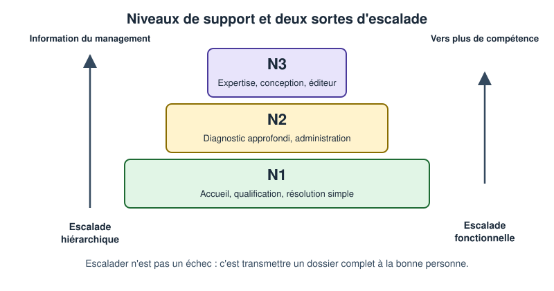
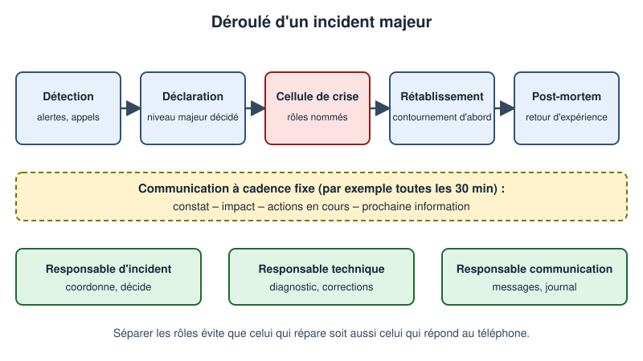
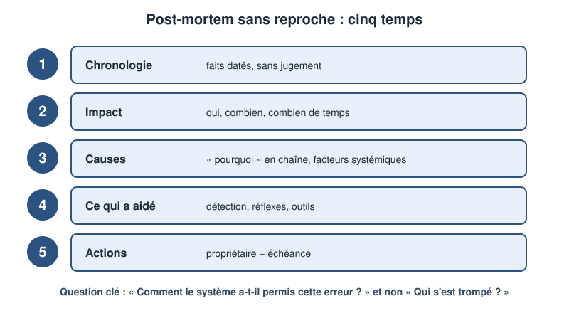
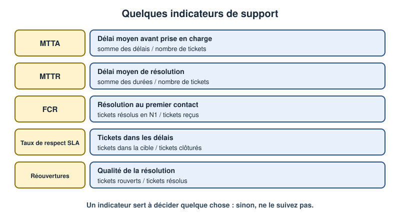

# Leçon — Communication et escalade au support : qualifier, escalader, informer, gérer un incident majeur, apprendre sans reproche

- **Tags** : `transverse`, `tout-en-un`, `lecon`, `support`, `communication`, `escalade`, `incident-majeur`, `post-mortem`, `indicateurs`
- **Niveau** : débutant à intermédiaire (technicien support N1/N2, futur responsable d'équipe)
- **Durée estimée** : 3 h 30 (lecture 1 h 30, laboratoire 1 h, exercices et quiz 1 h)

---

## Objectifs pédagogiques

À l'issue de cette leçon, vous saurez :

1. **Qualifier** une demande : recueillir les faits, évaluer impact et urgence, classer et vérifier ce qui est vérifiable immédiatement.
2. Distinguer les **niveaux N1, N2 et N3**, décider quand **escalader** et préparer un **dossier d'escalade** complet.
3. Rédiger des **messages clairs** à l'utilisateur : accusé de réception, demande d'information, point d'avancement, résolution.
4. Conduire la communication d'un **incident majeur** : déclaration, rôles, cadence, clôture.
5. Animer un **post-mortem sans reproche** et en tirer des actions concrètes.
6. Choisir et calculer quelques **indicateurs** de support, sans leur faire dire n'importe quoi.

## Prérequis et durée

- Notions d'incident, de priorité et de [[Glossary:SLA]] (voir la leçon [ITIL 4 pour le technicien](lecon-itil4-technicien.md)) ; savoir ouvrir un terminal Linux.
- Une **machine virtuelle jetable** pour la mise en pratique (aucun outil installé : seuls Bash et `awk` sont utilisés).
- Durée totale : environ 3 h 30.

## L'essentiel en bref

- Un dossier bien **qualifié** se résout plus vite : mieux vaut deux minutes de bonnes questions que vingt minutes de tâtonnement.
- **Escalader n'est pas échouer** : c'est confier un dossier **complet** à la personne la mieux placée, sans faire répéter l'utilisateur.
- Un bon message dit **ce qui se passe, ce que cela change pour vous, ce que nous faisons, quand vous aurez des nouvelles**.
- Dans un incident majeur, on **sépare les rôles** (décider, réparer, informer) et on communique à **cadence fixe**.
- Le post-mortem cherche **comment le système a permis l'erreur**, jamais le coupable.



*Figure 1 — Niveaux de support et deux sortes d'escalade : fonctionnelle (vers la compétence) et hiérarchique (vers la décision).*

---

## 1. Qualifier : bien démarrer un dossier

### 1.1 Pourquoi qualifier ?

Aux urgences, l'infirmier d'accueil ne soigne pas : il **évalue** et oriente. Le technicien de premier niveau joue ce rôle : une bonne qualification **oriente** vers le bon traitement et **protège** le temps des experts.

### 1.2 La fiche de qualification

Cinq rubriques suffisent à la plupart des dossiers :

| Rubrique | Questions | Exemple |
|---|---|---|
| Qui | Qui est touché ? Combien de personnes ? | « Le service comptabilité, 8 personnes » |
| Quoi | Message exact, comportement observé | « Erreur 550 à l'envoi, la réception fonctionne » |
| Quand | Début, fréquence, ce qui a changé | « Depuis 9 h 10, après un redémarrage » |
| Impact / urgence | Quelle activité bloquée ? Quelle échéance ? | « Clôture mensuelle avant 17 h » |
| Contournement | Peut-on travailler autrement ? | « Via le webmail, mais lent » |

Posez les questions en **langage simple**, une à la fois, et reformulez : « Si je résume, depuis 9 h 10, vous ne pouvez plus envoyer de courriel, mais vous en recevez. C'est bien cela ? » La reformulation évite les malentendus.

### 1.3 Les vérifications rapides avant tout transfert

Avant d'escalader, le N1 vérifie ce qui est **rapide et sans risque** : le problème est-il reproductible, touche-t-il d'autres personnes, existe-t-il un article de la base de connaissances, une panne connue, une supervision en alerte ? Un dossier qui contient déjà ces réponses fait gagner des heures au N2.

### 1.4 Fait ou interprétation ?

« Le serveur est planté » est une interprétation ; « la page affiche une erreur 503 depuis 9 h 10 » est un fait. Consignez les **faits** et marquez les hypothèses comme telles.

## 2. Les niveaux de support et l'escalade

### 2.1 Qui fait quoi ?

| Niveau | Rôle | Exemples |
|---|---|---|
| N0 | Libre-service | FAQ, portail, réinitialisation automatisée |
| N1 | Accueil, qualification, résolution des cas simples | Mot de passe, configuration courante, procédure connue |
| N2 | Diagnostic approfondi, administration | Serveur, réseau, applications, accès complexes |
| N3 | Expertise, conception, éditeur ou constructeur | Correction de défaut, analyse de code, évolution |

Les noms varient selon les organisations (niveau 1, 2, 3 ; premier, deuxième, troisième rang). L'important est que **chacun sache** ce qu'il traite et à qui transmettre.

### 2.2 Deux sortes d'escalade

- **Escalade fonctionnelle** : transmettre à un niveau **plus compétent** (du N1 vers le N2, du N2 vers le N3 ou un fournisseur).
- **Escalade hiérarchique** : **informer ou solliciter le management** quand l'enjeu dépasse l'équipe : risque de dépassement de SLA, utilisateur critique, décision d'arbitrage, incident majeur.

La confusion fréquente : croire que l'escalade hiérarchique « pousse » la résolution. Elle sert à **décider et prévenir**, pas à réparer.

### 2.3 Quand escalader ?

Quand il y a une **limite de compétence ou de droits** (le N1 ne peut pas accéder au serveur), une **limite de temps** (30 minutes sans avancée sur un P3, ou 25 % du délai d'un P1 consommé), un **impact qui s'étend** (le deuxième puis le dixième utilisateur), une **priorité élevée** (P1 ou P2 : escalade immédiate) ou un **risque** pour les données, la sécurité ou la réglementation.

Règle pratique : **escaladez tôt, avec un dossier complet**. Une escalade tardive est perçue comme une dissimulation ; une escalade sans dossier fait perdre du temps à tous.

### 2.4 Le dossier d'escalade



*Figure 2 — Déroulé d'un incident majeur : la communication, la technique et la décision sont portées par des personnes différentes.*

Le dossier doit permettre au suivant de **ne rien redemander**. Modèle :

1. **Résumé** en une phrase : « Messagerie : envoi impossible pour 8 personnes de la comptabilité depuis 9 h 10. »
2. **Impact et urgence**, priorité, échéance de SLA.
3. **Faits observés** : messages d'erreur copiés tels quels, heures.
4. **Ce qui a changé** récemment.
5. **Ce qui a été fait** et le résultat (« redémarrage du client : sans effet »).
6. **Éléments liés** : poste, serveur, tickets similaires, articles consultés.
7. **Coordonnées et disponibilité** de l'utilisateur, contournement éventuel.
8. **Ce qui est attendu** du destinataire.

### 2.5 La passe de relais

Le niveau suivant **accuse réception** et l'utilisateur est **prévenu** (« Votre dossier est transmis à l'équipe messagerie ; vous aurez des nouvelles avant 11 h »). Le N1 reste le point de contact tant que le ticket n'est pas résolu.

## 3. Écrire à l'utilisateur

### 3.1 Les cinq règles

1. **Dire la situation avant les détails** : le lecteur doit comprendre en deux lignes.
2. **Éviter le jargon** : « le service d'envoi est arrêté » plutôt que « le démon [[Glossary:SMTP]] a crashé ».
3. **Être honnête** : ne promettez que ce que vous maîtrisez, annoncez « je reviens vers vous à 11 h » et tenez-le, même pour dire « pas encore de nouvelle ».
4. **Donner la prochaine étape** : qui fait quoi, quand.
5. **Rester courtois et factuel** : pas d'accusation, pas de ton défensif.

### 3.2 Une structure simple

**Constat — Impact — Action — Prochaine information.** Cette structure sert à tous les messages d'avancement.

### 3.3 Gabarits

**Accusé de réception**

> Bonjour, nous avons bien reçu votre demande (n° 2026-0412) : envoi de courriel impossible. Un technicien la traite et vous répondra avant 11 h. Si la situation évolue, répondez à ce message.

**Demande d'information** (une question précise, facile à répondre)

> Pour avancer, pouvons-nous avoir le texte exact du message d'erreur (une capture d'écran convient) et l'heure à laquelle il apparaît ? Sans retour de votre part d'ici jeudi, nous mettrons la demande en attente.

**Point d'avancement**

> Nous avons identifié que le problème vient du service d'envoi, qui s'est arrêté ce matin. Environ 120 personnes sont concernées ; la réception n'est pas touchée. L'équipe messagerie relance le service. Prochaine information avant 10 h 30.

**Résolution**

> Votre messagerie fonctionne de nouveau depuis 10 h 42 : le service d'envoi a été relancé. Pouvez-vous confirmer que vos messages partent ? Sans réponse de votre part d'ici trois jours, la demande sera clôturée.

### 3.4 Mauvais messages et corrections

« C'est réglé. » ne dit rien de vérifiable : écrivez « Le service d'envoi est relancé depuis 10 h 42 ; pouvez-vous confirmer ? ». « Vous n'avez pas lu la procédure » accuse : résumez plutôt les étapes. « Il suffit de réinstaller » cache le risque : annoncez la sauvegarde et la durée. Enfin, trois jours de silence détruisent la confiance : écrivez même sans nouveauté.

## 4. L'incident majeur

### 4.1 Qu'est-ce que c'est ?

Un **incident majeur** est un incident à **impact très élevé** sur l'activité (service critique indisponible, grand nombre d'utilisateurs, enjeu de sécurité ou réglementaire), qui exige une **organisation spécifique** : la procédure normale ne suffit pas. Les critères de déclaration sont écrits à l'avance (« service X indisponible plus de 15 minutes pour plus de 50 utilisateurs »).

### 4.2 Les rôles

| Rôle | Mission |
|---|---|
| Responsable d'incident | Coordonne, arbitre, décide, assure la cohérence |
| Responsable technique | Dirige le diagnostic et les corrections, mobilise les experts |
| Responsable communication | Rédige et diffuse les messages, tient le journal |
| Scribe (si possible) | Note heure par heure les faits et décisions |

Séparer ces rôles évite le piège classique : l'expert qui répare est interrompu toutes les trois minutes par des questions.

### 4.3 Le déroulé

1. **Détection** : alerte de supervision ou afflux d'appels.
2. **Déclaration** : le responsable d'incident constate les critères, ouvre l'incident majeur, ouvre un canal dédié (salle de crise, pont téléphonique, conversation).
3. **Cellule de crise** : rôles nommés, première évaluation d'impact.
4. **Rétablissement** : on privilégie le **contournement** ou le retour arrière à la recherche de la cause ; le diagnostic fin peut attendre.
5. **Retour d'expérience** : post-mortem (section 5).

### 4.4 La cadence de communication

Annoncez au début la **cadence** (par exemple toutes les 30 minutes pour un P1) et **tenez-la**, même en l'absence de nouveauté. Destinataires distincts :

Trois destinataires, trois contenus : les **utilisateurs** (impact, contournement, prochaine information), la **direction** (impact sur l'activité, estimation prudente, décisions attendues) et les **équipes techniques** (faits détaillés, tâches, journal).

Exemple de message utilisateurs :

> [Incident en cours] Messagerie — point de 10 h 00. Constat : les envois échouent depuis 9 h 10. Impact : environ 120 personnes ; la réception est normale. Action : l'équipe messagerie relance le service. Contournement : webmail. Prochaine information avant 10 h 30.

Évitez d'annoncer une **heure de rétablissement** que vous ne maîtrisez pas ; préférez « nous reviendrons vers vous à 10 h 30 avec une estimation ».

### 4.5 Clôture

Un incident majeur n'est clos que lorsque : le service est **vérifié** par les utilisateurs, la communication finale est envoyée (durée, cause connue, mesures), le journal est archivé et le **post-mortem** est planifié (sous cinq jours ouvrés, par exemple).

## 5. Le post-mortem sans reproche

### 5.1 Principe

Un **post-mortem** (ou retour d'expérience) est une revue **écrite** d'un incident, destinée à apprendre. Il est **sans reproche** : on part du principe que chacun a agi au mieux avec les informations dont il disposait, et on cherche comment **le système** (procédures, outils, organisation) a rendu l'erreur possible ou difficile à détecter. Si l'on punit, les gens cachent les erreurs, et l'organisation perd l'information.



*Figure 3 — Les cinq temps d'un post-mortem : la question clé est « comment le système a-t-il permis cela ? ».*

### 5.2 Le déroulé

1. **Chronologie** : événements datés, factuels, sans jugement (« 9 h 10 : alerte », « 9 h 25 : redémarrage tenté »).
2. **Impact** : qui, combien de temps, quelles conséquences.
3. **Causes** : méthode des **« pourquoi » en chaîne** (cinq fois environ), jusqu'à une cause **actionnable**.
4. **Ce qui a bien fonctionné** : détection, réflexes, outils, communication.
5. **Actions** : chacune a un **propriétaire**, une **échéance** et un critère de réussite.

### 5.3 Exemple condensé (fictif)

- **Pourquoi la messagerie s'est-elle arrêtée ?** Le disque du serveur était plein.
- **Pourquoi plein ?** Les journaux ont grossi anormalement.
- **Pourquoi n'a-t-on pas été prévenu ?** L'alerte « disque à 90 % » n'existait pas pour ce serveur.
- **Pourquoi ?** Le serveur a été ajouté à la [[Glossary:CMDB]] mais pas à la supervision.
- **Pourquoi ?** La procédure de mise en service ne prévoit pas cette étape.

**Actions** : (1) ajouter la supervision du disque, propriétaire équipe exploitation, d'ici vendredi ; (2) ajouter l'étape « supervision » à la procédure de mise en service, propriétaire responsable d'équipe, d'ici deux semaines ; (3) contrôler que tous les serveurs de la CMDB sont supervisés, d'ici un mois.

On n'écrit pas : « Jean a oublié d'ajouter la supervision ».

### 5.4 Bonnes pratiques

Faites animer la séance par quelqu'un qui n'a pas géré l'incident, jugez les **décisions** avec ce que l'on savait alors (biais rétrospectif), ne retenez que les actions que l'on fera **réellement**, et partagez le document.

## 6. Mesurer sans se tromper

### 6.1 Quelques indicateurs



*Figure 4 — Des indicateurs simples, avec leur formule : un indicateur sans définition est inutilisable.*

- **MTTA** (délai moyen de prise en charge) et **[[Glossary:MTTR]]** (délai moyen de résolution).
- **FCR** (*first contact resolution*) : part des tickets résolus dès le premier niveau.
- **Respect des SLA** et **taux de réouverture**.
- **Satisfaction** après clôture (une question, un champ libre).

### 6.2 Les pièges

Pièges : la **moyenne** trompe (quelques tickets très longs faussent le MTTR : regardez la **médiane**) ; on clôt vite puis on rouvre (suivez la réouverture avec le MTTR) ; mélanger les priorités masque un P1 raté (calculez **par priorité**) ; un chiffre sans décision associée n'est lu par personne.

> Loi de Goodhart : quand une mesure devient un objectif, elle cesse d'être une bonne mesure.

## Mise en pratique guidée

Objectif : **calculer des indicateurs** à partir d'un petit fichier de tickets fictifs et **générer un message d'avancement** structuré. Aucune installation, aucun accès réseau, aucune donnée réelle.

> **Précautions** : travaillez dans une **[[Glossary:VM]] jetable** ; pour toute modification sensible ailleurs, prenez un **instantané**, gardez un **accès console de secours**, testez et sachez **revenir en arrière**. Ici, seuls des fichiers d'un dossier dédié sont créés puis supprimés (retour arrière).

### Étape 1 — Dossier de travail

```bash
mkdir -p ~/lab-escalade && cd ~/lab-escalade
```

👉 Explication : crée un dossier dédié et s'y place ; tout ce que vous produisez y reste.

### Étape 2 — Tickets fictifs

```bash
cat > tickets.csv <<'EOF'
id,priorite,prise_min,resolution_min,cible_ttr_min,niveau,reouvert
T-001,P3,12,95,1440,N1,non
T-002,P2,30,300,480,N2,non
T-003,P3,45,2000,1440,N2,oui
T-004,P4,200,600,4320,N1,non
T-005,P1,5,180,240,N3,non
T-006,P3,60,120,1440,N1,non
EOF
```

👉 Explication : chaque ligne est un ticket : délai de prise en charge, durée de résolution et cible de résolution (en minutes), niveau qui a résolu, réouverture éventuelle. Les données sont inventées.

### Étape 3 — Script d'indicateurs

```bash
cat > indicateurs.sh <<'EOF'
#!/usr/bin/env bash
# Usage : ./indicateurs.sh tickets.csv
set -euo pipefail
awk -F, 'NR>1 {
  n++; prise+=$3; reso+=$4
  if ($6=="N1") fcr++
  if ($4<=$5) ok++
  if ($7=="oui") rouv++
}
END {
  printf "Tickets             : %d\n", n
  printf "MTTA (min)          : %.1f\n", prise/n
  printf "MTTR (min)          : %.1f\n", reso/n
  printf "Résolus en N1 (FCR) : %.0f %%\n", 100*fcr/n
  printf "SLA respectés       : %.0f %%\n", 100*ok/n
  printf "Réouvertures        : %.0f %%\n", 100*rouv/n
}' "${1:?fichier CSV}"
EOF
chmod +x indicateurs.sh
```

👉 Explication : `awk` lit le CSV en sautant l'en-tête (`NR>1`), cumule les durées et compte les cas, puis affiche les moyennes et pourcentages à la fin. `set -euo pipefail` arrête le script en cas d'erreur.

### Étape 4 — Lancer et interpréter

```bash
./indicateurs.sh tickets.csv
```

👉 Explication : vous devez obtenir 6 tickets, MTTA 58,7 min, MTTR 549,2 min, FCR 50 %, SLA respectés 83 %, réouvertures 17 %. Notez que le seul ticket T-003 (2000 min) tire le MTTR vers le haut : c'est le piège de la moyenne.

### Étape 5 — Observer l'effet d'une valeur extrême

```bash
sed 's/^T-003,P3,45,2000/T-003,P3,45,200/' tickets.csv > tickets-sans-extreme.csv
./indicateurs.sh tickets-sans-extreme.csv | sed -n '3p'
```

👉 Explication : `sed` remplace la durée de T-003 par 200 minutes dans une **copie** du fichier ; la ligne 3 de la sortie (MTTR) tombe à 249,2 min (contre 549,2) et les SLA respectés passent à 100 %. Un seul ticket long change fortement les chiffres : regardez aussi la médiane.

### Étape 6 — Générer un message d'avancement structuré

```bash
cat > message.sh <<'EOF'
#!/usr/bin/env bash
# Usage : ./message.sh "<service>" "<constat>" "<impact>" "<action>" "<prochaine info HH:MM>"
set -euo pipefail
service=${1:?service}; constat=${2:?constat}; impact=${3:?impact}; action=${4:?action}; prochaine=${5:?heure}
cat <<MSG
Objet : [Incident en cours] ${service} — point de situation de $(date +%H:%M)

Constat   : ${constat}
Impact    : ${impact}
Action    : ${action}
Prochaine information au plus tard à ${prochaine}.

Contournement : à préciser s'il existe.
Support : support@example.com
MSG
EOF
chmod +x message.sh
./message.sh "Messagerie" "Les envois échouent depuis 09:10" "Environ 120 utilisateurs, réception non touchée" "Équipe messagerie sur place, relance du service en cours" "10:30"
```

👉 Explication : le script impose les quatre rubriques **Constat – Impact – Action – Prochaine information** (il refuse de s'exécuter si un argument manque) et ajoute l'heure courante de la machine. L'adresse `support@example.com` est fictive.

### Étape 7 — Vérifier le garde-fou

```bash
./message.sh "Messagerie" "constat seulement"; echo "code retour : $?"
```

👉 Explication : appelé avec trop peu d'arguments, le script s'arrête avec un message d'erreur et un code retour non nul : on ne peut pas envoyer un message incomplet.

### Retour arrière et nettoyage

```bash
cd ~ && rm -r ~/lab-escalade
```

👉 Explication : supprime le dossier de travail et son contenu. Si vous avez pris un instantané de la VM, vous pouvez aussi le restaurer.

## Exercices

1. **Qualification** — Un utilisateur écrit : « Internet est cassé, c'est urgent !!! ». Rédigez les cinq questions que vous poserez, dans l'ordre, en langage simple.
2. **Faits ou interprétations** — Classez : (a) « Le serveur a planté. » (b) « La page affiche l'erreur 503 depuis 9 h 10. » (c) « C'est sûrement le pare-feu. » (d) « Trois collègues ont le même message. »
3. **Escalade** — Un P3 stagne depuis 40 minutes ; le N1 n'a pas les droits sur le serveur concerné. Quelle escalade ? Rédigez le résumé du dossier en une phrase puis listez les rubriques à joindre.
4. **Message** — Réécrivez ce message : « C'est réglé, vous aviez mal paramétré. » en suivant la structure Constat – Impact – Action – Prochaine information.
5. **Incident majeur** — Associez chaque tâche à un rôle : (a) rédiger le message de 10 h 30 ; (b) décider de basculer sur le site de secours ; (c) analyser les journaux du serveur ; (d) noter les heures des décisions.
6. **Post-mortem** — Reformulez en langage sans reproche : « Paul a supprimé la mauvaise sauvegarde. » Proposez deux actions.
7. **Indicateurs** — Votre MTTR est excellent mais le taux de réouverture est de 30 %. Que concluez-vous ? Proposez deux mesures.

## Corrigés des exercices

1. Exemples : Qui est concerné (vous seul, plusieurs personnes) ? Que voyez-vous exactement (message, page blanche) ? Depuis quand, et que s'est-il passé juste avant ? Les sites internes fonctionnent-ils ? Quelle activité est bloquée et pour quand ?
2. (a) interprétation ; (b) fait ; (c) interprétation (hypothèse) ; (d) fait.
3. Escalade **fonctionnelle** vers le N2 système. Résumé : « Application de facturation : accès lent pour 5 personnes depuis 9 h, P3, échéance de résolution à 17 h. » Rubriques : impact et priorité, faits et messages d'erreur, ce qui a changé, actions déjà menées et résultats, éléments liés, coordonnées, attente précise.
4. Exemple : « Votre accès est rétabli depuis 10 h 42 (impact : vous ne pouviez plus ouvrir le dossier partagé). Nous avons corrigé le droit manquant sur le dossier. Pouvez-vous confirmer que l'ouverture fonctionne ? Sans réponse d'ici trois jours, nous clôturerons la demande. »
5. (a) responsable communication ; (b) responsable d'incident ; (c) responsable technique ; (d) scribe.
6. « La procédure de purge permettait de supprimer une sauvegarde sans contrôle. » Actions : (1) ajouter une confirmation et une vérification de la date avant suppression (propriétaire exploitation, deux semaines) ; (2) conserver une copie « corbeille » pendant sept jours.
7. On résout vite mais mal : tickets clos prématurément. Mesures : exiger une confirmation de l'utilisateur avant clôture ; analyser les causes de réouverture par catégorie et corriger les procédures ou formations concernées.

## Quiz

**1. Quel est le rôle principal de la qualification ?**
a) Faire patienter l'utilisateur ; b) Remplacer la résolution ; c) Recueillir les faits, évaluer impact et urgence, orienter ; d) Comptabiliser le temps.
*Réponse : c. Elle oriente et protège le temps des experts.*

**2. Qu'est-ce qu'une escalade fonctionnelle ?**
a) Transmettre à un niveau plus compétent ; b) Prévenir la direction ; c) Changer de logiciel ; d) Fermer le ticket.
*Réponse : a. L'escalade hiérarchique, elle, vise le management.*

**3. Quel est le but d'une escalade hiérarchique ?**
a) Réparer plus vite ; b) Réduire le nombre de tickets ; c) Sanctionner ; d) Décider, arbitrer et informer quand l'enjeu dépasse l'équipe.
*Réponse : d. Elle sert la décision et l'information, pas la réparation.*

**4. Quel élément ne doit PAS manquer dans un dossier d'escalade ?**
a) Un avis personnel sur le fournisseur ; b) Les actions déjà tentées et leur résultat ; c) Le nom du dernier visiteur ; d) La date d'achat du poste.
*Réponse : b. Sans cela, le niveau suivant refait tout.*

**5. La structure recommandée d'un message d'avancement est :**
a) Excuses – promesse – conclusion ; b) Aucune ; c) Cause – coupable – sanction ; d) Constat – Impact – Action – Prochaine information.
*Réponse : d. Elle répond aux quatre questions du lecteur.*

**6. Que faire si aucune nouveauté n'est disponible à l'heure du point annoncé ?**
a) Se taire ; b) Fermer le ticket ; c) Écrire quand même : « toujours en cours, prochain point à… » ; d) Changer la cadence sans prévenir.
*Réponse : c. Tenir la cadence entretient la confiance.*

**7. Dans un incident majeur, pourquoi séparer les rôles ?**
a) Pour éviter que ceux qui réparent soient interrompus et pour que chacun se concentre sur sa tâche ; b) Pour impressionner ; c) Pour réduire le coût ; d) Par obligation légale.
*Réponse : a. Décider, réparer, informer sont trois activités distinctes.*

**8. Un post-mortem sans reproche cherche surtout :**
a) Le responsable ; b) Comment le système a permis l'incident, afin de l'améliorer ; c) Un prétexte pour supprimer des procédures ; d) À rassurer la direction.
*Réponse : b. Punir pousse à cacher les erreurs.*

**9. Une bonne action de post-mortem comporte :**
a) Une intention générale ; b) Un budget illimité ; c) Le nom du fautif ; d) Un propriétaire, une échéance et un critère de réussite.
*Réponse : d. Sans propriétaire ni échéance, l'action ne se fait pas.*

**10. Un MTTR en baisse et un taux de réouverture en hausse suggèrent :**
a) Des tickets clos trop vite, une qualité dégradée ; b) Un excellent service ; c) Un problème de mesure sans importance ; d) Qu'il faut supprimer l'indicateur.
*Réponse : a. Il faut lire les indicateurs ensemble.*

## Erreurs fréquentes et dépannage

| Symptôme | Cause probable | Remède |
|---|---|---|
| Le N2 redemande tout | Dossier d'escalade incomplet | Utiliser le modèle de la section 2.4 |
| Post-mortem qui vire au procès | Animateur impliqué, vocabulaire accusateur | Animateur neutre, reformulation en « le système a permis… » |
| Actions jamais réalisées | Pas de propriétaire ni d'échéance | Suivi en réunion d'équipe, relance automatique |
| `message.sh` s'arrête avec `3: impact` | Argument manquant | Fournir les cinq arguments entre guillemets |
| `indicateurs.sh` affiche des valeurs fausses | CSV mal formé (virgules en trop) | Vérifier 7 colonnes par ligne |

## À retenir

- **Qualifier** : faits, impact, urgence, contournement ; reformuler.
- **Escalader tôt, avec un dossier complet** ; le N1 reste le contact de l'utilisateur.
- **Constat – Impact – Action – Prochaine information**, à l'heure annoncée, même sans nouveauté.
- **Incident majeur** : rôles séparés, cadence fixe, contournement d'abord, clôture vérifiée.
- **Post-mortem sans reproche** : chronologie, impact, causes, ce qui a aidé, actions avec propriétaire.
- **Indicateurs** : définis, lus ensemble, rattachés à une décision.

## Pour aller plus loin

- Chapitre « Postmortem Culture: Learning from Failure » (*Site Reliability Engineering*, Google) : <https://sre.google/sre-book/postmortem-culture/>
- Chapitre « Managing Incidents » (*Site Reliability Engineering*, Google) : <https://sre.google/sre-book/managing-incidents/>
- Guide [[Glossary:NIST]] SP 800-61 sur la gestion des incidents de sécurité : <https://csrc.nist.gov/pubs/sp/800/61/r2/final>
- Manuel de GNU Awk : <https://www.gnu.org/software/gawk/manual/>

## Crédits des images

Aucune image externe n'est utilisée.

| Fichier | Source (URL Commons) | Auteur | Licence (nom + URL) | Modifications |
|---|---|---|---|---|
| `images/escalade-1.svg` | Création originale du projet Pack Master | Projet Pack Master | CC0 1.0 — <https://creativecommons.org/publicdomain/zero/1.0/deed.fr> | Sans objet |
| `images/escalade-2.svg` | Création originale du projet Pack Master | Projet Pack Master | CC0 1.0 — <https://creativecommons.org/publicdomain/zero/1.0/deed.fr> | Sans objet |
| `images/escalade-3.svg` | Création originale du projet Pack Master | Projet Pack Master | CC0 1.0 — <https://creativecommons.org/publicdomain/zero/1.0/deed.fr> | Sans objet |
| `images/escalade-4.svg` | Création originale du projet Pack Master | Projet Pack Master | CC0 1.0 — <https://creativecommons.org/publicdomain/zero/1.0/deed.fr> | Sans objet |

Schémas créés à la main en SVG, dédiés au domaine public (CC0).

## Historique de vérification

| Date | OS/logiciel | Testeur | Verdict |
|---|---|---|---|
| 2026-11-01 | Scripts `indicateurs.sh` et `message.sh` (Bash, `awk`, `sed`) sous Linux — exécutés réellement dans un dossier local jetable, supprimé ensuite | Rédacteur (assistant) | Scripts testés localement ; procédure complète en VM : Non testé sur plateforme cible |
