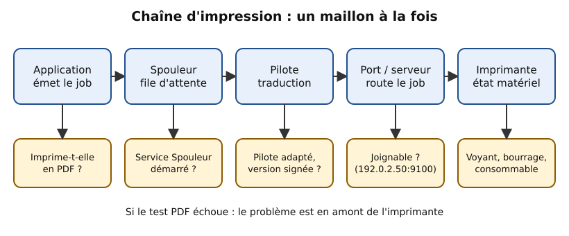
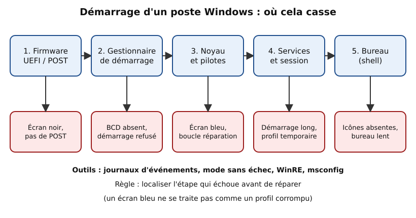
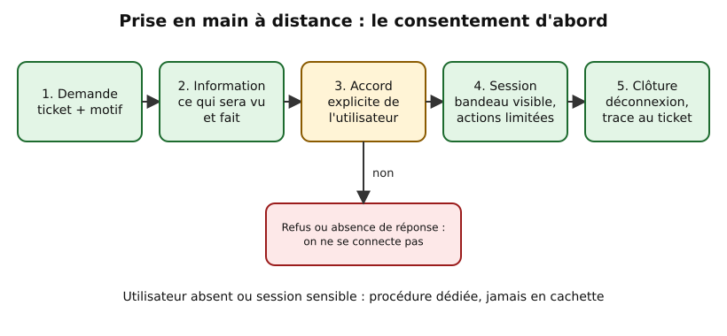

# Leçon — Le poste Windows client : profils, impression, mises à jour, pilotes, réseau, démarrage et prise en main à distance

- **Tags** : `transverse`, `tout-en-un`, `lecon`, `support`, `windows`, `poste-client`, `diagnostic`, `prise-en-main-a-distance`
- **Niveau** : débutant à intermédiaire (technicien support N1/N2)
- **Durée estimée** : 4 h (lecture 1 h 30, laboratoire 1 h 15, exercices et quiz 1 h 15)

---

## Objectifs pédagogiques

À l'issue de cette leçon, vous saurez :

1. Expliquer ce qu'est un **profil utilisateur** Windows, reconnaître un profil temporaire ou corrompu et traiter le cas sans perdre de données.
2. Diagnostiquer une panne d'**impression** maillon par maillon (application, spouleur, pilote, port, imprimante).
3. Contrôler l'état des **mises à jour** et distinguer un échec de téléchargement, d'installation ou de redémarrage.
4. Repérer un **pilote** défaillant et revenir à une version saine.
5. Résoudre les pannes **réseau** courantes du poste (adresse, [[Glossary:DNS]], proxy, profil réseau).
6. Situer une panne de **démarrage**.
7. Choisir un **outil de diagnostic** adapté et conduire une **prise en main à distance** dans le respect du consentement de l'utilisateur.

## Prérequis et durée

- Notions de base de Windows 10/11 (compte, dossier, service) et la leçon [Méthode de dépannage structurée](lecon-methode-depannage.md) (cycle questionner → documenter).
- Une **machine virtuelle Windows jetable** (aucun poste de production), avec snapshot et accès à la console de l'hyperviseur.
- Durée totale : environ 4 h.

## L'essentiel en bref

- Un poste Windows, c'est **une chaîne de couches** : matériel, démarrage, système et pilotes, services, session et profil, applications. Une panne se localise avant de se réparer.
- Le **profil** contient les données et préférences de l'utilisateur : on le **renomme et on le sauvegarde**, on ne le supprime pas d'emblée.
- L'**impression** se dépanne de l'application vers l'imprimante, en testant d'abord une impression vers un fichier PDF.
- Les **journaux d'événements** sont la première source de preuves : ils donnent l'heure, le composant et le code.
- Toute **prise en main à distance** repose sur l'information et l'accord de l'utilisateur, la limitation au besoin et la trace dans le ticket.

---

## 1. Penser « chaîne » : du bouton d'alimentation à l'application

Un poste est une chaîne : cuisine (matériel), personnel (système), salle réservée au client (profil) et plat servi (application). Dépanner, c'est trouver l'étape qui échoue.

Rappel de méthode : relevez l'**heure exacte**, le **dernier changement**, comparez, ne modifiez qu'une chose à la fois. Toutes les commandes de cette leçon sont **en lecture seule**, sauf mention contraire (⚠️), à exécuter sur une [[Glossary:VM]] de laboratoire.

## 2. Profils utilisateur

### 2.1 Anatomie d'un profil

À la première ouverture de session, Windows crée `C:\Users\<nom>` à partir d'un modèle : dossiers personnels (Documents, Bureau), données d'application (`AppData`) et ruche de registre (`NTUSER.DAT`). En entreprise, des éléments sont **redirigés** vers un serveur ou **itinérants** : la panne peut alors venir du serveur, pas du poste.

### 2.2 Symptômes d'un profil défaillant

- Message « Nous ne pouvons pas nous connecter à votre compte » ou **profil temporaire** (dossier `TEMP` ou `nom.000`, bureau vide).
- Paramètres qui ne se conservent pas, application qui ne démarre que pour cet utilisateur.
- Ouverture de session très longue.

Comparez : le même compte sur un autre poste, puis un autre compte sur ce poste. Si seul cet utilisateur sur ce poste est touché, le profil local est la piste principale.

### 2.3 Observer sans modifier

```powershell
Get-CimInstance Win32_UserProfile | Select-Object LocalPath, LastUseTime, Loaded, Special | Format-Table -AutoSize
```

👉 Explication : liste les profils présents (chemin, dernière utilisation, chargé ou non, profil système) ; un profil « Loaded » en trop ou un chemin `TEMP` oriente le diagnostic.

```powershell
whoami /user
```

👉 Explication : affiche le compte courant et son identifiant de sécurité ([[Glossary:SID]]), utile pour retrouver la clé de registre du profil.

```powershell
Get-WinEvent -FilterHashtable @{LogName='Application'; ProviderName='Microsoft-Windows-User Profile Service'} -MaxEvents 10 | Format-List TimeCreated, Id, Message
```

👉 Explication : affiche les 10 derniers événements du service de profils ; ils expliquent l'échec de chargement (fichier verrouillé, droits, disque plein).

### 2.4 Traiter un profil défaillant sans perte

1. **Sauvegarder les données** avant toute action (copie vers un support de sauvegarde autorisé).
2. **Créer un profil neuf** en ouvrant une session avec un compte de test ou en renommant le dossier du profil fautif *après* sauvegarde.
3. **Restaurer uniquement les données** (Documents, favoris) dans le nouveau profil, pas les fichiers de configuration suspects.
4. Vérifier avec l'utilisateur, puis documenter.

⚠️ Sauvegarde de données avant manipulation (adapter les chemins, exemple en laboratoire) :

```powershell
robocopy C:\Users\lab-test D:\Sauvegarde\lab-test /E /XJ /R:1 /W:1 /COPY:DAT
```

👉 Explication : copie récursivement le profil (`/E`), sans suivre les jonctions (`/XJ`, évite les boucles), avec une seule tentative (`/R:1 /W:1`) et en conservant données, attributs et dates (`DAT`) ; la source n'est pas modifiée.

> **Retour arrière** : tant que l'ancien dossier existe (renommé, pas supprimé), on peut revenir à l'état initial. La suppression définitive n'intervient qu'après confirmation de l'utilisateur et du responsable.

## 3. Imprimantes

### 3.1 La chaîne d'impression



*Figure 1 — La chaîne d'impression : un maillon à la fois, en commençant par un test PDF.*

1. **Application** : imprime-t-elle vers « Microsoft Print to PDF » ? Si oui, application et spouleur fonctionnent ; le problème est en aval.
2. **Spouleur** (service Spooler) : file d'attente des travaux.
3. **Pilote** : traduit le document pour le modèle d'imprimante.
4. **Port ou serveur d'impression** : port [[Glossary:TCP]]/IP direct ou partage `\\serveur\imprimante`.
5. **Imprimante** : allumée, joignable, papier et consommables.

### 3.2 Contrôles en lecture seule

```powershell
Get-Printer | Select-Object Name, DriverName, PortName, PrinterStatus | Format-Table -AutoSize
```

👉 Explication : liste les imprimantes du poste avec pilote, port et état ; repère une imprimante « hors ligne » ou un mauvais port.

```powershell
Get-PrintJob -PrinterName "Imprimante-Test" | Format-Table Id, DocumentName, JobStatus -AutoSize
```

👉 Explication : affiche la file d'attente d'une imprimante (nom fictif à remplacer) ; un travail bloqué en erreur empêche souvent les suivants de partir.

```powershell
Get-Service Spooler | Format-List Name, Status, StartType
```

👉 Explication : vérifie que le service Spooler est démarré et en démarrage automatique.

```powershell
Test-NetConnection -ComputerName 192.0.2.50 -Port 9100
```

👉 Explication : teste la joignabilité du port d'impression brut (9100) de l'imprimante (adresse de documentation) ; un échec oriente vers le réseau ou l'imprimante, pas vers le poste.

### 3.3 Cas typiques

- **Travail « en erreur » qui bloque la file** : annuler le travail, au besoin vider le spouleur (⚠️ ci-dessous).
- **Imprimante « hors ligne »** : vérifier adresse, port 9100, alimentation.
- **Caractères étranges** : mauvais pilote ; installer celui du constructeur.
- **Partage inaccessible** : serveur d'impression, droits, nom ; tester depuis un autre poste.
- **Une seule application échoue** : comparer avec le Bloc-notes et avec un autre profil.

⚠️ Vider la file bloquée (VM de laboratoire, droits administrateur) :

```powershell
Stop-Service Spooler; Remove-Item "$env:SystemRoot\System32\spool\PRINTERS\*" -Force; Start-Service Spooler
```

👉 Explication : arrête le spouleur, supprime les fichiers de travaux en attente puis relance le service ; **les travaux en cours sont perdus**, il faut prévenir l'utilisateur. Retour arrière : aucun pour les travaux supprimés, d'où l'importance de prévenir et de relancer l'impression ensuite.

## 4. Mises à jour

### 4.1 Les trois temps

Téléchargement (réseau, source), installation (espace disque, composant endommagé), redémarrage (pilote ou application incompatible, retour arrière automatique) : l'échec peut survenir à chacun.

### 4.2 Observer l'état

```powershell
Get-HotFix | Sort-Object InstalledOn -Descending | Select-Object -First 10 HotFixID, Description, InstalledOn
```

👉 Explication : affiche les dix dernières mises à jour installées ; à corréler avec la date d'apparition du symptôme.

```powershell
Get-WinEvent -LogName 'Microsoft-Windows-WindowsUpdateClient/Operational' -MaxEvents 15 | Format-Table TimeCreated, Id, Message -Wrap
```

👉 Explication : journal du client Windows Update ; on y lit les échecs avec le code d'erreur à rechercher dans la documentation officielle.

```powershell
Get-Service wuauserv, bits | Format-Table Name, Status, StartType -AutoSize
```

👉 Explication : contrôle les services nécessaires au téléchargement et à l'installation.

```powershell
Get-Volume -DriveLetter C | Format-List DriveLetter, SizeRemaining, Size
```

👉 Explication : vérifie l'espace libre sur C: ; un disque presque plein est une cause fréquente d'échec d'installation.

### 4.3 Réparer le système de fichiers de composants (⚠️)

```powershell
DISM /Online /Cleanup-Image /CheckHealth
```

👉 Explication : vérification rapide, en lecture seule, de l'état du magasin de composants ; si elle signale une corruption, `ScanHealth` puis `RestoreHealth` peuvent suivre, avec snapshot préalable et droits administrateur.

### 4.4 Bonnes pratiques

Ne bloquez pas les mises à jour de sécurité pour « régler » un symptôme : désinstallez la mise à jour fautive de façon ciblée et signalez-la. En parc, comparez avec les autres postes (anneaux de déploiement) et lisez le code d'erreur avant toute réinstallation.

## 5. Pilotes

### 5.1 Rôle et symptômes

Un pilote défaillant provoque : périphérique non reconnu, point d'exclamation dans le Gestionnaire de périphériques, écran bleu, veille ou réseau instables. Un symptôme apparu **juste après une mise à jour de pilote** désigne presque toujours cette mise à jour.

### 5.2 Contrôles

```powershell
Get-PnpDevice -PresentOnly -Status Error | Format-Table FriendlyName, Class, InstanceId -AutoSize
```

👉 Explication : liste les périphériques présents en erreur, c'est-à-dire ceux qui affichent un avertissement dans le Gestionnaire de périphériques.

```powershell
Get-CimInstance Win32_PnPSignedDriver | Where-Object DeviceName -like "*Wi-Fi*" | Select-Object DeviceName, DriverVersion, DriverDate, Manufacturer
```

👉 Explication : affiche version, date et éditeur du pilote d'un périphérique (ici contenant « Wi-Fi ») pour le comparer à celui d'un poste sain.

### 5.3 Revenir à une version saine

1. **Documenter** la version actuelle (capture ou export de la commande ci-dessus).
2. Dans le Gestionnaire de périphériques : **Propriétés → Pilote → Version précédente** si disponible.
3. Sinon, installer la version validée par le constructeur ou par l'équipe de déploiement.
4. **Tester**, puis redémarrer et reconfirmer.

Utilisez des pilotes **signés** et provenant d'une source officielle ; évitez les « utilitaires de mise à jour de pilotes » tiers, source fréquente de problèmes et de logiciels indésirables.

## 6. Réseau du poste

### 6.1 Ordre de contrôle

Reprenez l'arbre de la leçon de méthode : **adresse [[Glossary:IP]] → passerelle → DNS → port du service → proxy → compte**.

```powershell
Get-NetIPConfiguration
```

👉 Explication : affiche interfaces, adresses IPv4/IPv6, passerelles et serveurs DNS ; une adresse en 169.254.x.x indique l'absence de [[Glossary:DHCP]].

```powershell
Get-DnsClientServerAddress -AddressFamily IPv4 | Format-Table InterfaceAlias, ServerAddresses
```

👉 Explication : affiche les serveurs DNS configurés par interface ; comparez-les avec ceux attendus (par exemple 192.0.2.53 en laboratoire).

```powershell
netsh winhttp show proxy
```

👉 Explication : lit le proxy WinHTTP du système ; un proxy résiduel est une cause classique de « le navigateur ne charge rien alors que le ping marche ».

### 6.2 Actions corrigeant le plus souvent

```powershell
ipconfig /flushdns
```

👉 Explication : vide le cache DNS local (⚠️ action sans danger, mais à noter) ; utile quand un nom pointe vers une ancienne adresse.

- **Renouvellement DHCP** (`ipconfig /release` puis `/renew`) : à ne **jamais** lancer à distance sur la seule connexion réseau, car la session peut être coupée ; prévoyez une console de secours.
- **Réinitialisation de la pile** (`netsh winsock reset`, `netsh int ip reset`) : modification sensible, avec snapshot, redémarrage, et retour arrière non trivial ; réservée au dernier recours.

### 6.3 Repères rapides

IP en 169.254.x.x : pas de DHCP. Ping par IP OK mais pas par nom : DNS. Ping OK mais navigation impossible : proxy ou filtrage. Partage inaccessible, Internet OK : nom, droits ou pare-feu (profil réseau « Public »). Certificats refusés : vérifier l'horloge.

## 7. Démarrage

### 7.1 Les étapes à connaître



*Figure 2 — Le démarrage en cinq étapes : le symptôme visible indique l'étape en cause.*

1. **Firmware (UEFI/POST)** : écran noir, bips, aucun disque détecté (matériel, mémoire, ordre de démarrage).
2. **Gestionnaire de démarrage** : « aucun périphérique de démarrage », BCD absent ou partition système endommagée.
3. **Noyau et pilotes** : écran bleu, boucle de « réparation automatique ».
4. **Services et session** : démarrage très long, profil temporaire, service en échec.
5. **Bureau (shell)** : lenteur après ouverture, icônes manquantes, applications au démarrage.

### 7.2 Observer l'historique

```powershell
Get-CimInstance Win32_OperatingSystem | Select-Object LastBootUpTime
```

👉 Explication : donne l'heure du dernier démarrage, à comparer avec l'heure du problème pour savoir si un redémarrage a eu lieu.

```powershell
Get-WinEvent -FilterHashtable @{LogName='System'; Id=41,6008} -MaxEvents 10 | Format-Table TimeCreated, Id, Message -Wrap
```

👉 Explication : recherche les arrêts inattendus (événement 41 Kernel-Power, 6008 arrêt imprévu) ; à relier à une coupure de courant, un plantage ou un arrêt forcé.

```powershell
bcdedit /enum
```

👉 Explication : affiche la configuration de démarrage (⚠️ lecture seule mais droits administrateur requis ; **ne modifiez** jamais le BCD sans sauvegarde préalable, `bcdedit /export`).

### 7.3 Réagir selon l'étape

- **Étapes 1-2** : si le disque est accessible, **sauvegardez les données** avant toute réparation (support externe, autre poste).
- **Étape 3** : le **mode sans échec** (environnement de récupération, atteignable par `shutdown /r /o /t 0` ou Maj + Redémarrer) charge un minimum de pilotes ; si le problème disparaît, un pilote ou un logiciel est en cause.
- **Étape 4** : `msconfig` (démarrage sélectif) permet d'isoler des services non Microsoft, à condition de noter et d'annuler les changements.
- **Étape 5** : comparez avec un nouveau profil ; examinez les programmes au démarrage dans le Gestionnaire des tâches.

## 8. Outils de diagnostic

| Outil | Lancement | Usage |
|---|---|---|
| Observateur d'événements | `eventvwr.msc` | Journaux Système, Application, Sécurité, par composant |
| Moniteur de fiabilité | `perfmon /rel` | Chronologie des plantages et des installations, très pédagogique |
| Gestionnaire des tâches | `taskmgr` | Processeur, mémoire, disque, démarrage |
| Moniteur de ressources | `resmon` | Détail par processus du disque et du réseau |
| Gestionnaire de périphériques | `devmgmt.msc` | État et version des pilotes |

```powershell
Get-ComputerInfo -Property CsName, OsName, OsVersion, OsBuildNumber, CsTotalPhysicalMemory
```

👉 Explication : résume nom, système, version et mémoire ; premier élément à joindre à un ticket pour que le N2 sache sur quoi il travaille.

```powershell
Get-PhysicalDisk | Format-Table FriendlyName, MediaType, HealthStatus, OperationalStatus -AutoSize
```

👉 Explication : affiche l'état de santé des disques ; un statut dégradé justifie une sauvegarde immédiate avant tout autre geste.

Principe : l'outil sert une **hypothèse** : on ouvre l'Observateur d'événements à l'heure relevée pendant l'entretien et on filtre par niveau.

## 9. Prise en main à distance et consentement

### 9.1 Pourquoi c'est sensible

Prendre la main, c'est voir et agir dans la session de quelqu'un : documents, messages, mots de passe saisis. Cet accès intrusif doit rester justifié et encadré par votre **charte informatique** (et, au besoin, le délégué à la protection des données).



*Figure 3 — Le consentement d'abord : sans accord, on ne se connecte pas.*

### 9.2 Principes

1. **Finalité** : un ticket précis ; pas de consultation de fichiers personnels.
2. **Information** : l'utilisateur sait ce que vous verrez et ferez, et peut vérifier qui vous êtes (contre les faux techniciens).
3. **Consentement** : acceptation **explicite**, interruption possible ; préférez un outil avec demande de validation et **bandeau visible**.
4. **Minimisation** : évitez messagerie, documents, paie ; ne copiez rien sans nécessité.
5. **Traçabilité** : heure de début et de fin, motif, actions, dans le ticket.
6. **Clôture** : déconnexion, vérification avec l'utilisateur, suppression des fichiers déposés.

### 9.3 Choisir la modalité

| Modalité | Principe | Point d'attention |
|---|---|---|
| Assistance à distance interactive (par exemple **Assistance rapide** de Windows ou **Assistance à distance** `msra`) | Partage de l'écran de l'utilisateur, avec son accord | Adaptée au dépannage « en direct » ; l'utilisateur voit tout |
| Bureau à distance ([[Glossary:RDP]]) | Ouvre une **nouvelle session** et verrouille généralement la session locale | Inadapté pour voir la session de l'utilisateur ; adapté aux serveurs ou aux postes non utilisés |
| Administration à distance non interactive (PowerShell, outils de gestion) | Commandes sans affichage du bureau | Journaliser les commandes ; moindre intrusion sur le contenu de la session |

Choisissez la **modalité la moins intrusive qui résout le problème** : souvent, une commande d'administration suffit sans voir l'écran.

### 9.4 Vérifications côté poste

```powershell
query user
```

👉 Explication : affiche les sessions ouvertes sur le poste (utilisateur, état, heure d'ouverture) ; permet de savoir si quelqu'un est connecté avant d'agir et de ne pas déconnecter une session sans prévenir.

```powershell
Get-NetFirewallRule -DisplayGroup "Remote Assistance" | Format-Table DisplayName, Enabled, Direction -AutoSize
```

👉 Explication : lit l'état des règles de pare-feu liées à l'assistance à distance, sans les modifier.

### 9.5 Situations délicates

- **Utilisateur absent** : sauf procédure d'urgence écrite, on ne se connecte pas à sa session ; on planifie.
- **Poste sensible** (juridique, paie, direction) : accord renforcé, présence de l'utilisateur.
- **Appel inattendu « du support »** : apprenez à l'utilisateur à vérifier votre identité par un canal connu et à refuser une prise en main non sollicitée (hameçonnage).

---

## Mise en pratique guidée

**Cadre** : VM Windows 10/11 **jetable**, isolée, avec un compte administrateur local de laboratoire. Avant de commencer : **snapshot** de la VM, **accès console hyperviseur** vérifié. Aucune donnée réelle.

### Atelier 1 — Dossier de diagnostic en lecture seule

1. Ouvrez PowerShell et créez un dossier de travail :

```powershell
New-Item -ItemType Directory -Path "$env:USERPROFILE\Diag" -Force | Out-Null
```

👉 Explication : crée un dossier `Diag` dans votre profil (rien n'est modifié ailleurs).

2. Collectez l'essentiel :

```powershell
Get-ComputerInfo -Property CsName, OsName, OsVersion | Out-File "$env:USERPROFILE\Diag\systeme.txt"; Get-NetIPConfiguration | Out-File "$env:USERPROFILE\Diag\reseau.txt"; Get-HotFix | Out-File "$env:USERPROFILE\Diag\correctifs.txt"
```

👉 Explication : enregistre en trois fichiers l'état du système, du réseau et des correctifs ; c'est le « dossier de base » joint à un ticket.

### Atelier 2 — Comparer deux profils

1. Créez un compte de test (⚠️ modification, dans la VM uniquement) :

```powershell
New-LocalUser -Name "lab-test" -NoPassword -Description "Compte de laboratoire jetable"
```

👉 Explication : crée un compte local sans mot de passe pour le laboratoire ; son profil sera généré à la première ouverture de session. Retour arrière : `Remove-LocalUser -Name "lab-test"`.

2. Ouvrez une session avec ce compte (via l'écran de verrouillage), constatez la création de `C:\Users\lab-test`, puis déconnectez-vous et relancez la commande de la section 2.3 pour comparer les deux profils.
3. Comparez les deux profils et notez ce que cela dit de la méthode « nouveau profil de test ».
4. **Retour arrière** :

```powershell
Remove-LocalUser -Name "lab-test"
```

👉 Explication : supprime le compte de test ; le dossier `C:\Users\lab-test` peut subsister et doit être supprimé manuellement dans la VM si souhaité.

### Atelier 3 — Spouleur et imprimante virtuelle

1. Constatez l'état du service avec `Get-Service Spooler` (section 3.2).
2. Imprimez une page de test vers « Microsoft Print to PDF » : le test PDF réussit.
3. ⚠️ Arrêtez puis redémarrez le spouleur et observez l'effet :

```powershell
Stop-Service Spooler; Get-Printer | Select-Object -First 1; Start-Service Spooler
```

👉 Explication : montre qu'avec le spouleur arrêté, l'énumération échoue (erreur) ; le redémarrage rétablit la situation. Retour arrière : `Start-Service Spooler` si une erreur survenait.

### Atelier 4 — Simulation de consentement

Par deux : le technicien demande, informe, obtient l'accord, puis rédige la note de clôture. L'« utilisateur » peut refuser : le technicien s'arrête et propose une alternative.

---

## Exercices

1. **Identifier la couche.** Pour chaque symptôme, indiquez l'étape ou le domaine : (a) écran bleu au chargement ; (b) bureau vide et dossier `TEMP` ; (c) page web impossible alors que le ping vers une IP réussit ; (d) impression en PDF réussie, mais pas sur l'imprimante réseau.
2. **Lire une sortie.** `Get-NetIPConfiguration` affiche une adresse en 169.254.x.x sans passerelle. Quelles hypothèses classer en premier ?
3. **Profil.** Un utilisateur obtient un profil temporaire. Rédigez la procédure sécurisée en quatre étapes.
4. **Impression.** Proposez un plan de diagnostic en cinq tests ordonnés pour « l'imprimante du service n'imprime plus pour tout le monde ».
5. **Mises à jour.** Après une mise à jour, la carte Wi-Fi coupe toutes les dix minutes. Quelles preuves collecter et quelle action ciblée ?
6. **Démarrage.** Un poste redémarre en boucle sur « réparation automatique ». À quelle étape situez-vous la panne et que tentez-vous en premier ?
7. **Consentement.** Un directeur demande de « jeter un œil » à distance à son poste pendant sa réunion, sans qu'il soit présent. Que répondez-vous ?

## Corrigés des exercices

1. (a) Démarrage, étape 3 (noyau, pilotes). (b) Profil (étape 4). (c) Réseau : proxy ou DNS. (d) Chaîne d'impression après le spouleur : pilote, port, réseau ou imprimante.
2. Pas de réponse DHCP : lien ou Wi-Fi non établi, [[Glossary:VLAN]] ou port incorrect, serveur DHCP indisponible, service client du poste. Vérifier d'abord l'état de la carte et comparer avec un autre poste.
3. Sauvegarder les données ; lire les événements du service de profils ; renommer le profil et en créer un neuf ; restaurer les données, valider, documenter. Pas de suppression sans accord.
4. Les autres imprimantes fonctionnent-elles ? L'imprimante est-elle allumée sans erreur ? Répond-elle (ping, port 9100) ? Le serveur d'impression est-il sain ? Un travail bloque-t-il la file ? Tout le monde touché : serveur, file ou imprimante, pas un poste.
5. Preuves : version et date du pilote, journaux aux heures des coupures, correctif installé. Action : retour à la version précédente du pilote, un seul changement, sur un poste pilote d'abord.
6. Étape 2 ou 3. Environnement de récupération, mode sans échec, journaux ; **sauvegarder les données** avant toute réparation lourde.
7. Refuser en son absence sauf procédure d'urgence validée ; proposer un créneau avec présence ou une action non intrusive ; documenter.

## Quiz

**Q1. Un profil temporaire signifie le plus souvent que :**
A. Le disque est neuf. B. Le profil habituel n'a pas pu être chargé. C. Le compte est supprimé. D. L'utilisateur est administrateur.
**Réponse : B.** Windows crée un profil provisoire quand il ne peut pas charger le profil habituel (fichier verrouillé, droits, corruption).

**Q2. Quelle est la première vérification d'une panne d'impression ?**
A. Réinstaller Windows. B. Tester l'impression vers PDF pour séparer l'application/le spouleur du reste. C. Changer la cartouche. D. Remplacer le câble réseau.
**Réponse : B.** Le test PDF écarte l'application et le spouleur à faible coût.

**Q3. Que fait `DISM /Online /Cleanup-Image /CheckHealth` ?**
A. Il répare les fichiers. B. Il vérifie rapidement, en lecture seule, l'état du magasin de composants. C. Il supprime les mises à jour. D. Il réinitialise le réseau.
**Réponse : B.** La réparation relève de `RestoreHealth`, après snapshot.

**Q4. Une adresse 169.254.x.x signale :**
A. Un DNS cassé. B. L'absence de réponse DHCP. C. Un proxy. D. Un problème de certificat.
**Réponse : B.** C'est l'adresse attribuée automatiquement quand aucun serveur DHCP ne répond.

**Q5. Le ping vers une IP marche, pas la navigation par nom. Où chercher ?**
A. Dans le BCD. B. Dans la configuration DNS. C. Dans les imprimantes. D. Dans le profil utilisateur.
**Réponse : B.** La résolution de noms est en cause ; la connectivité IP est correcte.

**Q6. Pourquoi renommer plutôt que supprimer un profil ?**
A. Pour gagner de la place. B. Pour garder un retour arrière. C. C'est obligatoire. D. Pour changer le SID.
**Réponse : B.** Tant que l'ancien dossier existe, on peut restaurer ou récupérer des données.

**Q7. Le mode sans échec aide à :**
A. Charger plus de pilotes. B. Déterminer si un pilote ou un logiciel tiers est en cause. C. Chiffrer le disque. D. Installer Windows.
**Réponse : B.** Il charge un minimum de pilotes et de services.

**Q8. Avant une assistance à distance interactive, que faut-il obtenir ?**
A. Le mot de passe de l'utilisateur. B. Son accord explicite après information. C. L'accord de son voisin. D. Rien si c'est urgent.
**Réponse : B.** Le consentement explicite est la règle ; un mot de passe ne se demande jamais.

**Q9. Pourquoi RDP est-il mal adapté pour regarder le problème d'un utilisateur ?**
A. Il est interdit. B. Il ouvre généralement une nouvelle session et verrouille la session locale. C. Il est plus lent. D. Il nécessite un [[Glossary:VPN]].
**Réponse : B.** On ne voit pas la session de l'utilisateur ; l'assistance interactive est plus adaptée.

**Q10. Quel journal donne la chronologie des échecs de mises à jour ?**
A. Microsoft-Windows-WindowsUpdateClient/Operational. B. Journal du spouleur. C. Journal DHCP serveur. D. Aucun.
**Réponse : A.** Ce journal contient les événements du client Windows Update, avec les codes d'erreur.

## Erreurs fréquentes et dépannage

| Erreur | Conséquence | Remède |
|---|---|---|
| Supprimer le profil sans sauvegarde | Perte de données | Sauvegarder, renommer, restaurer les données |
| Réinstaller le pilote d'imprimante sans test PDF | Perte de temps, cause non identifiée | Dépanner la chaîne dans l'ordre |
| Prendre la main sans accord | Atteinte à la vie privée, faute professionnelle | Demande, information, accord, trace |
| Corriger plusieurs choses à la fois | Cause inconnue | Un changement, une mesure |

## À retenir

- Localisez l'étape (démarrage, système, session, application) avant de réparer.
- Profil : sauvegarder, renommer, restaurer les données ; ne pas supprimer.
- Impression : application → spouleur → pilote → port → imprimante, avec test PDF d'abord.
- Mises à jour et pilotes : corréler avec la date, ciblez le correctif, revenez en arrière sur un seul élément.
- Réseau : IP → passerelle → DNS → proxy → port ; attention aux commandes qui coupent la session distante.
- Prise en main à distance : finalité, information, **consentement explicite**, minimisation, traçabilité, clôture.

## Pour aller plus loin

- Dépannage de Windows Update : <https://learn.microsoft.com/windows/deployment/update/windows-update-troubleshooting>
- Environnement de récupération Windows : <https://learn.microsoft.com/windows-hardware/manufacture/desktop/windows-recovery-environment--windows-re--technical-reference>
- Assistance rapide : <https://learn.microsoft.com/windows/client-management/client-tools/quick-assist>
- [[Glossary:RGPD]] (EUR-Lex) : <https://eur-lex.europa.eu/eli/reg/2016/679/oj>

## Crédits des images

| Fichier | Source (URL Commons) | Auteur | Licence (nom + URL) | Modifications |
|---|---|---|---|---|
| `images/poste-windows-client-1.svg` | Création originale (aucune source externe) | Projet Pack Master | CC0 1.0 — <https://creativecommons.org/publicdomain/zero/1.0/> | Sans objet |
| `images/poste-windows-client-2.svg` | Création originale (aucune source externe) | Projet Pack Master | CC0 1.0 — <https://creativecommons.org/publicdomain/zero/1.0/> | Sans objet |
| `images/poste-windows-client-3.svg` | Création originale (aucune source externe) | Projet Pack Master | CC0 1.0 — <https://creativecommons.org/publicdomain/zero/1.0/> | Sans objet |

Création originale du projet Pack Master, dédiée au domaine public (CC0). Aucune image Commons retenue : l'[[Glossary:API]] de Commons renvoyait [[Glossary:HTTP]] 429 lors de la recherche.

## Historique de vérification

| Date | OS/logiciel | Testeur | Verdict |
|---|---|---|---|
| 2026-11-01 | Windows 10/11, PowerShell 5.1/7 | Rédaction assistée (Copilot) | Non testé sur plateforme cible |
